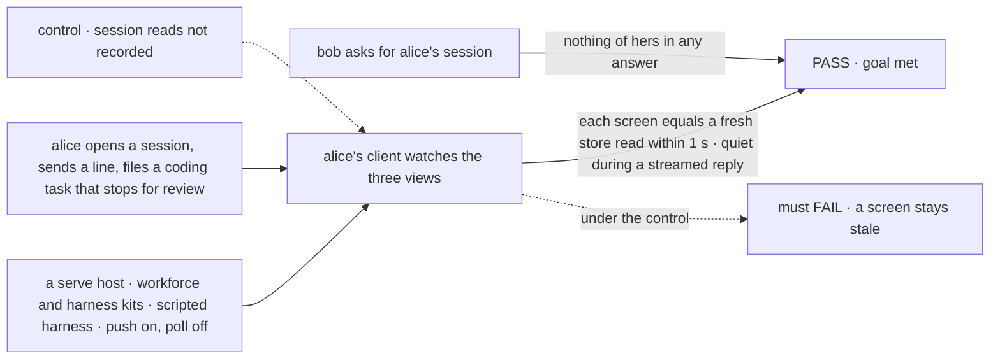
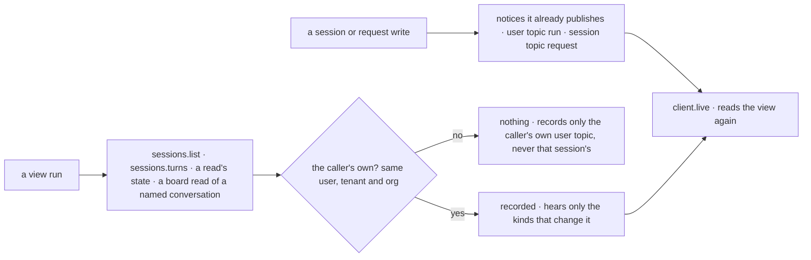

# FIX-2725 · Views can read sessions: worker sessions, session turns and the coding board as live views

**Spec** · [Decisions](DECISIONS.md)

## Five people, before and after

| Someone who… | Today | After |
|---|---|---|
| **opens the lab's sidebar** | Sees sessions an app assembled: one list call per worker, then four reads per row, then a subscription it keeps by hand, and a poll every 3 s | Sees one view's answer. It changes when a session opens or a turn starts or ends, and never once per streamed word |
| **watches a session's turns** (running, stopped, failed) | Gets them from an app that re-reads the session's requests on every notice | Gets them from one view; the words still stream as they do today |
| **watches a coding board** | Gets rows an app built from the board, each task's holds, a `harness` action run in another session, `getTask` per task and a pull-request read per run | Gets the rows from one view the harness kit serves, including the first task filed on an empty board |
| **builds a screen on workforce** | Writes the ~1,100 adapter lines claude-code-style has, or calls `listWorkerSessions` and assembles the rest | Watches three views with `useView` |
| **asks for someone else's session** | Is refused by the session routes | Is refused the same way, and learns no topic of theirs: the server decides which sessions a view reads ([D1](DECISIONS.md#d1)) |

[FIX-2627](../FIX-2627/DECISIONS.md#decided-during-implementation) deferred these three views
here: a view could not list sessions or read a session's requests, and a kit could not add a view
to flows another kit builds. [FIX-2628](../FIX-2628/DECISIONS.md#how-it-got-here) waits on this
to delete its adapter.

## The goal, and how we'll know it's met

**A screen shows a user's sessions with a worker, a session's turns and a session's coding board
by watching three views the kits install, current within a second of each change with no poll,
showing only the caller's own sessions, so an app writes none of that assembly. A fourth view,
recorded work, is a task's detail on the coding worker flow.**

| Is it the right goal? | |
|---|---|
| **The real need** | The issue: "designs a recorded, read-only session read for views … then builds the three screens on it. It also decides how a kit puts a view into flows another kit builds." FIX-2628 (owner, Fork B): "about 1,100 of `src/adapter.ts`'s 1,622 lines feed the three views" |
| **Smaller, and rejected** | "The engine reads; the views come later." Nothing an app deletes. Or "the views answer, but are polled." The lab already polls; a view that never wakes is the same screen |
| **Bigger, and not this issue's** | Deleting the lab's adapter ([FIX-2628](../FIX-2628/SPEC.md)). Moving teammates' and Shift Manager's screens onto the views (their epics). A view of what an app adds to a row, such as the lab's dismissals |
| **Not done if** | An area of the adapter has no view to replace it ([the map](#what-replaces-each-part-of-the-adapter)) · a view answers, or names a topic of, a session the caller may not run in · a screen stays current only by a poll · a view re-runs once per streamed chunk · the first task filed on an empty board never reaches the board · a view runs an action in another session |



The check compares each screen with what the store holds after each step and counts view runs; it
never reads the recorder.

| How we verify | |
|---|---|
| **Goal check** | `goals/views/screens-read-sessions-live/` (new), built on `goals/views/a-screen-watches-a-view/` and `goals/realtime/app-views-read-on-notice/` (serve host, poll off, scratch-patch controls) · model `n/a`, scripted harness · run by the implementer at completion · verdict on the implementation PR |
| **Signal** | `a:equals-store`: after each step, each of the three answers equals a fresh read of the store (sessions with their running state and default, turns and their status, board rows with holds, harness, review and error), within 1 s, poll off. `b:quiet`: during one reply of 40 streamed chunks, the session list, the turns view and the board each run at most 3 times (amended at implementation: the session list at most 4, two per lifecycle edge, since one status write reaches it on the user topic and on the session's `request`; and as often at 120 chunks as at 40). `c:own-only`: none of these answers anything or names a topic of the other session (the caller's own user topic is the only one recorded): bob's call with alice's session id; alice's sessions in a second org and a second tenant; a caller the roster flow admits as alice whom the agent flow's resolver rejects, asking for agent-flow sessions; and alice's own write session. `d:no-actions`: no view run starts a request |
| **Input** | Two workers, one on the agent flow and one coding worker with `harness: codex`. A second session opened from another tab. A session's work project changed. A first task filed on an empty board. A task that settles, whose `onTaskSettled` turn shows as running. A worker message that wakes a reply, and a coordinator conversation on its second round, each shown as running. A watched conversation deleted, then recreated under its id: the board shows the new one's tasks. A task that fails once, then is retried. An app whose `agent` entry is its own flow must pass `a` too |
| **Anti-game** | Don't assert on the recorder, the hearing list or a view's unit test. Keep the poll off: a timer hides a missed notice |
| **Control that must fail** | `GOAL_CONTROL=unrecorded-session-reads`: `list` records nothing, so a new session never reaches the list; FAILS `a:equals-store` (amended at implementation: `turns` is now `turns-deaf-to-request`'s, which hears only `state` on the session and FAILS `b:quiet`). `GOAL_CONTROL=admit-by-input`: the reads skip the owner rule; FAILS `c:own-only`. `GOAL_CONTROL=user-only-admission`: the reads check the user id alone, skipping org, tenant, the owning flow's verdict and the write-session drop; FAILS `c:own-only`. Today's `main` has no views to watch |

## What changes

![Before and after. Before, the lab's adapter lists sessions through the client, reads requests, holds and task details per row, runs a harness action in another session and polls. After, the engine gives a view two more reads of the caller's own sessions, recorded on topics those writes already publish; workforce serves the worker sessions and session turns views on its roster flow; the harness kit serves the coding board on its own flow and a recorded-work view on the coding worker flow; the screen watches them](figures/what-changes.svg)

The engine adds the reads, each kit serves its views on a flow it already owns, and the screen
only watches.

```diff
  // a view's block, in any kit (D1)
  execute: async (input, ctx) => {
+   const host = requireRequestHost(ctx);
+   const rows = await host.sessions!.list({ flowKind: "agent", fields: { workerId: input.worker }, limit: 100 });
+   const turns = await host.sessions!.turns(input.sessionId, { limit: 50 });  // status, never the words
  }

  // a screen (FIX-2628 writes these hooks)
- const rows = useWatch((on) => adapter.watchSessions(on), []);
+ const { value: rows } = useView(workerSessionsViewRef(), { worker: mode.worker });
- const tasks = useWatch((on) => adapter.watchTasks(sessionId, on, setStale), [sessionId]);
+ const { value: tasks, stale } = useView(codingBoardViewRef(), { sessionId });      // the harnesses flow, user scope (D2)
```

Names past `list`, `turns` and the four views' names are the implementer's.

**Docs:** at release, the Views page gains "reading your sessions" (what a view may read of the
caller's sessions, and when it hears a change); `docs/workforce/workers-on-disk.md`'s "all their
conversations" section moves from `listWorkerSessions` to the view; the workforce and
harness-manager READMEs list their new views. No new page. Contributor docs in the implementation
PR: `flows-and-actions.md`'s view section, `state-and-scopes.md`'s paragraph on reading another
session, the `view` row of `mechanisms.yaml`, the lab README's sessions row, and the docs-revamp
facts files that name `listWorkerSessions`.

## How a change reaches the screen



## What replaces each part of the adapter

| Adapter area (FIX-2628's count) | Replaced by |
|---|---|
| Worker sessions, ~220: `watchSessions`, `rowOf`, `runningTurns`, `firstLineOf`, `waitingCountFor` | workforce's **worker sessions** view: per row the id, title, worker, last change, whether a turn runs in it, the session's fields, `isDefault` (default first, then latest), and the tasks waiting on the user by id and attempt, so the app takes away its own dismissals. Which sessions count is `listWorkerSessions`' rule. The first-line fallback is [Q2](DECISIONS.md#q2) |
| Session turns, ~500: `watchThread`'s request reads, stopping, retry, and `watchTaskWork`'s work | workforce's **session turns** view (each turn's status, times, source and error); the words stay on `sessionFeed` and the in-flight call on the request stream; `entriesOf` and `withStopped` move unchanged, as FIX-2628 says; the plan and pull requests come from the **recorded work** view |
| Coding board, ~350: `boardOf`, `harnessOf`, `tasksAndTopicsOf`, `holdsOf`, `watchTasks`, outputs, errors, review answers' lookup | harness-manager's **coding board** view: the task-list rows plus each one's open holds and where their answers go, its harness, review, landing and error, and its pull requests by number. Answering stays the Inbox client's `answerOne` and the board's actions |
| Row types, ~150 | The views' output types |
| `createWorkforceClient`'s `listWorkerSessions` | Removed here, with the teammates goal that reads it moved onto the view. `findWorkerSession` stays: it finds the one session a write goes to |

## What stays as it is

- The session stream, `sessionFeed`, a request's stream, and every action and answer route.
- `sessions.read` and `sessions.history` for actions; who may read a session; `assertSessionAdmitted` on the view routes.
- The board's own task-list view, its notices and FIX-2625's partial answers.
- The HTTP session list and request list for clients.

## What's already here, and the debt

| Already here | What this does with it |
|---|---|
| **The job: let a running block read the caller's other sessions.** Mechanism `view` (`view-reads.ts` `createViewDependencies`), and `RequestSessions.read` / `history` (`request-host.ts:349`, FIX-2160 D2, FIX-2173). Searched `sessions.list`, `listWorkerSessions`, `requests(`, `PeerSessionView`, `history(` across `packages/` | **Extends** `RequestSessions` with `list` and `turns`, through its one owner rule. `read` gains the lineage id and records only when its `state` is read. None lists today |
| The HTTP session list: the store's filters (flow, user, tenant, org, parentage, fields) and the route's readonly-field guard (`session-routes.ts` `resolveStateFilter`) | **Reused** below `list`: the same store filters (BP-033), the same per-row admission (`ownResolverVerdict` ?? `hostRuleAdmits`, write sessions dropped), and the guard moves to one helper both call |
| `listWorkerSessions`' membership rule (`workers/client.ts`: `carriesOnly`, `WORKER_ONLY`, `byRecent`, default first), shared with `findWorkerSession` | **Moved** beside `CRITERIA_STATE_KEYS` in `derive-session-id.ts`; the client and the view import it |
| [FIX-2623](../FIX-2623/DECISIONS.md#d1): reads recorded, not declared; peer reads refused in user and org views | **Amended:** user views may read the caller's sessions. Org views still refuse |
| [FIX-2625 D3](../FIX-2625/DECISIONS.md#d3): a board read is heard on its board notices, through the running session and the filers | **Extends:** in a user view there is no running session, and an empty board names no filer, so nothing is heard. `getOrCreateTaskCollection` takes the admitted conversation's id in the running session's place |
| [FIX-2627](../FIX-2627/DECISIONS.md#decided-not-asked)'s coding board "served by a package that depends on both", and its deferral | **Built**, on the harness kit's own flow, not a `views` slot ([D2](DECISIONS.md#d2)) |
| The conversation ledger, user-scoped "so a task session on another flow reads and settles the row" (`conversation-board/ledger.ts`), reached by `conversationLedgerAt` and `filingSessionIdOf` | **Builds on:** why the board can be served from any flow |

| Adds | Existing piece considered | Why it doesn't fit / how composed |
|---|---|---|
| `sessions.list`, `sessions.turns` | `sessions.history`; the HTTP lists | **Extends** `RequestSessions`. `history` is what a model reads (settled turns, with words); a screen needs every turn's status and no words |
| Hearing rules for the new reads and an unrecorded identity | `createViewDependencies`; `recordSessionReads`' record-on-get | **Extends** the one surface; a row each in `views-dependency-matrix.test.ts`, the named-conversation board read included |
| Worker sessions and session turns views | The roster view, `listWorkerSessions` | **Composed** on the roster flow, on the moved membership rule |
| Coding board view | The board's task-list view, `inboxItems` | **Composed:** the same list code and Inbox rule, run on the server |
| Recorded work view | `readRecordedWork`, `readSessionPullRequests`; the `changes` view | **Composed** beside `changes`, on one mapping the two readers share, not a third |

| The debt | |
|---|---|
| **Removes** | `listWorkerSessions`; the reason FIX-2628 keeps ~1,100 adapter lines; the peer-read refusal in user views; the private copies of the membership rule and the state-filter guard |
| **Adds** | Two reads and four views, permanent by design. Sessions are listed two ways, the HTTP list and `list`: permanent by design, one filter and one guard under both |
| **Leaves** | Teammates' and Shift Manager's screens keep `readRecordedWork` and their own assembly (their epics) |

**Net: down.** Each app stops assembling sessions; the framework gains reads it already half had.

## Sign off

**[The goal](#the-goal-and-how-well-know-its-met), at that size:** three screens on live views (a fourth, recorded work, is a task's detail), own sessions
only, no poll, and nothing left for an app to assemble. If wrong: views that exist but still leave
the lab its adapter.

**[The debt](#whats-already-here-and-the-debt), net down:** the adapter's reason, a client call and
two private rules go; two reads and four views come. If wrong: a second session list that drifts
from the first.

1. **[D2](DECISIONS.md#d2) · No kit adds a view to another kit's flows: a view that reads across
   them runs at user scope on its own kit's flow.** The one to weigh. If wrong: a later view that
   needs another flow's session resources has no home.
2. **[D1](DECISIONS.md#d1) · A view may list the caller's sessions and read their turns; the
   server decides which, and it hears only the changes that alter them.** If wrong: a list that
   wakes on every word, or one a caller can point at someone else's.

**Open: 1.** [Q2](DECISIONS.md#q2) · what the sidebar shows before a title is generated: I recommend
"Untitled", dropping the first-line fallback.

Feature · `core`, `engine`, `workforce`, `harness-manager` · M (two reads, the hearing
rules, four views, two rules moved, one client call removed) · after FIX-2625, FIX-2627, FIX-2734
(merged) · blocks FIX-2628 · [Linear](https://linear.app/fixpoint-labs/issue/FIX-2725)
