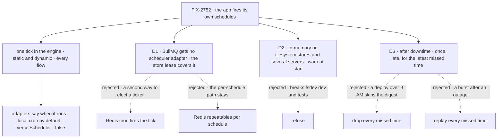

# FIX-2752 · Decisions

[Spec](SPEC.md) · **Decisions**

Three decisions are the sign-off. The owner already decided the shape (2026-11-15, in the issue):
one `createFlowState({ scheduler })` option, a local cron by default, one adapter interface whose
only job is firing the shared tick, a store lease so one process ticks, and the outside-cron guides
removed. What is left is whether BullMQ needs an adapter at all, what more than one server on
in-memory stores gets, and what a schedule does after downtime.

## The tree

Solid edges are what you're signing. Dashed edges lost, and the label says why.

## D1 · BullMQ gets no scheduler adapter: the default local cron, elected by the store lease, already ticks once across a BullMQ deployment

| | |
|---|---|
| **Instead of** | The issue's `bullmqJobQueue` as a scheduler adapter, firing the tick from one Redis repeatable job · or keeping today's Redis repeatable per schedule (`registerStaticSchedules`, `createBullmqScheduleIndex`) behind the dispatch worker |
| **Because** | Every process of a BullMQ deployment shares one SQLite or Postgres store, since the job-queue process writes what the web process streams (a documented requirement of the `jobQueue` contract, `bullmq/README.md`). The local cron runs in job-queue worker processes too, so a web tier that can't tick (Vercel) is covered by its workers. That store's `leases` already elect one holder across processes; the durability sweeper relies on it today. So the local cron ticks once across the deployment with nothing from BullMQ. A Redis-cron adapter would be a second way to choose the ticker, with its own job, worker path and failure modes, for the same result. Tenet 2: fewer primitives, each doing more |
| **Locks in** | `bullmqJobQueue` carries no scheduler. `registerStaticSchedules`, `createScheduleDispatchWorker`, `createBullmqScheduleIndex` and its id helper are deleted, not wrapped. A BullMQ deployment's dynamic schedules use the SQLite or Postgres schedule index |

![D1, whether BullMQ needs a scheduler adapter. Chosen: no adapter, the local cron with the store lease. Instead of: Redis cron fires the tick. It comes down to how many ways choose the ticker: with the store lease there is one for every host; a Redis adapter adds a second for BullMQ alone. Price: a BullMQ app on a store with no shared lease would double-tick, and hand-over takes up to three minutes. Tie: either way each scheduled time fires once at the endpoint. Locks in that the BullMQ schedule helpers are deleted. Flips if a BullMQ deployment runs on stores its processes do not share](figures/d1-no-bullmq-adapter.svg)

It comes down to how many ways choose the ticker: a Redis adapter adds a second, for BullMQ alone.

**What would change my mind:** a BullMQ deployment whose processes don't share their store's
leases. None can work today: the job-queue process would write where the web process can't read.

## D2 · More than one server on in-memory or filesystem stores is warned about at start, not refused

| | |
|---|---|
| **Instead of** | Refusing to start the local cron on in-memory or filesystem stores |
| **Because** | An in-memory lease lives in one process, so the process can't see a second server; there is nothing to refuse on. The filesystem store's lease mostly elects one process on one disk, but two processes can both take an expired lease (`filesystem/lease-store.ts`, read then delete then create), and the endpoint's record holds there per process only, so nothing backs it. Refusing would break `fsdev dev` and tests, the first place a schedule is tried. Today, in-memory stores in production already warn |
| **Locks in** | In production (`NODE_ENV=production`) the local cron on in-memory or filesystem stores logs once at start: run one server, or SQLite or Postgres. SQLite and Postgres need nothing |

![D2, what more than one server on in-memory or filesystem stores gets. Chosen: a warning at start. Instead of: refusing. It comes down to what the process can see: an in-memory lease cannot see a second server and a filesystem lease can race, so a refusal would hit every such app, fsdev dev and tests included. Price: two in-memory production servers can double-fire a static schedule. Tie: one in-memory server works either way. Locks in a production warning. Flips if in-memory stores become a production target](figures/d2-warn-in-memory.svg)

It comes down to what the process can see: it can't see the second server, so a refusal hits every such app.

**What would change my mind:** in-memory or filesystem stores becoming a supported multi-server setup. Today
startup already warns that nothing persists there.

## D3 · After downtime each schedule fires once, late, for the latest time it missed; earlier missed times are dropped

| | |
|---|---|
| **Instead of** | Dropping every missed time (fire only on time) · or replaying every missed time in order |
| **Because** | A deploy or a restart over 9 AM should not skip the morning digest, and an hour's outage should not send sixty minute-schedules at once. Today a dynamic schedule sends its oldest missed time: after two missed times it fires the older and skips the newer, and after three or more the endpoint refuses it as stale, so it fires nothing. A static schedule has no rule at all. One rule for both: the tick names the latest scheduled time since the last tick (static) or the latest one due (dynamic), and the endpoint's record and staleness rule stay as they are |
| **Locks in** | A last-tick record per app, which also makes any beat work (a minute locally, fifteen minutes or a day on Vercel). The dynamic tick sends the latest due time, not the index row's `nextFireAt`. "No missed-window replay" stays a non-goal |

It comes down to a restart over the scheduled minute: dropping skips it, replaying bursts.

**What would change my mind:** an app where each missed run carries its own work (an invoice per
day). That wants replay with a cap, which is a schedule option later, not the default.

## Decided, not asked

### Invariants

- **One tick a minute across a deployment.** Its convergence point is `ScheduleTicker.tick`: the
  local cron, `vercelScheduler`'s route and any later adapter call only it, and it is the one
  writer of the last-tick record. The local cron calls it only while holding the lease. Nothing
  else dispatches a schedule: `serve()`, BullMQ and Vercel lose their own paths.
- **One firing per scheduled time** stays the endpoint's record, unchanged. The lease is an
  optimization over it, not the guarantee.

### The tick

- **It lives in the engine**, beside the stale-request sweeper; core already carries `cron-parser`.
  `runScheduleTick` and `scheduleDispatchRequest` move there from `scheduled/collection`, which
  keeps the schedule collections and the `ScheduleIndex` contract. The endpoint stays in
  `@flow-state-dev/scheduled`.
- **Static:** for each enabled static schedule of each registered flow, the latest scheduled time
  in its timezone after the last tick and at or before now. **Dynamic:** `claimDue` on each flow's
  index, one index once, as today; each entry dispatched at its latest due time (D3), from the
  `cron` and `timezone` the entry carries. Core's structural `ScheduleDueEntry` names those two
  fields, which every index row already has.
- **The last-tick record** is one record in the app's resource state at a system key; with none, a
  first tick counts from one interval ago. The endpoint's per-schedule floor alone would give
  "once, late" if every tick sent each static schedule's latest past time, but then a schedule
  added today fires its last past time on deploy (a monthly invoice on the 15th), and every tick
  calls the endpoint once per static schedule. The record avoids both.
- **Dispatch** goes through the app's own router in-process, bearing `CRON_SECRET` when set, as
  `serve()` does today. With `baseUrl` it goes over the network instead, so on Vercel each fire is
  its own function invocation, not a share of the tick's.
- **A flow that declares schedules with no scheduled transport mounted** fails `ready()` naming the
  missing line, whatever the scheduler. Mounting it by default is [FIX-2753](https://linear.app/fixpoint-labs/issue/FIX-2753).

### The local cron and the lease

- **When it runs:** in a process that builds the router (`getRouter()`, `ready()`, `serve()`,
  `fsdev dev`) or starts a job-queue worker (D1), and only when a registered flow declares static
  schedules or an index. **A fire runs the way an action runs on that deployment:** with a job
  queue, the tick's dispatch is enqueued through the queue's runner in every mode. A `process-only`
  job-queue process, whose router has no runner today (`createFlowState`'s job-queue wiring), builds that runner
  for the tick, so a fire it claims keeps the queue's retries and survives a worker crash. `fsdev run`,
  `fsdev chat` and `fsdev block` resolve the runtime only and never tick. Each minute, timer
  unref'd, stopped by `dispose()` before the stores close.
- **The lease:** `stores.leases`, its own sentinel key, a per-process holder, two intervals long,
  renewed by its holder on its own timer every half lease, not only at a tick's start, so a tick
  longer than the lease can't lapse it (every `LeaseStore` renews for the same holder); a holder that
  fails to renew stops dispatching. Released on dispose so a clean restart hands over at once. A
  crash hands over within three minutes. An acquire that throws (SQLite's `SQLITE_BUSY` under
  contention) counts as not holding: idle this minute. The
  concurrency lease backend is not used: it orders runs on a key, it doesn't elect.
- **Amendment, 2026-11-16 (post-merge, during the build):** "with a job queue, the tick's
  dispatch is enqueued through the queue's runner in every mode" holds for **static** fires only.
  A **dynamic** fire runs in the process that ticked, even when a job queue is configured. Why:
  its action core is a block the resolver makes at dispatch time, which a queue job can't carry;
  an external runner dropped it, so the fire was claimed and never ran (the goal's
  `queue:fires-once` showed every dynamic time fire 0 times). The rule sits at the inbound host,
  not the scheduler: any dispatch carrying a resolved core runs in-process, as
  `transports/runner.ts` already documented. Cost: a dynamic fire gets no queue retries, and a
  ticking process that crashes mid-run loses it, as dynamic schedules were already
  non-recoverable.

### The interface and the adapters

- **`createFlowState` calls `start` at construction**, and `tick()` builds the runtime when it
  hasn't been, so a cold serverless function's first request can be the tick. The built-in local
  cron is internal and starts its timer when the router is built. `scheduler: false` starts
  nothing. `scheduler` is its own option, not a field on `jobQueue` (D1).
- **`vercelScheduler({ secret? })`** in `@flow-state-dev/vercel`: `start` keeps the ticker; `route`
  checks `Authorization: Bearer <CRON_SECRET>` with today's constant-time compare and an empty
  secret refusing all, then ticks with the deployment URL. Answers 500 when the tick's claim throws,
  so the next beat retries.
- **On Vercel without it** (`VERCEL` set, the local default, a flow with schedules) startup warns
  to pass `vercelScheduler()`.
- **Vercel Cron's plan limits** ([Vercel](https://vercel.com/docs/cron-jobs/usage-and-pricing)):
  Hobby runs a cron once a day within the hour; Pro, once a minute. The last-tick record makes a
  daily beat fire each schedule once a day, late; the docs say a per-minute beat needs Pro.
  Kitchen-sink keeps its fifteen-minute beat on one route.

### Shipping

- **Depends on FIX-2751** for the names `jobQueue` and `bullmqJobQueue`; it lands first.
- **Changesets** for `engine` (the option), `scheduled`, `node`, `bullmq` and `vercel` (removals and
  the adapter), each naming what replaces each removed export. No aliases (BP-034).
- **The guide removal is a `docs-fix` PR** that can merge before the build: those pages describe
  setups no code ever backed. The rewrite of `scheduled.md` and the other pages waits for
  `/release-docs`, since it describes the new behaviour.
- **No factual checker.** The spec's one count, five firing paths, is the search listed in
  `SPEC.md` → *What's already here*; nothing else is counted.

## Analysis

2026-11-15, on the draft. **Verdict: right approach, four fixes folded.** Reuse: the sweeper's lease
and the moved tick, agreed; the last-tick record kept, with its reason now stated. Prior art:
Oban's leader lease in Postgres and Solid Queue's unique run row match a lease plus a per-time
record. Other shapes: a Redis-cron adapter wins only where nothing long-lived builds a router,
which the fold closes by ticking in job-queue workers. Necessity and size: right. Folded: workers
tick (D1), lease renewal on a timer, filesystem in D2, the core due entry's two fields and the
callers that move. Noted for the implementer: SQLite's lease acquire is a deferred transaction.

## Considered and dropped

- **Make `serve()` tick static schedules too.** The smaller goal: one server works, but every
  server still ticks, Vercel and BullMQ keep their paths, and the engine still has no answer for
  a Next.js host that isn't `serve()`.
- **Release the lease after each tick**, as the durability sweeper does. Then a second process can
  take it later in the same minute and tick again. Holding and renewing it keeps one ticker.
- **Keep Vercel's per-schedule cron entries.** Exact timing on Hobby for static schedules only, at
  the price of a route and an entry per schedule and a second path. Hobby's hour-wide precision
  makes that exactness small.
- **Move the scheduled endpoint into the engine now**, so no line is needed. Right direction, and
  a larger move than this issue: [FIX-2753](https://linear.app/fixpoint-labs/issue/FIX-2753).

## Open

None.

## Settled

No POC. The lease behaviour the design rests on, same-holder renewal and one holder across
processes, is in every `LeaseStore` today (`memory/lease-store.ts`, `filesystem/lease-store.ts`'s
exclusive create, the SQLite and Postgres upserts' `holder` guard) and in its conformance suite.

## Notes from review

Recorded for the implementer to weigh against the code; not folded into the design.

- **Cursor (direction approve), SPEC.md `b:one-ticker`:** "tick record" is ambiguous next to the
  D3 last-tick record. Name what the goal reads per minute (the lease holder, or a small claim
  record the tick writes) so the check stays simple.
- **Cursor, phasing:** a phased build (unify the tick, static schedules and the default cron
  first; delete the BullMQ and Vercel paths second) could shrink the blast radius without
  changing direction.
- **Cursor, D3:** D3 changes dynamic dispatch timing (latest missed time, not today's oldest or
  stale). Pin it in integration coverage, not only the goal; optionally ship it after the path
  unification.
- **Cursor:** keep `serve()`'s per-index `Set` dedupe when walking flows, so a shared index is not
  claimed twice. On SQLite, the sweeper and the tick at `:00` can BUSY-skip a minute; a holder
  renew fast path helps.

## How it got here

- **Review fold (Codex)** — a fire claimed in a `process-only` job-queue process is enqueued through the job
  queue's runner, not run inline, because that process's router has no runner.
- **Analysis fold** — the local cron also runs in job-queue worker processes (a Vercel web tier with
  BullMQ workers had nothing ticking), the lease renews on its own timer, and D2 widened to
  filesystem stores, whose lease can race and whose record is per process.
- **Draft** — the owner's shape from the issue, built as one engine tick that adds static
  schedules, the durability sweeper's lease pattern for one ticker, and Vercel as the one adapter;
  BullMQ's adapter dropped as covered by the lease (D1).
