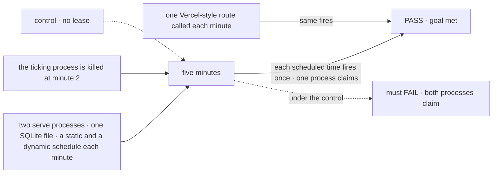
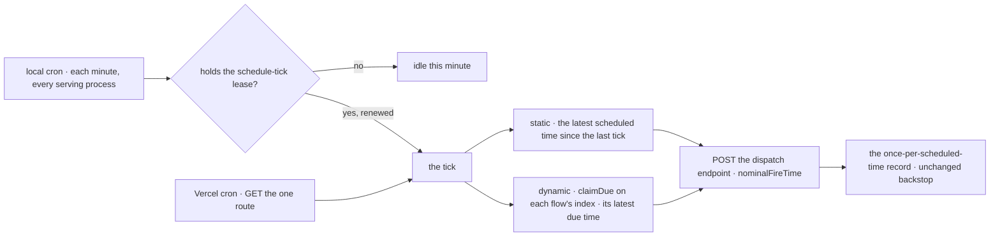

# FIX-2752 · A scheduler option on createFlowState: local cron by default, one tick, scheduler adapters

**Spec** · [Decisions](DECISIONS.md)

## Five people, before and after

| Someone who… | Today | After |
|---|---|---|
| **runs one server, or `fsdev dev`, with a static schedule** | Sees it never fire. `serve()` ticks only flows that name a schedule index, so static schedules need an outside cron | Sees it fire on time with no setup past mounting the scheduled endpoint, which they already do |
| **runs three servers on one Postgres** | Has all three claim every minute; the endpoint's record stops double runs | Has one server tick; the others stay idle and take over within three minutes if it stops ([the lease](DECISIONS.md#the-local-cron-and-the-lease)) |
| **deploys with the BullMQ job queue** | Wires `registerStaticSchedules`, `createScheduleDispatchWorker` and a BullMQ schedule index by hand | Wires nothing: the default ticks once across the deployment through the shared store lease ([D1](DECISIONS.md#d1)) |
| **deploys on Vercel** | Adds a cron entry and a GET-to-POST route per static schedule, and a tick route per flow with dynamic schedules | Adds one route and one cron entry for all schedules of all flows |
| **reads the docs for a host** | Finds EventBridge and Cloud Scheduler guides that no code backs, and a page that says the host always owns the scheduler | Finds one page: the app fires its own schedules, and a serverless host adds one route |

## The goal, and how we'll know it's met

**Every schedule an app declares, static and dynamic, fires once per scheduled time from the app
itself, with no outside cron on a long-lived host and one cron route on a serverless one, and one
process ticks however many run.**

| Is it the right goal? | |
|---|---|
| **The real need** | The issue: "schedules get one built-in mechanism … a single server or `fsdev dev` needs zero setup", "only one process fires", and the five firing paths become one |
| **Smaller, and rejected** | "Make `serve()` tick static schedules too." Static schedules fire on one server, but every server still ticks, Vercel and BullMQ keep their own paths, and the guides stay |
| **Bigger, and not this issue's** | Mounting the scheduled endpoint with no line at all, which moves the transport into the engine ([FIX-2753](https://linear.app/fixpoint-labs/issue/FIX-2753)). Fan-out, `onOverlap: "queue"`, retries |
| **Not done if** | A static schedule needs an outside cron on `serve()` or `fsdev dev` · two processes on one shared store both tick in the same minute · a scheduled time fires twice · `fsdev run` fires a schedule · a job-queue deployment whose web tier doesn't tick fires nothing · any of the five old paths is still exported |



The check counts fires from the action's own writes and claims per process from the store; it
never reads the tick's logs.

| How we verify | |
|---|---|
| **Goal check** | `goals/scheduled-work/fires-with-no-outside-cron/` (new), beside `recurring-work-files-a-task` · model `n/a` · run by the implementer at completion · verdict on the implementation PR |
| **Signal** | `a:fires-once`: over five minutes no scheduled time, static or dynamic, has two runs, and every one outside the handover has exactly one, counted from the rows the action writes. `b:one-ticker`: no minute has two processes claiming, and every minute outside the handover has exactly one, read from the tick record (the handover's gap is `c`'s, not `b`'s). `c:failover`: after the ticker is killed, the other process ticks within three minutes, and the time missed during the handover fires once, late. `d:route`: the same flow with `scheduler: vercelScheduler()` and its route called each minute gives `a`. `e:one-path`: none of the removed exports resolves from its package, checked by importing each |
| **Input** | Two `serve()` processes over one SQLite file, the scheduled endpoint mounted; a flow with a static `* * * * *` schedule and a schedule collection with one user's row at `* * * * *`. Repeated over Postgres when `GOAL_PG_URL` is set. A third run: `fsdev run` on the same flow for ninety seconds fires nothing. A fourth: one web process with `scheduler: false` and one job-queue worker process; the worker ticks |
| **Anti-game** | Real processes and a real clock. Don't call the tick from the test; don't read the tick's log lines |
| **Control that must fail** | `GOAL_CONTROL=no-lease`: every process ticks; FAILS `b:one-ticker`. `GOAL_CONTROL=index-only`: the tick skips static schedules, as `serve()` does today; FAILS `a:fires-once`. `GOAL_CONTROL=cli-ticks`: the local cron starts on `getRuntime()`; the `fsdev run` leg fires and FAILS. Today's `main` fails `a` and `e` |

## What changes

![Before and after. Before, five separate paths fire schedules: serve's tick for indexed flows, BullMQ's static schedule registration and its dispatch worker, BullMQ's per-row schedule index, Vercel's GET-to-POST shim per static schedule, and Vercel's tick handler per flow, plus outside crons the docs name. After, one tick in the engine fires static and dynamic schedules of every flow through the existing dispatch endpoint; a scheduler adapter only decides when the tick runs: the local cron by default, elected by a store lease, or Vercel's one route](figures/what-changes.svg)

One tick fires every schedule; a scheduler adapter only says when it runs.

```diff
  // a long-lived server, fsdev dev, or a BullMQ deployment: nothing to add
  export default createFlowState({
    flows, stores: sqliteStores({ filename }),
    adapters: [createScheduledTransportAdapter()],
-   jobQueue: queue,
  });
- await registerStaticSchedules({ registry, queue: queue.queue });
- createScheduleDispatchWorker({ connection, queueName, baseUrl, secret });
+ // jobQueue: bullmqJobQueue({ connection }) — schedules need nothing from it (D1)

  // Vercel: one route for every schedule of every flow
+ export const scheduler = vercelScheduler();          // CRON_SECRET; @flow-state-dev/vercel
+ export const flowState = createFlowState({ flows, stores, scheduler, adapters: [createScheduledTransportAdapter()] });
- export const GET = createGetToPostCronShim({ flowKind: "weekly-digest", scheduleId: "monday-summary" });
- export const GET = createScheduleTickHandler({ flowKind: "weekly-digest", index });
+ export const GET = scheduler.route;                    // app/api/cron/schedules/route.ts
  // vercel.json: { "crons": [{ "path": "/api/cron/schedules", "schedule": "* * * * *" }] }

  // a host that fires the tick itself, or none
+ createFlowState({ scheduler: false, … });
```

The adapter interface, as engine types:

```ts
interface SchedulerAdapter {
  /** Called once by createFlowState. Run `ticker.tick()` when the schedules should be checked. */
  start(ticker: ScheduleTicker): { stop(): Promise<void> };
}
interface ScheduleTicker {
  /** Fire what is due now, static and dynamic, every flow. `baseUrl`: dispatch over the network to this deployment. */
  tick(options?: { baseUrl?: string }): Promise<ScheduleTickReport>;
}
```

Names past `scheduler`, `SchedulerAdapter`, `ScheduleTicker` and `vercelScheduler` are the
implementer's.

**Docs:** at release, `docs/server/scheduled.md` is rewritten (the app fires its own schedules;
the local cron, the lease and what one server on in-memory stores means; the Vercel route; turning
it off) and `docs/server/schedule-index.md` drops its "bring a cron" section;
`guides/scheduled-vercel-cron.md` becomes the one-route walkthrough; `guides/background-jobs-bullmq.md`
loses its schedule wiring; `guides/keeping-a-flow-running.md` loses its outside-cron mention; the
scheduled, vercel and bullmq READMEs follow. **Removed now, as a `docs-fix` PR, since no code ever
backed them:** `guides/scheduled-eventbridge.md`, `guides/scheduled-cloud-scheduler.md`, their
two `sidebarsGuides.ts` entries, and their mentions in the scheduled README. Contributor docs in
the implementation PR: `docs/architecture/scheduled-actions.md` (the tick, the non-goals), the
`schedule` and `bullmq` rows of `mechanisms.yaml`, the JSDoc in `packages/scheduled/src/index.ts`
and `packages/core/src/types/schedules.ts`, and the docs-revamp pages and facts files
(`concepts/background-work`, `concepts/serving-flows`, `build/schedules`). No new page.

## How a tick fires



## What stays as it is

- The dispatch endpoint, its auth order, its once-per-scheduled-time record and staleness rule, and every response code.
- `schedules.static`, `schedules.resolve`, `schedules.index` and the `ScheduleIndex` contract with its SQLite and Postgres indexes (core's structural due entry names the `cron` and `timezone` every index row already carries); schedule collections a block declares; one index serves one flow; the routines capability's and kitchen-sink's index proxies.
- The job queue (FIX-2751's `jobQueue` and `bullmqJobQueue`) for running actions.

## What's already here, and the debt

| Already here | What this does with it |
|---|---|
| **The job: fire a flow's schedules on a clock.** Mechanism `schedule`. Five ways do it today: `serve()`'s `serveScheduleTicks` (`node/src/serve.ts`, FIX-2536), `registerStaticSchedules` with `createScheduleDispatchWorker` (`bullmq/src/schedules.ts`), `createBullmqScheduleIndex` (`bullmq/src/schedule-index.ts`), `createGetToPostCronShim` and `createScheduleTickHandler` (`vercel/src/schedules.ts`). Searched `claimDue`, `upsertJobScheduler`, `startScheduleTick`, `runScheduleTick`, `cron` across `packages/` | **Folds** all five into one tick in the engine. This is the one way, not a sixth |
| **The job: elect one process for periodic work.** The durability sweeper's sentinel lease (`durability-sweeper.ts` `SWEEPER_LEASE_KEY`) on `stores.leases` (FIX-140), which every store has and which renews for the same holder | **Reused:** the tick takes its own sentinel key on the same `LeaseStore`. The concurrency lease backend (mechanism `lease`) orders runs on a key and is not used |
| The tick body, `runScheduleTick` and `scheduleDispatchRequest` (`scheduled/src/tick.ts`); the dispatch id format, `formatScheduleId` (`scheduled/src/createResourceCollectionScheduleResolver.ts`) | The tick **moves** into the engine, beside the stale-request sweeper, and widens to static schedules. The engine learns the dispatch route's path, which the `scheduled` endpoint owns. `formatScheduleId` **moves** down to `core`, so the engine's tick and the endpoint share one id format; every caller (`scheduled`'s routes and collection entry, workforce's `scheduled-work.ts`, the BullMQ id helper until it goes, two goals and their tests) imports it from there |
| The `jobQueue` adapter shape (FIX-2751) and its `leaseBackend` field | **Precedent** for a `createFlowState` adapter option; the scheduler is a separate option, not a field on the job queue ([D1](DECISIONS.md#d1)) |
| [FIX-2536](../FIX-2536/SPEC.md): the tick runs two ways, per beat and on an interval; one index serves one flow | **Kept and amended:** both ways stay, now as adapters; static schedules join; `serve()` no longer owns the interval |
| [Epic FIX-2471 D10](../../epics/FIX-2471/DECISIONS.md#d10): subscription polling on per-user schedule rows | **Kept:** those rows are dynamic schedules the tick claims, unchanged |
| `docs/architecture/scheduled-actions.md` → "v1 non-goals": no scheduler loop in the engine | **Superseded** in part: the engine runs the tick. No missed-window replay, no fan-out, still |

| Adds | Existing piece considered | Why it doesn't fit / how composed |
|---|---|---|
| `scheduler` option, `SchedulerAdapter` | `jobQueue` | **New**, small: the job queue runs actions; this decides when the tick runs. Carrying it on the job queue would tie Vercel to a queue it doesn't have |
| The local cron with its lease | `serve()`'s interval; the sweeper's lease | **Composed** from both: the interval moves out of `serve()`, the lease is the sweeper's pattern on its own key |
| A last-tick record | The endpoint's per-schedule record | **New**, one record per app: which static scheduled times fall since the last tick, at any beat |
| `vercelScheduler()` | `createScheduleTickHandler` | **Replaces** it and the shim: one route, every flow |

| The debt | |
|---|---|
| **Removes** | `serveScheduleTicks` and its test; `registerStaticSchedules`, `createScheduleDispatchWorker`, `createBullmqScheduleIndex` and its id helper; `createGetToPostCronShim`, `createScheduleTickHandler`; `runScheduleTick`, `startScheduleTick` and `scheduleDispatchRequest` from `scheduled/collection`; kitchen-sink's per-schedule cron routes; two guides; every outside-cron mention. Callers that move to the engine's tick: `goals/webhook-routing/polls-each-event-once-without-a-webhook` (its `walk-all` control edits `tick.ts` by path) and workforce's `subscriptions-harness.ts` |
| **Adds** | One option, one interface, one adapter, one record: permanent by design |
| **Leaves** | The scheduled endpoint is still a line an app mounts; startup refuses a flow with schedules when it is missing ([FIX-2753](https://linear.app/fixpoint-labs/issue/FIX-2753)). Vercel Cron is a legacy feature moving to Vercel Schedules; the adapter shape takes a second Vercel adapter if that lands |

**Net: down.** Five firing paths and two guides become one tick and one adapter.

## Sign off

**[The goal](#the-goal-and-how-well-know-its-met), at that size:** every static and dynamic
schedule fires once per scheduled time from the app, one process ticks, and the five paths are
gone. If wrong: static schedules fire on one server but every host still wires its own path.

**[The debt](#whats-already-here-and-the-debt), net down:** five paths and two guides go; an
option, an interface, one adapter and one record come. If wrong: a sixth path beside the five.

1. **[D1](DECISIONS.md#d1) · BullMQ gets no scheduler adapter: the default local cron, elected by
   the store lease, already ticks once across a BullMQ deployment.** The one to weigh: the issue
   names a BullMQ adapter. If wrong: a BullMQ deployment whose stores share no lease double-ticks.
2. **[D2](DECISIONS.md#d2) · More than one server on stores that can't elect one process safely
   (in-memory, filesystem) is warned about at start, not refused.** If wrong: someone runs two such
   servers in production and a static schedule fires twice.
3. **[D3](DECISIONS.md#d3) · After downtime each schedule fires once, late, for the latest time it
   missed; earlier missed times are dropped. Static and dynamic alike.** If wrong: a job where every
   missed run matters (one invoice a day) loses all but the last.

Feature · `engine`, `scheduled`, `node`, `bullmq`, `vercel`, `kitchen-sink` · M (one tick moved and
widened, one lease, one adapter, five paths deleted) · after FIX-2751 · [Linear](https://linear.app/fixpoint-labs/issue/FIX-2752)
