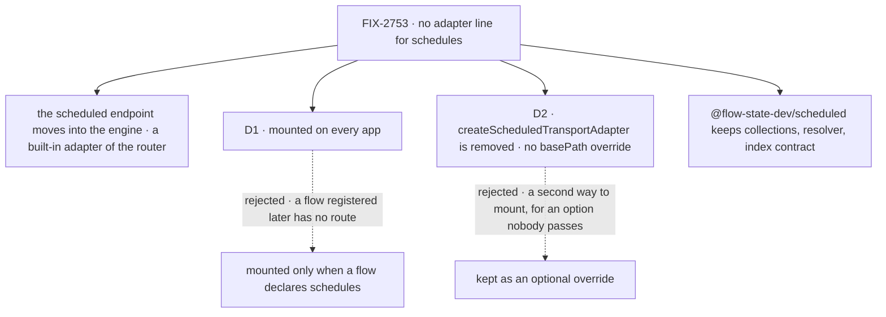

# FIX-2753 · Decisions

[Spec](SPEC.md) · **Decisions**

Two decisions are the sign-off. The issue already fixes the outcome: a flow with `schedules` is
reachable on its dispatch endpoint with no adapter line. FIX-2752's spec named the route: the
transport moves into the engine. What is left is when the engine mounts it, and whether the
public factory stays as an override.

## The tree

Solid edges are what you're signing. Dashed edges lost, and the label says why.

## D1 · The router mounts the scheduled endpoint on every app, not only when a flow declares schedules

| | |
|---|---|
| **Instead of** | Mounting it only when a registered flow declares schedules at the time the router is built |
| **Because** | A router's adapters are fixed when it is built, and `register()` adds flows after that; FIX-2752 already arms the local cron for a scheduled flow registered late. A conditional mount would leave that flow's fires with no route. Mounted always, the endpoint does what the HTTP routes do: look the flow up, and answer not found for a flow that declares no schedules, before the principal resolver runs, so an app with none never sees a `scheduled` call. It is one more built-in adapter in the list the HTTP adapter already sits in, with no branch. Tenet 2: one primitive, no mode |
| **Locks in** | `POST /api/flows/:flowKind/schedules/*scheduleId/dispatch` and `GET /api/flows/:flowKind/schedules` are framework routes on every app. An app adapter that registers the same path string is refused at startup by the router's collision check; one that registers the same shape under other parameter names is shadowed, since built-in routes match first |

![D1, when the router mounts the scheduled endpoint. Chosen: on every app. Instead of: only when a flow declares schedules. It comes down to a flow registered after the router is built: with an always-on mount its fires have a route; with a conditional mount they get the catch-all's 404. Price: every app answers on the two schedule paths, and an app route on them collides at startup. Tie: an app with schedules at start works either way. Locks in two framework routes. Flips if an app needs those paths for its own routes](figures/d1-always-mounted.svg)

It comes down to a flow registered after the router is built: a conditional mount leaves its fires with no route.

**What would change my mind:** an app that serves its own route at `/api/flows/:kind/schedules`.
None in the repository does; the path sits inside the framework's own namespace.

## D2 · `createScheduledTransportAdapter` is removed, with its unused `basePath`; no override stays

| | |
|---|---|
| **Instead of** | Keeping the factory, exported from the engine, as an optional override for `basePath`, with the built-in mount skipped when one is passed |
| **Because** | No caller in the repository passes `basePath`; every one calls the factory bare, and nothing mounts the flow API under another prefix. Every other framework transport route without a dedicated base path already registers under the canonical `/api/flows` (`CANONICAL_ROUTE_NAMESPACE`, webhooks included). Keeping the factory keeps two ways to mount one endpoint for an option nobody uses. BP-034: a moved published export's old path goes, with no alias |
| **Locks in** | The schedule routes live under `/api/flows` only. An app served under another prefix (`serve({ basePath })`, a Next.js route elsewhere) loses its one workaround: the local cron still fires in-process, but an outside cron or `vercelScheduler()` sending to the prefix gets a 404, as webhooks do today. An app with the line gets a type error on the import and deletes the line; the changeset says so. A hand-written adapter with source `scheduled` collides with the built-in routes and is refused at startup |

![D2, whether createScheduledTransportAdapter stays as an override. Chosen: removed, with basePath. Instead of: kept as an optional override. It comes down to who passes basePath: nobody in the repository, so the override is a second way to mount one endpoint for nothing. Price: every app with the line edits one import and one line, and an app served under another prefix can't take outside fires there. Tie: an app on /api/flows works either way. Locks in the schedule routes under /api/flows. Flips if an app under another prefix takes outside fires](figures/d2-no-override.svg)

It comes down to who passes `basePath`: nobody, so an override is a second way to mount for nothing.

**What would change my mind:** an app that serves the flow API under another prefix and takes
fires from outside. The fix then is one router option that moves every framework transport route
(webhooks too), not the factory back.

## Decided, not asked

- **Where the code goes.** The dispatch and list handlers, the scheduled-time claim and
  `findScheduledRequest` move to `packages/engine/src/transports/scheduled/`, beside `webhook/`.
  The engine never imports `@flow-state-dev/scheduled`, and `scheduled` no longer imports the
  engine at all: its dependency goes.
- **The fired-record key is shared, engine-free.** The endpoint writes the record and a flow
  that deletes a schedule deletes it (workforce's `scheduled-work.ts`, through
  `scheduled/collection`). The two helpers (`FIRED_RECORDS_PATTERN`, `firedRecordCollectionKey`)
  move down to core, where `formatScheduleId` went in FIX-2752; every caller imports them from
  there, with no re-export.
- **Cron math stays in core.** The claim's next-time parsing (`firstAfter` in `scheduledTime.ts`)
  becomes a core helper beside `latestScheduledTime`, so the engine adds no `cron-parser` dependency.
- **A flow with no `schedules` answers 404 on both routes before auth, with the same bytes as an unknown flow** (`404 { error: "flow_not_found" }`), with or without a secret, so the route can't confirm an instance the catalog hides from the caller (a pinned flow). Today the listing
  runs the principal resolver and returns an empty list. Mounted on every app (D1), that would
  send `source: "scheduled"` calls to resolvers of apps with no schedules.
- **What the root entry of `@flow-state-dev/scheduled` keeps:** the collection exports,
  `createBadCronWarner`, `parseNextFireAt` and `./testing`. `SCHEDULED_TRANSPORT_SOURCE` moves
  to the engine's public entry with the endpoint (shift-manager's principal resolver reads it),
  one constant with the engine's internal `SCHEDULED_SOURCE`.
- **`createFlowState`'s tick** sends in-process fires to the router's own path, so
  `#scheduledBasePath()` goes with the startup refusal.
- **The tests move with the code.** `scheduled/test/adapter.test.ts` and its siblings that drive
  the endpoint move to the engine's tests and build the router with no adapter. The two engine
  tests that record fires through a stand-in adapter on the schedule path record them another way
  (the tick's injected send, or the action's own writes).

## Considered and dropped

- **Mount from `createFlowState` only, not the router.** The tick lives there, but a host that
  builds `createFlowApiRouter` itself (tests, the integration suite) would still need the line, so
  the line survives for one path. The router is the one place every app passes through.
- **Mount on first need: attach the routes when `register()` first adds a flow with schedules.**
  It avoids two route probes per request on an app that never schedules, but adds a router that
  changes its route table after it is built, for a cost that is two string matches.
- **Keep the endpoint in `scheduled` and have the engine load it.** The engine can't import a
  package that imports it, and a dynamic import of an optional peer is a hidden dependency.

## Open

None.

## Settled

None. No POC: nothing here is unverified. The router's built-in list and its collision check
exist (`createFlowApiRouter.ts`), and the handlers import only the engine's host surface and core.

## Analysis

2026-11-17 · watermark 2026-11-15 · **build as scoped, two folds.**
- Reuse: the one Adds item extends the router's built-in adapter list; nothing else is new.
- Prior art: Inngest's `serve()` and Trigger.dev's declarative schedules need no route wiring; matches D1.
- Other shapes: the dropped alternatives are weighed; no ideation needed.
- New factors: FIX-2752 done; adjacent schedule issues move nothing.
- Necessity: right size. Ergonomics: one surprise goes. Major concerns: none.
- **Folded:** the *Removes* row missed shift-manager, two labs, two goals and a rules file that names a moved file; the listing route answered 200 for a flow with no schedules, so it now answers 404 before auth.
- **Recorded:** no route collides with the two paths; the router, not `createFlowState`, is the one place every host passes; the engine has every import the handlers need except `cron-parser`, which goes through core; a host mounted off `/api/flows` can't reach the routes, as today.

## Notes from review

From the Cursor review on #5317 (2026-11-17), for the implementer:
- `g:one-way`: walking every `packages/*` `exports` entry is brittle; a stable enforcer (no root export + no `packages/engine/src/**` import of `@flow-state-dev/scheduled`) may be enough.
- `f:no-line`: bundles mount, auth, list shape and the no-schedule 404; splitting legs would make failures easier to read.
- Removes / docs lists: a category plus a grep instruction would age better than enumerating every lab and goal path.
- Prefer the 404 for flows without `schedules` before `arrayBuffer()` / `resolvePrincipal`.

## How it got here

- **Draft** — the issue's outcome (no adapter line) met by moving the scheduled endpoint into the
  engine as a built-in adapter of the router, mounted on every app, with the public factory
  removed; builds on FIX-2752's tick and the router's HTTP built-in.
