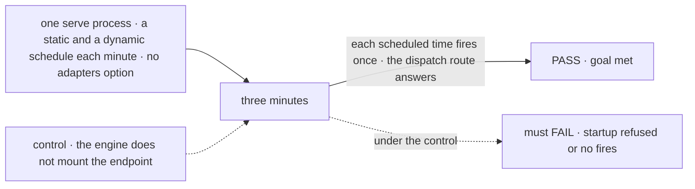

# FIX-2753 · Mount the scheduled endpoint with no adapter line when a flow declares schedules

**Spec** · [Decisions](DECISIONS.md)

## Six people, before and after

| Someone who… | Today | After |
|---|---|---|
| **adds a schedule to a flow on a long-lived server or `fsdev dev`** | Sees startup refuse until they add `adapters: [createScheduledTransportAdapter()]`, from a second package | Sees it fire on time. There is nothing to add |
| **deploys on Vercel with `vercelScheduler()`** | Adds the scheduler line and the adapter line | Adds the scheduler line only |
| **already has the adapter line** | It works | Gets a type error on the import, and deletes the line ([D2](DECISIONS.md#d2)) |
| **has no schedules at all** | Has no schedule routes | Has them, and each answers not found before any auth runs ([D1](DECISIONS.md#d1)) |
| **serves the flow API under another prefix (`serve({ basePath })`)** | Can pass the same `basePath` to the adapter, and the tick follows it | Has the schedule routes at `/api/flows` only, like webhooks: an outside cron or `vercelScheduler()` sending to the prefix gets a 404. The local cron still fires ([D2](DECISIONS.md#d2)) |
| **reads the schedules page or a guide** | Learns a mount line and the package it comes from | Learns `schedules` on the flow, and nothing else |

## The goal, and how we'll know it's met

**A flow that declares schedules fires them, and answers on its dispatch endpoint, with no line
in the app beyond `schedules` on the flow, on every host the scheduler supports.**

| Is it the right goal? | |
|---|---|
| **The real need** | The issue: "this line is the only setup a schedule still needs, and forgetting it is a startup error rather than something that just works." The outcome it names: "a flow with `schedules` is reachable on its dispatch endpoint with no adapter line" |
| **Smaller, and rejected** | "`createFlowState` adds the adapter itself when a flow has schedules, and the export stays." The engine can't build an adapter from a package that imports the engine, so this is only reachable by moving the code anyway; keeping the export beside it leaves two ways to mount one endpoint ([D2](DECISIONS.md#d2)) |
| **Bigger, and not this issue's** | Folding the rest of `@flow-state-dev/scheduled` (schedule collections, the resolver, the index contract) into core or the engine. Fan-out, `onOverlap: "queue"` |
| **Not done if** | An app with schedules and no `adapters` is refused at startup or fires nothing · the schedule listing route is gone · a flow with no schedules can be dispatched or listed, or reaches the app's principal resolver · `createScheduledTransportAdapter` still resolves from any package · the engine imports `@flow-state-dev/scheduled` |



The check counts fires from the action's own writes, as FIX-2752's goal does, with the app's
adapter line removed.

| How we verify | |
|---|---|
| **Goal check** | `goals/scheduled-work/fires-with-no-outside-cron/` (FIX-2752's), amended · model `n/a` · run by the implementer at completion · verdict on the implementation PR |
| **Signal** | Every leg of that goal passes with no `adapters` in its app and host. New leg `f:no-line`: on the first `serve()` process, `GET /api/flows/<the flow>/schedules` with the secret answers 200 and lists the flow's static schedule by id, and the same request, with and without the secret, for a registered flow with no schedules answers the same status and body as an unused flow id (`404 flow_not_found`). Neither writes a fire, so `a`'s ledger is untouched. New leg `g:one-way`: `createScheduledTransportAdapter` resolves from no entry of any `packages/*` `package.json` `exports`, checked by importing each entry; and no file under `packages/engine/src` imports `@flow-state-dev/scheduled` |
| **Input** | That goal's two `serve()` processes over one SQLite file, its static and dynamic `* * * * *` schedules, and its Vercel-style leg, each with the `adapters` line deleted |
| **Anti-game** | Real processes and a real clock. Don't pass any adapter in the goal's app; don't call the tick or the route handler from the test |
| **Control that must fail** | `GOAL_CONTROL=no-builtin-mount`: patches the router's built-in adapter list in `engine/src/routes/createFlowApiRouter.ts` to leave the scheduled endpoint out; FAILS `a:fires-once` (nothing fires) and `f:no-line` (the catch-all's 404). Today's `main`, with the line deleted, refuses at startup and so fails `a` and `f`; it fails `g:one-way` as is |

## What changes


The endpoint moves into the engine, beside the tick that sends to it, and mounts itself.

```diff
  export default createFlowState({
    flows,
    stores: sqliteStores({ filename }),
-   adapters: [createScheduledTransportAdapter()],
  });
- import { createScheduledTransportAdapter } from "@flow-state-dev/scheduled";

  // Vercel
  export const flowState = createFlowState({
-   flows, stores, scheduler, adapters: [createScheduledTransportAdapter()],
+   flows, stores, scheduler,
  });

  // schedule collections are unchanged
  import { defineScheduleCollection } from "@flow-state-dev/scheduled/collection";
```

`createScheduledTransportAdapter`, its `basePath` option and `CreateScheduledTransportAdapterOptions` go.
`SCHEDULED_TRANSPORT_SOURCE` moves to the engine's public entry; the fired-record helpers and a
next-time cron helper move to core (see [Decided, not asked](DECISIONS.md#decided-not-asked)).

**Docs:** at release, `docs/server/scheduled.md` drops the mount step and says the endpoint is
always there, under `/api/flows`; `guides/keeping-a-flow-running.md`, `guides/scheduled-dynamic.md`
and `docs/workforce/delegating-work.md` drop the adapter line; the scheduled README becomes the collections-and-index package; the engine README
drops its commented adapter line. Contributor docs in the implementation PR:
`docs/architecture/scheduled-actions.md` (the endpoint is the engine's, always mounted), the
`schedule` row of `mechanisms.yaml` (its package and file), the JSDoc in
`packages/scheduled/src/index.ts`, and the docs-revamp facts files that show the line
(`concepts/serving-flows`, `concepts/background-work`, `catalog/starters/teammates`,
`build/schedules/vercel-cron`, `readmes/scheduled`), and the three unreleased changesets that
teach the line (`app-fires-its-own-schedules`, `subscription-polling`, `no-compat-scheduled`). No new page.

## What stays as it is

- The dispatch and list routes: their paths under `/api/flows`, their auth order, the
  once-per-scheduled-time record, overlap policy, `source: "scheduled"`, every response code.
- The tick, the local cron and its lease, `vercelScheduler()` and `scheduler: false` (FIX-2752).
- `schedules.static`, `schedules.resolve`, `schedules.index`; `@flow-state-dev/scheduled/collection`
  and its schedule collections, resolver and index contract; the store indexes.

## What's already here, and the debt

| Already here | What this does with it |
|---|---|
| **The job: serve the route a fire is sent to.** Mechanism `schedule`. One way does it, `createScheduledTransportAdapter` (`scheduled/src/createScheduledTransportAdapter.ts`, `routes.ts`). Searched `SCHEDULED_SOURCE`, `schedules/*scheduleId/dispatch`, `handleDispatch` across `packages/` | **Moves** into the engine and mounts itself. Still one way |
| **The job: mount a framework transport with no line.** The built-in HTTP adapter (`createFlowApiRouter`, `createHttpTransportAdapter`) | **Precedent:** the scheduled endpoint becomes a second built-in adapter in the same list |
| The webhook transport (`engine/src/transports/webhook/`), in the engine but still a line, since it needs per-provider secrets | **Precedent** for where the code lives, not for the line: the scheduled endpoint needs no config ([D2](DECISIONS.md#d2)) |
| FIX-2752's startup refusal and `#scheduledBasePath()` in `createFlowState` | **Removed:** nothing is left to refuse, and the path is the router's own |
| [FIX-2752 SPEC](../FIX-2752/SPEC.md#whats-already-here-and-the-debt), *Leaves* row: "the scheduled endpoint is still a line an app mounts" | **Paid** by this issue |
| FIX-2085 D2, the dispatch order and the claim (no retained spec; recorded in the header of `scheduled/src/routes.ts`) | **Kept** as is; only the file moves |

| Adds | Existing piece considered | Why it doesn't fit / how composed |
|---|---|---|
| A built-in scheduled adapter in the router | The HTTP built-in adapter; the user `adapters` list | **Extends** the router's built-in list with the same `InboundTransportAdapter` the package exports today |
| Fired-record key helpers in core | The same helpers in `scheduled/collection` | **Moved**, not added: the engine and the collection both need them, and only core is below both |
| A next-time cron helper in core | `latestScheduledTime` in core; `cron-parser` called directly in `scheduledTime.ts` | **Extends** core's schedule helpers beside `latestScheduledTime`, so the engine takes no `cron-parser` dependency |

| The debt | |
|---|---|
| **Removes** | `createScheduledTransportAdapter` and its options; `findScheduledRequest` from the package root; the fired-record helpers from `scheduled/collection`; `scheduled`'s dependency on the engine, whole; the startup refusal and its test; `#scheduledBasePath()` and `scheduleDispatchRequest`'s `basePath`; the two engine tests' stand-in adapters on the schedule path (`local-scheduler.test.ts`, `scheduler.test.ts`), which now collide and need another seam; the adapter line in kitchen-sink, shift-manager's devteam host, the `claude-code-style` and `teammates` labs, the goals (`scheduled-work/*`, `routines/one-list-for-what-runs-for-you`, `webhook-routing/polls-each-event-once-without-a-webhook`), the workforce, vercel and integration tests, and five docs pages. Callers that name a moved file by path: `recurring-work-files-a-task`'s `memory-dedupe` control (`scheduledTime.ts`) and `workforce-coordination/runs-on-one-task/rules.mjs` |
| **Adds** | Nothing that is debt. The schedule routes answer on every app, also one with no schedules, and only under `/api/flows`: permanent by design ([D1](DECISIONS.md#d1), [D2](DECISIONS.md#d2)) |
| **Leaves** | `@flow-state-dev/scheduled` keeps the collections, the resolver and the index contract. A package for those is fine; folding it is not this issue's |

**Net: down.** One line in every scheduled app, one refusal, one package-crossing read and one
export go; one built-in adapter comes.

## Sign off

**[The goal](#the-goal-and-how-well-know-its-met), at that size:** a flow with schedules fires
and answers with no line past `schedules`, on every host. If wrong: the line stays for some host,
and the guides keep teaching it.

**[The debt](#whats-already-here-and-the-debt), net down:** the line, the refusal and one export
go, and `scheduled` stops depending on the engine; one built-in adapter and two core helpers come. If wrong: two ways to mount the endpoint.

1. **[D1](DECISIONS.md#d1) · The router mounts the scheduled endpoint on every app, not only when a
   flow declares schedules.** The one to weigh. If wrong: an app that serves its own route at
   `/api/flows/:kind/schedules` collides at startup.
2. **[D2](DECISIONS.md#d2) · `createScheduledTransportAdapter` is removed, with its `basePath`; no
   override stays, so the schedule routes live under `/api/flows` like webhooks.** If wrong: an app
   served under another prefix can't take fires from an outside cron or `vercelScheduler()` until a
   router option lands.

Feature · `engine`, `scheduled`, `kitchen-sink`, goals and tests · S (one adapter moved, one line
deleted per app) · after FIX-2752 · [Linear](https://linear.app/fixpoint-labs/issue/FIX-2753)
