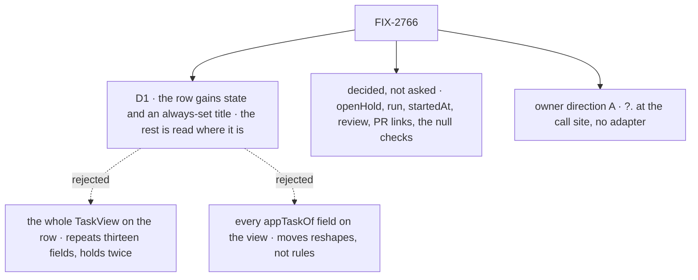

# FIX-2766 · Decisions

[Spec](SPEC.md) · **Decisions**

One call for sign-off: what the view's row answers. The owner already chose direction A on
2026-11-17 (screens read `CodingBoardTask` and handle `null` at the call site with `?.`; no
normalizing helper), and that is not reopened here. The epic decided the rest: no legacy path,
and a row Teammates needs extends this view ([its seams](../../epics/FIX-2683/DECISIONS.md#coordination-seams)).

## The tree

Solid edges are what you're signing. Dashed edges lost, and the label says why.

## D1 · The coding board row gains `state` and an always-set `title`; every other field `appTaskOf` built is read from the row where it already is

| | |
|---|---|
| **Instead of** | (a) The whole `TaskView` on each row, as a `view` field. (b) Every derivation the issue lists moved into the view: `openHold`, `run`, `runLink` and the `startedAt` fallback as well |
| **Because** | Of `appTaskOf`'s work, two pieces are rules both apps repeat: the title (`title ?? goal`, in `appTaskOf` and Teammates' `titleOf`) and the display state (`taskView`, in `appTaskOf` and Teammates' `viewOf`). The view answers those once. The screens use one field of `TaskView`, `state`; the rest of it repeats thirteen of the row's own fields (id, title, goal, assignee, status, error, status note, spend, harness and four times) and carries the holds a second time beside `asks`, on a board FIX-2773 measured at about 530 bytes a row and kept bounded on purpose. The other pieces are reshapes, not rules: `openHold` is `asks[0]` (its `confirm`-as-`input` mapping has no reader; every reader checks only `review`, presence or `prompt`), `run` and `runLink` are the row's `run`, `leaseUntil` and `runFlow`, and `review` is already cut by the view. Putting reshapes on a published row would be the translation layer again, in a package. [Tenet 3](../../../docs/philosophy.md): subtract before adding |
| **Locks in** | On harness-manager's published coding board row: `title` becomes a required string and a new `state` is added, orchestration's `TaskViewStatus` (`queued`, `held`, `running`, `waiting`, `failed`, `done`, `cancelled`). Both are projected from one `taskView(row, asks)` call, so the title fallback (title, else goal, else id) stays orchestration's rule and the view writes no copy of it. A minor changeset. `state` uses the word the glossary reserves for scope and resource state, as `TaskView.state` already does; the implementation PR adds that exception to the glossary's "State" entry rather than coin a second name for the same value |

It comes down to the board read: the whole `TaskView` sends most of every row twice.

**What would change my mind:** a screen that needs most of `TaskView` (its `hold`, its `times`,
its `model`) on every card. Then the whole `TaskView` earns its bytes, and the row carries it.

## Decided, not asked

- **Owner direction A holds.** Screens import `CodingBoardTask` from
  `@flow-state-dev/harness-manager/browser` and read it with `?.`, `??` and `== null`. No helper
  drops `null` fields; direction B is not needed, since every call site reads cleanly in the
  sketches above.
- **`state` reads the view's `asks`**, as Teammates' `viewOf` does today, so a card's column
  (from `asks[0]`) and its state read the same holds. Claude-code-style's `appTaskOf` passes no
  holds, so `taskView` reads the listed row's own. If any test row's state differs between the
  two, the implementation PR names the case; the `asks` form wins.
- **The `startedAt` fallback goes.** Every claim writes `startedAt` (`applyClaimToTask`), and
  `linkRun` is fenced to a claimed row, so a row with a run has a `startedAt`. The fallback
  served only rows written before that; the owner's rule is no legacy support.
- **The time signal reads the row.** `task-signals.tsx`'s `TaskTime` and `taskSignal` take the
  row's `state`, `updatedAt`, `completedAt`, `run` and `leaseUntil` in place of a `TaskView` and a
  built `run`, so Teammates' `runTimesOf` goes too. Its exact props are the implementer's; both
  apps' copies stay identical.
- **A PR's link is a separate value.** `withPullRequestLinks` and `usePullRequestLinks` hand back
  the links list for `PullRequestOpen`, not a copy of the task.
- **The null checks.** About 20 checks in claude-code-style's components compare a task field
  with `=== undefined`. Each is converted to `== null` or `?.`, and the PR lists every one. A
  converted check whose result changes behaviour, seen or not (`useTaskWork`'s `coding` flag gates
  the recorded-work read), gets a test with the field `null` that fails under the old form. The one-off `no-unnecessary-condition` run is the sweep that finds any
  missed; it is not committed as a rule, since it would flag far more than this change.
- **Dead code that this removes, removed.** `steps` was never set by `appTaskOf`; its
  `ThreadsBoard` branch goes with it. `appTaskOf`'s tests go with it; the two rules they covered
  (title fallback, state) are tested on the view instead. Deleting a test of deleted code is not
  loosening one.
- **Not FIX-2777's files.** Nothing here imports or edits `packages/shift-manager`, `reads.ts`
  or `lab-data.tsx`. FIX-2773 is merged, so Teammates' `lib/task.ts` is free to change.

## Considered and dropped

| Alternative | Why not |
|---|---|
| Direction B, one shared helper that drops `null` fields from any view row | The owner's fallback only if A reads badly. It doesn't: every call site above is one `?.` or `== null` |
| Each app calls `taskView` itself (Teammates' `viewOf`, kept and copied) | Leaves two copies of one rule; the issue's direction is that the view answers it |
| A type-aware lint rule committed for both labs | Flags much outside this change; a one-off sweep covers the risk this change creates |

## Analysis

2026-11-20 · watermark 2026-11-17 (issue filed) · **Right approach, smaller than the issue's list.**
Done in the authoring pass, not by a separate analyst: this worker had no way to dispatch one.

1. **Reuse** — both *Adds* rows compose existing pieces: `state` is `taskView`'s, `title` is the
   row's own field filled. See [Builds on / Adds](SPEC.md#whats-already-here-and-the-debt).
2. **Prior art** — Teammates already reads `CodingBoardTask` directly with small helpers
   (FIX-2773); this follows it and deletes the two helpers the view now answers.
3. **Other shapes** — the whole `TaskView` on the row, and every `appTaskOf` field on the view.
   Both in D1.
4. **New factors** — FIX-2773 merged (#5446) with Teammates on the same row; FIX-2769 merged with
   the shared inventory. Both shape this, neither blocks it.
5. **Necessity** — earns its place: the L4 rule exists to remove this type, and the epic can't
   close a clean inventory with it listed.
6. **Ergonomics** — a starter reads one type, the view's, with `?.`.
7. **Concerns** — the strict `=== undefined` checks fail silently. Recorded as the null-checks
   line above and the goal's second control. Folded.

## How it got here

- **Draft** — the issue listed six derivations to move into the view. Reading the callers cut it
  to two (title and state); the rest are reshapes the screens read from the row. A first draft
  also claimed the old and new state disagree for a run's unrecorded stop; reading `inboxItems`
  (called with no suspensions) showed both come from the row's recorded holds, so the claim was
  dropped and any difference left to a test.

**Open: none.**
