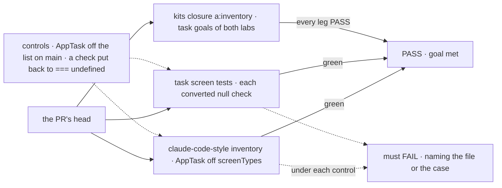
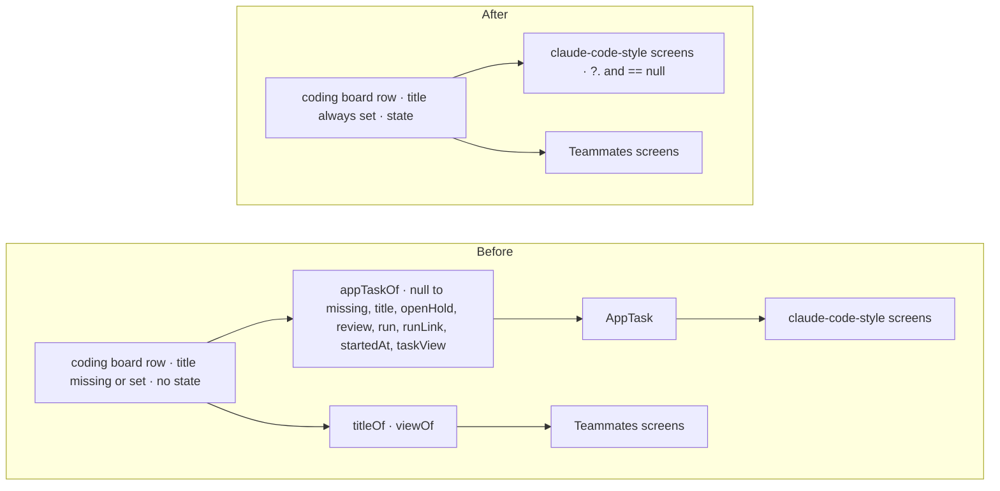

# FIX-2766 · Claude Code-style task screens read the coding board row directly

**Spec** · [Decisions](DECISIONS.md)

## Four people, before and after

| Someone who… | Today | After |
|---|---|---|
| **starts an app from claude-code-style and copies its task screens** | Copies `AppTask`, a second hand-written row type, and `appTaskOf`, 30 lines that copy each coding board row into it. Half of it only turns `null` into a missing key | Copies screens that read harness-manager's `CodingBoardTask` as it is, with `?.` and `== null` at each call site. No row type of its own |
| **uses claude-code-style's task board** | Sees each card's title, column, time signal, review note, landed line and PR wait | Sees the same on every card. A check that tested a `null` field with `=== undefined` would have stopped matching without an error; each one is converted and tested |
| **maintains Teammates' task cards** | Keeps its own `titleOf` and `viewOf`, the same two derivations claude-code-style keeps | Reads `task.title` and `task.state` from the view. One rule for each, in the view |
| **maintains harness-manager's coding board view** | Has a row whose `title` may be missing and no display state, so each app works both out | Has a row that answers both: `title` is always set and `state` is given, both projected from one orchestration `taskView` result ([D1](DECISIONS.md#d1)) |

## The goal, and how we'll know it's met

**Claude-code-style's task screens read the coding board row with no translation: `AppTask` and
`appTaskOf` are gone, `AppTask` is off the inventory's screen-type list, the view answers the
row's title and display state for both apps, and every task screen shows what it shows today.**

| Is it the right goal? | |
|---|---|
| **The real need** | The issue: "`AppTask` is the kind of hand-written row type the inventory's L4 rule exists to remove. It passes today only because it's on the screen-types allowlist." The epic's seam: "a row Teammates needs extends that view; no second board view" ([FIX-2683](../../epics/FIX-2683/DECISIONS.md#coordination-seams)) |
| **Smaller, and rejected** | Rename `AppTask` and move it off the allowlist, keeping `appTaskOf`. The allowlist shrinks and the second row type stays, which the owner's direction A rules out |
| **Bigger, and not this issue's** | Shift Manager's snapshot types (FIX-2777). Sharing the two apps' copied task hooks and `task-signals.tsx` ([FIX-2756](https://linear.app/fixpoint-labs/issue/FIX-2756)) |
| **Not done if** | `AppTask` or `appTaskOf` exists anywhere · `AppTask` is still on `screenTypes` · a task check still compares a nullable row field with `=== undefined` · Teammates still has `titleOf` or `viewOf` · a card's title, column or time signal differs from today without the PR naming the case ([the state's holds](DECISIONS.md#decided-not-asked)) · a test was skipped or loosened to get green · claude-code-style's or Teammates' inventory goes red · the kits closure goal's `a:inventory` fails |



The inventory proves the row type is gone; the screen tests prove no `null` slipped past a check.

| How we verify | |
|---|---|
| **Goal check** | `pnpm --filter @flow-state-dev/claude-code-style test` (its inventory and screen tests) and Teammates' `pnpm test`. `goals/kits/an-app-is-config-ui-and-small-flows`, `GOAL_LEGS=a` for `a:inventory`. The task goals in `goals/claude-code-style-lab/`: `tells-a-stopped-task-from-a-working-one`, `a-pr-task-waits-for-its-merge`, `hands-off-a-review`, `acts-on-an-opened-task`. Run by the implementer; verdicts on the implementation PR |
| **Signal** | Both inventories green with `AppTask` deleted from `screenTypes`; each goal's every leg PASS; and a one-off type-aware lint (`@typescript-eslint/no-unnecessary-condition`, not committed) over both labs' `src/` reports no `=== undefined` on a nullable row field, its output in the PR |
| **Input** | The rows the screen tests already build, plus one row per nullable field set to `null` (`harness`, `review`, `landed`, `error`, `runFlow`, `spend`) |
| **Anti-game** | Don't assert on a helper that rebuilds the old shape: the inventory reads the source. Don't build test rows with the field missing where the view sends `null`; that is the case the strict checks hid |
| **Control that must fail** | (1) On `main`, `AppTask` deleted from `screenTypes`: the inventory fails L4 naming `src/app/tasks.ts`. (2) For each converted check whose result changes behaviour, seen or not (a card's column, the errored note, the review note, the landed line, the PR wait, Resolve's `ready` in `ReviewAccept`, and `useTaskWork`'s `coding` flag that enables the recorded-work read), putting `=== undefined` back makes a named test fail. (3) The view test for `state` fails on `main`'s row, which has none |

## What changes



The row answers its title and its state; both apps' screens read it, and the translation goes.

The view's row, and a call site (illustrative; the implementer names nothing new):

```diff
  // packages/harness-manager/src/kit/coding-board.ts
  const codingTaskSchema = listedTaskSchema.extend({
+   /** Its short label, else its goal: what a screen shows for it. */
+   title: z.string(),
+   /** Orchestration's `taskView` state of the row with its `asks`: queued, held, running, waiting, failed, done or cancelled. */
+   state: z.enum(["queued", "held", "running", "waiting", "failed", "done", "cancelled"]),
```

```diff
  // labs/claude-code-style/src/components/ThreadView.tsx
- const question = task.openHold && task.openHold.kind !== "review" ? task.openHold : undefined;
+ const ask = task.asks[0]?.ask;
+ const question = ask !== undefined && ask.kind !== "review" ? ask : undefined;
- {task.error !== undefined ? … }
+ {task.error != null ? … }
```

What goes from claude-code-style: `AppTask`, `appTaskOf` and its tests, `withPullRequestLinks`'s
copy of the row (it hands back the links, not a task), and the never-set `steps` field with the
`ThreadsBoard` branch that reads it. What goes from Teammates: `titleOf`, `viewOf`, and
`runTimesOf` if the time signal takes the row.

**Docs:** no user docs; both labs are private and their READMEs are written at release. A minor
changeset for `@flow-state-dev/harness-manager` names the coding board row's required `title` and
its new `state`.

## What stays as it is

- **The view's input and its other fields**, `review` included: it is already `null` except on
  a completed harness task.
- **The time signal's rules** (working, quiet, ended). Only what they read from changes.
- **Shift Manager.** Nothing here touches `packages/shift-manager` (FIX-2777's).

## What's already here, and the debt

| Already here | What this does with it |
|---|---|
| **The job: a task's title and display state for a screen.** Claude-code-style's `appTaskOf`, Teammates' `titleOf` and `viewOf`, both over orchestration's `taskView`. Searched `title ?? `, `taskView(`, `viewOf`, `titleOf` in `labs/`, `packages/`, `apps/` | **Folds** both app copies into the view, which calls `taskView` once per row and keeps its `state` by that name ([D1](DECISIONS.md#d1)) |
| The board's claim (`applyClaimToTask`), which writes `startedAt` on every claim, and `linkRun`, fenced to a claimed row | **Relied on**: a row with a run always has `startedAt`, so `appTaskOf`'s fallback to the run's start served only rows from before that, and goes (no legacy support) |
| [FIX-2773](../FIX-2773/SPEC.md#whats-already-here-and-the-debt): "Its view derivations stay FIX-2766's; until they land, the screen calls `taskView` itself" | **Completed**: the derivations land, and Teammates' interim copy goes |
| [FIX-2769 D1](../FIX-2769/DECISIONS.md#d1): a type leaving the allowlist needs a reason | **Kept**: `AppTask` is deleted, not moved |

| Adds | Existing piece considered | Why it doesn't fit / how composed |
|---|---|---|
| `state` on the coding board row | The whole `TaskView` on the row; each app calling `taskView` | **Composed** from `taskView(row, asks)`, keeping only the field the row lacks ([D1](DECISIONS.md#d1)) |
| `title` always set on the row | Each app's `title ?? goal`; a fallback written in the view | **Composed** from the same `taskView(row, asks)` result as `state` (its title, else goal, else id), so the rule stays orchestration's alone |

| The debt | |
|---|---|
| **Removes** | `AppTask` and `appTaskOf` (about 70 lines and a type with 21 fields); the `startedAt` fallback; a dead `confirm`-as-`input` mapping no reader checks; the never-set `steps`; Teammates' `titleOf` and `viewOf`; one `screenTypes` entry. Two of three copies of the title and state rules |
| **Adds** | One field and one tightened field on a published view row |
| **Leaves** | The glossary's "State" entry, which `TaskView.state` already stretches; the implementation PR adds the display-state exception to it ([D1](DECISIONS.md#d1)). The two apps' copied `task-signals.tsx` and task hooks (FIX-2756) |

**Net: down.** A row type and two app copies of one rule go; the view gains one field.

## Sign off

**[The goal](#the-goal-and-how-well-know-its-met), at that size:** no `AppTask`, off the
allowlist, the view answering title and state for both apps, every task screen as today. If
wrong: claude-code-style keeps a second row type that a starter copies.

**[The debt](#whats-already-here-and-the-debt), net down:** a row type and two app copies go;
the view gains `state`. If wrong: a published row field we would have to retire.

1. **[D1](DECISIONS.md#d1) · The row carries `state` and an always-set `title`, not the whole
   `TaskView`; the other `appTaskOf` fields are read from the row where they are.** The one to
   weigh. If wrong: a screen that needs more of `TaskView` calls `taskView` itself.

**Open: none.**

Improvement · `packages/harness-manager` (the coding board view), `labs/claude-code-style`
(src, tests, inventory settings), `labs/teammates` (`lib/task.ts` and its callers) · S to M
(about 150 lines out, two fields in) · after FIX-2755 and FIX-2773 (merged) · parallel with
FIX-2777 (no shared file) · [Linear](https://linear.app/fixpoint-labs/issue/FIX-2766) · epic
[FIX-2683](../../epics/FIX-2683/SPEC.md)
