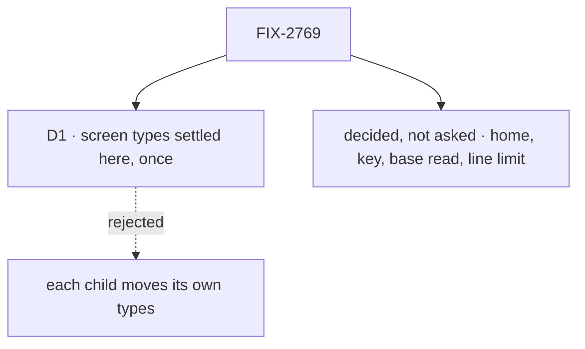

# FIX-2769 · Decisions

[Spec](SPEC.md) · **Decisions**

One call for sign-off. The epic's D3 already decided the module, the allowlist and its key, and
which rules each app meets ([FIX-2683 DECISIONS](../../epics/FIX-2683/DECISIONS.md#d3)); this
issue doesn't reopen them.

## The tree

## D1 · Which types an app keeps as its own is settled in this PR, once; a later move off the allowlist needs a written reason, and the closure lists every one

| | |
|---|---|
| **Instead of** | Claude Code-style's rule today: each child moves the types it thinks the screen computes from the allowlist to the screen-type list, in its own reviewed PR |
| **Because** | The epic is done when both allowlists are empty. If one line moves a row type to the screen-type list, an empty allowlist does not show that the work happened ([tenet 7](../../../docs/philosophy.md#7-prove-the-goal-not-the-mock)). Settled here, all about 180 calls (Teammates 43, Shift Manager 137) get one review with the code in view. After that, a type that leaves the allowlist for the screen-type list in one PR fails the test unless its screen-type entry carries a reason. The closure (FIX-2778) prints every such reason for its reviewer. A new type, on neither list at the merge-base, goes on the screen-type list as today |
| **Locks in** | This PR classifies every exported type both apps have today. A child that disagrees with a call writes the reason, and the closure audits it. A type renamed and then listed still gets past; that rests on review ([epic ER-2](../../epics/FIX-2683/DECISIONS.md#who-owns-what)) |

**What would change my mind:** the seeding finds more than about a third of Shift Manager's types
can't be called without the child's own design. Then this PR seeds only the clear ones
(component props, routes, theme), and the rest start on the allowlist with no reason needed to
move them.

It comes down to the empty allowlist: if a one-line move empties it, the closure proves nothing.

## Decided, not asked

- **Home: `labs/test-support/inventory.ts`.** Beside `contract.ts`, which both labs and the goals
  already import by relative path. Shift Manager's test reaches it the same way, as
  `packages/core`'s tests reach `scripts/`. It imports only Node's built-ins, and is never a
  package export (epic D3).
- **The key is `{file, symbol, kind}`, compared as a multiset.** The symbol is the enclosing
  exported function (epic D3); a call outside one names the top-level declaration that holds it;
  an import names what it imports; a type names itself; a gone file and a cap name the file or
  `configuration`. Teammates has 5 keys that repeat today (two `.flow(` calls in one function),
  so a set would let a third call through.
- **CI picks the base for each event and passes it in; the test never guesses it.** CI's run is
  the only authoritative one. On `pull_request`, the base is `HEAD^1` of the merge commit, which
  is the branch the PR merges into. On `merge_group`, it is `github.event.merge_group.base_sha`.
  On a push to `main`, it is `HEAD^1`. CI's test job checks out at depth 2, as the export-check
  job does, so that commit is there.
- **A local run with no base passed uses `git merge-base HEAD origin/main`, and says a local PASS
  is not CI's answer.** A stale `origin/main` can give an older base, as
  `check-root-exports.mjs` already warns. Local runs don't fetch `origin`: a test that reaches the
  network is slower and fails offline, and CI is the answer that counts.
- **The test fails closed when no base resolves, and never skips.** An allowlist absent at the
  base (this PR) is a subset trivially; its seed is what review reads.
- **Depends on CI running on merge groups.** `ci.yml` has no `merge_group` trigger today, so the
  merge queue never runs the ratchet on its merge commit. A PR can pass on a base that the queue
  then changes. Adding the trigger is a separate change, outside this issue, because it changes
  how fast the queue merges. Until it lands, the ratchet holds on each PR's own base only.
- **Where the line limit applies.** Teammates: every file under `src/app/` (15 files, 2,090
  lines today), so a new file there fails too. Shift Manager: `src/lib/reads.ts` (1,014). And
  while Teammates' L2 entry stands, its configuration total can't pass its merge-base (608): a
  cap is a size finding, and nothing else stops it growing before FIX-2771 shrinks it. This is
  the invariant's one convergence point: every rule's finding and every listed file's length
  pass through the same ratchet.
- **The rules each app runs** are the epic's [ER-2](../../epics/FIX-2683/DECISIONS.md#who-owns-what).
  Teammates: L1 to L4, H, own sessions; gone files `src/adapter.ts` (gone already, after
  FIX-2755) and `test/fake-app.ts`; entry `src/main.tsx`; L4 outside `src/components/`, as in
  claude-code-style. Shift Manager: L3 with entry `src/lib/connection.ts`; L4 over all of `src/`,
  components and surfaces included; own sessions over its `src/`; gone file `src/lib/reads.ts`;
  and a type named `…Snapshot` can never go on its screen-type list. Claude Code-style: as today,
  with an empty allowlist.
- **Findings and the ratchet are separate calls.** The closure goal grades findings with no
  allowlist, and its `todays-main` control reads an archive with no git, so findings take a
  folder, and only the ratchet reads git.
- **Seeding the allowlists is mechanical apart from D1's calls.** Every finding the rules report
  on the PR head goes on the allowlist, except the types D1 puts on a screen-type list.

## Considered and dropped

- **A baseline file with no base read.** The diff that adds a finding can add its entry; the
  export check reads the base for this reason.
- **Counts per file and rule** (ESLint's [bulk suppressions](https://eslint.org/docs/latest/use/suppressions)
  shape). It catches growth but not which child owns an entry, which is what the job children
  need. The multiset of keys keeps both.
- **A snapshot of results that may only improve** ([Betterer](https://phenomnomnominal.github.io/betterer/)).
  The same idea with a tool and a results file to keep; the rules are already ours, as code.
- **Per-rule `it.fails`.** The epic's D3 dropped it: one flag can't measure six children.

## Open

None.

## Settled

- **The baseline counts.** `node specs/issues/FIX-2769/poc/baseline/count.mts` re-derives every
  count here on any commit, with each app's entry and type scope. On `origin/main` `d32d608512`
  (after FIX-2755): Teammates L2 608 config lines, L3 13 findings in 10 files (21 keys, 5 of
  them repeated), L4 43 types, H 0, `test/fake-app.ts` there. Shift Manager L3 18 findings in
  13 files (24 keys), L4 137 types (`src/lib` 66, `src/components` 70, `src/gaps.ts` 1,
  `src/surfaces` 0), `reads.ts` there. Claude Code-style clean. (The epic's 5 and 32 for Teammates
  predate FIX-2755's split.) Claude Code-style's type list, applied to Teammates, hides 2 of the 43.

## Analysis

### Analysis — FIX-2769 issue spec · 2026-11-17 · watermark 2026-11-17

Run inline by the author, who had no sub-agent tool; the epic's analysis covered the set.
**Verdict:** right approach; the epic set the shape, and this spec adds D1.

1. **Reuse.** The rules: **extend**. The base read: **reuse** the export check's. The home: **reuse** `labs/test-support/`.
2. **Prior art.** ESLint's bulk suppressions and Betterer (*Considered and dropped*).
3. **Other shapes.** The three under *Considered and dropped*.
4. **New factors.** FIX-2755 and FIX-2629 merged today; the children are filed.
5. **Necessity.** Yes: every job child and the closure need it.
6. **Ergonomics.** A child deletes its entries from one JSON file.
7. **Concerns.** Laundering a row type onto the screen-type list; CI's base commit.

| Finding | Objective | Changes the approach? | Disposition |
|---|---|---|---|
| A one-line move to the screen-type list empties the allowlist with no work | 7 | Yes | Folded: D1 |
| The CI test job has no base commit | 7 | No | Decided: depth 2, and a base passed in per event |
| Teammates repeats keys; a set lets a third call through | 1 | No | Decided: a multiset |

## How it got here

- **Draft** — one module moves claude-code-style's rules and takes each app's settings; each app
  gets an allowlist compared with the merge-base, and the epic's line limit; built on the epic's
  D3 and the export check's base read, with the screen types settled here (D1).
- **Review round 1** — Codex: CI passes the base per event (pull request, merge group, push) and
  the test never guesses it; the merge-queue trigger is named as a dependency; a local run says it
  is not CI's answer, and fails closed. Gitar: the baseline POC now fails on a file a rule skips
  by accident.
- **Amendment (implementation review, 2026-11-17)** — the module imports `typescript`, not only
  Node's built-ins (*Decided, not asked → Home*). An L3 call is keyed by its innermost holder (a
  function, method, class, or function bound to a const; `(module)` outside them all), which
  takes the real lexical scope: a line scanner kept the last declaration it saw, so a call moved
  out of an allowlisted function kept that function's entry (Codex). Scope can't be tracked by
  hand here: JSX text holds apostrophes a scanner reads as strings. `typescript` is the repo's
  own dev dependency, and the module runs only in tests and goals. Engineering call, recorded; not
  a re-gate. The module is `inventory.mts`, so the closure's `tsx` run loads it as ESM.
