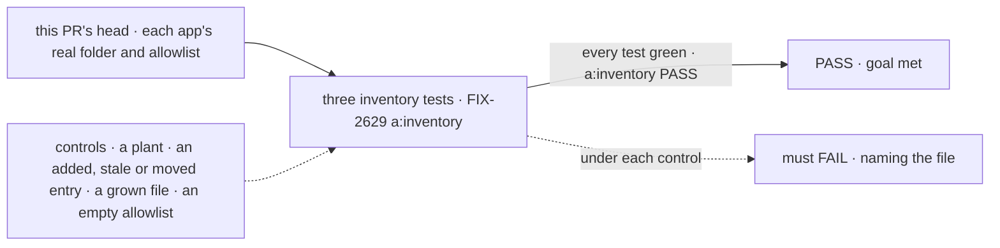
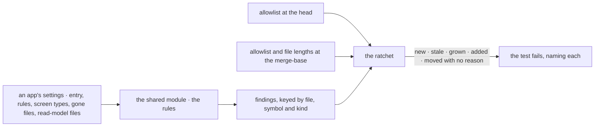

# FIX-2769 · One inventory for every app

**Spec** · [Decisions](DECISIONS.md)

## Five people, before and after

| Someone who… | Today | After |
|---|---|---|
| **builds one job child of FIX-2683** | Can't tell their progress: the rules fail Teammates on 66 findings at once, none marked as theirs | Deletes their own entries on the app's allowlist, named by file, symbol and kind. A stale or added entry fails |
| **adds a client import, a `.flow(` call or a hand-typed row to Teammates or Shift Manager** | Nothing stops it; FIX-2618's freeze holds by review only | Sees the app's test fail, naming the file, symbol and kind |
| **adds lines to what is left of a read model** | Nothing stops it | Sees the test fail past the file's merge-base length, or on a new file in Teammates' `src/app/` |
| **wants an entry gone by calling a row type the screen's own** | Edits one line of the screen-type list | Must write a reason, which the closure lists ([D1](DECISIONS.md#d1)) |
| **runs claude-code-style's test or FIX-2629's closure goal** | Imports the rules from that lab's test folder | Imports them from one shared module; same verdicts |

## The goal, and how we'll know it's met

**Claude Code-style, Teammates and Shift Manager run the same inventory rules from one module,
and Teammates' and Shift Manager's `pnpm test` fail on any finding not on a checked-in allowlist
that may only shrink, and on any read-model file that grows past its merge-base length.**

| Is it the right goal? | |
|---|---|
| **The real need** | The issue: "each later child is measured by the entries it deletes, and the closure runs the same rules" (the epic's D3) |
| **Smaller, and rejected** | A list of findings each app may keep, with no merge-base comparison or line limit: the list grows with the code, and logic grows inside a listed function (epic D3, ER-4) |
| **Bigger, and not this issue's** | Deleting any finding. Holding Shift Manager to the caps. A published package |
| **Not done if** | any control below passes · claude-code-style's verdicts change · the test skips when it can't read the merge-base |



Each control plants into a copy of the real app folder, against a real git base.

| How we verify | |
|---|---|
| **Goal check** | The three apps' inventory tests (`pnpm test` in `labs/claude-code-style`, `labs/teammates`, `packages/shift-manager`), and `goals/kits/an-app-is-config-ui-and-small-flows/` with `GOAL_LEGS=a`. Run by the implementer at completion; verdict on the implementation PR |
| **Signal** | All three tests green; `a:inventory` PASS. Each control below fails with a message that names its file |
| **Input** | The apps as they are on the PR head; the base CI passes in for the event ([Decided, not asked](DECISIONS.md#decided-not-asked)) |
| **Anti-game** | Don't assert on the module's return for a hand-made folder: plant into a copy of the app's own folder, as FIX-2629's `planted-adapter` does. Don't stub the git read |
| **Control that must fail** | (1) `src/app/glue.ts` in Teammates, `src/lib/glue.ts` in Shift Manager: a client import, a `.subscribe(` and a row type. (2) One entry added to the allowlist. (3) One entry whose finding is gone. (4) One line appended to `src/app/tasks.ts`, and to `reads.ts`. (5) A type moved from the allowlist to the screen list with no reason. (6) Each allowlist emptied on today's `main`: Teammates fails L2, L3, L4 and the fake app; Shift Manager fails L3, L4 and `reads.ts` (the epic's control). And FIX-2629's own `todays-main` and `planted-adapter` still FAIL |

## What changes


The rules move to one module that each app calls with its own settings and allowlist.

The shape an app's test takes (illustrative, not the signature; the implementer names it):

```diff
  // labs/teammates/test/inventory.test.ts (new; Shift Manager's is the same shape)
+ import { checkInventory } from "../../test-support/inventory.ts";
+ import allowlist from "./inventory-allowlist.json";
+
+ const teammates = {
+   root: new URL("..", import.meta.url),
+   entry: "src/main.tsx",
+   rules: ["L1", "L2", "L3", "L4", "H", "own sessions"],
+   gone: ["src/adapter.ts", "test/fake-app.ts"],
+   readModel: ["src/app/"],
+   screenTypes: { "src/lib/looks.ts": ["TeammateColor", "Look"] },
+ };
+
+ it("meets its inventory but for its allowlist, which only shrinks", () => {
+   expect(checkInventory(teammates, allowlist)).toEqual([]);
+ });
```

```diff
  // labs/teammates/test/inventory-allowlist.json (new): today's findings, each owned by one child
+ [
+   { "file": "src/app/conversations.ts", "symbol": "topic", "kind": "client import" },
+   { "file": "src/app/tasks.ts", "symbol": "BoardTask", "kind": "type" },
+   { "file": "test/fake-app.ts", "symbol": "(file)", "kind": "gone" }
+ ]
```

```diff
  // labs/claude-code-style/test/inventory.test.ts
- import { filesUnder, hostWiring, LAB, overCaps, reachingTheServer, unlistedTypes, unclassified } from "./inventory-rules";
+ import { checkInventory } from "../../test-support/inventory.ts";
  // its settings: entry src/main.tsx, its SCREEN_TYPES, an empty allowlist
```

`labs/claude-code-style/test/inventory-rules.ts` goes. The closure goal's `inventory.mts` and
`leg-b.mts` import from the shared module.

**Docs:** no user docs and no changeset: no published export changes, and Shift Manager's tests
don't ship. In the implementation PR, `labs/claude-code-style/README.md` and the closure goal's
`goal.md` name the module's new path.



## What stays as it is

- The rules, L1 to L4 and H ([FIX-2629 D1](../FIX-2629/DECISIONS.md#d1)), and which app meets which (the epic's [ER-2](../../epics/FIX-2683/DECISIONS.md#who-owns-what)).
- Claude Code-style's verdicts, and its own `it.fails` on workforce's project concept (FIX-2594).
- Every app's code: this issue deletes no finding.

## What's already here, and the debt

| Already here | What this does with it |
|---|---|
| **The job: grade an app's files against the inventory rules.** One way: `labs/claude-code-style/test/inventory-rules.ts`, wired to that lab's entry, type list and folder. Searched `inventory`, `reachingTheServer`, `unlistedTypes` in `labs/`, `packages/`, `goals/`, `scripts/` | **Moves** to one module, parameterized by app ([epic D3](../../epics/FIX-2683/DECISIONS.md#d3)). Its importers in FIX-2629's goal move with it |
| `labs/test-support/contract.ts`, shared by both labs and the goals by relative path | **Precedent** for the module's home |
| The export check's base read (`scripts/check-root-exports.mjs`, `gitReader`), and its CI job at depth 2 | **Reused** for the merge-base read. CI's test job moves from depth 1 to 2 and passes the base per event. The merge queue needs a `merge_group` trigger, a separate change |
| [FIX-2629 D1](../FIX-2629/DECISIONS.md#d1), [FIX-2152 ER-1](../../epics/FIX-2152/DECISIONS.md#who-owns-what), [FIX-2618 ER-8](../../epics/FIX-2618/DECISIONS.md#who-owns-what) | **Kept** as the epic amended them: its ER-2 and ER-4 |
| Claude Code-style's screen-type list | **Kept** per app. Applied to Teammates it hides 2 types by file name |

| Adds | Existing piece considered | Why it doesn't fit / how composed |
|---|---|---|
| One inventory module (`labs/test-support/inventory.ts`) | Claude Code-style's rules; a script in `scripts/`; a package | **Extends** the rules with an app's settings. No package export (epic D3) |
| A per-app allowlist, and the line limit | The export check, which keeps no baseline file | **Composes** its base read. Here each finding is listed, so a child can delete its own |

| The debt | |
|---|---|
| **Removes** | `labs/claude-code-style/test/inventory-rules.ts` (moved); claude-code-style's type list hiding Teammates' types by file name |
| **Adds** | Two allowlists, which the epic's children empty and the closure (FIX-2778) needs empty. Two screen-type lists and the module: permanent by design. One commit more in each CI test checkout |
| **Leaves** | The own-session rule stays a repo-wide grep in the closure goal, beside each app's own scan. The rules read source with patterns, not a parser: a finding written in an unusual form can pass (FIX-2629's choice, kept) |

**Net: flat.** One module moves and takes settings; two allowlists come that end empty.

## Sign off

**[The goal](#the-goal-and-how-well-know-its-met), at that size:** one module, an allowlist per
app that only shrinks, and the line limit. If wrong: the job children have nothing that measures
them, and the adapters can grow while they work.

**[The debt](#whats-already-here-and-the-debt), net flat:** one module moves; two allowlists come,
which end empty. If wrong: the allowlists outlive the epic.

1. **[D1](DECISIONS.md#d1) · Which types an app keeps as its own is settled in this PR, once;
   a later move off the allowlist needs a written reason, and the closure lists them.** The one
   to weigh. If wrong: this PR classifies about 180 types, and a child that disagrees with a call
   writes a reason instead of just moving it.

Improvement · `labs/test-support`, `labs/claude-code-style`, `labs/teammates`, `packages/shift-manager`
tests, the FIX-2629 goal, CI's test checkout · M (one module moved, two allowlists seeded, about
180 types classified) · after FIX-2629 and FIX-2755 (both merged) · the merge queue enforces it once CI runs on merge groups (a separate change) · blocks FIX-2771 to FIX-2778 ·
[Linear](https://linear.app/fixpoint-labs/issue/FIX-2769) · epic [FIX-2683](../../epics/FIX-2683/SPEC.md)
