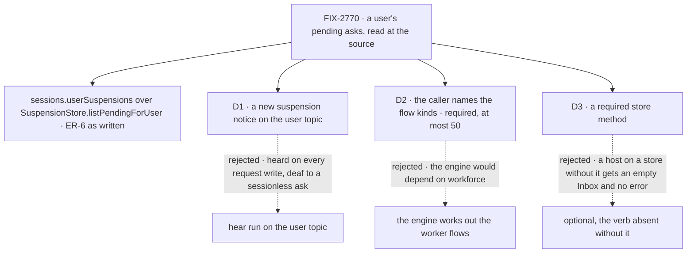

# FIX-2770 · Decisions

[Spec](SPEC.md) · **Decisions**

Three decisions are the sign-off. The epic already fixes the rules
([ER-6](../../epics/FIX-2683/DECISIONS.md#who-owns-what)): one store query joined to the request,
every scope predicate inside it, a projection without `stepInput` or `resumeData`, heard only on
suspension changes. What is left is what "heard" is made of, who names the flows, and whether a
store may skip the read.

## The tree

Solid edges are what you're signing. Dashed edges lost, and the label says why.

## D1 · The read wakes on a new `suspension` notice on the user's topic, not on `run`

| | |
|---|---|
| **Instead of** | Hearing the `run` notice that every request write already publishes on its owner's user topic |
| **Because** | ER-6 says the read is heard only on suspension changes. `run` on the user topic fires on every request write of the user, in every session: each turn's start, each status move, each finish. A sessionless request publishes no notice at all (`requestNotices` returns none without a session), so a sessionless ask would never wake the view. The suspension store gets the wrapper the request and session stores have (`withChangeBus`): `set` and `deleteForRequest` publish `suspension` on the owner's user topic once the write lands, under the request's tenant. `pruneTerminalBefore` deletes only resolved rows, which the read never returns, so it publishes nothing. Tenet 5: one publish point |
| **Locks in** | `"suspension"` is a public `ChangeKind` (contracts), accepted by the view route's `changed` body and the client's kind order. A client that switches over every kind gets a new case; the changeset says so. The notice names nothing, like every user-topic notice, since that topic spans the user's organizations |

![D1, what wakes the read. Chosen: a new suspension notice on the user topic. Instead of: the run notice every request write publishes. It comes down to a turn starting or finishing in any session: with suspension it is not heard; with run the Inbox view re-runs. Also: a sessionless ask is heard only with suspension. Price: a new public notice kind. Locks in suspension as a change kind. Flips if the Inbox re-running on every request write stays under a second and sessionless asks can wait for a refresh](figures/d1-suspension-notice.svg)

It comes down to a turn starting anywhere: on `run`, every one re-runs the Inbox view.

**What would change my mind:** the Inbox view staying under a second when re-run on every request
write of a user with dozens of worker sessions, and no sessionless ask that has to show without a
refresh. Then `run` would do and the kind could go.

## D2 · The caller names the flow kinds, required and at most 50; the engine never reads every flow

| | |
|---|---|
| **Instead of** | The engine working out the worker flows itself, or an optional list that reads every flow on the host when absent |
| **Because** | ER-6 limits the read to the worker flows the Inbox walks today and forbids widening it to every flow. Which flows are workers' is the worker inventory's answer, one layer up: the engine never depends on workforce. FIX-2774's view already reads that inventory on the server, so it passes the kinds, as `workerFlowNames` does in the browser now. A required, bounded list with no wildcard is how "never widened" holds at the verb. The kinds come from server code, never from a caller's body; the identity is closed over as on every session read |
| **Locks in** | `userSuspensions({ flowKinds })` takes 0 to 50 kinds. An empty list is allowed on purpose, since a Lab with no workers has an empty Inbox: it answers `{ suspensions: [], more: false }` without a query. More than 50 is the only refusal: it throws a `FlowStateConfigError` naming the limit. Matched on the request's `flow_kind` column, which every store indexes. Which kinds a block passes is that block's review, at FIX-2774 |

It comes down to layering: only workforce knows which flows are workers'.

**What would change my mind:** a second kit needing "the worker flows" too. Then the set becomes a
fact the host is given once, and the verb reads it instead of taking it.

## D3 · Every suspension store must implement the joined read

| | |
|---|---|
| **Instead of** | An optional store method, with `sessions.userSuspensions` absent on a store without it, as `wakes` is |
| **Because** | ER-6 rules out the only fallback a missing method could have (list, then filter). Optional, a host on a custom store would serve an Inbox that is always empty and says nothing. Required, the adapter's author gets a type error naming the method. The four stores in the repository implement it either way: memory and filesystem join to the request store their registry factory hands them, SQLite and Postgres in one SQL statement. Pre-1.0, a `minor` changeset |
| **Locks in** | `SuspensionStore.listPendingForUser` is required. `createInMemorySuspensionStore` and `createFilesystemSuspensionStore` take the request store they join to; built bare, the method throws a config error naming the option rather than answering nothing |

![D3, whether a store may skip the joined read. Chosen: a required store method. Instead of: optional, with the verb absent without it. It comes down to a host on a custom store: required, its author gets a type error naming the method; optional, its Inbox is silently empty. Price: every custom adapter must implement it on upgrade. Tie: the four stores in the repository implement it either way. Locks in a sixth required SuspensionStore method. Flips if a published store exists that cannot reach the request table](figures/d3-required-method.svg)

It comes down to a custom store: optional means an Inbox that is empty and says nothing.

**What would change my mind:** a published third-party suspension store that keeps suspensions
where it cannot reach the request records. Then the method is optional and the verb names its
absence.

## Decided, not asked

- **Where the read lives.** `RequestSessions.userSuspensions(query)` beside `read`, `history`,
  `list` and `turns`, under the same identity (`RequestSessionsInputs.identity`), so the user,
  tenant and organization are never the caller's. It answers `{ suspensions, more, next? }`,
  oldest first by `(createdAt, suspensionId)`, at most 200 a page. When `more` is true, `next` is
  the `{ createdAt, suspensionId }` of the last row **the store returned**; passing it back as
  `after` reads on from strictly after that pair, so a tie on `createdAt` neither repeats nor
  skips a row. Rows the credential check below drops come after the store, so a page can hold
  fewer than 200 rows, or none, while `more` is true. `next` still points past the dropped rows,
  never at the last row shown, so paging neither stalls on them nor skips the rows after them. A user view may call
  it; an org view may not, as for the other session reads.
- **The query, and its convergence point.** `SuspensionStore.listPendingForUser({ userId,
  tenantId, orgId, flowKinds, now, limit, after? })` is the one place the scope is applied, and nothing
  else lists asks. Every predicate sits in the store's own query: suspension joined to its request
  by `request_id` (an inner join, so a row with no request drops); the request's `user_id` and the
  suspension's `userId` both the caller's; `tenant_id` and `org_id` exact and NULL-safe. The
  query object always owns the `tenantId` and `orgId` keys, `undefined` included, so absence can
  never widen the read as it does for `matchesTenantFilter`'s list-everything callers; a
  principal with no tenant matches only requests with none (`IS ?` in SQLite, `IS NOT DISTINCT FROM` in Postgres, `matchesTenantFilter` and
  `matchesOrgFilter` in memory and on disk), so a request with a null `orgId` never matches a
  caller with one; `flow_kind` in the list; `status = 'pending'`; `expiresAt` absent or after
  `now`, the engine's clock; reason in `USER_SUSPENSION_REASONS`, which carries the old `human_*`
  names as `isUserSuspension` does. In SQLite and Postgres the join and every predicate are one
  statement; nothing is read back and filtered.
- **The projection.** The store selects only these: `suspensionId`, `requestId`, `flowKind`,
  `flowId` (the request's, else the suspension's), `sessionId` (the request's), `kind` (by
  `suspendForUserKindOf`), `shape` (by the moved `suspensionShape`), `title`, `message`, `allow`,
  `resumeSchema`, `render`, `createdAt`, `expiresAt`. These are what today's Inbox list and card
  draw. Never `stepInput`, `resumeData`, `data`, `resolvedBy`, `blockInstanceId` or `stepIndex`.
  Each adapter builds the row field by field; spreading a record is the leak this rules out, and
  structural typing would not catch it, so the tests check the keys at runtime.
  `data` is the author's payload, unbounded, and the card draws the prompt, not it. A field
  FIX-2774 finds missing is an additive change to this type in its PR, never a second read.
- **The worker link is FIX-2774's, under one constraint.** The engine has no notion of a worker,
  so the projection carries the flow instance and session an answer goes through, and FIX-2774
  maps a session to its worker on the server. An earlier draft prescribed `sessions.list({ ids })`
  for that. It can't be used: `list` records the user's session list
  (`sessionReadObserver.list` → `{ scope: "user", what: "sessions" }`), which hears `run` on the
  user topic whether or not `ids` is passed (`PEER_KINDS.sessions`), and every request write with
  a session publishes `run` there (`requestNotices`). A view combining it with this read would run
  again on every turn start and finish, which D1 exists to prevent. **The constraint FIX-2774's
  spec settles:** the worker lookup must not hear `run` on the user topic. Where the mapping
  comes from (a field the server stamps where this read can carry it, or a per-session read whose
  hearing is narrower) is FIX-2774's design, against this constraint.
- **Every row passes the instance's own credential check, with or without a session.** The
  query compares stored ids with the view's principal; it can't ask a flow instance with a
  resolver of its own whether it would accept this request. So every projected row goes through
  `ownResolverVerdict` (`routes/instance-caller.ts`), judged on the row's request: it drops a
  write record, re-resolves the caller with that instance's resolver, requires the row's user and
  organization to be that answer, and applies the instance's pin. A refusal drops the row, as a
  missing request does. When the row has a session, `admitListedSession`'s host rule applies on
  top, as for the session list. A sessionless ask has no `SessionRecord` for
  `admitListedSession`, so calling `ownResolverVerdict` directly is what covers it.
  **The shape it reads adds no field.** `ownResolverVerdict` takes `OwnedRecord` (`flowKind`,
  `flowId`) plus `userId` and `orgId`, and `isWriteRecord` reads `sessionId`. The projection
  already carries the request's `flowKind`, `flowId` and `sessionId`. Its user and organization
  are the principal's, since the query matched them exactly, so the verb passes the principal's
  `userId` and `orgId` rather than projecting them.
  **This is the check ER-6 allows after the store, not a scope filter.** ER-6's "never a filter
  after the store" covers the scope predicates: user, tenant, organization, flow, status,
  expiry and the waits-on-a-person reasons, all of which stay in the query. This check
  re-asks an instance's own sign-in about rows already in scope, and it can only remove rows.
- **The ask predicate moves.** `suspensionShape`, `SuspensionShape` and the schema classification
  they read move to `contracts/src/types/suspension.ts`, beside `isUserSuspension` and
  `suspendForUserKindOf`, re-exported by core. `@flow-state-dev/react` keeps exporting both
  (ER-3's no-alias rule covers app read paths, not this public surface), and its form builds
  fields from the moved classifier. The ui registry's card is unchanged.
- **The name avoids the retired word.** The glossary's `ask-symbol` retirement bars `*Ask*`
  identifiers outside Shift Manager and orchestration's Inbox, so the code says "user
  suspension": the term `isUserSuspension` already uses. No glossary entry changes.
- **What the read hears.** One recorded read, `{ scope: "user", what: "suspensions" }`, hears
  `suspension` on the user topic, and nothing else. The goal's `c:quiet` leg also checks the
  view's whole recorded hearing, so FIX-2774 can run the same leg over its combined view (this
  read, the worker lookup and the task holds) and see a broad dependency fail it. An ask that passes its `expiresAt` unanswered
  is dropped by the next read; what wakes the view is the sweep's write that expires it.
- **Tests, each shown failing first.** A store conformance suite
  (`engine/src/stores/testing/`, run by memory, filesystem, SQLite, and Postgres when
  `FSD_TEST_POSTGRES_URL` is set) answers nothing for: the same user in another tenant; in another
  organization; a second user in the same organization; a request with a null `orgId`; the same
  user's ask in another flow; a suspension whose request is missing; an expired ask; a wait gate;
  a raw `ctx.suspend` for an event; a principal with no tenant against a tenant-bound request.
  It lists a sessionless ask only through its request's scope. Beside those:
  - **The projection's keys, at runtime.** A pending row is seeded with `stepInput`, `resumeData`
    and `data` all set, and each returned row's key set must equal the projection's declared set
    exactly, on all four stores. Type tests assert `stepInput`, `resumeData` and `data` are not
    keys of the row type.
  - **The scope keys are owned.** The query object the engine builds always has own `tenantId`
    and `orgId` keys, on all four stores' calls.
  - **One joined statement in SQL.** For SQLite and Postgres, the missing-request case also
    asserts, by counting and inspecting the statements the adapter runs, that one statement ran
    and that it joins `requests`, not only that the row is absent.
  - **Paging.** Exactly 200 rows answer `more: false` and no `next`; 201 answer `more: true` and a
    `next` that reads the last one; a `next` that falls inside a `createdAt` tie reads on with no
    row repeated or skipped.

  Engine tests: the identity comes from the request, never the query; zero flow kinds answer
  `{ suspensions: [], more: false }` with no store call, and 51 throw `FlowStateConfigError`
  naming the limit; an ask answered in a dispatch run's session is gone in the update the
  answer's notice causes (the ghost ask); a chunk, a turn start and a turn finish wake no view
  that read only this. Two credential cases: a row whose stored user and organization match the
  view's principal, with no `sessionId`, on an instance whose own resolver refuses this request,
  is not listed; its sessioned twin is not listed either. A page where the check drops rows
  answers `more: true` with fewer rows, and its `next` reads on to the rows after the dropped
  ones.

## Considered and dropped

- **List, then filter in the engine.** The simpler shape, and the one ER-6 forbids: every scope
  check but the user's would run after the store returned other people's rows.
- **Stamp tenant and organization on the suspension record.** It would let the stores drop the
  join, but needs a backfill for every record already written, and the request stays the source
  of truth either way.
- **An HTTP route for the read.** Not needed: FIX-2774's view calls it on the server, and a route
  would be a second place to keep the scope rules.
- **`principalOwnsRequest` as the ownership rule.** It treats a request with no organization as
  every organization's; ER-6 names it as the rule not to use.

## Open

None.

## Settled

None. No POC: the parts this composes exist and behave as cited. The request host's session reads
and their view admission (`request-sessions.ts`, `view-routes.ts`), the store wrapper that
publishes (`publish-writes.ts`), the NULL-safe tenant and org clauses in both SQL adapters, and
the `request_id` key on `suspension_records` in both schemas.

## Analysis

2026-11-17 · watermark 2026-11-17 · **build as scoped.** Run by the author in this dispatch, which
had no sub-agent to hand it to; the reviewer should weigh it as such.
- Reuse: every Adds item extends a piece named in *Builds on*; `list` and `principalOwnsRequest`
  are the rejected reuses ER-6 names.
- Prior art: not researched outside the repository in this dispatch; the epic's D2 already
  settled that the answer is a server read.
- Other shapes: a suspension-stamped scope and a route are weighed above.
- New factors: FIX-2754 added `sessions.list({ ids })`, which the worker link uses.
- Necessity: the epic's D2 needs it; nothing does it on the server today.
- Major concerns: D1 adds a public kind; D3 breaks custom adapters. Both are on the sign-off.

## Notes from review

Round 1 (#5348, 2026-11-17), all folded as implementation obligations; no decision changed:
- Codex 4605209501: structural typing won't stop an adapter spreading a record, so the projection's keys are checked at runtime against a row seeded with all three payload fields.
- Codex 4605209512: a principal with no tenant against a tenant-bound request; the query object always owns `tenantId` and `orgId`.
- Codex 4605209537: a 200 cap with no way to read on was a dead end; the page now carries a `(createdAt, suspensionId)` cursor.
- Codex 4605209524: the SQL adapters prove the missing-request row drops in the one joined statement, by statement shape and count.
- Codex 4605209542 and Gitar 4605155408: one rule for the flow list's bounds; D2's *Because* no longer says "non-empty".

Round 2 (#5348, 2026-11-17):
- Greptile 4605238531: confirmed against the code: `sessions.list({ ids })` hears `run` on the user topic. The worker lookup's design moves to FIX-2774 with the constraint named under *Decided, not asked → The worker link*; `c:quiet` checks the view's whole hearing.
- Cursor 4605230964: an empty flow list is allowed on purpose; more than 50 is the only refusal.
- Cursor 4605230977: one sentence on why the per-instance admission doesn't conflict with ER-6.
- Cursor 4605230985, for the implementer: one shared helper derives `kind` and `shape` and builds the row from selected fields, used by every adapter, so the four stores can't drift. SQL adapters import it from core, not the engine.
- Cursor 4605231000, for the implementer: `createInMemoryStores` and `createFilesystemStores` pass the request store they build to the suspension store; no store reaches a sibling any other way.
- Cursor 4605231010: the slicing order is the implementer's build plan; declined here.

Round 3, security (#5348, 2026-11-17), past the two-round budget because it is a security fix:
- Cursor 4605355747 (High): a sessionless ask never reached `ownResolverVerdict`, so a caller an instance's own resolver refuses could read it. Every row now passes that check, with or without a session; two engine tests, shown failing first. Left open for the owner.

## How it got here

- **Draft** — ER-6 built as a fifth request-host session read over one required, joined store
  query, woken by a new `suspension` notice; the flow kinds named by the caller; the ask
  predicate moved beside `isUserSuspension`.
- **Review round 1** — five findings folded as obligations: runtime key checks on the projection,
  the null-tenant case and owned scope keys, a paging cursor, one joined SQL statement proved by
  shape, and one rule for the flow list's bounds. D1 to D3 unchanged.
- **Review round 2** — the worker lookup the draft prescribed would hear every turn; its design
  moves to FIX-2774 under a named constraint, and the quiet leg checks the view's whole hearing.
- **Review round 3 (security)** — a sessionless ask skipped the instance's own credential check.
  Every row now passes `ownResolverVerdict`, judged on its request; `next` points past rows the
  check drops. No decision changed.
