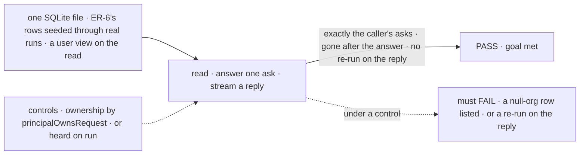
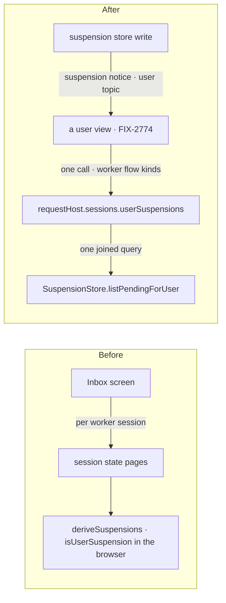
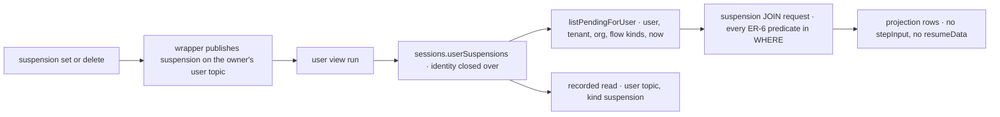

# FIX-2770 · A user's pending asks, read at the source

**Spec** · [Decisions](DECISIONS.md)

The rules this read obeys are locked by the epic: [FIX-2683 ER-6](../../epics/FIX-2683/DECISIONS.md#who-owns-what).
This spec builds to them and settles only what they leave open: where the read lives, what wakes
it, which flows it covers, and who must implement it.

## Six people, before and after

| Someone who… | Today | After |
|---|---|---|
| **has asks waiting in a dozen worker sessions** | Shift Manager's browser walks every worker session's item log, page by page, to find them | One server read lists them, oldest first, for a view to serve |
| **has the same user id in two organizations, or two tenants** | Is protected only by which sessions the browser happened to list | Never sees the other one's asks, including one whose request names no organization ([ER-6](../../epics/FIX-2683/DECISIONS.md#who-owns-what)) |
| **answers an ask that waits in a dispatch run's session** | Sees it disappear when the next snapshot reads that session | Sees it leave the list in the same update the answer causes ([D1](DECISIONS.md#d1)) |
| **watches the Inbox while a worker streams a long reply** | Nothing re-reads until an explicit refresh | Nothing re-reads either: the read wakes only when a suspension changes, never on a chunk or a turn starting ([D1](DECISIONS.md#d1)) |
| **writes a flow that parks on a wait gate or a raw `ctx.suspend` for an event** | Its gate is filtered out in the browser, after it was read | Its gate is never read: only a stop that waits on a person comes back |
| **maintains a custom store adapter** | Implements `SuspensionStore`'s five methods | Gets a type error until it implements the sixth, the joined read ([D3](DECISIONS.md#d3)) |

## The goal, and how we'll know it's met

**A user's pending asks across every worker session come from one server read that can only
return their own, current asks that wait on a person, carries no run payload, and runs again only
when a suspension changes.**

| Is it the right goal? | |
|---|---|
| **The real need** | The epic, D2: "an answer across sessions is one read on the server, never stitched in the client." The Inbox has no such read today. ER-6 adds that a suspension record carries no tenant, so the read must not leak an ask across tenants |
| **Smaller, and rejected** | "A view that calls `SuspensionStore.list({ userId, status: 'pending' })` and filters the rest in code." ER-6 forbids it: Postgres filters that call on the user only, so every other user-scope check is a filter after the fact |
| **Bigger, and not this issue's** | The Inbox view itself, composing these with task holds (FIX-2774). Answering an ask (FIX-2743). Teammates' "needs you" (FIX-2756) |
| **Not done if** | Any of ER-6's nine cases lists a row · the read is built on `SuspensionStore.list` · a row carries `stepInput`, `resumeData` or `data` · a streamed chunk or a turn start with no suspension write re-runs it · SQLite or Postgres lacks it · `@flow-state-dev/react` stops exporting `suspensionShape` |



| How we verify | |
|---|---|
| **Goal check** | `goals/user-suspensions/lists-only-what-waits-on-you/` (new) · model `n/a` · run by the implementer at completion · verdict on the implementation PR |
| **Signal** | `a:scope`: a user view calling the read returns exactly the caller's pending, unexpired, user-waiting suspension ids on the named flows, and none of ER-6's nine other rows. `b:gone`: answering the caller's ask in a dispatch run's session makes the view's next pushed result lack it, with no refresh. `c:quiet`: a 20-chunk reply and a turn started and finished in another worker session, with no suspension write, add no view run, and the view's recorded hearing is the user topic's `suspension` kind alone. FIX-2774 reruns this leg over its combined view. `d:projection`: every row's key set is exactly the projection's declared set; `stepInput`, `resumeData` and `data` are on none |
| **Input** | One `createFlowState` over a SQLite file (and over Postgres when `FSD_TEST_POSTGRES_URL` is set), flows that `suspendForUser`, park on a wait gate and `ctx.suspend` for an event, two users in two orgs and two tenants, and a request with no `orgId`; rows written by real runs, the missing-request row by deleting its request |
| **Anti-game** | Real runs, a real store, the view called over HTTP and watched on the push socket. Don't call the store method from the goal, and don't seed suspensions with `set()` except for the missing-request row |
| **Control that must fail** | `GOAL_CONTROL=owns-request` swaps the exact org match for `principalOwnsRequest`'s: FAILS `a:scope` (the null-org row is listed). `GOAL_CONTROL=hear-run` hears `run` on the user topic instead of `suspension`: FAILS `c:quiet` |

Beside the goal, ER-6's cases run in CI as a store conformance suite on all four stores, each
shown failing first ([Decided, not asked](DECISIONS.md#decided-not-asked)).

## What changes



A new verb on the request host's session reads, over one new store query that joins each
suspension to its request.

```diff
  // a user view's block, on the server (FIX-2774 writes it)
  const sessions = requireRequestHost(ctx).sessions!;
+ const page = await sessions.userSuspensions({ flowKinds: workerFlowKinds });  // { suspensions, more, next? }; pass next back as `after`
+ // each row: suspensionId, requestId, flowKind, flowId?, sessionId?, kind, shape,
+ //           title?, message, allow?, resumeSchema?, render?, createdAt, expiresAt?

  // @flow-state-dev/engine, what a store adapter implements
  export interface SuspensionStore {
    list(filter?: SuspensionFilter): Promise<SuspensionRecord[]>;
+   listPendingForUser(query: PendingUserSuspensionQuery): Promise<PendingUserSuspension[]>;
  }
- createInMemorySuspensionStore()
+ createInMemorySuspensionStore({ requests })   // and the filesystem factory: the store it joins to

  // @flow-state-dev/contracts, re-exported by core and by react
+ export { suspensionShape, type SuspensionShape }   // beside isUserSuspension
+ export const USER_SUSPENSION_REASONS             // the set the SQL predicate reads

  // the change kinds a view hears
- type ChangeKind = "items" | "request" | "run" | "state" | "resource" | "board" | "resync";
+ type ChangeKind = "items" | "request" | "run" | "state" | "resource" | "board" | "suspension" | "resync";
```

**Docs:** at release, `packages/core/README.md`'s request host section gains
`sessions.userSuspensions`; `docs/api/client.md` lists the `suspension` notice kind; the engine
README names the store method an adapter implements. Contributor docs in the implementation PR:
`docs/architecture/state-and-scopes.md` (the request host's session reads),
`publish-writes.ts`'s table of what publishes what, and the `add-store-adapter` skill's
`SuspensionStore` contract. No new page.

## How it gets there



## What stays as it is

- `SuspensionStore.list`, `matchesSuspensionFilter` and every caller of them: the sweeper, the
  stop path, the debug route.
- `deriveSuspensions` in `react`, for one conversation's rendering. The ui registry's suspension
  card. `@flow-state-dev/react`'s public `suspensionShape` and `SuspensionShape` (now re-exported).
- `principalOwnsRequest` and its callers: the dispatch seam keeps its own rule.
- Shift Manager's Inbox: FIX-2774 moves it onto a view over this read; nothing in the app changes here.

## What's already here, and the debt

| Already here | What this does with it |
|---|---|
| **The job: list a user's pending asks.** One way does it, in the browser: Shift Manager's `readPendingSuspensions` and `readAsks` (`shift-manager/src/lib/reads.ts`) walk each worker session's items. Searched `listSuspended(`, `suspensions.list(`, `isUserSuspension(` across `packages/` | **Replaced** by FIX-2774 on this read; the snapshot child (FIX-2777) deletes it ([ER-8](../../epics/FIX-2683/DECISIONS.md#who-owns-what)) |
| `RequestSessions.read`, `history`, `list`, `turns` ([FIX-2160 D2](../FIX-2160/DECISIONS.md), [FIX-2725 D1](../FIX-2725/DECISIONS.md#d1)) | **Extended:** a fifth verb, the same identity closed over, the same view admission |
| The view read recorder ([FIX-2623](../FIX-2623/DECISIONS.md)) and the one publish point ([FIX-2426](../FIX-2426/DECISIONS.md)) | **Extended:** one recorded read and one wrapped store, publishing on the topic a user's session list already uses |
| `matchesTenantFilter`, `matchesOrgFilter` and their SQL twins (`IS ?`, `IS NOT DISTINCT FROM`) | **Reused** as the rule each adapter's `WHERE` mirrors, key always present |
| `isUserSuspension` ([FIX-2129](../FIX-2129/DECISIONS.md)) | **Kept** as the one predicate; its reason set is exported so SQL reads the same set |
| `suspensionShape` in `react/src/hooks/useSuspensionForm.ts` | **Moved** beside `isUserSuspension`, with the schema classification it reads; `react` re-exports it |
| [FIX-2683 ER-6](../../epics/FIX-2683/DECISIONS.md#who-owns-what), the seams *The ask predicate* and *The pending-asks read* | **Built** as written |

| Adds | Existing piece considered | Why it doesn't fit / how composed |
|---|---|---|
| `RequestSessions.userSuspensions` | `sessions.list` then `history` per session | Per-session reads are the stitching ER-5 rules out, and a sessionless ask has no session to list |
| `SuspensionStore.listPendingForUser` | `SuspensionStore.list(filter)` | ER-6 forbids filtering after it; it filters on the user alone in Postgres and cannot see the request |
| The `suspension` change kind | `run` on the user topic | Heard on every request write, and silent for a sessionless request ([D1](DECISIONS.md#d1)) |
| `USER_SUSPENSION_REASONS` | `isUserSuspension`'s private set | **Extends** it: the same set, exported, so the SQL predicate and the JS one can't drift |

| The debt | |
|---|---|
| **Removes** | Nothing yet: the browser walk goes with FIX-2774 and FIX-2777 |
| **Adds** | A sixth required method on `SuspensionStore`, which every adapter keeps ([D3](DECISIONS.md#d3)): permanent by design. A seventh change kind: permanent by design ([D1](DECISIONS.md#d1)) |
| **Leaves** | `SuspensionRecord` still has no tenant or org of its own; the read scopes through the request, as ER-6 says. A record that carried its own scope would let the stores drop the join; not this issue's |

**Net: flat here, down across the epic.** One verb, one store method and one notice kind come;
the browser walk they replace goes in FIX-2774 and FIX-2777.

## Sign off

**[The goal](#the-goal-and-how-well-know-its-met), at that size:** one server read of a user's
pending asks, scoped inside the query, with no run payload, woken only by a suspension change.
If wrong: the Inbox view (FIX-2774) has no read to stand on, or one that leaks.

**[The debt](#whats-already-here-and-the-debt), flat:** a verb, a store method and a notice kind
come; the browser walk goes later in the epic. If wrong: two ways to list asks outlive the epic.

1. **[D1](DECISIONS.md#d1) · The read wakes on a new `suspension` notice on the user's topic, not
   on the `run` notice every request write publishes.** The one to weigh. If wrong: a public
   notice kind for one reader.
2. **[D2](DECISIONS.md#d2) · The caller names the flow kinds, required and at most 50; the engine
   never reads every flow.** If wrong: a block that passes every kind it knows widens the read
   past the Inbox's flows.
3. **[D3](DECISIONS.md#d3) · Every suspension store must implement the joined read.** If wrong: a
   custom adapter breaks on upgrade for a read its host may not use.

Feature · `contracts`, `core`, `engine`, `client`, `react`, `store-sqlite`, `store-postgres` ·
M (one verb, one store method in four stores, one notice kind, one predicate moved) · blocks
FIX-2774, FIX-2778 · [Linear](https://linear.app/fixpoint-labs/issue/FIX-2770)
