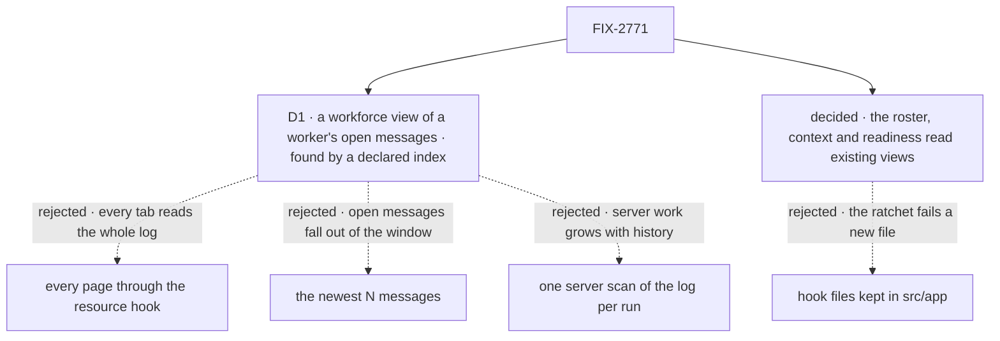

# FIX-2771 · Decisions

[Spec](SPEC.md) · **Decisions**

One call is the owner's: where Teammates reads worker messages once its own read goes, which adds
a framework view and two indexes neither the epic nor FIX-2770's spec covers. Everything else follows the epic's
rules and is recorded below so the implementer doesn't re-derive it.

## The tree

Solid edges are what you sign. Dashed edges lost, and the label says why.

## D1 · Teammates' message lines read a new workforce view of a worker's open messages and the answers to the messages on screen, found through declared indexes on the log

| | |
|---|---|
| **Instead of** | Every page of the log in the browser, through an option on react's `useResource` · a view of the newest N messages · a view that scans the log on the server each run |
| **Because** | Teammates' screens use the log for three things: messages to a worker not yet taken ("pending"), replies a worker asked for and hasn't had ("Messaging …"), and whether a sent line on screen was answered. Every one is a fact of open rows or of one row's reply, and the row already carries `status`, `replyRequested` and `answeredBy`. The engine's declared indexes (`indexes` + `findBy`, read from an index on SQLite and Postgres) find those rows without reading history (BP-033) |
| **Locks in** | A public view on workforce (`workerMessagesViewRef`, a release note) and two declared indexes on the message log: `open` and `inReplyTo`. Every log write keeps their entries. What Teammates shows is unchanged |

It comes down to one new message: every page means every tab rereads a log that only grows.

**The fork:** do we index workforce's message log and serve a worker's open messages, or teach the generic resource hook to read the whole log?

**In plain terms:** Teammates shows which messages are still on their way to a worker, which replies a worker is still waiting for, and whether each message on screen was answered. Today every worker on screen rereads the user's whole message history whenever any message arrives. That read must leave the app: either workforce answers "what is still open for this worker", or the browser keeps reading everything.

**The trade-off:** the view costs one public name, two indexes on the log, and one more index write on every message write. A run then reads one worker's open rows plus one indexed lookup per message on screen (at most 50), however long the history. The hook adds no name, but every run reads the whole log, in every tab, per worker on screen.

**My recommendation:** the indexed view. It is the only option whose cost doesn't grow with history, and the screen stays exactly as it is.

**What would change my mind:** Teammates needing a message history list, which no screen shows today. Then a paginated history read is the shape, and this view is the wrong one.

**What being wrong costs:** low. The index entries are rebuilt from rows on first lookup, so dropping or reshaping them later needs no migration; the view is one screen's dependency.

## Decided, not asked

- **The busy dot moves with the roster** (FIX-2771's, per the coordinator). The worker sessions view names the default session and whether a turn runs; the "Idle · …" age comes from the session turns view's last turn (`completedAt`, else `startedAt`), never the session's `updatedAt`, which a board `dispatch` moves. Today's read leaves out `dispatch` too; a test pins that a dispatch doesn't reset the age.
- **A row's type is the view's.** `AppWorker` becomes `RosterEntry`. A screen works out what it draws where it draws it; a type moves to the screen-type list only with a reason.
- **Writes go through workforce's client** (`hire`, `edit`, `reset`, `fire`) and its input types. Re-check is one direct read of the readiness view with `refresh`.
- **No new file in `src/app/`.** The ratchet fails one, and ER-4 ends the read model. A screen calls the package hook itself; a thin hook, where one earns it, sits beside the screen.
- **The lab's context view moves to `flows/lab-context.mts`,** with its ref beside it, so `src/` imports no `viewRef`. It keeps the delegates it reads off the worker files.
- **The host meets the cap the way claude-code-style's does:** its prose goes to the README's "The host", and it imports `operatorGitHub`, `operatorGitHubToken`, `sqliteScheduleIndex`, `setupCommandFrom` and `checkCommandsFrom` instead of its copies. Prompts stay. `openTeammates` keeps its options: goals import it.
- **The message view** sits on the roster flow at user scope, beside the worker sessions view. Input: `{ worker, ids? }`, `ids` at most 50. It returns the worker's open rows (`findBy("open", worker)`: `unconfirmed`, or `replyRequested` with no `answeredBy` and not refused or undeliverable; indexed under both `from` and `to`), and for each id its row and its reply (`findBy("inReplyTo", id)`), so "answered" and "no answer" hold for an old line too. Rows are the log's own schema. A memory store scans instead of indexing: development only. The implementer's tests pin that a new open row and a new reply each reach a watching view, and that `pendingFor`, `owedRepliesFrom` and `answerIn` give today's answers on the view's rows. The **convergence point** is the engine's index writer: every write of a log row, by any flow that declares the collection, passes it.
- **The message popup** reads the row's `toSession` through `react`'s `useSessionFeed`, which is on `main` today, so it does not wait on FIX-2772. It takes the step projection from wherever `steps.ts` is when it lands.
- **The cross-app goals keep their Teammates legs,** repointed from `createAppCalls()` to the hooks rendered under the app's provider; a leg is never retired to make this land.
- **Glossary:** `workerMessagesViewRef` uses no retired word; the implementation PR rechecks `glossary.mjs`.
- **Shift Manager decides for itself.** Its Messages screen reads whole exchanges and a total count, which this view doesn't serve. FIX-2775 chooses its own read.

## Considered and dropped

| Alternative | Why not |
|---|---|
| Keep `workers.ts`, `setup.ts` and `talk.ts` as hook files, claude-code-style's layout | The epic deletes this read model; the ratchet fails a new file there |
| Read delegates from FIX-2776's delegate read | Not built yet, and it would put this issue behind a Shift Manager child for four first-run lines |
| Replace Teammates' worker list with workforce's `Roster` component | Changes what a person sees; this epic changes reads, not screens |
| Leave the cap to the closure | The epic signed the cap at 300 with this issue as its owner |
| A view of the newest N messages | An older message still on its way, or a reply still owed, falls out of the window, and "Messaging …" and the pending line go wrong (Codex review) |
| One server scan of the log per run, filtered by worker | Bounds what is sent, not what is read: server work grows with history × workers on screen × tabs (Codex review) |

## Settled

- **The 15 entries, and that every allowlist entry has exactly one owner:** **CONFIRMED** by
  `poc/entries/check.mts` on `e90786196b`, with the coordinator's ownership: 15 for this issue,
  25 for FIX-2772, 12 for FIX-2773 and 5 for the last Teammates child to merge, of 57. The
  configuration is 608 lines (host 397, `fsdev.config.mts` 66, prompts 145), so the host has 89.
  Its control plants an entry nobody owns and exits 1. The premise held.

## Analysis

### Analysis — FIX-2771 spec · 2026-11-17 · watermark 2026-11-17 (FIX-2769 merged)

Run inline by the author (no sub-agent tool here); the cross-spec review may re-run it.

**Verdict:** right approach. D1 became a view after the hook's first page was found to be
random, then an indexed view after review (below).

1. **Reuse.** Roster, worker sessions, readiness: **reuse**. Message log: **extend** it with a
   view. Host helpers: **reuse** five exports ([Builds on / Adds](SPEC.md#whats-already-here-and-the-debt)).
2. **Prior art.** The epic's (Relay, Convex): each screen declares what it reads.
3. **Other shapes.** Under *Considered and dropped*.
4. **New factors.** FIX-2769 merged (#5351); FIX-2770's spec merged; no sibling spec PR open.
5. **Necessity.** Yes: leg t needs these entries gone and the cap met.
6. **Ergonomics.** A starter copier meets `useView` and workforce's types.
7. **Concerns.** The seams with siblings, since decided by the coordinator.

| Finding | Objective | Changes the approach? | Disposition |
|---|---|---|---|
| `useResource`'s first page of the log is random, not recent | 1 | Yes | Folded: D1 is a view |
| A newest-N view drops open rows; a server scan grows with history; `updatedAt` moves on dispatch (Codex, round 1) | 7 | Yes | Folded: D1 reads declared indexes; the idle age reads turns |
| No row named `AppCalls`, `AppState`, `Unsubscribe`, `Item`, `steps.ts`, the busy dot | 7 | No | Decided by the coordinator: SPEC → *Where this area ends* |

## How it got here

- **Draft** — framed as the epic's t1: 15 allowlist entries and the cap. The roster, context and
  readiness read existing views; worker messages need a new workforce view (D1); the host follows
  claude-code-style's.
- **Seams settled** — the coordinator decided the six sibling seams; the counts and the popup's
  hook (`useSessionFeed`, on `main`) follow.
- **Review round 1** — D1 changed from a bounded newest-N view to a view over declared indexes of
  open messages and replies, because Codex showed the window drops open rows and a per-run scan
  grows with history. FIX-2775 is no longer part of D1's case. The idle age reads turns, not
  `updatedAt`.

**Open:** none.
