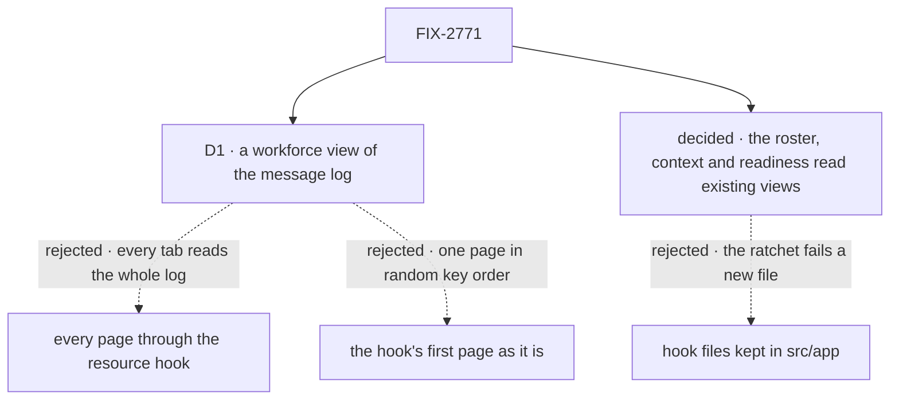

# FIX-2771 · Decisions

[Spec](SPEC.md) · **Decisions**

One call is the owner's: where Teammates reads worker messages once its own read goes, which adds
a framework view neither the epic nor FIX-2770's spec covers. Everything else follows the epic's
rules and is recorded below so the implementer doesn't re-derive it.

## The tree

Solid edges are what you sign. Dashed edges lost, and the label says why.

## D1 · Teammates' message lines read a new workforce view of the log: one worker's messages, newest first, bounded

| | |
|---|---|
| **Instead of** | Reading every page of the log in the browser, through an option added to react's `useResource` · or `useResource`'s first page as it is |
| **Because** | The log's keys are random ids: a first page is an arbitrary 200, and every page is the whole log, reread by every tab on every new message, per worker on screen. A view on the roster flow, which declares the log, reads it once on the server and sends one worker's newest rows (ER-1, BP-033, BP-042) |
| **Locks in** | A public view on workforce (`workerMessagesViewRef`, a release note). Teammates shows a worker's newest messages, not its whole history. Shift Manager and FIX-2756 read this view, not a second |

It comes down to one new message: every page means every tab rereads a log that only grows.

**The fork:** do we add a message view to workforce, or teach the generic resource hook to read the whole log?

**In plain terms:** Teammates shows what workers say to each other. Today each worker on screen rereads the user's whole message history whenever any message arrives. That read must leave the app: either workforce answers "this worker's recent messages", or the browser keeps reading everything through a general hook.

**The trade-off:** the view is one more public name, and shows only a worker's newest messages (at least 200). The hook adds no name, but its cost grows with history, in every tab.

**My recommendation:** the view: its cost doesn't grow with history, and Shift Manager (FIX-2775) and FIX-2756 share it.

**What would change my mind:** Shift Manager's Messages screen needing the whole log, unbounded. Then one every-page hook serves both apps.

**What being wrong costs:** low. A view nobody else adopts is a small public name; moving to the hook later is one screen's change.

## Decided, not asked

- **The busy dot moves with the roster** onto workforce's worker sessions view: the default session's `running` and `updatedAt`. It counts a worker's turns (`TURN_ACTIONS`) where today's counts every request but `dispatch`; a test pins the match. FIX-2771's, per the coordinator.
- **A row's type is the view's.** `AppWorker` becomes `RosterEntry`. A screen works out what it draws where it draws it; a type moves to the screen-type list only with a reason.
- **Writes go through workforce's client** (`hire`, `edit`, `reset`, `fire`) and its input types. Re-check is one direct read of the readiness view with `refresh`.
- **No new file in `src/app/`.** The ratchet fails one, and ER-4 ends the read model. A screen calls the package hook itself; a thin hook, where one earns it, sits beside the screen.
- **The lab's context view moves to `flows/lab-context.mts`,** with its ref beside it, so `src/` imports no `viewRef`. It keeps the delegates it reads off the worker files.
- **The host meets the cap the way claude-code-style's does:** its prose goes to the README's "The host", and it imports `operatorGitHub`, `operatorGitHubToken`, `sqliteScheduleIndex`, `setupCommandFrom` and `checkCommandsFrom` instead of its copies. Prompts stay. `openTeammates` keeps its options: goals import it.
- **The message view** sits on the roster flow at user scope, beside the worker sessions view. Its rows are the log's own schema, filtered by `from` or `to` on the server, newest first. The keys carry no worker, so the server reads every page once per change; an index fixes it if that ever costs a second.
- **The message popup** reads the row's `toSession` through `react`'s `useSessionFeed`, which is on `main` today, so it does not wait on FIX-2772. It takes the step projection from wherever `steps.ts` is when it lands.
- **The cross-app goals keep their Teammates legs,** repointed from `createAppCalls()` to the hooks rendered under the app's provider; a leg is never retired to make this land.
- **Glossary:** `workerMessagesViewRef` uses no retired word; the implementation PR rechecks `glossary.mjs`.

## Considered and dropped

| Alternative | Why not |
|---|---|
| Keep `workers.ts`, `setup.ts` and `talk.ts` as hook files, claude-code-style's layout | The epic deletes this read model; the ratchet fails a new file there |
| Read delegates from FIX-2776's delegate read | Not built yet, and it would put this issue behind a Shift Manager child for four first-run lines |
| Replace Teammates' worker list with workforce's `Roster` component | Changes what a person sees; this epic changes reads, not screens |
| Leave the cap to the closure | The epic signed the cap at 300 with this issue as its owner |

## Settled

- **The 15 entries, and that every allowlist entry has exactly one owner:** **CONFIRMED** by
  `poc/entries/check.mts` on `e90786196b`, with the coordinator's ownership: 15 for this issue,
  25 for FIX-2772, 12 for FIX-2773 and 5 for the last Teammates child to merge, of 57. The
  configuration is 608 lines (host 397, `fsdev.config.mts` 66, prompts 145), so the host has 89.
  Its control plants an entry nobody owns and exits 1. The premise held.

## Analysis

### Analysis — FIX-2771 spec · 2026-11-17 · watermark 2026-11-17 (FIX-2769 merged)

Run inline by the author (no sub-agent tool here); the cross-spec review may re-run it.

**Verdict:** right approach. It changed one thing: D1 became a view after the hook's first page
was found to be random.

1. **Reuse.** Roster, worker sessions, readiness: **reuse**. Message log: **extend** it with a
   view. Host helpers: **reuse** five exports ([Builds on / Adds](SPEC.md#whats-already-here-and-the-debt)).
2. **Prior art.** The epic's (Relay, Convex): each screen declares what it reads.
3. **Other shapes.** Under *Considered and dropped*.
4. **New factors.** FIX-2769 merged (#5351); FIX-2770's spec merged; no sibling spec PR open.
5. **Necessity.** Yes: leg t needs these entries gone and the cap met.
6. **Ergonomics.** A starter copier meets `useView` and workforce's types.
7. **Concerns.** The seams with siblings, since decided by the coordinator.

| Finding | Objective | Changes the approach? | Disposition |
|---|---|---|---|
| `useResource`'s first page of the log is random, not recent | 1 | Yes | Folded: D1 is a view |
| No row named `AppCalls`, `AppState`, `Unsubscribe`, `Item`, `steps.ts`, the busy dot | 7 | No | Decided by the coordinator: SPEC → *Where this area ends* |

## How it got here

- **Draft** — framed as the epic's t1: 15 allowlist entries and the cap. The roster, context and
  readiness read existing views; worker messages need a new workforce view (D1); the host follows
  claude-code-style's.
- **Seams settled** — the coordinator decided the six sibling seams; the counts and the popup's
  hook (`useSessionFeed`, on `main`) follow.

**Open:** none.
