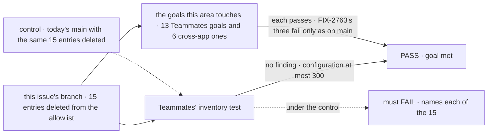

# FIX-2771 · Teammates' people, context and talk

**Spec** · [Decisions](DECISIONS.md)

## Five people, before and after

| Someone who… | Today | After |
|---|---|---|
| **hires, renames, edits or fires a teammate** | The list follows the change, through the app's own roster watch and a row type the app wrote | The same, read through workforce's roster view; the row's type is workforce's |
| **opens Teammates for the first time** | Sees the folder, model, default harness and who hands work to whom, read by the app's own call | The same lines, from the lab's context view kept current by the package hook |
| **checks which coding harnesses are ready, and presses Re-check** | A one-off read the app wrote | The harness kit's readiness view, and Re-check reads it again |
| **sees a teammate busy, or a message one worker sent another** | Each worker row re-reads the whole message log, every page, on every new message | One server read per worker gives that worker's newest messages ([D1](DECISIONS.md#d1)); the busy dot comes from workforce's worker sessions view |
| **starts an app from Teammates** | Copies 351 lines of read model for this area and a 397-line host, over the 300-line cap | Copies screens over package views, and a host of about 89 lines |

## The goal, and how we'll know it's met

**Teammates' roster, hiring and edits, context strip, harness readiness and worker messages read only through kit views, direct reads and package hooks, its configuration fits in 300 lines, and every screen behaves as it does today.**

| Is it the right goal? | |
|---|---|
| **The real need** | The epic's leg t: Teammates' allowlist empty and its caps met ([FIX-2683](../../epics/FIX-2683/SPEC.md#the-goal-and-how-well-know-its-met)). This issue's share is its 15 entries and the cap |
| **Smaller, and rejected** | "The 15 entries are gone." Met by moving the same reads into `src/lib/` or `flows/`, where the inventory's L3 doesn't look ([ER-2](../../epics/FIX-2683/DECISIONS.md#who-owns-what)) |
| **Bigger, and not this issue's** | Conversations, files, stop and window ([FIX-2772](https://linear.app/fixpoint-labs/issue/FIX-2772)); task cards and the fake app ([FIX-2773](https://linear.app/fixpoint-labs/issue/FIX-2773)); what the two starters share (FIX-2756) |
| **Not done if** | A read moved to an unscanned folder · a screen hand-types a row a view returns · the cap met by cutting prompts · a goal below fails, or a FIX-2763 goal fails in a new way |



The inventory reads the source, and the goals read the page and the store; neither reads a hook's return.

| How we verify | |
|---|---|
| **Goal check** | `labs/teammates/test/inventory.test.ts`; every goal in `goals/teammates-lab/` (the host changes under all 13); and `realtime/roster-follows-hires`, `realtime/app-views-read-on-notice`, `live-read/one-loop-every-watcher`, `attachments/lab-composers`, `routines/sessions-in-the-labs-manage-their-routines`, `kits/workforce-and-harnesses-install-as-kits`. The implementer runs them; verdicts in the implementation PR |
| **Signal** | The inventory test passes with exactly these 15 entries gone. Each goal passes, except FIX-2763's three, which fail on the same signal as on `main` or pass |
| **Input** | Each goal's own held-out input; real models where a goal names one |
| **Anti-game** | Not a hook's return or a view's unit test: both pass while a screen reads through glue. A read moved outside `src/` is review's to catch |
| **Control that must fail** | Today's `main` with the 15 entries deleted from the allowlist: the inventory test must FAIL, naming each. The control legs of the three cross-app goals must still FAIL as their `goal.md` says |

## What changes


Left is today, right is after: the dashed box is what goes, and the blue box is the one thing the framework gains.

**The 15 entries, and what replaces each** (from `labs/teammates/test/inventory-allowlist.json` at `e90786196b`):

| Entry (file · symbol · kind) | Replaced by |
|---|---|
| `configuration` · `(lines)` · cap | The host cut to fit: the context flow to `flows/`, package helpers imported, its prose to the README |
| `src/app/setup.ts` · `viewRef` · client import | The lab's context view, read with `useView`; its ref lives beside its flow |
| `src/app/setup.ts` · `AppContext` · type | That view's answer type |
| `src/app/setup.ts` · `AppHarness` · type | The harness kit's readiness view row (`harnessReadinessViewRef`) |
| `src/app/setup.ts` · `SetupCalls` · type | Deleted: a hook read and one direct read for Re-check |
| `src/app/workers.ts` · `AppWorker` · type | Workforce's `RosterEntry`, from `rosterView` |
| `src/app/workers.ts` · `NewTeammate` · type | Workforce's `HireWorkerInput` |
| `src/app/workers.ts` · `TeammateEdit` · type | Workforce's `EditWorkerInput` |
| `src/app/workers.ts` · `Activity` · type | Workforce's worker sessions view row (`running`, `updatedAt`) |
| `src/app/workers.ts` · `topic` · client import | The same view: no topic named by the app |
| `src/app/workers.ts` · `WorkerCalls` · type | Deleted: hooks read, workforce's client writes |
| `src/app/talk.ts` · `AppTalk` · type | The new message log view's row ([D1](DECISIONS.md#d1)) |
| `src/app/talk.ts` · `topic` · client import | The same view |
| `src/app/talk.ts` · `readEveryCollectionPage` · client import | The same view |
| `src/app/talk.ts` · `TalkCalls` · type | Deleted |

`workers.ts`, `setup.ts` and `talk.ts` are deleted (ER-3). The fifteen are checked by `poc/entries/check.mts`, which also gives every other entry one owner ([Settled](DECISIONS.md#settled)).

**A screen's read, as it changes:**

```diff
- const activity = useWatch(adapter.watchActivity, worker.id);
- const talk = useWatch(adapter.watchTalk, worker.id) ?? [];
+ const sessions = useView(workerSessionsViewRef(), { worker: worker.id }).value;
+ const activity = sessions?.find((s) => s.isDefault);
+ const talk = useView(workerMessagesViewRef(), { worker: worker.id }).value ?? [];
```

**Docs:** workforce's message log view is a published export, so its changeset records it for `/release-docs`. Teammates is private: its README gains "The host", which the last Teammates child rewrites with the rest (epic docs line).

## Where this area ends

For the cross-spec review: each row is a call about a sibling, recommendation last.

| Seam | With | This spec's call |
|---|---|---|
| The busy dot (`watchActivity`, `Activity`, `workers.ts` · `topic`) | FIX-2772, whose epic row names "activity" | **This issue**, since the code and its two entries are in `workers.ts`, and deletion lands file by file ([ER-8](../../epics/FIX-2683/DECISIONS.md#who-owns-what)) |
| One client for the package hooks, in `main.tsx` | FIX-2772 (`files.ts` · `createClient` is its entry), FIX-2773 | Whichever child lands first moves the client into the entry and deletes that entry |
| `AppCalls`, `AppState`, `Unsubscribe`, `Item`, and `steps.ts`'s three types | No row names them | Each child takes its own fields out; the last Teammates child to merge deletes the entries |
| The message popup's turn | FIX-2772's session hook | This issue reads the recipient's session through the hook FIX-2772 lands |
| Each worker's delegates | FIX-2776's delegate read | Kept in the lab's context view; FIX-2756's candidate |
| The message log view | FIX-2775 (Shift Manager's Messages) | Built here; Shift Manager may read it with no worker named |

## What stays as it is

- Every screen in this area, as a person sees it ([ER-3](../../epics/FIX-2683/DECISIONS.md#who-owns-what)).
- The six `WORKER.md` prompts and `TEAM.md`: 145 lines, uncut.

## What's already here, and the debt

| Already here | What this does with it |
|---|---|
| Workforce's `rosterView` and `watchRoster` | **Builds on**: the roster list reads the view |
| Workforce's worker sessions view ([FIX-2725](https://linear.app/fixpoint-labs/issue/FIX-2725)) | **Builds on**: the busy dot |
| The harness kit's readiness view | **Builds on**, unchanged |
| The message log collection (`workforce/messages/*`, user scope) | **Extends**: a view reads it ([D1](DECISIONS.md#d1)) |
| Ways to read the message log today | **Two, both in apps**: Teammates' `watchTalk` and Shift Manager's `useMessages`, each reading every page. Searched `WORKER_MESSAGES`, `workerMessage`, `readEveryCollectionPage` in `packages/`, `labs/`, `apps/`. None in a package |
| `operatorGitHub`, `operatorGitHubToken`, `sqliteScheduleIndex`, `setupCommandFrom`, `checkCommandsFrom` | **Reused**: the host drops its copies, as claude-code-style's did |
| [FIX-2683 ER-4](../../epics/FIX-2683/DECISIONS.md#who-owns-what), the read-model ratchet | **Kept**: three files go, none grows, none is added |
| [FIX-2683's cap](../../epics/FIX-2683/DECISIONS.md#decided-while-drafting-recorded-so-no-child-reopens-them): 300 lines, prompts included | **Kept and met** |

| Adds | Existing piece considered | Why it doesn't fit / how composed |
|---|---|---|
| A message log view on workforce's roster flow | `useResource` over the collection; `listAll()` | **Composed** on the collection the roster flow already declares, at user scope, beside the worker sessions view. The hook reads one page in random key order, and `listAll()` is not live ([D1](DECISIONS.md#d1)) |

| The debt | |
|---|---|
| **Removes** | `workers.ts` (174 lines), `setup.ts` (53), `talk.ts` (124); about 308 host lines (copies of package helpers, the context flow, the prose); 15 allowlist entries |
| **Adds** | One workforce view. Permanent by design |
| **Leaves** | Shift Manager's own log read (FIX-2775). Delegates read off the worker files in the lab's flow (FIX-2756). The shared entries above (the last Teammates child) |

**Net: down.** 351 lines of read model and about 308 host lines go; one workforce view comes.

## Sign off

**[The goal](#the-goal-and-how-well-know-its-met), at that size:** 15 entries gone, the cap met, every screen as today. If wrong: the entries go while the reads move somewhere the inventory doesn't look.

**[The debt](#whats-already-here-and-the-debt), net down:** three read-model files and most of the host go; one workforce view comes. If wrong: the view is a second message read beside Shift Manager's, if FIX-2775 keeps its own.

1. **[D1](DECISIONS.md#d1) · Teammates' message lines read a new workforce view of the log, one worker's newest messages, instead of every page in the browser.** If wrong: a public view we keep for one screen, or a bound that hides an old message someone looks for.

**Open: none.** D1 is the one to weigh; the six seams above are for the cross-spec review.

Improvement · `labs/teammates` + `workforce` · medium · [FIX-2683](../../epics/FIX-2683/SPEC.md)
