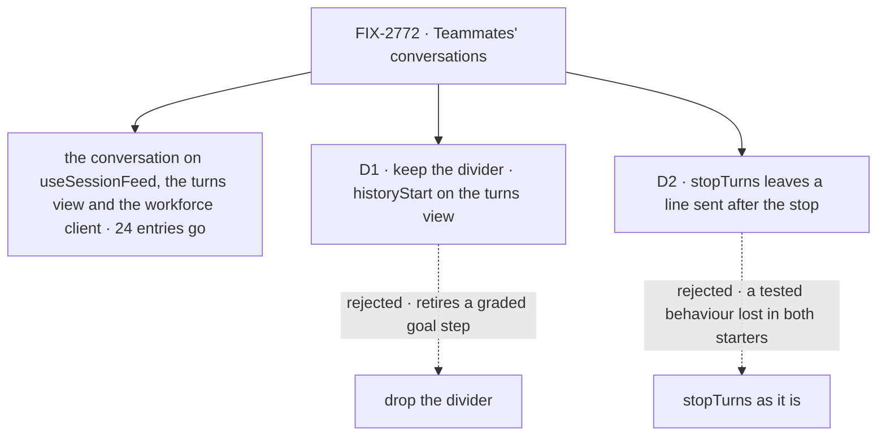

# FIX-2772 · Decisions

[Spec](SPEC.md) · **Decisions**

Two decisions are the sign-off. The epic fixes the rest: one inventory with a shrink-only
allowlist ([D3](../../epics/FIX-2683/DECISIONS.md#d3)), no legacy path, no read-model growth, no
new shared package ([ER-2, ER-3, ER-4, ER-7](../../epics/FIX-2683/DECISIONS.md#who-owns-what)).
What is left is the two places Teammates' conversation does something no package read or client
does yet, and each needs a package change.

## The tree

Solid edges are what you're signing. Dashed edges lost, and the label says why.

## D1 · Keep the *Earlier turns summarized* divider, by adding each turn's `historyStart` to workforce's session turns view

| | |
|---|---|
| **Instead of** | Dropping the divider from Teammates · or keeping `window.ts`' own request read, which needs `topic` and `client.sessions`, two L3 findings the closure must not see |
| **Because** | The divider is where the worker's word-for-word reading begins: the last answering turn's `historyStart`, moved forward by the summary's mark. The engine already records `historyStart` on every request ([FIX-1613](https://linear.app/fixpoint-labs/issue/FIX-1613)), and the client's request list carries it, but no package read a screen may use does: the turns view's row (`id, action, status, source, startedAt, completedAt, error`) leaves it out, and core's `SessionTurn` with it. Step 4 of `a-worker-talks-to-another-while-you-talk` grades the divider on the page, so dropping it retires a goal step. The turns view is the read this issue already moves the conversation's running, stopped and retryable turns onto, so one field there is the whole addition. ER-1: a missing read goes into the package that owns the data |
| **Locks in** | `historyStart: { requestId } \| null` on core's `SessionTurn` (optional, as on the request summary) and on workforce's turns view row, with changesets for `core`, `engine` and `workforce` (`minor`). The summary's mark is read from the session's `historySummary` resource through `useResource(…, { session })`; if no browser-safe handle for that resource exists, core exports one beside `historySummaryStateSchema`. No new public name is coined (`historyStart` is the engine's own term) |

It comes down to the goal step: dropping the divider retires the proof that the summary works on screen.

**What would change my mind:** the owner retiring step 4's divider check as a lab nicety. Then
the divider goes, `window.ts` is deleted outright, and no package changes for it.

## D2 · Stop keeps leaving a follow-up line to run, by teaching workforce's `stopTurns` to leave a turn its client sent after the stop began

| | |
|---|---|
| **Instead of** | Using `stopTurns` as it is, which reads the running turns after the press and stops every one, the follow-up included · or keeping Teammates' own guard around its own `abort` calls |
| **Because** | Teammates pins the behaviour in a test (*leaves a line sent after the press to run on*, `test/watch-on-notice.test.ts`): a line sent while the stop's read is in flight starts its own turn, and Stop never reaches it. Teammates does it by naming each send's request id and aborting by hand, a `.flow(` call L3 forbids. Workforce's `stopTurns` has the same race, so Claude Code-style can stop your follow-up today. The fix belongs where both starters stop a turn: the workforce client names each send's request id, and a `stopTurns` call leaves any turn that client sent after the call began. No new option; one rule for every caller |
| **Locks in** | The workforce client sets the request id of each `send`, and `stopTurns` resolves to the turns it stopped without the ones its client sent after the call began. A `workforce` changeset (`patch`) says so. A send from another tab or client is still stopped: only the client that pressed Stop knows what it sent after |

It comes down to the follow-up: as it is, `stopTurns` stops a line you sent after pressing Stop.

**What would change my mind:** the owner accepting that a follow-up sent during a stop can be
stopped with it, in both starters. Then Teammates retires the test with its reason, and
workforce is unchanged.

## Decided, not asked

- **Where the hooks live.** In what is left of `src/app/conversations.ts` (ER-4: `src/app/` may
  not gain a file, and no file there may grow). `window.ts` and `files.ts` are deleted; the pure
  code they and `conversations.ts` hold (`toEntries`, `answeringOf`, `windowMarkOf`, the file read)
  moves to `src/lib/`, unchanged in behaviour. The implementer may lay it out otherwise inside
  those limits.
- **Reclassifying is not a way out.** Four types become screen types, each with the reason the
  settings require, the way Claude Code-style names `ThreadEntry`, `ThreadView` and
  `AppConnection`: `ConversationEntry` (drawn from stored items), `ConversationView` (assembled
  from the feed and the turns), `WindowMark` (the divider, computed), `AppConnection` (the page's
  own base path and fetch, for a line's files). Every other type is deleted. A type a view returns
  takes its type from the view.
- **The convergence point for "no new finding" is the inventory test**, which every writer of a
  file under `labs/teammates/src` passes through on `pnpm test`; it already fails on a new finding,
  a stale entry and a grown read-model file. Nothing else enforces it.
- **`ClientHttpError` goes by reading the error's own `status`.** `App.tsx` keeps telling a status
  the server answered from a dead socket; it reads `status` off the failed read's error, with no
  client value. The roster watch that throws it is FIX-2771's.
- **Activity reads the turns view** on the worker's conversation once it opens: running is a turn
  in progress, last active is the newest turn's end or start. A worker with no conversation is
  idle, as today. The turns view lists the turn actions only, which is what `QUIET_ACTIONS`
  approximates by leaving out `dispatch`.
- **Running, stopped and retryable read the turns view too**, as Claude Code-style's thread does,
  instead of the last 20 requests. A stopped line stays once its turn leaves the read, as today.
- **Approvals answer through `react`'s approval hook**, not a Teammates call.
- **`send` streams through the workforce client** and hands its `Response` to the open
  conversation's `useSessionFeed().followResponse`, as Claude Code-style's `threadFeeds` does.
- **Sibling edges are proposals for cross-spec review**, not decisions here:
  `session-feed.ts`' last three entries, `steps.ts`' three types, and `workers.ts`' activity
  ([Where this meets its siblings](SPEC.md#where-this-meets-its-siblings)).
- **Tests.** Each Teammates test that pins a conversation behaviour is ported to the hooks with
  its assertion intact; the Stop test is the one D2 must keep green.

## Considered and dropped

- **A conversation view or hook in `react` that both starters share.** The epic's ER-7 keeps copies
  as copies until FIX-2756 pulls them out.
- **`useSession` for the conversation.** It is the chat hook for one flow's own session; Claude
  Code-style's thread uses `useSessionFeed` and the turns view, which is the shape this joins.
- **Reading `historyStart` from `useRequestStream`.** It follows one request, not the session's
  latest answering turn.

## Open

None for the owner. The three sibling edges go to cross-spec review.

## Settled

- **The entry counts.** `node specs/issues/FIX-2772/poc/entry-ledger/check.mjs`, on `main`
  `e90786196b`: 57 entries, each owned once (this issue 24, plus 3 if it takes `steps.ts`;
  FIX-2771 13; FIX-2773 13; the shared scaffolding 4). Its negative control, `PLANT=1`, adds an
  unowned entry and fails naming it. The premise held: the epic's row maps to 24 entries without
  overlap.

## Analysis

### Analysis · FIX-2772 issue spec · 2026-11-17 · watermark 2026-11-17

Run inline by the author: this worker has no sub-agent tool. The coordinator's cross-spec review
covers the set.

**Verdict:** right approach.

1. **Reuse.** `useSessionFeed`, the turns view, the workforce client, `useResource` and the
   approval hook: **reuse**. The turns view and `stopTurns`: **extend** (D1, D2). Nothing new.
2. **Prior art.** Claude Code-style, in this repository, on the same pieces.
3. **Other shapes.** Dropping the divider (D1), accepting the Stop race (D2), a shared
   conversation hook (dropped, ER-7).
4. **New factors.** FIX-2769 merged today with the allowlist this reads.
5. **Necessity.** Yes: the epic's closure needs an empty allowlist.
6. **Ergonomics.** A starter's conversation is hooks over package reads, as in Claude Code-style.
7. **Concerns.** Landing order with the siblings for `session-feed.ts`.

## How it got here

- **Draft** — the conversation job framed as the 24 allowlist entries the epic's row names,
  replaced by Claude Code-style's pieces; two gaps (the divider's `historyStart`, Stop's follow-up)
  go into workforce and core as D1 and D2.
