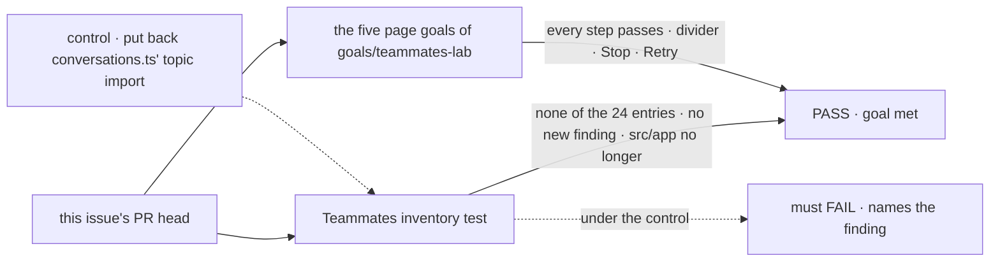
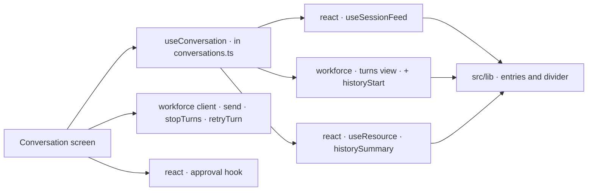

# FIX-2772 · Teammates' conversations

**Spec** · [Decisions](DECISIONS.md)

The rules this issue obeys are locked by the epic: [FIX-2683 ER-1, ER-2, ER-3, ER-4, ER-7 and
ER-8](../../epics/FIX-2683/DECISIONS.md#who-owns-what), and [D3](../../epics/FIX-2683/DECISIONS.md#d3)'s
shrink-only allowlist. This spec names the entries it removes, what replaces each, and the two
calls the replacement can't make without the owner.

## Five people, before and after

| Someone who… | Today | After |
|---|---|---|
| **talks to a teammate in the lab** | Sees the reply stream in, a run of steps, Stop, Retry on a failed turn, and approvals, through 600 lines of Teammates' own calls | Sees the same, read through `react`'s session feed and workforce's turns view and client |
| **has a long conversation** | Sees the *Earlier turns summarized* divider where the worker's word-for-word reading begins | Sees the same divider, read from workforce's turns view ([D1](DECISIONS.md#d1)) |
| **presses Stop and sends a follow-up at once** | The follow-up runs; only the turns running at the press stop | The same, now in workforce's client, so Claude Code-style gets it too ([D2](DECISIONS.md#d2)) |
| **starts an app from Teammates** | Copies `session-feed.ts`, a call interface per job and 24 inventory findings in this area | Copies screens and thin hooks over package reads: none of the 24 |
| **maintains the epic** | Teammates' allowlist has 57 entries | It has 33, or 30 if cross-spec review gives this issue `steps.ts` ([Where this meets its siblings](#where-this-meets-its-siblings)) |

## The goal, and how we'll know it's met

**Every conversation screen in Teammates (the thread, its composer, Stop, Retry, approvals,
files, the window divider and each roster row's activity) reads and writes through package hooks
and clients, and the 24 allowlist entries for that area are gone, with every Teammates goal the
conversation touches still passing.**

| Is it the right goal? | |
|---|---|
| **The real need** | The epic's row: "Feed, send, files, stop, approvals, retry, window, activity on the package's session hooks; `App.tsx`'s `ClientHttpError` import; `session-feed.ts` goes." Its goal: Teammates meets claude-code-style's whole inventory, with an empty allowlist at the closure |
| **Smaller, and rejected** | "Move the feed only, and keep the divider and Stop's guard as app code." Each needs a `topic` import or a `.flow(` call, which L3 forbids, so the entries would stay. Or "drop the divider": it retires a graded goal step ([D1](DECISIONS.md#d1)) |
| **Bigger, and not this issue's** | The roster, hire, context and talk (FIX-2771). Task cards, runs and the fake app (FIX-2773). A conversation view shared with Claude Code-style (FIX-2756, [ER-7](../../epics/FIX-2683/DECISIONS.md#who-owns-what)) |
| **Not done if** | Any of the 24 entries is on the allowlist · an entry left by being moved to the screen-type list without a reason · `session-feed.ts` exists after the last of the three Teammates children merges · a file under `src/app/` grew · the divider, Stop with a follow-up, Retry, an approval, a file thumbnail or the roster's busy dot behaves differently · a page goal in `goals/teammates-lab/` fails |



| How we verify | |
|---|---|
| **Goal check** | `labs/teammates/test/inventory.test.ts` with the 24 entries deleted from `inventory-allowlist.json`, and the five page goals in `goals/teammates-lab/` (`a-worker-talks-to-another-while-you-talk`, `shows-a-workers-steps`, `stops-and-re-runs-a-task-from-its-popup`, `tells-a-stopped-task-from-a-working-one`, `first-run-shows-its-context`) · run by the implementer at completion · verdict on the implementation PR |
| **Signal** | The inventory test passes against the shrunk allowlist (it already fails on a stale or a new entry and on a grown `src/app/` file). Step 4 of `a-worker-talks-to-another-while-you-talk` sees the *Earlier turns summarized* divider above both facts. The ported unit test *leaves a line sent after the press to run on* passes against the workforce client |
| **Input** | Each goal's own held-out input and model |
| **Anti-game** | Don't satisfy the inventory by moving a type to the screen-type list without the reason the settings require, or a read into a folder the rules don't scan ([ER-2](../../epics/FIX-2683/DECISIONS.md#who-owns-what)). The goals read the page and the store, never the hooks |
| **Control that must fail** | Put `import { topic } from "@flow-state-dev/client"` back in `src/app/conversations.ts`: the inventory fails, naming it. The ported Stop test, run against today's `stopTurns`, fails: the follow-up is stopped |

Beside the goal, `node specs/issues/FIX-2772/poc/entry-ledger/check.mjs` re-derives the entry
counts from the allowlist on `main` ([Settled](DECISIONS.md#settled)).

## What changes


The screens keep their behaviour; what they read through moves from Teammates' own calls to
package hooks and clients, two of which change in their package.

```diff
  // labs/teammates: the conversation screen
- const view = useWatch(adapter.watchConversation, sessionId);
- const connection = useWatch(adapter.watchConnection, sessionId) ?? "connecting";
- const mark = useWatch(adapter.watchWindow, sessionId);
+ const { view, connection, mark } = useConversation(sessionId);
+ // useSessionFeed (items, runs, connection, earlier) + useView(sessionTurnsViewRef(), { sessionId })
+ // + the history summary resource; entries and the divider are drawn from them in src/lib
- adapter.send(sessionId, text, attachments);
+ const answer = await workforce.send(sessionId, text, { stream: true, attachments });
+ followResponse(answer);
- adapter.interrupt(sessionId);          adapter.retry(sessionId, requestId);
+ await workforce.stopTurns(sessionId);  await workforce.retryTurn(sessionId, requestId);

  // labs/teammates/src/main.tsx: the one client, built by the entry
+ const client = createClient({ userId: readUserId(), baseUrl: readBasePath(), fetcher });

  // @flow-state-dev/workforce: one row of the session turns view (D1)
  { id, action, status, source, startedAt, completedAt, error,
+   historyStart: { requestId: string } | null }
```

**The entries it removes, and what replaces each.** All 24 are on
`labs/teammates/test/inventory-allowlist.json` on `main` (`e90786196b`). *Deleted* means the
finding no longer exists. *Screen type* means the type moves to `src/lib/` and onto
`inventory-settings.ts`'s screen-type list with the reason the settings require, as
claude-code-style lists `ThreadEntry`, `ThreadView` and `AppConnection`.

| # | File · symbol · kind | Replaced by | Outcome |
|---|---|---|---|
| 1 | `src/app/conversations.ts` · `topic` · client import | `useView(sessionTurnsViewRef(), { sessionId })`: running, ended, aborted and retryable turns | Deleted |
| 2 | `conversations.ts` · `send` · flow call | workforce client `send(…, { stream: true, attachments })`, its `Response` to the feed's `followResponse` | Deleted |
| 3 | `conversations.ts` · `interrupt` · flow call | workforce client `stopTurns` ([D2](DECISIONS.md#d2)); the stop shows until the turns view shows each stopped turn ended | Deleted |
| 4 | `conversations.ts` · `answerApproval` · flow call | `react`'s approval hook, answering the `user_approval` stop | Deleted |
| 5 | `conversations.ts` · `retry` · flow call | workforce client `retryTurn` | Deleted |
| 6 | `src/app/files.ts` · `createClient` · client import | The client built once in `src/main.tsx`, the entry L3 lets import it, handed down by the provider | Deleted |
| 7 | `src/app/window.ts` · `topic` · client import | The turns view's `historyStart` ([D1](DECISIONS.md#d1)) and the history summary resource through `useResource(…, { session })` | Deleted |
| 8 | `src/app/workers.ts` · `topic` · client import | `watchActivity`'s only use: the turns view on the worker's open conversation | Deleted |
| 9 | `src/components/App.tsx` · `ClientHttpError` · client import | The failed roster read's `status` read off the error itself, with no client value | Deleted |
| 10 | `src/lib/session-feed.ts` · `sessionFeed` · client import | `react`'s `useSessionFeed` | Deleted with the file |
| 11 | `session-feed.ts` · `watch` · subscribe call | `useSessionFeed`'s `items` | Deleted with the file |
| 12 | `session-feed.ts` · `watchState` · subscribe call | `useSessionFeed`'s `state` | Deleted |
| 13 | `session-feed.ts` · `watchRuns` · subscribe call | `useSessionFeed`'s `runs` | Deleted |
| 14 | `conversations.ts` · `ConversationEntry` · type | The entries drawn from stored items, in `src/lib/` | Screen type |
| 15 | `conversations.ts` · `ConversationView` · type | What the conversation hook hands back, assembled from the feed and the turns | Screen type |
| 16 | `conversations.ts` · `ConversationCalls` · type | The hooks and the workforce client | Deleted |
| 17 | `files.ts` · `AppConnection` · type | Where the page reads a line's files: the page's own base path and fetch | Screen type |
| 18 | `files.ts` · `FileCalls` · type | `client.upload` and a file read in `src/lib/` | Deleted |
| 19 | `window.ts` · `WindowMark` · type | The divider, drawn from the feed, the turns and the summary | Screen type |
| 20 | `window.ts` · `WindowRead` · type | The turns view's row and the resource's value | Deleted |
| 21 | `window.ts` · `HistorySummaryFace` · type | The history summary's own state type from core | Deleted |
| 22 | `window.ts` · `WindowCalls` · type | The conversation hook | Deleted |
| 23 | `workers.ts` · `Activity` · type | The activity hook's result, read off the turns view's rows | Deleted |
| 24 | `session-feed.ts` · `SessionFeed` · type | `useSessionFeed`'s result | Deleted with the file |

**Docs:** no user page. The changesets for `core`, `engine` and `workforce` say that a session
turns row carries `historyStart` and that `stopTurns` leaves a turn its client sent after the stop
began; `/release-docs` writes them up. Teammates is private: the last Teammates child rewrites its
README ([the epic's docs line](../../epics/FIX-2683/SPEC.md#whats-in-the-box)).



## Where this meets its siblings

The epic assigns this issue the conversation job; three edges of it are shared. Each has a
proposal for cross-spec review to confirm or move ([ER-8](../../epics/FIX-2683/DECISIONS.md#who-owns-what)).

| Edge | With | The question | Proposed |
|---|---|---|---|
| **`session-feed.ts`** | FIX-2771, FIX-2773 | The epic gives this issue the file, but `state.ts`'s `watchFeed` over it also serves FIX-2773's run, review and task-copy reads and FIX-2771's message exchange. Replacing it there would need a client import, a new finding | Entries 12, 13 go in this PR. Entries 10, 11 and 24 go with the file, in the PR that moves the last `watchFeed` caller off it: this one if it merges after FIX-2771 and FIX-2773, otherwise that sibling's. Until then a conversation's session can have two feeds open, the hook's and the task copies' |
| **`steps.ts`'s three types** (`SessionStep`, `StepRun`, `RunSummary`) | FIX-2771, FIX-2773 | A turn's run of tool calls is drawn inline in a conversation, in a run's transcript (FIX-2773) and in a message exchange (FIX-2771). The epic names no owner | This issue moves `steps.ts` to `src/lib/` as screen code (it reads no server) and names the three as screen types, editing one import line in `runs.ts` and `talk.ts`. That makes 27 entries |
| **`workers.ts`' `topic` and `Activity`** | FIX-2771 | `workers.ts` is the roster's file, but `topic` is used only by `watchActivity`, which the epic's row and `src/app/index.ts`'s table name as the conversation's | This issue's (entries 8 and 23). FIX-2771 keeps `AppWorker`, `TeammateEdit`, `NewTeammate` and `WorkerCalls` |

Not this issue's, named so no child is left holding them: `AppCalls`, `AppState`, `Unsubscribe` and
`Item`, the scaffolding every job shares, go with the last of the three Teammates children to merge.

## What stays as it is

- Every conversation behaviour the people table names, and every Teammates test that pins one,
  ported to the hooks (the 14 test files that build on the fake app keep their scenarios; FIX-2773
  ledgers the fake).
- `toEntries`, `answeringOf` and the divider's arithmetic: moved to `src/lib/`, not rewritten. A
  near-copy of Claude Code-style's `entriesOf` stays a copy ([ER-7](../../epics/FIX-2683/DECISIONS.md#who-owns-what)), named for FIX-2756.
- `RETRYABLE_SOURCES`, the page's copy of the engine's retry sources, and the test that pins it.
- The roster, hire, context, talk, tasks and runs: siblings' areas.
- `useSessionFeed`, `useView`, `useResource` and the approval hook in `react`: used, not changed.

## What's already here, and the debt

| Already here | What this does with it |
|---|---|
| **The job: one conversation, followed and driven** (items, turns, send, stop, retry, answer). Claude Code-style does it on `useSessionFeed`, the session turns view and the workforce client (`labs/claude-code-style/src/app/sessions.ts`, `calls.ts`); Teammates does it on its own calls. Searched `sessionFeed(`, `stopTurns`, `retryTurn`, `sessions.requests(` across `packages/` and `labs/` | **Joined**: Teammates becomes the second app on Claude Code-style's pieces. No new way to do the job |
| `react`'s `useSessionFeed` ([FIX-2757](https://linear.app/fixpoint-labs/issue/FIX-2757)) | **Reused** as is |
| workforce's session turns view ([FIX-2725 D1](../FIX-2725/DECISIONS.md#d1)) | **Extended** with each turn's `historyStart` ([D1](DECISIONS.md#d1)) |
| workforce client `send`, `stopTurns`, `retryTurn` | **Reused**; `stopTurns` leaves a turn its client sent after the stop began ([D2](DECISIONS.md#d2)) |
| The history summary capability ([FIX-1613](https://linear.app/fixpoint-labs/issue/FIX-1613)): `historyStart` on each request, the summary's mark in a session resource | **Read**, through the turns view and `useResource` |
| The shared inventory and Teammates' settings ([FIX-2769](https://linear.app/fixpoint-labs/issue/FIX-2769), [epic D3](../../epics/FIX-2683/DECISIONS.md#d3)) | **Used**: 24 entries deleted, four types named with reasons |

| Adds | Existing piece considered | Why it doesn't fit / how composed |
|---|---|---|
| `historyStart` on `SessionTurn` and the turns view's row | `client.sessions.requests` (has it, but is a client value, L3); the session snapshot (no requests) | **Extends** the turns view: the one read of a session's turns a screen already uses |
| `stopTurns` leaves a turn its client sent after the stop began | A Teammates guard around its own `abort` calls | **Extends** the workforce client: the guard needs `.flow(`, which L3 forbids, and Claude Code-style has the same race |

| The debt | |
|---|---|
| **Removes** | `session-feed.ts` (108 lines), `window.ts` and `files.ts` as call modules, most of `conversations.ts` (384) and three call interfaces; 24 allowlist entries |
| **Adds** | One optional field on a published view row and one rule in the workforce client, both permanent by design |
| **Leaves** | The conversation entries drawn twice, here and in Claude Code-style (FIX-2756). The scaffolding entries, for the last Teammates child. A second open feed on one session while `watchFeed` has callers ([Where this meets its siblings](#where-this-meets-its-siblings)) |

**Net: down.** About 600 lines of Teammates' calls and 24 findings go; one field and one rule come
to packages two apps share.

## Sign off

**[The goal](#the-goal-and-how-well-know-its-met), at that size:** every conversation screen on
package hooks and clients, the 24 entries gone, the conversation's goals passing. If wrong: the
epic's closure finds Teammates still reaching the server in its conversation.

**[The debt](#whats-already-here-and-the-debt), net down:** Teammates' conversation calls and
`session-feed.ts` go; one view field and one client rule come. If wrong: the turns view carries a
field only Teammates reads.

1. **[D1](DECISIONS.md#d1) · Keep the *Earlier turns summarized* divider, by adding each turn's
   `historyStart` to workforce's session turns view.** The one to weigh. If wrong: a published
   view grows a field for one screen in one private app.
2. **[D2](DECISIONS.md#d2) · Stop keeps leaving a follow-up line to run, by teaching workforce's
   `stopTurns` to leave a turn its client sent after the stop began.** If wrong: a package
   behaviour change for a race few people hit.

Improvement · `labs/teammates`, `workforce`, `core`, `engine` · M (24 entries; two package
changes, each with a changeset) · after FIX-2755 and FIX-2769 (both merged) · blocks FIX-2778 ·
[Linear](https://linear.app/fixpoint-labs/issue/FIX-2772) · epic [FIX-2683](../../epics/FIX-2683/SPEC.md)
