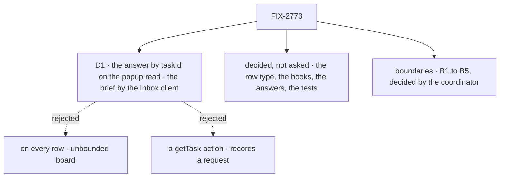

# FIX-2773 · Decisions

[Spec](SPEC.md) · **Decisions**

One call for sign-off: the one framework change this issue needs. The epic already decided the
rest: the views to read ([its seams](../../epics/FIX-2683/DECISIONS.md#coordination-seams)), no
legacy path (ER-3), no read model growth (ER-4), and copies stay copies (ER-7). FIX-2766's owner
direction decided the row type.

## The tree

## D1 · A task's answer comes on the open popup's board read, by `taskId`, never on every row; a re-run reads the brief whole through the Inbox client

| | |
|---|---|
| **Instead of** | (a) The answer and brief on every row of the coding board, as the first draft had it. (b) The brief on the popup's `detail`, as the second draft had it. (c) A `getTask` action on every popup open |
| **Because** | Teammates shows a teammate's whole answer in a task's popup, and a re-run copies the task's brief; the card shows neither, and no screen shows the brief. Codex measured the first draft's cost (P1 on #5363): nothing bounds the board, and claude-code-style reads it whole on every load. Measured below, a realistic board passes 100 KB with answers on the rows. The popup already holds its own board watch today (`Popups.tsx`), so naming its task there adds one answer to a read it already makes, and records nothing. The brief can't come on that read: it must be cut to keep the read bounded, and Greptile found that a cut brief silently drops a long brief's instructions from the re-run (P1 on #5363). `getTask` returns `context` whole (`task-tools-capability.ts`, `readTaskView`). No lossless copy by source exists on the server: `createTask` takes no source task, and `followUpOf` runs in the old task's session with its worker, which a re-run on another worker is not. So the re-run sends the board's existing `getTask`, as the page does today, through the Inbox client. [Tenet 2](../../../docs/philosophy.md): one input on a view, one read on a client, no second path |
| **Locks in** | On harness-manager's published coding board view: an optional `taskId` input. With `taskId` set, the view still returns the full `CodingBoardTask[]`, with `detail` (`answer`, `answerCut`) filled only on the named row, the answer cut at `getTask`'s 20,000-character limit; without it, `detail` is `null` on every row. `error` also carries a cancelled task's reason. On orchestration's published Inbox client: `BoardActions.get(id)`, the board's `getTask` read, brief whole. A changeset for each package (minor) |

**The measurement** (`poc/board-size/`). A real coding board on claude-code-style's own host, only
the model scripted, two settled research tasks, read through the view today: **530 bytes a row**
(531 and 525), 1,059 for the board.

| Read | Today | The answer and brief on every row (rejected) | This D1 |
|---|---|---|---|
| Any board read, 50 tasks, answers about 3 KB | 26 KB | about 180 KB | 26 KB |
| Any board read, 500 tasks (the board's lifetime cap), answers at the 20,000 cut | 265 KB | about 10.3 MB, more with briefs, which have no limit | 265 KB |
| The open popup's board read | the board | the board, with every answer | the board, plus one answer: at most about 20 KB more |
| A re-run | one `getTask` from the page, then the re-file | the brief from the row | one `getTask` through the Inbox client, then the re-file: the same two requests as today |

**The ask, in six parts**

- **The fork.** Does a finished task's answer travel with every read of the board, or only with
  the one read an open popup already makes for its task? And does a re-run copy the brief from a
  bounded read, or read it whole first?
- **In plain terms.** Today Teammates finds a teammate's answer in its own copies of the
  conversation, and asks the server for a task's brief before a re-run. Both must come from a
  package now. The card shows neither; an open popup shows the answer; only a re-run uses the brief.
- **The trade-off.** On every row: the board read grows from about 26 KB to about 180 KB for a
  50-task conversation, and to about 10 MB at the cap, for every app on every load. On the popup's
  read: that read carries one answer more, at most about 20 KB, and nothing else changes. For the
  brief, a bounded copy is cheaper but can drop a long brief's instructions without a sign; a whole
  read costs the one request a re-run sends today.
- **My recommendation.** The answer by `taskId` on the popup's own read, and the brief whole
  through `BoardActions.get`. Every board read stays at today's size, and a re-run loses nothing.
- **What would change my mind.** A screen that needs the answer for many tasks at once, such
  as a card that previews it. Then a short preview on the row, capped, beside this read.
- **What being wrong costs.** Little. It is one optional input and one nullable field on a
  pre-1.0 view, and one read method on a pre-1.0 client, each read through one hook or call.

It comes down to a board read's size: on the rows it grows with every answer, for every app.

## Decided, not asked

- **The row type is `CodingBoardTask`, read with `?.` and `== null`.** FIX-2766's owner direction
  (A), and its note that Teammates' task child uses the same row shape with no translation layer.
  The screen's `running`, `done`, `failed`, `cancelled` fold is a function in `src/lib/`, not a
  type. `BoardTask` and `TaskWaiting` are deleted, not moved to the screen-type list. A component
  check that compares a field with `=== undefined` becomes `== null`; each is tested where it
  matters (FIX-2766's warning).
- **`taskView` is called at the call site** until FIX-2766 moves it into the view, as
  claude-code-style does today. This issue does not wait on FIX-2766.
- **No new file in `src/app/`.** The inventory fails one (FIX-2769's read-model rule). `runs.ts`
  goes; its hooks join `tasks.ts`, which shrinks. `useTasks` and `useTaskWork` copy
  claude-code-style's (ER-7).
- **Answers go to the hold the board holds now.** The Inbox client's `answerOne`, on the hold read
  from the row's `asks` at answer time (FIX-2628). `openHolds` and `holdsOfTasks` go.
- **Board actions stay the Inbox client's `board(at)`** on the conversation that filed the task.
  A re-run is `refile` with the brief `BoardActions.get` read and the existing `rerunOverrides`
  line, now a `src/lib/` function. `TaskActions` becomes orchestration's `BoardActions`; `TaskAnswer` becomes `InboxAnswer`.
- **A task's run:** steps from `useSessionFeed` on the run session through `runSteps`; the review
  from the latest review stop through harness-manager's `reviewDetail`; the call in flight from
  `useRequestStream` (`reconnect: true`, `tool_output` only) and the feed; the plan from the
  recorded work view, live. This replaces the hand-built request-stream store and the topic read.
- **A PR's link** stays `readSessionPullRequests`, the package direct read the popup uses today.
- **The answer's cut has one convergence point:** the view takes it from the same helper
  `getTask`'s read uses (`READ_OUTPUT_LIMIT`), so the two never cut differently. The brief is never
  cut: only `BoardActions.get` reads it, and only for a re-run.
- **`useTaskDetail(sessionId, taskId)`** is the popup's hook, beside `useTasks` in `tasks.ts`. It
  replaces the popup's own board watch; a card never calls it, so no card holds a watch of its own.
- **A re-run** calls `BoardActions.get(id)`, then `refile` with that whole brief and the
  `rerunOverrides` line. `withBrief` and its `.flow(` call go; the same read now lives in the package.
- **When the settled-task goal's Teammates leg moves off `watchTasks`**, its 0-reads-while-a-reply-
  streams signal also covers an open popup's `taskId` watch, not only the list's board read.
- **`error` on a cancelled task.** Claude-code-style's checks that read `error` as a failure must
  check `status` too; the implementer runs its suite and its `acts-on-an-opened-task` goal.
- **Tests.** The four task tests that use the fake (`popup-holds`, `task-actions`, `task-spend`,
  `task-summary`) move to a stub server or the lab's own host, as claude-code-style's
  `stub-server.ts` and `app-host.ts` do. Every task or run scenario of the fake goes into the
  implementation PR's ledger: a test that now covers it, or "dropped, because …".
- **Goals re-pointed, not dropped.** `goals/task-board/a-settled-task-reaches-the-board`'s Teammates
  leg reads the lab's new path, and its controls patch that path. The same for
  `stops-and-re-runs-a-task-from-its-popup`'s `wrong-board` and `other-session` patches.

## Considered and dropped

- **The answer and brief on every row** (the first draft's D1). Unbounded board, measured in D1.
- **The brief on the popup's `detail`, cut** (the second draft). A re-run of a long brief would
  lose instructions silently (Greptile).
- **A server-side copy by source task.** `createTask` has no such input, and `followUpOf` means the
  old task's session and worker; adding one changes a model-facing tool for one app's button.
- **A short answer preview on every row, with the full answer read on open.** The card never
  shows the answer, so a preview serves no screen.
- **Keep `BoardTask` as a screen type, with a reason.** The allowlist empties and the translation
  layer stays: what FIX-2766 rules out, and what FIX-2769 D1 exists to catch.
- **Read the answer from the conversation's items with `useSessionFeed`.** It is today's
  stitching on a package hook: a long conversation may not have the copy loaded, and a copy from
  before a retry speaks for the wrong attempt.
- **A second, Teammates-only board view.** The epic's seam forbids it.
- **The recorded work view for a PR's link.** It reads one request; the popup reads the whole run
  session today, and nothing here needs that to change.

## Open

None. The boundaries with siblings (B1 to B5) were decided by the coordinator and are in
[SPEC.md](SPEC.md#boundaries-with-siblings).

## Settled

- **The 12 entries.** `node specs/issues/FIX-2773/poc/entries/check.mjs` re-derives them from the
  real allowlist and fails on an entry no owner row classifies. On `origin/main` `e90786196b`: 57
  entries; 12 this issue's (6 in `tasks.ts`, 6 in `runs.ts`); the fake's `gone` entry the last
  Teammates child's (B1), with the four shared types (B2); t1 15 (`workers.ts` by B5), t2 25
  (`steps.ts` by B3). With `--control` (a planted unclassified entry) it FAILs, as it must.
- **Not checked before the gate:** whether the coding board view meets the settled-task goal's
  signals for Teammates (a settled task within 1 s; 0 board reads over 10 s while a reply streams).
  Claude-code-style reads the view today, and no goal measures it there. It is the implementation's
  first check; if it fails, the fix goes in the view's topics (ER-1), never in the app.

## Analysis

### Analysis — FIX-2773 issue spec · 2026-11-17 · watermark 2026-11-17

Run inline by the author, who had no sub-agent tool; the epic's analysis covered the set.
**Verdict:** right approach. The epic set the views; this spec finds one gap in them (D1) and the
seams with siblings.

1. **Reuse.** The coding board and recorded work views, `useSessionFeed`, `useRequestStream`, the
   Inbox client: **reuse**. The row's missing fields: **extend** the view.
2. **Prior art.** Claude-code-style's `useTasks` and `useTaskWork`, the same pattern on the same
   views.
3. **Other shapes.** The answer on the popup's own read and the brief by a whole read (D1); a screen type kept; a second view (*Considered and
   dropped*).
4. **New factors.** FIX-2769 merged today, with the read-model rule that forbids a new file in
   `src/app/`. FIX-2766 and FIX-2782 filed today.
5. **Necessity.** Yes: the epic can't close with these entries.
6. **Ergonomics.** A starter copies two hooks and reads the view's row.
7. **Concerns.** The fake spans three children (B1, decided); the view's read rate is unchecked for
   Teammates (*Settled*).

| Finding | Objective | Changes the approach? | Disposition |
|---|---|---|---|
| The coding board row lacks the answer, the brief and a cancel's reason | 1 | Yes | Folded: D1 |
| (Codex, review round 1) On every row, the answer and brief leave the board read unbounded | 7 | Yes | Folded: D1 is a one-task read, measured |
| (Greptile, review round 2) A cut brief on `detail` drops a long brief's instructions from a re-run | 7 | Yes | Folded: the brief comes whole through `BoardActions.get` |
| The fake implements every job's calls, so it can't go in one child unless that child lands last | 7 | No | B1, decided by the coordinator: each child cuts its own scenarios; the last to merge deletes the file |
| `src/app/` may not gain a file | 7 | No | Decided: hooks join `tasks.ts` |

## Related: FIX-2782

[FIX-2782](https://linear.app/fixpoint-labs/issue/FIX-2782) asks Shift Manager's review card for
the ask, the run's summary, this round's commits, the files and the PR. **Easier, a little.** After
this issue, Teammates reads a review only through harness-manager's `reviewDetail`, and a task's
answer from the board's row. When FIX-2782 widens the review stop's data, Teammates' copy of the
card can show it by drawing it, with no read change. Nothing here makes it harder: this issue
doesn't touch the review stop's data or either app's review card.

## How it got here

- **Draft** — the task screens read the views claude-code-style reads; the 13 entries in
  `tasks.ts`, `runs.ts` and the fake go; the coding board row gains the answer and the brief (D1);
  five boundaries with the sibling jobs named for the cross-spec review.
- **B1 decided (coordinator, 2026-11-17)** — Gitar on #5363: the goal counted the fake's `gone`
  entry, which this issue can't remove unless it merges last. Each Teammates child cuts its own
  scenarios; the last of FIX-2771, FIX-2772 and FIX-2773 to merge deletes the file and the entry.
  This issue's goal is now the 12 `src/app/` entries and the fake's task and run scenarios.
- **B2 to B5 decided (coordinator, 2026-11-17)** — the last Teammates child removes the shared
  plumbing types, after each child removes its own fields; FIX-2772 owns `steps.ts` and moves it to
  `src/lib/`; the first child to merge adds the client to `main.tsx` and `AppProvider`; FIX-2771
  owns `workers.ts`. This issue's count stays 12.
- **Review round 1 (2026-11-17)** — Codex P1: with the answer and brief on every row, nothing
  bounds the board, and claude-code-style reads it whole on every load. Measured a real board (530
  bytes a row) and the bound (about 10 MB at the 500-task cap). D1 is now a one-task read on the same
  view, through an optional `taskId` input; the board read is unchanged.
- **Review round 2 (2026-11-17)** — Greptile P1: `getTask` returns `context` whole, so a re-run
  built from a cut `detail.context` loses a long brief's instructions. No server copy by source
  exists (`createTask` has none; `followUpOf` is a different job), so the re-run reads the brief
  whole through a new `BoardActions.get`, the read the page sends today. `detail` keeps only the
  answer. Cursor: with `taskId` the view still returns every row; the hook is `useTaskDetail`, used
  only by the popup, which already watches the board; the goal's 0-reads signal covers it.
