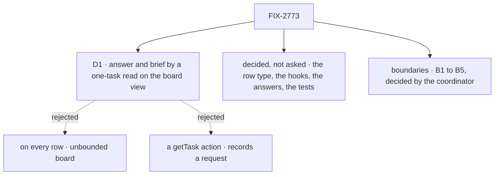

# FIX-2773 · Decisions

[Spec](SPEC.md) · **Decisions**

One call for sign-off: the one framework change this issue needs. The epic already decided the
rest: the views to read ([its seams](../../epics/FIX-2683/DECISIONS.md#coordination-seams)), no
legacy path (ER-3), no read model growth (ER-4), and copies stay copies (ER-7). FIX-2766's owner
direction decided the row type.

## The tree

## D1 · A task's answer and its brief come by a one-task read on the coding board view, never on every row

| | |
|---|---|
| **Instead of** | (a) The answer and brief on every row of the coding board, as the first draft had it. (b) A `get(id)` on the Inbox client's board, which sends `getTask` as an action |
| **Because** | Teammates shows a teammate's whole answer in a task's popup, and a re-run copies the task's brief; the card shows neither. The board row carries neither today. Codex measured the first draft's cost (P1 on #5363): each answer is cut at 20,000 characters, but nothing bounds the board, and claude-code-style reads the whole board on every load and resync without using the fields. Measured below, a realistic board passes 100 KB with answers on the rows, and the bound is about 10 MB. An Inbox action records a request in the conversation on every popup open. A view input reads that one task, live, and records nothing: when the task ends, the answer arrives with it. The epic's seam says a row Teammates needs extends this view, not a second one. [Tenet 2](../../../docs/philosophy.md): the view grows one input, not a second path |
| **Locks in** | On harness-manager's published coding board view: an optional `taskId` input that narrows the answer to that task, and a nullable `detail` on the row (`answer`, `answerCut`, `context`, `labels`, `priority`), filled only when the input names the task, each cut at `getTask`'s 20,000-character limit. `error` also carries a cancelled task's reason. A changeset (minor). The board read without `taskId` is unchanged for every app |

**The measurement** (`poc/board-size/`). A real coding board on claude-code-style's own host, only
the model scripted, two settled research tasks, read through the view today: **530 bytes a row**
(531 and 525), 1,059 for the board.

| Board read | Today | Answer and brief on every row (rejected) | This D1 |
|---|---|---|---|
| 50 tasks, answers about 3 KB | 26 KB | about 180 KB | 26 KB, and 3.5 KB for an open popup |
| 500 tasks (the board's lifetime cap), answers at the 20,000 cut | 265 KB | about 10.3 MB, more with briefs, which have no limit | 265 KB, and at most about 40 KB for an open popup (answer and brief, each cut) |

**The ask, in six parts**

- **The fork.** Does a finished task's answer, and its brief, travel with every read of the
  board, or only with a read of that one task while its popup is open?
- **In plain terms.** Today Teammates finds a teammate's answer in its own copies of the
  conversation, and asks the server for a task's brief before a re-run. Both must come from a
  package now. The card never shows them; only an open popup and a re-run need them.
- **The trade-off.** On every row: no extra read, but the board read grows from about 26 KB to
  about 180 KB for a 50-task conversation, and to about 10 MB at the cap, for every app on
  harness-manager on every load and resync. A one-task read: the board stays as it is, and an open
  popup holds one more live read, of at most about 40 KB. An Inbox action instead would also record
  a request in the conversation on each open.
- **My recommendation.** The one-task read, as an input on the same view. It keeps the board at
  today's size for every app, records nothing, and stays live.
- **What would change my mind.** A screen that needs the answer for many tasks at once, such
  as a card that previews it. Then a short preview on the row, capped, beside this read.
- **What being wrong costs.** Little. It is one optional input and one nullable field on a
  pre-1.0 view, and Teammates reads them through one hook.

It comes down to the board read's size: on the rows it grows with every answer, for every app.

## Decided, not asked

- **The row type is `CodingBoardTask`, read with `?.` and `== null`.** FIX-2766's owner direction
  (A), and its note that Teammates' task child uses the same row shape with no translation layer.
  The screen's `running`, `done`, `failed`, `cancelled` fold is a function in `src/lib/`, not a
  type. `BoardTask` and `TaskWaiting` are deleted, not moved to the screen-type list. A component
  check that compares a field with `=== undefined` becomes `== null`; each is tested where it
  matters (FIX-2766's warning).
- **`taskView` is called at the call site** until FIX-2766 moves it into the view, as
  claude-code-style does today. This issue does not wait on FIX-2766.
- **No new file in `src/app/`.** The inventory fails one (FIX-2769's read-model rule). `runs.ts`
  goes; its hooks join `tasks.ts`, which shrinks. `useTasks` and `useTaskWork` copy
  claude-code-style's (ER-7).
- **Answers go to the hold the board holds now.** The Inbox client's `answerOne`, on the hold read
  from the row's `asks` at answer time (FIX-2628). `openHolds` and `holdsOfTasks` go.
- **Board actions stay the Inbox client's `board(at)`** on the conversation that filed the task.
  A re-run is `refile` with the row's brief and the existing `rerunOverrides` line, now a `src/lib/`
  function. `TaskActions` becomes orchestration's `BoardActions`; `TaskAnswer` becomes `InboxAnswer`.
- **A task's run:** steps from `useSessionFeed` on the run session through `runSteps`; the review
  from the latest review stop through harness-manager's `reviewDetail`; the call in flight from
  `useRequestStream` (`reconnect: true`, `tool_output` only) and the feed; the plan from the
  recorded work view, live. This replaces the hand-built request-stream store and the topic read.
- **A PR's link** stays `readSessionPullRequests`, the package direct read the popup uses today.
- **The detail's cut has one convergence point:** the view takes it from the same helper
  `getTask`'s read uses (`READ_OUTPUT_LIMIT`), so the two never cut differently. `context` is cut
  there too, since it has no limit of its own.
- **The popup's one-task read** is a hook beside `useTasks` in `tasks.ts`; a re-run takes the brief
  from it, so a re-run sends nothing before `refile`.
- **`error` on a cancelled task.** Claude-code-style's checks that read `error` as a failure must
  check `status` too; the implementer runs its suite and its `acts-on-an-opened-task` goal.
- **Tests.** The four task tests that use the fake (`popup-holds`, `task-actions`, `task-spend`,
  `task-summary`) move to a stub server or the lab's own host, as claude-code-style's
  `stub-server.ts` and `app-host.ts` do. Every task or run scenario of the fake goes into the
  implementation PR's ledger: a test that now covers it, or "dropped, because …".
- **Goals re-pointed, not dropped.** `goals/task-board/a-settled-task-reaches-the-board`'s Teammates
  leg reads the lab's new path, and its controls patch that path. The same for
  `stops-and-re-runs-a-task-from-its-popup`'s `wrong-board` and `other-session` patches.

## Considered and dropped

- **The answer and brief on every row** (the first draft's D1). Unbounded board, measured in D1.
- **A short answer preview on every row, with the full answer read on open.** The card never
  shows the answer, so a preview serves no screen.
- **Keep `BoardTask` as a screen type, with a reason.** The allowlist empties and the translation
  layer stays: what FIX-2766 rules out, and what FIX-2769 D1 exists to catch.
- **Read the answer from the conversation's items with `useSessionFeed`.** It is today's
  stitching on a package hook: a long conversation may not have the copy loaded, and a copy from
  before a retry speaks for the wrong attempt.
- **A second, Teammates-only board view.** The epic's seam forbids it.
- **The recorded work view for a PR's link.** It reads one request; the popup reads the whole run
  session today, and nothing here needs that to change.

## Open

None. The boundaries with siblings (B1 to B5) were decided by the coordinator and are in
[SPEC.md](SPEC.md#boundaries-with-siblings).

## Settled

- **The 12 entries.** `node specs/issues/FIX-2773/poc/entries/check.mjs` re-derives them from the
  real allowlist and fails on an entry no owner row classifies. On `origin/main` `e90786196b`: 57
  entries; 12 this issue's (6 in `tasks.ts`, 6 in `runs.ts`); the fake's `gone` entry the last
  Teammates child's (B1), with the four shared types (B2); t1 15 (`workers.ts` by B5), t2 25
  (`steps.ts` by B3). With `--control` (a planted unclassified entry) it FAILs, as it must.
- **Not checked before the gate:** whether the coding board view meets the settled-task goal's
  signals for Teammates (a settled task within 1 s; 0 board reads over 10 s while a reply streams).
  Claude-code-style reads the view today, and no goal measures it there. It is the implementation's
  first check; if it fails, the fix goes in the view's topics (ER-1), never in the app.

## Analysis

### Analysis — FIX-2773 issue spec · 2026-11-17 · watermark 2026-11-17

Run inline by the author, who had no sub-agent tool; the epic's analysis covered the set.
**Verdict:** right approach. The epic set the views; this spec finds one gap in them (D1) and the
seams with siblings.

1. **Reuse.** The coding board and recorded work views, `useSessionFeed`, `useRequestStream`, the
   Inbox client: **reuse**. The row's missing fields: **extend** the view.
2. **Prior art.** Claude-code-style's `useTasks` and `useTaskWork`, the same pattern on the same
   views.
3. **Other shapes.** A one-task read (D1); a screen type kept; a second view (*Considered and
   dropped*).
4. **New factors.** FIX-2769 merged today, with the read-model rule that forbids a new file in
   `src/app/`. FIX-2766 and FIX-2782 filed today.
5. **Necessity.** Yes: the epic can't close with these entries.
6. **Ergonomics.** A starter copies two hooks and reads the view's row.
7. **Concerns.** The fake spans three children (B1, decided); the view's read rate is unchecked for
   Teammates (*Settled*).

| Finding | Objective | Changes the approach? | Disposition |
|---|---|---|---|
| The coding board row lacks the answer, the brief and a cancel's reason | 1 | Yes | Folded: D1 |
| (Codex, review round 1) On every row, the answer and brief leave the board read unbounded | 7 | Yes | Folded: D1 is a one-task read, measured |
| The fake implements every job's calls, so it can't go in one child unless that child lands last | 7 | No | B1, decided by the coordinator: each child cuts its own scenarios; the last to merge deletes the file |
| `src/app/` may not gain a file | 7 | No | Decided: hooks join `tasks.ts` |

## Related: FIX-2782

[FIX-2782](https://linear.app/fixpoint-labs/issue/FIX-2782) asks Shift Manager's review card for
the ask, the run's summary, this round's commits, the files and the PR. **Easier, a little.** After
this issue, Teammates reads a review only through harness-manager's `reviewDetail`, and a task's
answer from the board's row. When FIX-2782 widens the review stop's data, Teammates' copy of the
card can show it by drawing it, with no read change. Nothing here makes it harder: this issue
doesn't touch the review stop's data or either app's review card.

## How it got here

- **Draft** — the task screens read the views claude-code-style reads; the 13 entries in
  `tasks.ts`, `runs.ts` and the fake go; the coding board row gains the answer and the brief (D1);
  five boundaries with the sibling jobs named for the cross-spec review.
- **B1 decided (coordinator, 2026-11-17)** — Gitar on #5363: the goal counted the fake's `gone`
  entry, which this issue can't remove unless it merges last. Each Teammates child cuts its own
  scenarios; the last of FIX-2771, FIX-2772 and FIX-2773 to merge deletes the file and the entry.
  This issue's goal is now the 12 `src/app/` entries and the fake's task and run scenarios.
- **B2 to B5 decided (coordinator, 2026-11-17)** — the last Teammates child removes the shared
  plumbing types, after each child removes its own fields; FIX-2772 owns `steps.ts` and moves it to
  `src/lib/`; the first child to merge adds the client to `main.tsx` and `AppProvider`; FIX-2771
  owns `workers.ts`. This issue's count stays 12.
- **Review round 1 (2026-11-17)** — Codex P1: with the answer and brief on every row, nothing
  bounds the board, and claude-code-style reads it whole on every load. Measured a real board (530
  bytes a row) and the bound (about 10 MB at the 500-task cap). D1 is now a one-task read on the same
  view, through an optional `taskId` input; the board read is unchanged.
