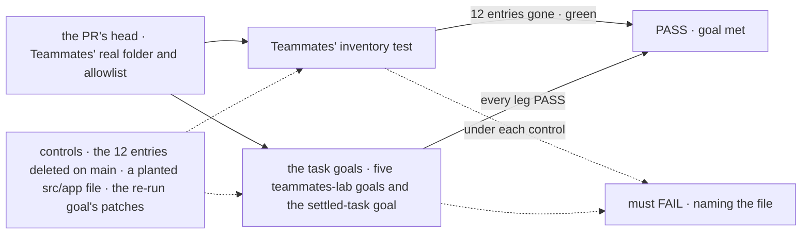
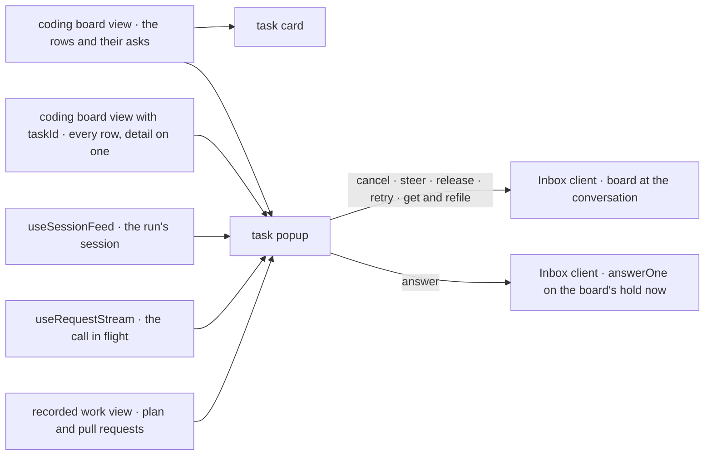

# FIX-2773 · Teammates' task cards

**Spec** · [Decisions](DECISIONS.md)

## Five people, before and after

| Someone who… | Today | After |
|---|---|---|
| **starts an app from Teammates and copies its task cards** | Copies 709 lines of watchers in `src/app/tasks.ts` and `runs.ts`, seven hand-written types, and a 900-line fake | Copies thin hooks over harness-manager's coding board and recorded work views and the `react` session hooks. A task's type is the view's `CodingBoardTask` |
| **opens a teammate's finished task** | Sees its answer, read from copies of the row in the conversation's items, which a long conversation may not have loaded | Sees the same answer, read for that one task while its popup is open ([D1](DECISIONS.md#d1)) |
| **re-runs a failed task on another harness** | The page sends a `getTask` action for the brief, then files the re-run | The re-run reads the brief whole through the Inbox client's `get`, the same `getTask` read the page sends today, now in the package; then files it the same way ([D1](DECISIONS.md#d1)) |
| **answers a run's question or review from a card** | Answers the hold the app cached at its last read | Answers the hold the board holds now, as claude-code-style does |
| **maintains harness-manager's views** | Has one consumer of the coding board view | Has two. A field Teammates needs goes on the view, not into the app |

## The goal, and how we'll know it's met

**Teammates' task cards and popups (board, run, review, recorded work, holds, actions, working
now) read only harness-manager's coding board and recorded work views, the `react` session hooks
and orchestration's Inbox client; the 12 `src/app/` allowlist entries below are gone; the fake's
task and run scenarios are cut and listed in the ledger; and every goal the task screens touch
passes.** The fake's own `gone` entry goes with the last Teammates child to merge ([B1](#boundaries-with-siblings), decided).

| Is it the right goal? | |
|---|---|
| **The real need** | The epic's row: "the second consumer of claude-code-style's task views", with "a ledger of the fake's scenarios, then the fake goes". The epic is done only when Teammates' allowlist is empty ([FIX-2683](../../epics/FIX-2683/SPEC.md#the-goal-and-how-well-know-its-met)) |
| **Smaller, and rejected** | Delete the client imports and the `.flow(` calls, and keep `BoardTask` as a screen type. The allowlist shrinks, and a second translation layer stays, which [FIX-2766](https://linear.app/fixpoint-labs/issue/FIX-2766)'s owner direction rules out |
| **Bigger, and not this issue's** | The conversation feed, talk, roster and window (FIX-2771, FIX-2772). Moving `appTaskOf`'s derivations into the view (FIX-2766). The review card's content ([FIX-2782](https://linear.app/fixpoint-labs/issue/FIX-2782)) |
| **Not done if** | any of the 12 `src/app/` entries is still on the allowlist · a task or run scenario is still in `test/fake-app.ts`, or is missing from the ledger · this issue merges last of FIX-2771, FIX-2772 and FIX-2773 and the fake's file or its `gone` entry is still there · a task row type is in `src/app/` or on the screen-type list · `tasks.ts` or `runs.ts` grows, or `src/app/` gains a file · a card or popup shows less than today: the answer, a cancel's reason, a PR's link after a steer, a run's question within the board's 1 s · `goals/task-board/a-settled-task-reaches-the-board` still calls the app's `watchTasks` · a second board view · claude-code-style's inventory goes red |



The inventory proves the read path is gone; the goals prove the cards still work through the views.

| How we verify | |
|---|---|
| **Goal check** | `pnpm --filter @flow-state-dev/teammates test` (the inventory test), and in `goals/teammates-lab/`: `a-coding-task-waits-for-your-review`, `a-pr-task-waits-for-its-merge`, `stops-and-re-runs-a-task-from-its-popup`, `tells-a-stopped-task-from-a-working-one`, `survives-a-crash-mid-turn`. Also `goals/task-board/a-settled-task-reaches-the-board` with its Teammates leg reading the lab's new path, and claude-code-style's `pnpm test`. Run by the implementer; verdict on the implementation PR |
| **Signal** | The inventory test green with the 12 entries deleted, and no task or run scenario left in the fake; every leg of each goal PASS. In the settled-task goal: the Teammates view shows a settled task within 1 s, and makes 0 board reads over 10 s while a reply streams |
| **Input** | Each goal's own held-out input; the scripted coder where the goal names it |
| **Anti-game** | Don't assert on a hook's return or a stubbed view: the inventory reads the source, and the goals read the page and the store. Don't drop a goal's control because its patch target moved: re-point it |
| **Control that must fail** | (1) On `main` with the 12 `src/app/` entries deleted, the inventory test fails naming each; the fake's `gone` entry stays, as it must until the last Teammates child. (2) A planted `src/app/task-row.ts` fails as a new read-model file. (3) `stops-and-re-runs-a-task-from-its-popup`'s `wrong-board` and `other-session` controls, re-pointed at the new code, must FAIL. (4) The settled-task goal's `whole-topic` control must FAIL its 0-reads signal |

## What changes

![Before and after. Before: the card and popup call src/app tasks.ts and runs.ts, which stitch four sources per row and build their own request stream, with seven types in the app and a 900-line fake. After: the card reads the coding board view; the popup reads one task's answer and brief through the same view, and the react session hooks and the recorded work view; actions and answers go through the Inbox client; tests use a stub server or the lab's host; 12 entries become 0, and the fake goes with the last Teammates child](figures/what-changes.svg)

The task screens read the views claude-code-style reads, and the app's stitching goes.

A card's read, and the view's new fields (illustrative; the implementer names them):

```diff
  // labs/teammates/src/components/Conversation.tsx
- const tasks = useWatch(adapter.watchTasks, sessionId) ?? [];
+ const tasks = useTasks(sessionId).value ?? [];        // useView(codingBoardViewRef(), { sessionId })
- {task.waiting?.prompt}
+ {task.asks[0]?.ask.prompt}
```

```diff
  // labs/teammates/src/components/Popups.tsx (a task's popup: where `task.result` is drawn today)
- const tasks = useWatch(adapter.watchTasks, popup.sessionId);
+ // useView(codingBoardViewRef(), { sessionId, taskId }): the full CodingBoardTask[], `detail` filled only on this task's row.
+ // It replaces the popup's own board watch; a card never calls it.
+ const tasks = useTaskDetail(popup.sessionId, popup.taskId).value;
  const task = tasks?.find((t) => t.id === popup.taskId);
- {task.result ? <MarkdownText text={task.result} /> : null}
+ {task.detail?.answer ? <MarkdownText text={task.detail.answer} /> : null}
```

```diff
  // packages/orchestration/src/inbox/client.ts (D1): the board's existing `getTask`, for a re-run's whole brief
  export type BoardActions = {
+   /** The task as the board's `getTask` reads it: its brief (context, labels, priority) whole. */
+   get(id: string): Promise<BoardTaskRead>;
```

```diff
  // packages/harness-manager/src/kit/coding-board.ts (D1)
- const codingBoardInputSchema = z.object({ sessionId: z.string().min(1) });
+ /** With `taskId`, the view still returns the full CodingBoardTask[], with `detail` filled only on the named row. Without it, `detail` is null on every row. */
+ const codingBoardInputSchema = z.object({ sessionId: z.string().min(1), taskId: z.string().min(1).optional() });
  const codingTaskSchema = listedTaskSchema.extend({
+   /** Only on the row the input's `taskId` names: what it came back with, cut as `getTask` cuts output. */
+   detail: z.object({ answer: z.string().nullable(), answerCut: z.boolean() }).nullable(),
-   /** Why its last attempt failed; only on a failed task. */
+   /** Why its last attempt failed, or the reason it was cancelled with; `null` otherwise. */
    error: z.string().nullable(),
```

What goes: `src/app/tasks.ts`'s `taskCalls` and its four sources, `src/app/runs.ts` whole (its
hooks move into `tasks.ts`, since `src/app/` may not gain a file), `TaskCalls` and `RunCalls` from
`AppCalls`, and `runFlows` and `openHolds` from `AppState`. The fake's task and run scenarios go,
each listed in the implementation PR's ledger ([B1](#boundaries-with-siblings)).

**Docs:** no user docs; Teammates is private. A changeset for `@flow-state-dev/harness-manager`
names the coding board view's `taskId` input, the row's `detail` and the wider `error`; one for `@flow-state-dev/orchestration` names `BoardActions.get` (D1); a patch one for `@flow-state-dev/engine` says a peer session's
read now hears its birth and delete, not each turn (the read-rate fix the settled-task goal
needed). Teammates' README is the last Teammates
child's (the epic's docs line).



## What stays as it is

- Every task screen's behaviour and copy: the card, the popup, the time signal, the actions row.
- `src/lib/task-presentation.ts`, `attention.ts`, `cleared.ts` and `status.ts`: screen code; they
  take `CodingBoardTask` in place of `BoardTask`.
- The review card (`components/flow-state/review-hold.tsx`) and what it draws. It reads the stop
  through harness-manager's `reviewDetail`, as today.
- `steps.ts` and its types ([B3](#boundaries-with-siblings)).

## What's already here, and the debt

| Already here | What this does with it |
|---|---|
| **The job: show a conversation's tasks.** Two ways: harness-manager's coding board view (claude-code-style's `useTasks`), and Teammates' `taskCalls`, which stitches the board's task-list view with row copies from items. Searched `taskListViewRef`, `codingBoardViewRef`, `watchTasks`, `boardCopies` in `labs/`, `packages/`, `goals/` | **Folds** the second into the first: this would otherwise stay the 2nd way |
| **The job: show a task's run.** Claude-code-style's `useTaskWork` over `useSessionFeed`, `useRequestStream` and the recorded work view; Teammates' `runCalls`, with its own request-stream store and topic read | **Folds** into the first |
| Harness-manager's `readSessionPullRequests`, a package direct read | **Reused** for a PR's link, as the popup reads it today: the whole run session, not one request. Claude-code-style reads the recorded work view by request instead; whether a steer's run loses the link there is the implementer's test, not this spec's |
| The epic's seam: "a row Teammates needs extends that view; no second board view" ([coordination seams](../../epics/FIX-2683/DECISIONS.md#coordination-seams)) | **Applied**: D1 |
| [FIX-2766](https://linear.app/fixpoint-labs/issue/FIX-2766)'s owner direction: screens read `CodingBoardTask` with `?.`; no translation type | **Applied** here. Its view derivations stay FIX-2766's; until they land, the screen calls `taskView` itself, as claude-code-style does |
| [FIX-2769 D1](../FIX-2769/DECISIONS.md#d1): a type leaving the allowlist for the screen-type list needs a reason | **Kept**: no type moves; each is deleted |
| [FIX-2628](https://linear.app/fixpoint-labs/issue/FIX-2628): answer the hold the board holds now | **Applied** to Teammates' answers |

| Adds | Existing piece considered | Why it doesn't fit / how composed |
|---|---|---|
| A `taskId` input on the coding board view, a `detail` (the answer) on the named row only, and `error` on a cancelled task | The answer on every row (Codex: unbounded board); the board's `getTask` action, which records a request | **Extends** the view (D1). Composed from `answerTextOf`, `getTask`'s cut, and the row the view already reads |
| `BoardActions.get(id)` on orchestration's Inbox client, for a re-run's whole brief | A server-side copy by source task: `createTask` has none, and `followUpOf` runs in the old task's session with its worker, the opposite of a re-run on another worker; the brief on the view's `detail`, which is cut | **Extends** the client with the board's existing `getTask` action, which returns `context` whole. The page sends this read today (`withBrief`); it moves into the package |
| Hooks `useTasks`, `useTaskWork` in Teammates' `tasks.ts` | Claude-code-style's same hooks | **Copies** them, by the epic's ER-7: FIX-2756 shares them |

| The debt | |
|---|---|
| **Removes** | Teammates' `taskCalls` and `runCalls` (about 600 of 709 lines); seven types; the row-copy merge across three sources; a hand-built request stream; the fake's task and run scenarios |
| **Adds** | An optional input and a nullable `detail` on a published view; one read method on a published client. A second copy of claude-code-style's task hooks, which FIX-2756 pulls into one place (ER-7) |
| **Leaves** | The fake's file and its `gone` entry, unless this issue merges last of the three ([B1](#boundaries-with-siblings)). `steps.ts`'s types (FIX-2772's) and the shared plumbing (the last child's) ([B2, B3](#boundaries-with-siblings)). `cleared.ts`'s and `attention.ts`'s "needs you", computed on the screen (the epic keeps it) |

**Net: down.** One of two ways to show a task goes; the view gains an optional input and a `detail`, and the Inbox client a `get`.

## Boundaries with siblings

All five were decided by the coordinator (2026-11-17), as engineering calls.

- **B1 · The fake. Decided by the coordinator (2026-11-17).** Fifteen test files use
  `test/fake-app.ts`; four are task tests. It implements all of `AppCalls`, so FIX-2771 and
  FIX-2772 must edit it when they remove their calls. Each Teammates child cuts its own scenarios
  and lists each in its PR's ledger (scenario to a test, or "dropped, because …"). This issue cuts
  the task and run scenarios. Whichever of FIX-2771, FIX-2772 and FIX-2773 merges last deletes the
  file and owns its `test/fake-app.ts · (file) · gone` entry. The coordinator amends the epic's row,
  which gave the whole fake to this issue.
- **B2 · Shared plumbing. Decided.** `AppCalls` (`calls.ts`), `AppState` (`state.ts`),
  `Unsubscribe` (`reads.ts`) and `Item` (`items.ts`) serve every job. Each child first removes its
  own fields from them; this issue removes `TaskCalls`, `RunCalls`, `runFlows` and `openHolds`. The
  last Teammates child to merge removes the four types and their entries.
- **B3 · `steps.ts`. Decided.** `SessionStep`, `StepRun` and `RunSummary` are used by
  conversations (t2), talk (t1) and a task's run (here). FIX-2772 owns them: it moves `steps.ts` to
  `src/lib/` and lists the three as screen types. This issue keeps calling `runSteps`, from
  wherever `steps.ts` is when it merges.
- **B4 · The provider. Decided.** Hooks need the client in context. Today `AppProvider` holds
  only `AppCalls`. The first Teammates child to merge builds the client in `main.tsx` and adds
  `client` and `pollIntervalMs` to `AppProvider`, as claude-code-style's `useAppContext`; the
  others use it. If that is this issue, it does both.
- **B5 · `workers.ts`. Decided.** Its `topic` import and `Activity` serve both the roster (t1)
  and activity (t2). FIX-2771 owns them, since it deletes `workers.ts`. Not this issue's.
- **The coding board view** is also changed by FIX-2766. Same file, no shared field: whichever
  lands second rebases.

## Sign off

**[The goal](#the-goal-and-how-well-know-its-met), at that size:** the task screens on the views
claude-code-style reads, 12 entries gone, the fake's task and run scenarios cut, every task goal
passing. If wrong: Teammates keeps a
second way to show a task, and the epic's allowlist can't empty.

**[The debt](#whats-already-here-and-the-debt), net down:** one of two task read paths goes; the
view gains a one-task input and the Inbox client a `get`. If wrong: the published view grows for one app's needs.

1. **[D1](DECISIONS.md#d1) · A task's answer comes on the open popup's board read, by `taskId`,
   never on every row; a re-run reads the brief whole through the Inbox client.** The one to weigh.
   If wrong: an open popup's board read carries one answer, and a re-run sends one read first.

Improvement · `labs/teammates` (src/app, components, tests), `packages/harness-manager` (the coding
board view), `packages/orchestration` (the Inbox client), two goals' Teammates legs · M (about 600 lines out, one view input in) · after FIX-2755 and
FIX-2769 (merged) · parallel with FIX-2771 and FIX-2772 (B1 to B4) ·
[Linear](https://linear.app/fixpoint-labs/issue/FIX-2773) · epic [FIX-2683](../../epics/FIX-2683/SPEC.md)
