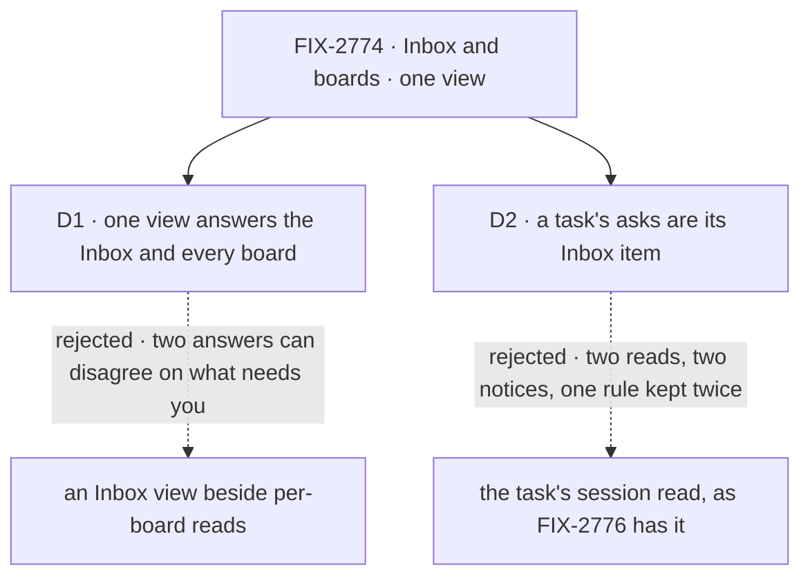

# FIX-2774 · Decisions

[Spec](SPEC.md) · **Decisions**

Two decisions are the sign-off. The epic fixes the rules: an answer across sessions is one read
on the server, and Shift Manager's Inbox and boards are one workforce user view
([ER-5](../../epics/FIX-2683/DECISIONS.md#who-owns-what), which this issue builds); the pending
asks are read at the source ([ER-6](../../epics/FIX-2683/DECISIONS.md#who-owns-what), FIX-2770's);
no legacy path (ER-3); `reads.ts` never grows (ER-4) and goes last (ER-8). What it left open: what
the one view answers, and whether a task's screen reads its asks from it. FIX-2770 left one more
here, how the view finds an ask's worker without hearing every turn; that is decided below.

## The tree

Solid edges are what you're signing. Dashed edges lost, and the label says why.

## D1 · One view answers the Inbox and every board, with each task's holds

| | |
|---|---|
| **Instead of** | An Inbox-only view (the asks and the tasks that hold you), with the Tasks board read per conversation through orchestration's task-list view, or through a second user view |
| **Because** | The Tasks board marks the rows that wait on you, the shift summary counts them, and the Inbox lists them. Today all three come from one snapshot. Two answers would each be right and could still disagree for a moment, or for good when one fails to load: the count-and-list rule ([FIX-1662 PLAN S3](../FIX-1662/PLAN.md)) broken across screens, which ER-5 exists to stop. The view already reads the whole ledger to find the tasks that hold you, so answering every row costs no second read. Per-board reads would also need the list of conversations, which only `sessions.list` gives, and it hears every turn on the user topic. Tenet 2: one view over pieces that exist (`userSuspensions`, the ledger, `inboxItems`, the roster) |
| **Locks in** | A public user view named `inbox` on workforce's roster flow, answering `{ items, tasks }`, and `inboxViewRef` in `@flow-state-dev/workforce/browser`. A host on the roster flow gets it with no setting. Its output is typed by the view, so Shift Manager holds no hand-written type for it (ER-2's L4) |

![D1, what the one workforce view answers. Chosen: the Inbox and every board, each task with its holds, in one view. Instead of: an Inbox view, with each board read on its own. It comes down to needs-you marks: in one view the count, the list and the board's marks can't disagree; with two reads they can. Price: any task row written re-sends the whole answer. Tie: the asks are read once either way. Locks in a public inbox view on the roster flow. Flips if one view run costs more than a second on a Lab with dozens of boards](figures/d1-one-answer.svg)

It comes down to needs-you marks: one answer can't disagree with itself; two can.

**What would change my mind:** the epic's own test, the view costing more than a second for a
user with dozens of conversations, or re-running often enough that leg c can't hold. Then the
view splits its `tasks` into a second view, and the board's marks read `items` alone.

## D2 · A task's asks are its Inbox item, read from the same view

| | |
|---|---|
| **Instead of** | What FIX-2776's merged spec has (*Decided, not asked*: "A task's asks come from its row's holds and the run session's pending suspensions, `deriveSuspensions` over the session's feed"), held equal to the Inbox by using one membership rule in both places |
| **Because** | The coordinator carried "a task's asks match the Inbox" here. Two reads can't promise it: the session feed hears `items` on the run's session, the view hears `suspension` on the user topic, so after an answer one moves before the other. `deriveSuspensions` also keeps an ask past its item's `expiresAt` until the sweep writes its end, so an expired ask can stay on the task's screen while the Inbox, whose read drops it at the deadline, has not listed it since. And the rule that groups an ask under a task (`inboxItems`: the row's holds, else the row's open run) would live in two places. Read from the view, the task's asks are its item's holds by construction. It costs nothing new to read: `useView` shares one read per view and input (`viewWatchIdentity`), and the sidebar count holds this one open on every screen |
| **Locks in** | Five sites in three of FIX-2776's files read the view (`TaskInspector`, `TaskSession`, `TaskFrame`), and, whatever D2's answer, three more are this issue's: the summary's two in `ShiftCoordinator` and `TaskInspector`'s Inbox link. FIX-2776's line for a task's asks is superseded by this one. Whichever of the two PRs merges second rebases |

![D2, where a task's screen reads the asks that wait on it. Chosen: its Inbox item, from the same view. Instead of: its run session's feed, as FIX-2776's spec has it. It comes down to whether they can differ: from one view they can't; from two reads they can after each answer, and for an expired ask until the run moves. Price: a task screen depends on the user-wide view. Tie: no extra request, the sidebar already holds the view. Locks in five sites in FIX-2776's files moved here. Flips if the task screen must draw an ask the Inbox doesn't list](figures/d2-task-asks.svg)

It comes down to whether they can differ: one view can't; two reads can, after every answer.

**What would change my mind:** a task screen that must show an ask the Inbox leaves out, such as
one in a flow that isn't a worker's. Then the task screen reads its session, FIX-2776's line
stands, and **task-equals-item** grades only worker flows.

## Decided, not asked

- **The view finds an ask's worker without hearing `run` on the user topic** (the constraint
  FIX-2770's spec left here). One `sessions.read` per distinct session an ask sits in reads its
  readonly `workerId`; it hears `run` and `state` on that session's topic only
  (`view-reads.ts`, `PEER_KINDS.identity`, `STATE_KINDS.session`). Never `sessions.list`, which
  hears `run` on the user topic (`PEER_KINDS.sessions`). The same read per board holder gives the
  board owner's label (its `workstreamId`, else `@<workerId>`), the flow its own questions answer
  through, and drops the rows of a conversation that is gone, as the snapshot's listed-session
  filter does.
- **Which asks are listed, and whose they are, is today's rule moved to the server.** The flow
  kinds are the worker flows: the inventory's `kind`s and the caller's own roster flows, read on
  the server (`readRosterEntries`, the inventory collection), never from input; the view takes
  none. An ask is kept and attributed exactly as `readAsks` does now: its session's own worker
  on that worker's flow, an unnamed worker on a worker flow, or a worker the inventory registers.
- **An ask with no conversation is listed.** It sits on a worker flow and waits on the user, so
  today's rule for "names no worker" lists it, unattributed. It answers through its flow and
  request, which is all `answerOne` uses. Its card has no *From the session* and no reply box.
  `InboxSuspension.sessionId` and its hold's source take `null` for it.
- **Every page is read.** `userSuspensions` answers 200 a page; the view follows `next` until
  `more` is false, under a ceiling that fails the view, never a shorter list (the count would lie).
  More than 50 worker flows fails the view with FIX-2770's message, shown as *Inbox didn't load*.
- **A failed read fails the whole view**, never a shorter list: an ask missing because a board
  didn't load would make the count wrong. The same rule as `inboxSection` today.
- **An ask's detail is the projection and its worker** (`InboxAsk`): the fields FIX-2770 projects,
  never `data`. A review's diff and verdict are read from the ask's session feed in the detail
  pane, as today. `expiresAt` becomes the hold's `due`.
- **The answer drops the refresh.** `AskCard` and the Inbox answer through orchestration's
  `answerOne` on the item's hold. The suspension notice re-runs the view, so `answer`, `settled`
  and the reads after an answer go. `answered`, which `Conversation.tsx` reads, goes with
  whichever of this issue and FIX-2776 merges second.
- **Refresh.** *as of · refresh* and `R` re-run the view on screen, as the epic's D2 says. The
  view keeps a 30 s poll for when push misses (`useView`'s `pollIntervalMs`), which leg d grades.
- **The one allowlist entry, and only it.** `lab-data.tsx`'s `settled`, re-derived by
  `poc/inbox-split/check.mjs`. Every type on the allowlist that these screens import (`Ask`,
  `BoardTaskView`, `ConversationBoards`, `PendingSuspension`, `RunLink`) is declared in `reads.ts`,
  which FIX-2777 deletes, and FIX-2775's roster still reads them: they stay FIX-2777's (ER-8).
  No new type is written in Shift Manager.
- **Changesets.** `@flow-state-dev/workforce` minor (the view), `@flow-state-dev/orchestration`
  minor (`sessionId: null`, `due`), `@flow-state-dev/shift-manager` minor (its screens read their
  own views, with the story for its sibling children).

## Considered and dropped

| Alternative | Why not |
|---|---|
| The view on a new flow of its own | The roster flow already answers the user's roster and declares the inventory at user scope with no session; a second flow is a second session per user |
| Find an ask's worker from its flow, with no session read | Several workers can share a worker flow (`doorOf` reads "every worker on one flow"), so the flow names no single worker |
| Stamp the worker on the suspension, so the projection carries it | A write in the engine for a workforce idea, which the engine never has (FIX-2770: "the engine has no notion of a worker") |
| Keep the 50-flow guard by reading in chunks of 50 | It works around a guard FIX-2770 set on purpose; no Lab near 50 worker flows is known |
| Put the view in orchestration beside `inboxItems` | The worker flows and the conversation ledger are workforce's |

## Settled

- **This issue's allowlist entry is exactly one, and all 70 have an owner** — **CONFIRMED** by
  `poc/inbox-split/check.mjs`: 70 entries, 32 · 21 · 16 · 1 (FIX-2776 · FIX-2777 · FIX-2775 ·
  this issue); PASS. `--control` plants an unclassified entry and an unclassified site: FAIL,
  exit 1. FIX-2776's checker is right on its own 32 and wrong on one other: `lab-data.tsx`'s one
  entry, `settled`, follows the answer call, which FIX-2776's spec leaves with this issue.
- **The snapshot census is 42 sites, 30 of them this issue's** — **CONFIRMED** by the same
  checker: 25, plus 5 that D2 moves; 8 FIX-2775's (`workerStates` and the roster's failures); 4
  FIX-2776's (`task.tsx`'s row read, `Conversation.tsx`'s `answered`).
- **A whole-ledger read in a user view hears every row written** — read in the code, not run: a
  host with any view publishes every resource write on its scope's topic
  (`createExecutionContext.ts`, `makeResourceChangeHandler`), and a user view's resource read is
  heard on the user topic (`view-reads.ts`, `ViewDependencies`). The implementation's first test
  writes a hold on a row from another session and sees the view re-run.

Run: `node specs/issues/FIX-2774/poc/inbox-split/check.mjs`.

## Analysis

2026-11-17 · watermark 2026-11-17 (FIX-2770 merged; FIX-2776's spec merged) · **Right approach,
with one change.** Run inline by the author: this session has no sub-agent tool, so the pass is
not independent. The coordinator can run a fresh one before the gate.

1. **Reuse** — every piece is composed: `userSuspensions`, `inboxItems`, `readRosterEntries`, the
   ledger, `useView`. The Adds are one view and two widened fields.
2. **Prior art** — harness-manager's coding board view composes `inboxItems` with a ledger the
   same way, for one conversation.
3. **Other shapes** — an Inbox view beside per-board reads (D1); per-session task asks (D2);
   chunked flow reads; a worker stamp in the engine (dropped).
4. **New factors** — FIX-2770 merged (#5361) with the worker-link constraint; FIX-2776's spec
   merged with the parity question handed here.
5. **Necessity** — yes: ER-5 names this issue as the builder.
6. **Ergonomics** — a screen calls `useView(inboxViewRef)`; another app gets the same answer.
7. **Concerns** — the view's re-run rate on a busy Lab (D1's mind-changer, leg c).

| Finding | Objective | Changes the approach? | Disposition |
|---|---|---|---|
| FIX-2776's checker gives `settled` to FIX-2777 | 1 | No | Settled; the checker change is named in SPEC.md's siblings table |
| The task screens' asks were planned per session | 7 | Yes | Folded: D2 |

## How it got here

- **Draft** — framed as the cross-session answer ER-5 names: one user view on the roster flow,
  composing FIX-2770's pending-asks read with the conversation ledger through orchestration's
  `inboxItems`; builds on harness-manager's coding board view pattern and FIX-2725's views.

**Open: none.**
