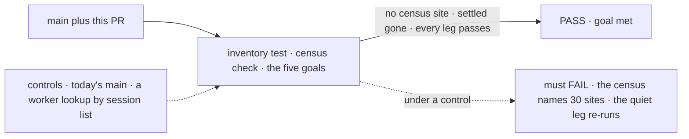
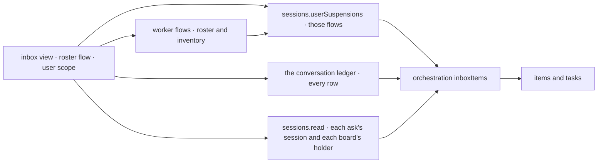

# FIX-2774 · Shift Manager's Inbox and boards

**Spec** · [Decisions](DECISIONS.md)

## Seven people, before and after

| Someone who… | Today | After |
|---|---|---|
| **has Shift Manager open while a worker stops to ask them** | Sees the Inbox count move after the whole Lab is read again: every worker session's asks, every board, the projects and the inventory | Sees it move when the one Inbox answer changes on the server, within the same second |
| **answers an ask in the Inbox** | Waits for a whole-Lab read after the answer, and another when the resumed run stops | Sees the item leave when the server records the answer; nothing else is read |
| **opens a task that waits on them** | Sees the task's asks and the Inbox's item for it from one snapshot, so they match | Sees them from one view, so they still match ([D2](DECISIONS.md#d2)) |
| **reads Tasks while a reply streams in another conversation** | Gets no re-read per streamed item | The same: a streamed reply, and a turn in a session that holds no ask and no board, re-run nothing |
| **has a worker ask from a run with no conversation** | Never sees it: the Inbox walks listed sessions only | **Open to the owner** ([Open](DECISIONS.md#open)). Recommended: sees it, from no named worker, and answers it; there is no conversation to open or reply into |
| **presses Retry on an Inbox that failed, or `R`** | Reads the whole Lab again | Re-runs the view on screen, and sees the server's reason when it fails again |
| **builds another app on workforce** | Has no read of what waits on a user across their sessions | Has the roster flow's `inbox` view, typed by its output ([D1](DECISIONS.md#d1)) |

## The goal, and how we'll know it's met

**Shift Manager's Inbox, its count, the Tasks board, the shift summary's needs-you numbers and
each task's asks read one workforce user view, built on the server from the pending-asks read
and the boards' holds; no screen this issue moves reads the snapshot's `inbox`, `asks` or
`boards` section; the answer's follow and its one allowlist entry are gone; and the Inbox and
task goals pass.**

| Is it the right goal? | |
|---|---|
| **The real need** | The epic's leg s and [ER-5](../../epics/FIX-2683/DECISIONS.md#who-owns-what): "an answer across sessions is one read on the server, never stitched in the client"; "Shift Manager's Inbox and boards are one workforce user view". This issue's row: "the Inbox, its count and the boards move onto it". The rule the snapshot existed for is kept: a count and its list never disagree ([FIX-1662 PLAN S3](../FIX-1662/PLAN.md)) |
| **Smaller, and rejected** | "The Inbox list and count only." The Tasks board's needs-you marks and the shift summary would then read a second answer, which can disagree with the first: the stitching ER-5 rules out. Or "the allowlist entry only": one entry, and every screen still on the snapshot |
| **Bigger, and not this issue's** | The roster's on-shift status and the TEAMS counts (`workerStates`: FIX-2775, which reads this view). One task's row and its actions (FIX-2776). Deleting `reads.ts`, the snapshot and its types (FIX-2777). Teammates' "needs you" (FIX-2756) |
| **Not done if** | A screen in the census's FIX-2774 rows still reads the snapshot's `inbox`, `asks` or `boards` · `lab-data.tsx`'s `settled` is on the allowlist · the view hears `run` on the user topic, or re-runs on a streamed reply · a task's asks on its screen differ from its Inbox item's · an ask is listed to another tenant's user, after it expired, or after it was answered · the count and the list disagree · Retry or `R` reads the snapshot instead of the view · `answered` stops moving while `Conversation.tsx` still reads it · a goal in the check fails, or a control in it doesn't |



The census reads the source and the goals read the page and the store, so neither passes while a
screen still draws the Inbox from the snapshot.

| How we verify | |
|---|---|
| **Goal check** | `pnpm --filter @flow-state-dev/shift-manager test -- inventory` with `lab-data.tsx`'s `settled` entry deleted; `node specs/issues/FIX-2774/poc/inbox-split/check.mjs` with this issue's expected sites set to 0; then `goals/shift-manager/`: `every-stop-is-one-inbox-item`, `a-coding-runs-question-is-answered-in-the-inbox`, `its-summary-changes-on-its-own`, `a-pr-task-waits-for-its-merge`, `it-shows-and-stops-a-task-run`. Model as each goal names. Run by the implementer; verdicts on the implementation PR |
| **Signal** | The inventory test and the census pass. Every goal passes. `its-summary-changes-on-its-own` grades the view's pushed value, not snapshot reads: **a** the count within 1 s of the ask; **b** no view run over a 10 s idle window; **c** a 200-item reply, and a turn started and finished in a worker session that holds no ask and no board, add no view run (FIX-2770's `c:quiet`, over this view's whole hearing); **d** the count within 31 s across processes. `every-stop-is-one-inbox-item` gains **task-equals-item**: for each of its six stops, the task screen's asks are its Inbox item's holds, before and after each answer; and **no-conversation**: a worker-flow run started with no session (`runAction`, `source: "system"`) stops for an approval, and the Inbox follows the owner's answer to [Open](DECISIONS.md#open): recommended, it lists the ask once, from no named worker, with no reply box, and answering it resumes the run (the other answer: it lists nothing). `its-summary-changes-on-its-own` gains **retry**: with the view's read refused once, the Inbox shows the server's reason, and Retry re-runs the view and lists the ask |
| **Input** | Each goal's own Lab and input. Leg c's quiet session is a worker conversation with no task and no ask |
| **Anti-game** | Grade the view's pushed value and the page, never a hook's return or a view unit test. A screen that reads the view and then filters the snapshot passes the goals but fails the census |
| **Control that must fail** | The census with expected sites 0 on today's main: FAILS, naming the 30 sites. `GOAL_CONTROL=hear-run`: the view finds an ask's worker through `sessions.list`, as `reads.ts` does in the browser: FAILS **c**. `GOAL_CONTROL=no-subscribe`, re-pointed at the view: FAILS **a**. `GOAL_CONTROL=session-only`: the view drops every ask with no session: FAILS **no-conversation** under the recommended answer |

The 30 sites and the one entry are re-derived by
[`poc/inbox-split/check.mjs`](poc/inbox-split/check.mjs), which classifies every allowlist entry
and every read of those sections in `src/`, and fails on one nobody named ([Settled](DECISIONS.md#settled)).
**A site is one token on one line**: a line that reads two of them, such as `TaskSession.tsx:48`
(`waitsOnYou` and `asksOfTask`), is two sites. The 30 sites are on 29 lines; the checker prints both.

## What changes


Left, five screens draw from a browser-built snapshot; right, they read one server answer, and
the per-session walk is struck through.

| Census sites (30) | What replaces them |
|---|---|
| `Inbox.tsx`: the list, the item at the route, the empty sentence, `answerOne` (6) | The view's `items`; orchestration's `answerOne` through the Inbox client, with no refresh after it. The section failure's Retry calls the view's `refresh()` and shows its `failure`, both new on `useView` (below), never `useLab().refresh` |
| `AskCard.tsx`: `answer` (1) | The same answer call on the item's hold. `lab-data.tsx`'s `answer`, `settled` and the refreshes after an answer go. `bump` and `answered` stay, bumped once when the answer lands, until FIX-2776 removes their one reader, `Conversation.tsx` ([siblings](#where-this-meets-its-siblings)) |
| `Sidebar.tsx`: the Inbox count and the Tasks count (3) | `items.length` and the open rows of the view's `tasks` |
| `Tasks.tsx`, `tasks.ts`: open rows, board owner, the summary line, the empty sentence (11) | The view's `tasks`, each with its board owner's label; the summary's Inbox part from `items` |
| `JumpTo.tsx`: every task (1) | The view's `tasks` |
| `ShiftCoordinator.tsx`: the summary's needs-you numbers and the Inbox link (2) | `items` and `tasks` from the view |
| `TaskInspector.tsx`, `TaskSession.tsx`, `TaskFrame.tsx`: the task's asks, whether it waits on you, its Inbox link (6) | The task's item in the view, by board and task id ([D2](DECISIONS.md#d2)) |

```diff
  // a Shift Manager screen
- const { snapshot } = useLab();
- const items = snapshot.inbox.ok ? snapshot.inbox.value : [];
+ const { value } = useView(inboxViewRef, {}, { pollIntervalMs: 30_000 });  // { items, tasks }
+ const items = value?.items ?? [];
- await answer(ask, { action: "approve" });       // then a whole-Lab read, and another when the run stops
+ await inbox.answerOne(item.holds[0], { approved: true });  // the view drops it on the suspension notice

  // @flow-state-dev/workforce: the roster flow's views
+ [INBOX_VIEW]: defineInboxView(installation)     // user scope, no session, no input
  // @flow-state-dev/workforce/browser
+ inboxViewRef                                    // typed by the view's output
+ type InboxView, InboxAsk                        // an item's detail: the projection and its worker

  // @flow-state-dev/react: UseViewResult
+ refresh(): void                                 // read again now: Retry, R, "as of · refresh"
+ failure?: { message: string; httpStatus?: number }  // why the last read failed, beside `stale`

  // @flow-state-dev/orchestration/inbox
- InboxSuspension.sessionId: string
+ InboxSuspension.sessionId: string | null        // a run with no conversation
+ InboxSuspension.due?: number                    // the ask's expiresAt, drawn as the hold's due
```

**Docs:** at release, `packages/shift-manager/README.md`'s Inbox, Tasks and summary sections say
each screen reads its own view, and what *as of · refresh* re-reads now;
`apps/docs/docs/shift-manager/overview.md` the same. `packages/workforce/README.md`'s roster
flow section names the `inbox` view. `packages/react/README.md`'s `useView` entry names
`refresh()` and `failure`. `apps/docs/docs/orchestration/task-board.md`'s Inbox part
names an ask with no conversation. No new page. This issue's changeset carries Shift Manager's
story to `/release-docs` for FIX-2776, FIX-2775 and FIX-2777 too, as the epic's docs line says.

## How it gets there



The view reads the worker flows off the roster and the inventory, never from its input, so the
read can't be widened ([ER-6](../../epics/FIX-2683/DECISIONS.md#who-owns-what)). It reads every
page of pending asks and the whole ledger, then one `sessions.read` per session an ask sits in or
a board is held by, for its worker, its flow and its board owner's label. Those reads hear that
session's topic only, never `run` on the user topic, which is the constraint FIX-2770 left here.
orchestration's `inboxItems` groups the asks under their tasks, as it does in the browser today
and in harness-manager's coding board view.

## What stays as it is

- What each screen shows and every word it uses. For an ask in a session, which asks are listed
  and whose worker they are follow today's rule in `reads.ts` (`readAsks`'s worker match on each
  listed session), moved to the server. An ask with **no** session is not covered by that rule:
  today's walk never reaches one. Whether it is listed is new behaviour, and it is the
  [Open](DECISIONS.md#open) question.
- `reads.ts`, the snapshot's `inbox`, `asks` and `boards` sections and their types. This issue
  removes readers and adds no line ([ER-4](../../epics/FIX-2683/DECISIONS.md#who-owns-what));
  FIX-2775's roster still reads them, and FIX-2777 deletes them
  ([ER-8](../../epics/FIX-2683/DECISIONS.md#who-owns-what)).
- The Inbox's answer route and orchestration's `answerOne`. FIX-2743's unauthenticated answer
  path, related, untouched.
- The Inbox detail's *From the session* and its reply box, which FIX-2776 moves onto the session
  hooks. A review's diff and verdict, which the projection never carries (`data`), come from the
  ask's session feed in the detail pane, as today.
- `deriveSuspensions` in `react`, for one conversation's inline asks.

## What's already here, and the debt

| Already here | What this does with it |
|---|---|
| **The job: what waits on this user, across their sessions.** One way does it, in the browser: `reads.ts`'s `readAsks` walk plus `inboxSection`, six sessions at a time. Searched `inboxItems(`, `userSuspensions(`, `listPendingForUser(` across `packages/` and `labs/` | **Replaced** by the view. The browser walk stays for FIX-2775's roster until FIX-2777 deletes it |
| FIX-2770's `sessions.userSuspensions` and its `suspension` notice (#5361) | **Builds on**: the view's one read of asks |
| orchestration's `inboxItems` (FIX-2133), the one place an Inbox item is built | **Reused** on the server, unchanged; two input fields widen |
| harness-manager's coding board view (FIX-2725 D2): `inboxItems` over one conversation's ledger, at user scope | **Pattern followed**, for every conversation at once. Not reused: it answers one conversation and coding rows only |
| `reads.ts`'s `inboxSection` (FIX-2133): today's merge of every board row (with its `holder`), the found asks and `flowOf` into `inboxItems`, failing whole when a board didn't load | **Lifted** into the view, not re-derived: the same row mapping, suspension mapping and `flowOf`, with the session list's flows replaced by the view's `sessions.read` answers. It is the merge the view must reproduce |
| workforce's roster view and `readRosterEntries`; the inventory collection the roster flow declares | **Reused** for the worker flow kinds, as `workerFlowNames` reads them in the browser |
| [FIX-2409](../FIX-2409/SPEC.md)'s live snapshot read and its goal `its-summary-changes-on-its-own` | **Superseded** for these screens: the goal is re-pointed at the view, its four legs kept |
| [FIX-1662 PLAN S3](../FIX-1662/PLAN.md): the count and the list from one snapshot | **Kept**, from one view |

| Adds | Existing piece considered | Why it doesn't fit / how composed |
|---|---|---|
| The roster flow's `inbox` view, `inboxViewRef` | The coding board view (one conversation); orchestration's task-list view (a session view per board); FIX-2725's worker sessions view | **Composes** `userSuspensions`, the ledger, `readRosterEntries` and `inboxItems` in one user view. The others answer one session, or list sessions and hear `run` |
| `InboxSuspension.sessionId: null`, `due` | `InboxSuspension` as it is | **Extends**: a projection row can have no session (only under the recommended answer to [Open](DECISIONS.md#open)), and carries `expiresAt`, which the hold's `due` already names |
| `UseViewResult.refresh()` and `failure` | The `LiveRead.refresh()` the watch already holds; `stale`, which says a read failed but not why | **Extends** `useView` (ER-1: a missing hook goes into `react`). Retry and `R` need a re-read now and the reason to show; Shift Manager's other screens on views get the same |

| The debt | |
|---|---|
| **Removes** | The Inbox's per-session walk from five screens; `lab-data.tsx`'s `answer`, `settled` and the refreshes after an answer; one allowlist entry; 30 snapshot reads |
| **Adds** | One public view and its ref: permanent by design. A whole-ledger read that re-runs the view on every task row written, and a `sessions.read` per board holder that re-runs it on a turn in that conversation: accepted, measured by leg c, and the epic's [D2](../../epics/FIX-2683/DECISIONS.md#d2) names when it flips |
| **Leaves** | The snapshot's three sections and the browser walk, for FIX-2775 and FIX-2777. Two views of a board row, this view's and orchestration's task-list view, which FIX-2776's task screen reads: one per job (every board, one board), both through `taskListEntriesFor` |

**Net: down.** A browser walk and its re-read loop go from five screens; the framework gains one
view over pieces it already has.

## Where this meets its siblings

| Seam | With | Decided |
|---|---|---|
| `Inbox.tsx` | FIX-2776 | FIX-2776 swaps `sendTurn`, `readSessionItems`, `flowUploader` and `askSessionOf`; this issue swaps what the list and the detail draw and the answer. Whichever merges second rebases (FIX-2776's spec, settled) |
| `AskCard.tsx` | FIX-2776 | The `Ask` type and the answer call are this issue's: the card takes the view's item detail. FIX-2776 changes its review-hold types only |
| A task's asks on `TaskInspector`, `TaskSession`, `TaskFrame`; the summary on `ShiftCoordinator` | FIX-2776 | Census rows marked D2, the summary's two and `TaskInspector`'s Inbox link: this issue's, read from the view. FIX-2776 moves the rest of those files. **This amends FIX-2776's merged spec**, whose *Decided, not asked* reads a task's asks per session: see [D2](DECISIONS.md#d2) |
| `answered` in `lab-data.tsx`, read by `Conversation.tsx` | FIX-2776 | `settled` goes here. `bump` and `answered` stay, bumped once when an answer lands, while `Conversation.tsx` reads them (its only reader). FIX-2776 deletes them with that read, since its live feed makes it unneeded. So neither merge order leaves a reader without a value |
| `workerStates` and the roster's counts | FIX-2775 | FIX-2775's, reading this view's `tasks` and `items` (the epic: "s2's sidebar counts read the view") |
| The allowlist split | FIX-2776's checker | Gives `lab-data.tsx` to FIX-2777 by file. Its one entry, `settled`, is this issue's. The checker needs a `bySymbol` override and FIX-2777's count 22 → 21; FIX-2776's own 32 is unchanged |

## Sign off

**[The goal](#the-goal-and-how-well-know-its-met), at that size:** five screens and a task's
asks on one view, the census at zero, the goals passing. If wrong: a needs-you number that
disagrees with the Inbox ships, and nobody owns it.

**[The debt](#whats-already-here-and-the-debt), net down:** the browser walk leaves five screens;
one view comes. If wrong: the view re-runs often enough on a busy Lab to cost more than the
snapshot did.

1. **[D1](DECISIONS.md#d1) · One view answers the Inbox and every board, with each task's holds,
   not an Inbox view beside per-board reads.** If wrong: every task row write re-sends the whole
   Inbox.
2. **[D2](DECISIONS.md#d2) · A task's asks are its Inbox item, read from the same view, not the
   task's session read beside it.** The one to weigh: it re-opens a call FIX-2776's merged spec
   made. If wrong: a task screen waits on the whole Inbox to draw one task's asks.

**[Open](DECISIONS.md#open) · An ask from a worker run with no conversation: list it, or leave it
out as today.** Recommended: list it. If wrong: the Inbox shows asks a person can answer but not
trace to a worker, or a run waits forever on a person who can't see it.

Improvement · `shift-manager`, `workforce`, `orchestration`, `react` · M (one view in, 30 screen sites
moved, one allowlist entry out) · blocked by FIX-2770 (merged #5361), FIX-2769 (merged) · blocks
FIX-2775, FIX-2777, FIX-2778 · [Linear](https://linear.app/fixpoint-labs/issue/FIX-2774)
