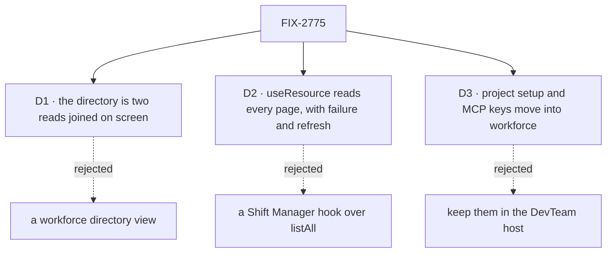

# FIX-2775 · Decisions

[Spec](SPEC.md) · **Decisions**

The calls this issue makes inside the epic's rules ([FIX-2683 ER-1 to ER-8](../../epics/FIX-2683/DECISIONS.md#who-owns-what)):
where the worker directory comes from, how a screen reads a whole collection, and who owns two
Lab contracts Shift Manager reads today from its test host.

## The tree

## D1 · The worker directory is two reads joined on the screen: the inventory, read whole, and the roster view

| | |
|---|---|
| **Instead of** | A workforce `directory` view on the roster flow that answers the organization's inventory and the user's own workers as one row type · or widening the roster view with the inventory's fields |
| **Because** | Both reads exist, are typed, and are kept current by scope: the inventory on the org topic, the roster view on the user topic. [ER-5](../../epics/FIX-2683/DECISIONS.md#who-owns-what) rules out an answer *across sessions* stitched in the client; this join is two scope reads, and the inventory rules already name its output a screen type ("a hook's output assembled from several reads", `test/inventory-settings.ts`). A new or wider view would change the roster surface Teammates and claude-code-style read, which is [FIX-2756](https://linear.app/fixpoint-labs/issue/FIX-2756)'s call ([ER-7](../../epics/FIX-2683/DECISIONS.md#who-owns-what)). Status and counts join that list with the Inbox view, the one answer FIX-2774 built, so the roster and the Inbox can't disagree |
| **Locks in** | One Shift Manager hook (`useWorkers` here) that every screen drawing a worker reads, and a worker type it computes, listed as a screen type with that reason. The join's rules are today's (`toWorker`, `workerNames`, `withRoster`), moved, not changed |

**What would change my mind:** two screens drawing one worker differently, or FIX-2756 finding
the starters join the same two reads. Then the join becomes a workforce view, in FIX-2756.

It comes down to who else is changed: two reads change nobody; a view changes the starters' surface.

## D2 · `useResource` reads a whole user or org collection and says why a read failed

| | |
|---|---|
| **Instead of** | A Shift Manager hook over `client.resource(...).listAll()` with its own `client.live` · keeping `useResource`'s first page of 200 · or a workforce view per collection |
| **Because** | [ER-1](../../epics/FIX-2683/DECISIONS.md#who-owns-what): a missing hook goes into `react`, never the app. An app live read imports the client's `topic`, which the inventory finds (`messages.ts` and `projects.ts` hold exactly that entry today). The first page silently drops rows past 200 on the message log, the projects and the inventory, which today's snapshot reads whole. `listAll()` already carries the page ceiling and the repeated-cursor stop `readEveryScopeEntry` copied, so the epic's "`readEveryScopeEntry` gives way to `listAll()`" lands in the hook every app uses. `failure` and `refresh()` are the two names `useView` gained in FIX-2774, for the same Retry and refresh keys |
| **Locks in** | Public API on `@flow-state-dev/react`, one changeset: `useResource(def, { all: true, topicPrefix })` at user or org scope, and `failure` and `refresh()` on its result. A notice that names entries still re-reads only those; one that names an entry not held reads the whole collection again |

**What would change my mind:** the owner wanting a screen to read one page at a time. Then the
message log and the projects page on the screen, and `all` isn't added.

It comes down to where the live read lives: in `react` once, or in the app, where the inventory finds it.

## D3 · The project setup view and the MCP keys route move from the DevTeam host into workforce

| | |
|---|---|
| **Instead of** | Leaving both in `teams/devteam/`, Shift Manager's test host, and listing Shift Manager's copies of their types (`ProjectSetup`, `McpServerKey`, `McpKeysRead`) as screen types · or a workforce ref to a view workforce doesn't define |
| **Because** | Shift Manager reads both on every Lab, but only its fixture serves them: on another Lab, a project's coordinator lookup fails and Settings shows no keys. Each reads data workforce owns: the project coordinator is workforce's installation (`installation.projectCoordinator()`), and the keys are workforce's `mcp-credentials/*` collection, whose header already says a host writes it through its own route. A hand-written type for another module's contract is what the allowlist exists to catch; relabeling it a screen type would empty the list without moving the read. `projects.ts`'s `viewRef` import (an L3 finding) goes with the typed ref |
| **Locks in** | Public API on `@flow-state-dev/workforce`, one changeset: the project setup view and its ref, and the MCP keys route adapter with its answer type. Every Lab on workforce can serve both; the DevTeam host imports them. The route keeps its rules: the caller is the verified user (BP-031), and no answer carries a key's value |

**What would change my mind:** the owner deciding both are DevTeam-only features. Then Shift
Manager reads nothing on other Labs and says so, and the three types are screen types with that
reason.

It comes down to what any Lab serves: today a project's coordinator and the keys page work only on the test host.

## Decided, not asked

- **The census is the done-state, not the allowlist alone.** 233 sites in 35 files, outside the
  four files FIX-2777 deletes, re-derived by `poc/directory-census/check.mjs` ([Settled](#settled)).
  Every site is this issue's: FIX-2774 and FIX-2776 have merged, and FIX-2777 only deletes.
- **The 16 entries, and only those**, by file: `messages.ts` (1), `projects.ts` (6),
  `routines.ts` (2), `usage.ts` (5), `mcp-credentials.ts` (2). The other 21 are FIX-2777's
  (`reads.ts`, `derive.ts`, `snapshot-subscribe.ts`).
- **Status keeps today's rule, from one answer.** A worker is on shift while it holds a running
  task or an ask in a session that names it. Both come from the Inbox view: `tasks` with their
  assignees resolved by `workerFor`, and `items`' suspension holds by `workerId`. An ask with no
  conversation counts for nobody, as FIX-2774 lists it. The convergence point is one function
  every status, count and dot reads (`workerStates` today), now taking the worker list and the
  view's value; no screen counts on its own.
- **The gate is workforce's `organization()`.** The identity read the client already makes,
  cached per client. A 401 or 403, or a Lab that serves no roster flow, is the refusal page;
  anything else is the unreachable page; the words are today's. A conversation's derived id
  reads it too, so `conversation.ts` stops reading `snapshot.orgId`.
- **Sessions come from `useSessionList({ includeDispatchRuns: true })`**, live on the user
  topic's `run`, as the snapshot's list was. A screen that needs one session by id reads it by id,
  as `SessionView` already falls back to.
- **Jump to's documents are one direct manifest read per worker flow**, through the first listed
  session of that flow, cached by flow as today. A manifest is a property of a flow, static per
  flow; the session is only its address, so this is not an answer across sessions.
- **Retry and R re-read what is on screen.** A section's Retry calls its hook's `refresh()`; R
  calls the refresh of the reads the page holds (the worker hook, the projects, the Inbox view).
  *as of · refresh* shows when the summary's reads last landed. Nothing calls `useLab().refresh`.
- **Routines, Usage and Messages stop re-reading on `readAt`.** Their views and the log are kept
  current by their own notices; a change a screen makes refreshes its own read. A 404 is read
  from `failure.httpStatus`, so `ClientHttpError` leaves those modules.
- **Types come from the package that owns the data**: the routine, usage, workstream and message
  types from their views' and collections' outputs; `Project` from the projects collection's
  client data, parsed by today's `toProject` (BP-030 rows still read). What the screen computes
  (the joined worker, a project with its progress) is a screen type with its reason.
- **`readEveryScopeEntry` goes from `reads.ts` too.** The snapshot's own inventory and projects
  reads call `listAll()` until FIX-2777 deletes them, so the function has no caller. `reads.ts`
  shrinks; ER-4 forbids only growth.
- **Helpers move, data doesn't.** Every `reads.ts` export a screen still imports (`Failure`,
  `describeFailure`, `Section`, `Worker`, `workerOf`, `workerNames`, `Project`,
  `ProjectVisibility`, `toProject`, `BoardTaskView`, the board refs and `GENERAL_TEAM`) moves to
  a screen module, so no file outside FIX-2777's four imports `reads.ts`. The census check is the
  test: any import left fails it.
- **Changesets.** `@flow-state-dev/react` minor (D2), `@flow-state-dev/workforce` minor
  (`organization()`, the definitions on `/browser`, D3), `@flow-state-dev/shift-manager` patch
  (the directory follows changes made elsewhere).

## Considered and dropped

| Alternative | Why not |
|---|---|
| Keep the snapshot for the directory alone | It is the read model the epic deletes ([D2](../../epics/FIX-2683/DECISIONS.md#d2)); FIX-2777 couldn't go |
| On-shift status from the worker sessions view | It hears `run` on the user topic, so a turn anywhere re-runs it, and it doesn't see asks; the Inbox view already holds both halves |
| Drop Jump to's documents group | A product change; the epic keeps every screen's behaviour |
| A workforce documents view | A new server read for a static, per-flow answer the manifest already gives |
| Split this issue in two (directory screens, then worker rows) | One hook serves both halves; the census is one total. The implementer may split the PR |

## Open / Settled

**Open:** none.

**Settled**

- **The census is 233 sites in 35 files, and the allowlist splits 16 · 21** — **CONFIRMED** by
  `poc/directory-census/check.mjs` on `origin/main` `b7d2f79f37`: 37 entries, every one
  classified; 233 sites on 195 lines (146 `snapshot`, 45 snapshot types, 26 `reads.ts` imports,
  16 `useLab()` snapshot fields). `--control` plants an unclassified entry and a site: FAIL, exit 1.
  `--built` on today's main: FAIL, naming the 233 sites and 16 entries. The one exemption,
  `routes.ts`'s location `snapshot`, is named in the checker with its reason.
- **`useResource` reads one page of a collection** — read in the code, not run:
  `packages/react/src/hooks/useResource.ts` lists with `limit: ENTRY_PAGE` (200), and nothing
  follows `nextCursor`.

Run: `node specs/issues/FIX-2775/poc/directory-census/check.mjs` (add `--control` or `--built`).

## Analysis

2026-11-19 · watermark 2026-11-19 (FIX-2774, FIX-2776 and FIX-2773 merged) · **Right approach.**
Run inline by the author: this session has no sub-agent tool, so the pass is not independent.
The coordinator can run a fresh one before the gate.

1. **Reuse** — the Inbox view, `useView`, `useSessionList`, the roster view, the existing views
   and collections. Extends: `useResource` (D2), the workforce client, `/browser`. Moves: D3.
2. **Prior art** — the epic's: each screen declares its read, none stitched.
3. **Other shapes** — a directory view (D1); an app hook (D2); keep the fixture contracts (D3).
4. **New factors** — FIX-2776 left `Conversation.tsx`'s `answered` read; taken here.
5. **Necessity** — yes: FIX-2777 can't delete while 233 sites read the snapshot.
6. **Ergonomics** — one option and two names on a hook every app already uses.
7. **Concerns** — size (L): 35 files. D3 widens workforce for one app's screens.

| Finding | Objective | Changes the approach? | Disposition |
|---|---|---|---|
| `useResource` reads one page; the snapshot read every page | 1 | Yes | Folded: D2 |
| The project setup view and the MCP route live in a fixture | 7 | Yes | Folded: D3 |
| `answered` outlived FIX-2776's live feed | 4 | No | Recorded: a seam, taken here |

## How it got here

- **Draft (2026-11-19)** — the directory is every snapshot reader the earlier children left:
  the worker list as two reads joined on screen, status from the Inbox view, whole collections
  through `useResource`, and the fixture's two Lab contracts moved into workforce; built on the
  epic's ER-1 and FIX-2774's view.
