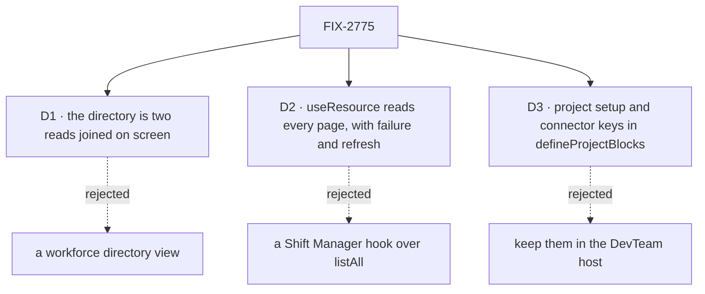

# FIX-2775 · Decisions

[Spec](SPEC.md) · **Decisions**

The calls this issue makes inside the epic's rules ([FIX-2683 ER-1 to ER-8](../../epics/FIX-2683/DECISIONS.md#who-owns-what)):
where the worker directory comes from, how a screen reads a whole collection, and who owns two
Lab contracts Shift Manager reads today from its test host.

## The tree

## D1 · The worker directory is the roster view plus the inventory, joined once per client; status reads the Inbox view's own attribution

| | |
|---|---|
| **Instead of** | A workforce `directory` view on the roster flow that answers the organization's inventory and the user's own workers as one row type · widening the roster view with the inventory's fields · or having the Inbox view hand out worker rows |
| **Because** | Both reads exist, are typed, and are kept current by scope: the inventory on the org topic, the roster view on the user topic. [ER-5](../../epics/FIX-2683/DECISIONS.md#who-owns-what) rules out an answer *across sessions* stitched in the client; this join is two scope reads, and the inventory rules already name its output a screen type ("a hook's output assembled from several reads", `test/inventory-settings.ts`). A new or wider view would change the roster surface Teammates and claude-code-style read, which is [FIX-2756](https://linear.app/fixpoint-labs/issue/FIX-2756)'s call ([ER-7](../../epics/FIX-2683/DECISIONS.md#who-owns-what)). **The Inbox view does not already hold this join.** It reads the inventory as `{ id, kind }` only and the roster as id-to-flow (`inventoryOf` and the view's block in `packages/workforce/src/workers/inbox-view.ts`): enough to pick the worker flows and stamp each ask's `workerId`, never a name, team, door or rules. Handing out rows from it would make every screen that draws a worker re-run on every task row written, which the Inbox view hears (FIX-2774's debt row). So the client does not repeat a server join: status takes the `workerId` the Inbox view already computed for each ask, and the directory rows come from the two reads |
| **Locks in** | One Shift Manager hook (`useWorkers` here) that every screen drawing a worker reads, and a worker type it computes, listed as a screen type with that reason. **One shared inventory read and one roster read per client**, as `roster.ts` shares one roster watch today (a provider or a client-keyed `WeakMap`, the implementer's call), so N screens never mean N `listAll()` reads on one org notice. The join's rules are today's (`toWorker`, `workerNames`, `withRoster`), moved, not changed |

**What would change my mind:** two screens drawing one worker differently, or FIX-2756 finding
the starters join the same two reads. Then the join becomes a workforce view, in FIX-2756.

It comes down to who else is changed: two reads change nobody; a view changes the starters' surface.

## D2 · `useResource` reads a whole user or org collection and says why a read failed

| | |
|---|---|
| **Instead of** | A Shift Manager hook over `client.resource(...).listAll()` with its own `client.live` · keeping `useResource`'s first page of 200 · or a workforce view per collection |
| **Because** | [ER-1](../../epics/FIX-2683/DECISIONS.md#who-owns-what): a missing hook goes into `react`, never the app. An app live read imports the client's `topic`, which the inventory finds (`messages.ts` and `projects.ts` hold exactly that entry today). The first page silently drops rows past 200 on the message log, the projects and the inventory, which today's snapshot reads whole. `listAll()` already carries the page ceiling and the repeated-cursor stop `readEveryScopeEntry` copied, so the epic's "`readEveryScopeEntry` gives way to `listAll()`" lands in the hook every app uses. `failure` and `refresh()` are the two names `useView` gained in FIX-2774, for the same Retry and refresh keys |
| **Locks in** | Public API on `@flow-state-dev/react`, one changeset: `useResource(def, { all: true, topicPrefix })` at user or org scope, and `failure` and `refresh()` on its result. `failure` is `useView`'s `ViewReadFailure`, the same type, not a copy; a `CollectionReadStoppedError` (a repeated cursor, past the page ceiling) reaches it with a readable message. Under `all`: a notice that names ids reads those ids and merges them in, held or new (the message log is append-only, so a new message is one entry read, never a `listAll()`); a full re-list happens only on a notice with no ids, a gap, or a failed entry read. `withNamedEntries`' `held.length >= ENTRY_PAGE` rule is a first-page rule and does not apply under `all`. With `topicPrefix`, the live read's paths narrow to that prefix, so a project's workstreams hear only their own project |

**What would change my mind:** the owner wanting a screen to read one page at a time. Then the
message log and the projects page on the screen, and `all` isn't added.

**Amendment (2026-11-19, Jake).** That change of mind happened, for the message log only.
The log reads one page at a time: the newest page first, and older pages as the reader
scrolls. `all` stays for bounded collections (projects, the worker inventory). Under `all`,
a notice with no ids, a missed-notice gap, or a failed entry read diffs the collection
manifest (each entry's storage key and version, no values) and reads only the entries that
are new or changed. It does not `listAll()`. [FIX-2845](https://linear.app/fixpoint-labs/issue/FIX-2845).

Message ids are `msg_` plus random bytes, so storage-key order is not time order.
Newest is each entry's `at`. A key sorted newest-first would show a random page.

It comes down to where the live read lives: in `react` once, or in the app, where the inventory finds it.

## D3 · `defineProjectBlocks` serves the project setup view and the connector keys route, moved from the DevTeam host

| | |
|---|---|
| **Instead of** | Leaving both in `packages/shift-manager/teams/devteam/` (`projectSetupView` in `host.mts`, `mcpCredentialsAdapter`, `statusOf` and `MCP_CREDENTIALS_PATH` in `mcp-credentials.mts`) and listing Shift Manager's copies of their types (`ProjectSetup`, `McpServerKey`, `McpKeysRead`) as screen types · standalone workforce exports a host wires by hand · or a workforce ref to a view workforce doesn't define |
| **Because** | Workforce owns both contracts: the project coordinator is its installation (`installation.projectCoordinator()`, `projects/project-coordinator.ts`), and the keys are its `mcp-credentials/*` collection (`projects/mcp-credentials.ts`), whose prefix is public surface, whose header already says a host writes it through its own route, and whose route must take the caller from the verified principal (BP-031). Today a Lab that isn't DevTeam answers 404, which Shift Manager already reads as no keys (`{ none: true }`) or no coordinator; the case is not that screens fail, but that a contract workforce owns is defined in a test host, and Shift Manager hand-writes its types. **Inside `defineProjectBlocks`, not beside it**, the way `checkRepository` ships: `labs/claude-code-style/flows/projects.mts` builds its projects flow from `defineProjectBlocks` and has no project setup, so standalone exports would leave it, and every host like it, without the view. The keys route takes the same offered-server list the blocks already take, so a host never keeps two lists. **It converges with [FIX-2615](https://linear.app/fixpoint-labs/issue/FIX-2615)** ([#5010](https://github.com/fixpoint-labs/flow-state-dev/pull/5010)): [FIX-2645](https://linear.app/fixpoint-labs/issue/FIX-2645) renames the MCP vocabulary to connectors, so every public name here is a connector name now, and FIX-2645's Teammates lab imports this route rather than serving a copy of Shift Manager's (its ER-2: one key reader) |
| **Locks in** | Public API on `@flow-state-dev/workforce`, one changeset. `ProjectBlocksOptions.projectCoordinator?: () => string \| null`; the blocks' `views` always carry the project setup view, answering `{ projectCoordinator: null }` when the option is absent, with a typed ref on `/browser`. The blocks also return the connector keys route as an inbound transport adapter beside `views`, built from the blocks' offered servers, with its answer type (`ConnectorKeyStatus`: `{ name, setAt }`) and its path constant (`CONNECTOR_KEYS_PATH`) on `/browser`; working names, every one in connector vocabulary. It extends `projects/mcp-credentials.ts` (the collection, `mcpCredentialProblem`, the prefix) and `projects/project-coordinator.ts`, never a parallel module. The stored prefix `mcp-credentials/` does not move here; whether it does is FIX-2645's, with its stored-key migration. The principal is resolved as the projects flow (`PROJECTS_FLOW`), under the route's own name as the envelope's action, a constant documented as a label no action answers to, replacing DevTeam's made-up `RESOLVE_AS` action. No answer carries a key's value. DevTeam imports both and keeps neither |

**What would change my mind:** the owner deciding both are DevTeam-only features. Then Shift
Manager reads nothing on other Labs and says so, and the three types are screen types with that
reason. Or FIX-2645 landing its rename first: then this uses its final names.

It comes down to who owns the contract: workforce owns the coordinator and the keys collection, so it owns the view and the route.

## Decided, not asked

- **The census is the done-state, not the allowlist alone.** 233 sites in 35 files, outside the
  four files FIX-2777 deletes, re-derived by `poc/directory-census/check.mjs` ([Settled](#settled)).
  Every site is this issue's: FIX-2774 and FIX-2776 have merged, and FIX-2777 only deletes.
- **The 16 entries, and only those**, by file: `messages.ts` (1), `projects.ts` (6),
  `routines.ts` (2), `usage.ts` (5), `mcp-credentials.ts` (2). The other 21 are FIX-2777's
  (`reads.ts`, `derive.ts`, `snapshot-subscribe.ts`).
- **Status keeps today's rule, from one answer.** A worker is on shift while it holds a running
  task or an ask in a session that names it. Both come from the Inbox view: `tasks` with their
  assignees resolved by `workerFor`, and `items`' suspension holds by `workerId`. An ask with no
  conversation counts for nobody, as FIX-2774 lists it. The convergence point is one function
  every status, count and dot reads (`workerStates` today), now taking the worker list and the
  view's value; no screen counts on its own.
- **The gate is workforce's `organization()`.** The identity read the client already makes,
  cached per client. A 401 or 403, or a Lab that serves no roster flow, is the refusal page;
  anything else is the unreachable page; the words are today's. A conversation's derived id
  reads it too, so `conversation.ts` stops reading `snapshot.orgId`.
- **Sessions come from `useSessionList({ includeDispatchRuns: true })`**, live on the user
  topic's `run`, as the snapshot's list was. A screen that needs one session by id reads it by id,
  as `SessionView` already falls back to.
- **Jump to's documents are one direct manifest read per worker flow**, through the first listed
  session of that flow, cached by flow as today. A manifest is a property of a flow, static per
  flow; the session is only its address, so this is not an answer across sessions.
- **Retry and R re-read what is on screen.** A section's Retry calls its hook's `refresh()`; R
  calls the refresh of the reads the page holds (the worker hook, the projects, the Inbox view).
  *as of · refresh* shows when the summary's reads last landed. Nothing calls `useLab().refresh`.
- **Routines, Usage and Messages stop re-reading on `readAt`.** Their views and the log are kept
  current by their own notices; a change a screen makes refreshes its own read. A 404 is read
  from `failure.httpStatus`, so `ClientHttpError` leaves those modules.
- **Types come from the package that owns the data**: the routine, usage, workstream and message
  types from their views' and collections' outputs; `Project` from the projects collection's
  client data, parsed by today's `toProject` (BP-030 rows still read). What the screen computes
  (the joined worker, a project with its progress) is a screen type with its reason.
- **`readEveryScopeEntry` goes from `reads.ts` too.** The snapshot's own inventory and projects
  reads call `listAll()` until FIX-2777 deletes them, so the function has no caller. `reads.ts`
  shrinks; ER-4 forbids only growth.
- **Helpers move, data doesn't.** Every `reads.ts` export a screen still imports (`Failure`,
  `describeFailure`, `Section`, `Worker`, `workerOf`, `workerNames`, `Project`,
  `ProjectVisibility`, `toProject`, `BoardTaskView`, the board refs and `GENERAL_TEAM`) moves to
  a screen module, so no file outside FIX-2777's four imports `reads.ts`. The census check is the
  test: any import left fails it.
- **Three PRs, in this order, by default.** D2 (`react`) in its own PR; D3 and the rest of the
  workforce surface (`organization()`, the definitions on `/browser`) in its own PR; then the
  screen migration, which depends on both and is the PR that proves the census. Package API is
  reviewed apart from the 35-file screen change.
- **Two checks, two questions.** The inventory test enforces that the allowlist only shrinks;
  the census enforces zero snapshot sites. Neither answers the other's question, so the goal
  check runs both.
- **Changesets.** `@flow-state-dev/react` minor (D2, in its PR), `@flow-state-dev/workforce` minor
  (`organization()`, the definitions on `/browser`, D3, in its PR), `@flow-state-dev/shift-manager`
  patch (the directory follows changes made elsewhere).

## Considered and dropped

| Alternative | Why not |
|---|---|
| Keep the snapshot for the directory alone | It is the read model the epic deletes ([D2](../../epics/FIX-2683/DECISIONS.md#d2)); FIX-2777 couldn't go |
| On-shift status from the worker sessions view | It hears `run` on the user topic, so a turn anywhere re-runs it, and it doesn't see asks; the Inbox view already holds both halves |
| Drop Jump to's documents group | A product change; the epic keeps every screen's behaviour |
| A workforce documents view | A new server read for a static, per-flow answer the manifest already gives |
| Split the screen migration in two (directory screens, then worker rows) | One hook serves both halves; the census is one total. The package PRs split off instead |

## Open / Settled

**Open:** none.

**Settled**

- **The census is 233 sites in 35 files, and the allowlist splits 16 · 21** — **CONFIRMED** by
  `poc/directory-census/check.mjs` on `origin/main` `b7d2f79f37`: 37 entries, every one
  classified; 233 sites on 195 lines (146 `snapshot`, 45 snapshot types, 26 `reads.ts` imports,
  16 `useLab()` snapshot fields). `--control` plants an unclassified entry and a site: FAIL, exit 1.
  `--built` on today's main: FAIL, naming the 233 sites and 16 entries, under a banner that says
  a FAIL before the implementation is expected. `--simulate-built` drops the 16 entries and every
  site from the tree it reads, the finished state: PASS, exit 0, so the goal check can pass. The one exemption,
  `routes.ts`'s location `snapshot`, is named in the checker with its reason.
- **`useResource` reads one page of a collection** — read in the code, not run:
  `packages/react/src/hooks/useResource.ts` lists with `limit: ENTRY_PAGE` (200), and nothing
  follows `nextCursor`.

Run: `node specs/issues/FIX-2775/poc/directory-census/check.mjs` (add `--control`, `--built` or
`--simulate-built`).

## Notes from review

Recorded for the implementer, verbatim in substance; not folded into the design.

- **Cursor, `topicPrefix`:** "The `topicPrefix` option is the only piece I'd watch for
  over-generalization; if it's only messages/projects today, saying 'only where today's patterns
  need filtered topics' might keep the public API smaller (not sure that's true — flagging as
  *maybe*)." Today a project's workstreams are its one user; keep the option no wider than that.
- **Cursor, the checker:** "A shared parameterized runner would be simpler *maintainability*
  later; I wouldn't block this spec on that. … any new exemption should come with a spec line."

## Analysis

2026-11-19 · watermark 2026-11-19 (FIX-2774, FIX-2776 and FIX-2773 merged) · **Right approach,
with one change.** The author ran the first pass inline (no sub-agent tool in that session). The
coordinator then ran an **independent** pass, which found one thing the inline pass missed and
which the coordinator verified: standalone D3 exports would leave claude-code-style's projects
flow (`labs/claude-code-style/flows/projects.mts`, built from `defineProjectBlocks`) without the
view. D3 now ships inside `defineProjectBlocks`.

1. **Reuse** — the Inbox view, `useView`, `useSessionList`, the roster view, the existing views
   and collections. Extends: `useResource` (D2), the workforce client, `/browser`,
   `defineProjectBlocks`, `projects/mcp-credentials.ts` and `projects/project-coordinator.ts` (D3).
2. **Prior art** — the epic's: each screen declares its read, none stitched.
3. **Other shapes** — a directory view, or worker rows from the Inbox view (D1); an app hook
   (D2); keep the fixture contracts, or export them standalone (D3).
4. **New factors** — FIX-2776 left `Conversation.tsx`'s `answered` read; taken here. FIX-2615's
   open epic spec (#5010) renames MCP to connectors and planned a second key route (D3).
5. **Necessity** — yes: FIX-2777 can't delete while 233 sites read the snapshot.
6. **Ergonomics** — one option and two names on a hook every app already uses.
7. **Concerns** — size (L): three PRs, the packages first. D3 widens workforce, inside the blocks
   every projects flow already builds from.

| Finding | Objective | Changes the approach? | Disposition |
|---|---|---|---|
| `useResource` reads one page; the snapshot read every page | 1 | Yes | Folded: D2 |
| The project setup view and the MCP route live in a fixture | 7 | Yes | Folded: D3 |
| Standalone D3 exports leave claude-code-style's projects flow without the view (independent pass) | 1 | Yes | Folded: D3 inside `defineProjectBlocks` |
| `answered` outlived FIX-2776's live feed | 4 | No | Recorded: a seam, taken here |

## How it got here

- **Draft (2026-11-19)** — the directory is every snapshot reader the earlier children left:
  the worker list as two reads joined on screen, status from the Inbox view, whole collections
  through `useResource`, and the fixture's two Lab contracts moved into workforce; built on the
  epic's ER-1 and FIX-2774's view.
- **Review round 1 (2026-11-19)** — D3 moved inside `defineProjectBlocks` beside
  `checkRepository`, in connector vocabulary, converging with FIX-2615 so FIX-2645's Teammates
  lab imports the route instead of copying it (independent analysis; architect review). D1 now
  says why the Inbox view doesn't already hold the directory join, and locks one shared read per
  client (Cursor). D2's live rule reads named ids and merges them under `all`, reuses
  `ViewReadFailure`, and narrows to `topicPrefix` (second look). The package PRs split off by
  default. The census check's `--built` mode can now pass (Greptile).
