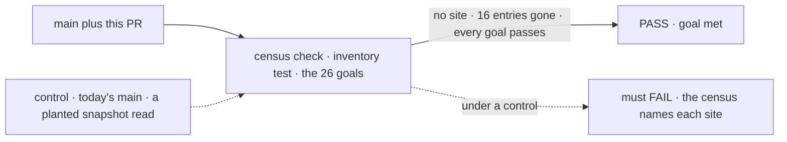
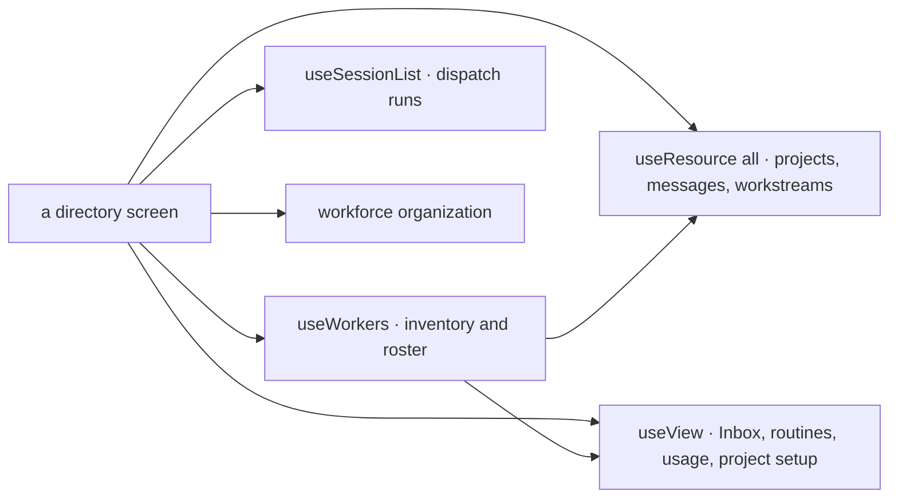

# FIX-2775 · Shift Manager's directory

**Spec** · [Decisions](DECISIONS.md)

## Seven people, before and after

| Someone who… | Today | After |
|---|---|---|
| **watches Roster or the sidebar's TEAMS while a worker picks up a task or stops to ask** | Sees the status move after a whole-Lab read, and can see the Inbox list an ask before the worker's row shows it | Sees the status move when the Inbox view does: the roster and the Inbox draw from one answer, so they agree |
| **hires a worker, or sees another tab add a project** | Sees it after the next whole-Lab read | Sees it when the roster or the projects read hears the change |
| **has Routines or Usage open while a worker changes a routine or a run reports usage** | Sees the change only on the next whole-Lab read | Sees it when the view changes |
| **opens a Lab that refuses them, or can't be reached** | Gets the refusal or the unreachable page from the snapshot's first read | Gets the same page and the same words, from the organization read |
| **presses Retry on a failed directory section, or R** | Reads the whole Lab again | Reads again what that section, or the screen, shows, and sees the server's reason if it fails again |
| **works on a Lab with more than 200 messages, projects or workers** | Sees every one | Sees every one ([D2](DECISIONS.md#d2)) |
| **builds another app on `react`** | Has no hook that keeps a whole user or org collection current and says why a read failed | Has `useResource(def, { all: true })`, with `failure` and `refresh()` ([D2](DECISIONS.md#d2)) |

## The goal, and how we'll know it's met

**Every Shift Manager screen still on the snapshot reads through package views, direct reads and
hooks instead: the connection gate, the sidebar's TEAMS, PROJECTS and counts, Roster, Jump to, a
project, Messages, Routines, Usage, Settings, and the worker rows and sessions on every other
screen. No file outside the four that FIX-2777 deletes reads the snapshot or imports `reads.ts`;
the directory's 16 allowlist entries and `readEveryScopeEntry` are gone; and every Shift Manager
goal passes.**

| Is it the right goal? | |
|---|---|
| **The real need** | The epic's leg s and [ER-1](../../epics/FIX-2683/DECISIONS.md#who-owns-what): Shift Manager reads what the server computes through views, direct reads and package hooks, with an empty allowlist. This issue's row: "organization, inventory, roster, projects, documents, routines, usage, rules and messages read through direct reads and existing views; `readEveryScopeEntry` gives way to `listAll()`; its sidebar counts read the Inbox view" |
| **Smaller, and rejected** | "The 16 entries only." The census below would keep 233 snapshot sites, and FIX-2777 could not delete the snapshot without moving screens itself, against [ER-8](../../epics/FIX-2683/DECISIONS.md#who-owns-what). Or "the named screens only": the worker rows on FIX-2776's screens were carried to this spec by FIX-2776, and nobody else owns them |
| **Bigger, and not this issue's** | Deleting `lab-data.tsx`'s snapshot, its re-read, `reads.ts`, `derive.ts`'s snapshot types and `snapshot-subscribe.ts` (FIX-2777). The connection bar's health once the snapshot read is gone (FIX-2777, inside `lab-data.tsx`). A directory view the starters share (FIX-2756) |
| **Not done if** | the census finds a site · one of the 16 entries is on the allowlist, or moved to the screen-type list with no reason · `readEveryScopeEntry` exists · a screen's Retry or R reads the snapshot · a worker's status disagrees with the Inbox for the same ask · a list stops at 200 rows · the refusal or unreachable page loses its words · a goal of Shift Manager fails, or a control in it doesn't |



The census reads the source and the goals read the page and the store, so neither passes while a
screen still draws from the snapshot.

| How we verify | |
|---|---|
| **Goal check** | `node specs/issues/FIX-2775/poc/directory-census/check.mjs --built` (`--simulate-built` shows this passes on the finished state); `pnpm --filter @flow-state-dev/shift-manager test -- inventory` with the 16 entries deleted; then every goal under `goals/shift-manager/` (26): the sidebar is on every page, so every goal touches the directory. Model as each goal names. Run by the implementer; verdicts on the implementation PR |
| **Signal** | The census prints 0 sites and 0 entries for this issue. The inventory test passes. Every goal passes. Two legs are new: `it-shows-who-is-on-shift` gains **one answer** (a worker stops for an approval; the Inbox lists it and the worker's row reads on shift in the same view update, and both clear when it is answered), and `its-summary-changes-on-its-own` gains **directory live** (a routine paused and a project added from another session show on Routines and in PROJECTS within 2 s, with no snapshot read) |
| **Input** | Each goal's own Lab and input. The directory-live leg uses a second client as the same user |
| **Anti-game** | Don't grade a hook's return or a view's unit test. A screen that reads a view and then the snapshot passes the goals and fails the census. A list cut at one page passes a small Lab, so the hook's own test reads a 450-entry collection |
| **Control that must fail** | The census with `--built` on today's main: FAILS, naming the 233 sites and 16 entries, under a banner that says this is expected before the implementation. `--control` plants an entry and a site: FAILS. `GOAL_CONTROL=status-from-snapshot` keeps the roster's status on the snapshot's walked asks: FAILS **one answer** |

The 233 sites and the entry split are re-derived by
[`poc/directory-census/check.mjs`](poc/directory-census/check.mjs), which classifies every
allowlist entry and fails on one nobody named ([Settled](DECISIONS.md#settled)). A site is one
token kind on one line, outside the four files FIX-2777 deletes. The inventory test enforces that the allowlist only shrinks; the census enforces zero snapshot sites; the goal check runs both.

## What changes


Left, the screens draw from one browser-built snapshot; right, each reads its own package read,
and the snapshot has no reader left.

| Census sites (233) | What replaces them |
|---|---|
| `App.tsx`: the gate, R, the screens' props (30) | workforce's `organization()` for the gate: a 401 or 403, or a Lab with no roster flow, is the refusal, anything else unreachable, in today's words. R re-reads the reads the page holds |
| The worker directory: `Sidebar.tsx`, `Roster.tsx`, `roster.ts`, `tasks.ts`, `WorkerSettings.tsx` (44) | One Shift Manager hook joins the inventory, read whole, with the roster view ([D1](DECISIONS.md#d1)). Status and counts come from the Inbox view's `items` and `tasks`, as FIX-2774 left them to this issue |
| Worker rows and sessions on other screens: `ShiftCoordinator`, `Inbox`, `TaskFrame`, `TaskInspector`, `Tasks`, `SessionView`, `TaskBoardMeta`, `Conversation`, `conversation.ts` (87) | The same worker hook; react's `useSessionList` with dispatch runs for the sessions a screen finds; `organization()` for a conversation's derived id. `Conversation.tsx`'s `answered` read goes with the line it shares, since its feed is live (FIX-2776) |
| Projects, workstreams and documents: `Project.tsx`, `projects.ts`, `JumpTo.tsx` (44) | `useResource(def, { all: true })` on the shared and private projects and on a project's workstreams by prefix; `useView` on the project setup view ([D3](DECISIONS.md#d3)) and the workstream report; Jump to's documents from one direct manifest read per worker flow, cached by flow |
| Their own reads: Messages, Routines, Usage, Settings, rules, a document (20) | `useResource(..., { all: true })` on the message log; `useView` on the routines, harness usage and worker usage views, typed by their outputs; the connector keys route from workforce ([D3](DECISIONS.md#d3)). None re-reads on `readAt` |
| Helpers from `reads.ts` in seven other files (8) | Every `reads.ts` export a screen still imports moves to a screen module: `Failure`, `describeFailure`, `Section`, `Worker`, `workerOf`, `workerNames`, `Project`, `ProjectVisibility`, `toProject`, `BoardTaskView`, the board refs (`conversationBoardRef`, `collectionOfBoard`, `CONVERSATION_BOARD_COLLECTION`) and `GENERAL_TEAM`. `readEveryScopeEntry`, `createLabReader`, `LabReader` and `LabSnapshot` go with their callers. So FIX-2777 deletes four files and edits none |

```diff
  // a Shift Manager screen
- const { snapshot } = useLab();
- const workers = snapshot.inventory.ok ? snapshot.inventory.value.workers : [];
+ const { workers, failure, refresh } = useWorkers();      // inventory, read whole, joined with the roster view
- readEveryScopeEntry(client, "user", WORKER_MESSAGES_PATTERN)  // with its own client.live and topic import
+ const log = useResource(workerMessagesResource, { all: true });  // every page, kept current
- useRoutines(snapshot.readAt)                              // client.view once per Lab read
+ const routines = useView(routinesView, {});

  // @flow-state-dev/react: useResource, at user or org scope
+ useResource(def, { all: true, topicPrefix? })            // every page through listAll()
+ UseScopeCollectionResult.failure?: ViewReadFailure      // useView's own type
+ UseScopeCollectionResult.refresh(): void                 // and on a single resource

  // @flow-state-dev/workforce
+ WorkforceClient.organization(): Promise<string>          // the identity it already reads, once
+ workerInventoryResource, projectsResource, privateProjectsResource, workerMessagesResource  // on /browser
  // workforce: defineProjectBlocks, moved from Shift Manager's DevTeam host (D3); working names
+ defineProjectBlocks({ mcpServers, checkRepository, projectCoordinator? })
+   .views.projectSetup                                    // always; { projectCoordinator: null } when absent
+   .connectorKeys                                         // the key route's adapter, same offered servers
+ projectSetupView, ConnectorKeyStatus, CONNECTOR_KEYS_PATH  // on /browser
```

**Docs:** at release, `packages/react/README.md`'s `useResource` entry names `all`,
`topicPrefix`, `failure` and `refresh()`; `packages/workforce/README.md` names
`organization()`, the four collection definitions on `/browser`, and what `defineProjectBlocks`
now serves: the project setup view and the connector keys route. FIX-2774's changeset carries Shift Manager's own story; this issue's adds that the
directory screens follow changes made elsewhere. No new page.

## How it gets there



Every read is kept current by its own notices, so nothing re-reads on a whole-Lab clock. The
worker hook and the status helpers are the only joins left on the screen, and they join two
scope reads and one view, never a per-session walk ([ER-5](../../epics/FIX-2683/DECISIONS.md#who-owns-what)).

## What stays as it is

- What each screen shows and every word it uses. Who is on shift follows today's rule in
  `derive.ts` (a running task, or an ask in a session that names the worker), drawn from the
  Inbox view.
- `lab-data.tsx`'s snapshot, its re-read, `reads.ts`, `derive.ts`'s snapshot types and
  `snapshot-subscribe.ts`. This issue removes every reader and adds no line
  ([ER-4](../../epics/FIX-2683/DECISIONS.md#who-owns-what)); FIX-2777 deletes them. It may shrink
  `reads.ts`: `readEveryScopeEntry` goes, and the snapshot's own reads use `listAll()`.
- The writes: hire and edit through workforce's client, routine pauses and deletes, standing rules,
  a project's writes, a connector key's set and clear. The stored key prefix `mcp-credentials/`
  (FIX-2645 decides whether it moves).
- The DevTeam fixture host as a Lab; it builds both from `defineProjectBlocks` and keeps neither.

## What's already here, and the debt

| Already here | What this does with it |
|---|---|
| **The job: read every entry of a user or org collection, kept current.** Mechanism rows `collection`, `push-delivery`, `react`. Four ways: `readEveryScopeEntry` here (with an app `client.live`), the client's `listAll()` (once), `useResource` (live, first page only), `useResourceCollectionList` (session collections, by page). Searched `listAll(`, `readEveryCollectionPage(`, `useResource(`, `client.live(` across `packages/` and `labs/` | **Replaced and extended**: `useResource` reads every page through `listAll()`; `readEveryScopeEntry` goes. Three ways remain, one per need: once, live, live by page |
| **The job: the worker directory.** The inventory collection (org), workforce's roster view (user), joined here by `roster.ts`'s shared watch; the Inbox view joins the same two on the server for its own rows | **Kept as reads, joined by one hook** ([D1](DECISIONS.md#d1)) |
| FIX-2774's Inbox view (`inboxViewRef`), its `items` and `tasks` | **Reused** for on-shift status and counts, as FIX-2774 handed over |
| react's `useSessionList` (`includeDispatchRuns`), `useView` with `failure` and `refresh()` (FIX-2774) | **Reused**; `useResource` gains the same `failure` and `refresh()` |
| workforce's `routinesView`, `workerUsageView`, `workstreamReportView`; harness-manager's `harnessUsageViewRef` | **Reused**, read live instead of once per Lab read |
| workforce's client, which reads the roster flow's identity once (`orgOf`) | **Extended**: `organization()` exposes it |
| The DevTeam host's `projectSetupView` (`teams/devteam/host.mts`) and `mcpCredentialsAdapter`, `statusOf`, `MCP_CREDENTIALS_PATH` (`teams/devteam/mcp-credentials.mts`), which Shift Manager reads on every Lab | **Moved** into `defineProjectBlocks` ([D3](DECISIONS.md#d3)) |
| workforce's `projects/mcp-credentials.ts` (the keys collection, `mcpCredentialProblem`) and `projects/project-coordinator.ts` | **Extended** by the route and the view; no parallel module |
| [FIX-2615](https://linear.app/fixpoint-labs/issue/FIX-2615)'s open epic spec ([#5010](https://github.com/fixpoint-labs/flow-state-dev/pull/5010)): connectors, and a key route planned for the Teammates lab | **Converges**: connector names now; FIX-2645's Teammates lab imports this route ([D3](DECISIONS.md#d3)) |
| [FIX-2409](../FIX-2409/SPEC.md)'s "moving around costs no reads"; [FIX-1662 PLAN S3](../FIX-1662/PLAN.md)'s one snapshot | **Retired** for these screens by the epic's [D2](../../epics/FIX-2683/DECISIONS.md#d2); a count and its list still come from one answer |

| Adds | Existing piece considered | Why it doesn't fit / how composed |
|---|---|---|
| `useResource`'s `all`, `topicPrefix`, `failure`, `refresh()` | `useView`'s `failure` and `refresh()`; the client's `listAll()`; `useResourceCollectionList` | **Extends** `useResource` with `listAll()` and `useView`'s two names ([D2](DECISIONS.md#d2)). The list hook pages a session collection by hand |
| `WorkforceClient.organization()` | The client's private `orgOf`; `client.flow(ROSTER_FLOW).identity()`, an L3 finding in an app | **Extends** the client: the read it already makes |
| Four collection definitions on `workforce/browser` | `PROJECTS_PATTERN`, `WORKER_MESSAGES_PATTERN` and the inventory pattern as bare strings | **Extends** `/browser` with the definitions workforce already has, so a read is typed by its client data |
| The project setup view and the connector keys route, served by `defineProjectBlocks` | The DevTeam host's copies; standalone exports; `checkRepository`'s view in the same blocks | **Extends** `defineProjectBlocks` as `checkRepository` does, so every projects flow built from it serves both, claude-code-style's included ([D3](DECISIONS.md#d3)) |
| `useWorkers` in Shift Manager | A workforce directory view | **Composes** two reads ([D1](DECISIONS.md#d1)) |

| The debt | |
|---|---|
| **Removes** | 233 snapshot sites; `readEveryScopeEntry`; `roster.ts`'s shared watch; `messages.ts`'s and `projects.ts`'s own live reads; the `readAt` re-reads in Messages, Routines, Usage and a project; 16 allowlist entries; Shift Manager's dependence on a fixture host's contracts |
| **Adds** | Four names on `useResource`, one client call, four exported definitions, one view and one route moved into a package: permanent by design. The worker join stays Shift Manager code ([D1](DECISIONS.md#d1)), which FIX-2756 weighs |
| **Leaves** | The snapshot and its modules, now unread, for FIX-2777. The connection bar still counts the snapshot read until FIX-2777 rewires it. Jump to's documents from per-flow manifests, read through one listed session each |

**Net: down.** The browser-built read model loses its last readers and an app live loop goes; the
packages gain the reads it stood in for.

## Where this meets its siblings

| Seam | With | Decided |
|---|---|---|
| The snapshot and its modules | FIX-2777 | Every reader goes here, every import of `reads.ts` outside its four files too; FIX-2777 deletes the four and edits none |
| Status and counts from the Inbox view | FIX-2774 | This issue's: FIX-2774 handed over `workerStates` and the roster's counts. `lab-data.tsx`'s interim note goes with them |
| `Conversation.tsx`'s worker rows and `answered` | FIX-2776 | Worker rows were carried here. `answered` was left after FIX-2776's live feed landed; it goes here with the line it shares, and `noteAnswered` with it |
| Teammates' and claude-code-style's roster | FIX-2756 | Unchanged. The worker join is named for FIX-2756 ([ER-7](../../epics/FIX-2683/DECISIONS.md#who-owns-what)) |

## Sign off

**[The goal](#the-goal-and-how-well-know-its-met), at that size:** every remaining screen off the
snapshot, the census at zero, the 16 entries gone, every goal passing. If wrong: FIX-2777 finds
a reader nobody owns, and moves screens itself.

**[The debt](#whats-already-here-and-the-debt), net down:** the read model's last readers and an
app live loop go; four hook names, a client call and two moved contracts come. If wrong: the
worker join drifts between screens before FIX-2756 looks at it.

1. **[D1](DECISIONS.md#d1) · The worker directory is two reads joined on the screen, not a new
   workforce view.** If wrong: Shift Manager keeps a join the server could own.
2. **[D2](DECISIONS.md#d2) · `useResource` reads a whole collection and says why a read failed,
   not an app hook over `listAll()`.** If wrong: three public names on a hook for one app's lists.
3. **[D3](DECISIONS.md#d3) · `defineProjectBlocks` serves the project setup view and the
   connector keys route, moved from the DevTeam host.** The one to weigh: every projects flow then
   serves both, and FIX-2645's Teammates lab imports the route. If wrong: a route and a view in a
   package for one app's screens.

Improvement · `shift-manager`, `react`, `workforce` · L (233 screen sites in 35 files, 16
allowlist entries out, four hook names in), as three PRs: `react` (D2), `workforce` (D3 and the
client), then the screens · blocked by FIX-2774 (merged #5445), FIX-2769
(merged) · blocks FIX-2777, FIX-2778 · [Linear](https://linear.app/fixpoint-labs/issue/FIX-2775)
