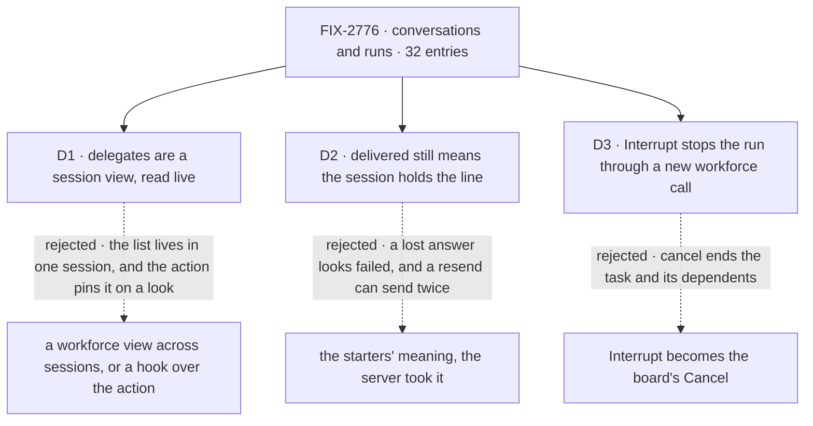

# FIX-2776 · Decisions

[Spec](SPEC.md) · **Decisions**

Three decisions are the sign-off. The epic fixes the rules: screens read only through package
views, hooks and calls ([ER-1](../../epics/FIX-2683/DECISIONS.md#who-owns-what)), the allowlist
only shrinks ([D3](../../epics/FIX-2683/DECISIONS.md#d3)), no legacy path (ER-3), and `reads.ts`
never grows (ER-4). What it left open: the delegate list's shape, what *delivered* means once the
composer reads live, and where Shift Manager's missing calls go.

## The tree

Solid edges are what you're signing. Dashed edges lost, and the label says why.

## D1 · The delegate list is a view on the conversation's own session, read live

| | |
|---|---|
| **Instead of** | The two shapes the epic named: a workforce user view across sessions (the shape for an answer read across sessions), or a package hook that runs the `listDelegates` action |
| **Because** | The list is one conversation's: it lives in that session's state, and the panel reads one session at a time. So the epic's own test picks per session. A hook over the action would still be an action per look, which writes the list the first time it reads it and hears nothing afterwards: the panel misses an add the coordinator's own tool makes. A session view on the worker flow is what harness-manager's recorded work view already is: typed by its output, read with react's existing `useView`, kept live by the server. It needs no new hook. It computes the same records and the same per-delegate check as the action, without the first-read write a view can't make; what it shows is the list the session holds, or would copy in now if it never has, which is what a task filed now and the conversation's next post route to. Tenet 2: one existing hook, no new concept |
| **Locks in** | A public view named `delegates` on every flow that carries a worker's delegates, and `delegatesViewRef(flow)` in `@flow-state-dev/workforce/browser`. A host app with its own worker flow gets the view with the actions. The `listDelegates` action and tool stay, for hosts, tests and models |

It comes down to the coordinator's own add: the view shows it, a look through the action misses it.

**What would change my mind:** a screen that lists delegates across several conversations at
once. Then the list is an answer across sessions, and ER-5 makes it one workforce user view.

## D2 · *Delivered* still means the session holds the line, read live

| | |
|---|---|
| **Instead of** | The meaning claude-code-style and Teammates use: workforce's `send` resolves when the server takes the line, the box clears, and a failed turn shows in the conversation with Retry |
| **Because** | The epic keeps every screen's behaviour ([D2](../../epics/FIX-2683/DECISIONS.md#d2)), and a goal holds this one (`it-sends-a-turn-into-a-worker-session`: "says *delivered* only once it is there"). The difference shows when an answer is lost: today Shift Manager says *unconfirmed, check before sending again* and never offers a resend, so a person can't send a line twice by accident. Under "took it" a lost answer reads as failed and invites one. The cost of keeping it falls: the polls in `send.ts` become two live reads the screen already holds, the session's feed (the line is there) and workforce's session turns view (the turn completed, stopped on an ask, or failed with its reason) |
| **Locks in** | Shift Manager's composer keeps a screen-side check the starters don't have, so FIX-2756 can't share it as-is: it either adopts this meaning for all three apps or keeps two. workforce's `send` answers `{ requestId }` so the screen can match the line and the turn |

It comes down to a lost answer: today it warns against resending; "took it" invites a double send.

**What would change my mind:** the owner wanting one composer meaning across all three apps now,
before FIX-2756. Then Shift Manager takes the starters' meaning here, and the goal's words change.

## D3 · Interrupt stays a stop of the run, through a new workforce call; every other missing call goes into its package

| | |
|---|---|
| **Instead of** | Turning Interrupt into the board's Cancel, as claude-code-style's task screen does, which adds nothing to any package |
| **Because** | Cancel ends the task and cancels the tasks that wait on it. Interrupt stops this run and keeps the task, with its run link unchanged, to be retried or steered: a goal grades both (`it-shows-and-stops-a-task-run`, legs **cancel** and **the request reads aborted first**). ER-1 says a missing call goes into the package that owns the data, never the app. workforce's client already stops every turn of a session (`stopTurns`) and retries one request by id (`retryTurn`); stopping one by id is the same path. The other gaps follow the same rule: `send` takes the task id and answers the request id, `upload` goes through the worker's flow, `addDelegate` and `removeDelegate` compose the existing actions, `useRequestStream` reports when the request ended, and orchestration exports the types of the items it writes |
| **Locks in** | Public API, one changeset: `WorkforceClient.stopRun`, `upload`, `addDelegate`, `removeDelegate`, `send`'s `taskId` and `{ requestId }` answer; `UseRequestStreamResult.completedAt`; orchestration's item value types on `/tasks`. Every app on workforce gets them, and they stay through 1.0 |

It comes down to what a person loses: Cancel ends the task and its dependents; a stop keeps it.

**What would change my mind:** the owner deciding a task screen needs only Cancel, as
claude-code-style's has. Then Interrupt goes, `stopRun` isn't added, and the goal's leg is retired
with that reason.

## Decided, not asked

- **The 32 entries, and only those.** Re-derived from the real allowlist by
  `poc/allowlist-split/check.mjs` ([Settled](#settled)). The other 38 are FIX-2777's (22: the
  snapshot, `reads.ts`, `derive.ts`) and FIX-2775's (16: messages, projects, routines, usage,
  MCP keys), by file.
- **The delegates view's convergence point.** One function computes each delegate's description
  and what it takes, for the action, the tool and the view. **The view never writes, and this
  issue adds no write and moves none.** What pins the list stays as it is: its first change, its
  first read through the `listDelegates` action or tool, or the coordinator's first post (which
  reads the list when it opens). A task-board action reads it without writing (`taskDelegates`),
  and `delegates: all` is never pinned by a read, only by a change (FIX-2081 D2). The
  implementation PR tests that a view read leaves the session's list unwritten.
- **A running post routes to the roster it started with; the panel shows the next one's.** For a
  `delegates: all` coordinator, a post keeps the defaults it read when it opened
  (`postStateOf` → `post.defaults`) for every delivery of that request, while the view re-runs
  when the roster changes. So while one post is routing, the panel can show a worker hired
  mid-post that this post won't reach; the next post will. That is FIX-2081 D2's rule ("the
  roster as it stands, read per call") and today's behaviour: the panel's action read used the
  roster at the moment of the look too. The view only shows it sooner. Engineering call: the
  panel shows what the conversation routes to from now on; no extra wording, and no change to
  routing.
- **`send` decides the task id, not the screen.** It sends `taskId` only where the session's door
  takes one, reading that from the worker inventory, so no screen reads the inventory to send. The
  door is always `respond` (`workerDoorOf`), so the target names no door.
- **Interrupt's word comes from the record.** `stopRun` aborts through the session's own flow,
  and a request already ended is no failure. The screen draws *interrupted* only when the run's
  live status reads `aborted` (FIX-1664's rule).
- **Upload by worker.** A project Stream's first line has no session yet, so `upload` takes the
  worker and goes through its flow, whose sign-in the send runs.
- **First-line files.** The composer moves the draft's files with its text when the draft key
  changes, the rule it already applies to the text. The fix is in Shift Manager's composer; the
  ui registry's `useAttachments` is unchanged.
- **The task row reads orchestration's task-list view** on the conversation that holds the board,
  as `conversation-tasks.ts` already does. Not the coding board view: Shift Manager's boards hold
  non-coding tasks too.
- **A task's asks** come from its row's holds (the task-list view) and the run session's pending
  suspensions (`deriveSuspensions` over the session's feed, one session).
  *Superseded by [FIX-2774 D2](../FIX-2774/DECISIONS.md#d2) (2026-11-17): the five task-ask
  sites in `TaskInspector`, `TaskSession` and `TaskFrame` read FIX-2774's `inbox` view, and are
  FIX-2774's to move.*
- **Goal controls follow the code.** Controls that swap `src/lib/run.ts` or `src/lib/send.ts`
  move to the module that replaces each, and must still fire.
- **No new file layout.** Where Shift Manager's hooks live is the implementer's; ER-8's file map
  is Teammates'. The board id `tasks` comes from a package export if there is one, else a screen
  constant, never `reads.ts`.

## Where this meets its siblings

Settled by the coordinator before review, and recorded in
[SPEC.md → Where this meets its siblings](SPEC.md#where-this-meets-its-siblings--decided): the
`Inbox.tsx` call sites are this issue's; `AskCard`'s `Ask` and answer call stay with FIX-2774; a
task's asks matching the Inbox goes to FIX-2774's spec; worker rows from the roster view go to
FIX-2775's spec; `send` has one contract with FIX-2772 (the client sets the request id, `send`
returns it); the task row reads the task-list view.

## Considered and dropped

| Alternative | Why not |
|---|---|
| Keep `sendTurn` and `interruptRun`, moved into a Shift Manager `src/app/` | ER-1: still a screen reaching the server; the inventory finds them wherever they live |
| A Shift Manager hook that polls the run's record, as today | A second way to follow a request beside `useRequestStream`, and an L3 finding |
| Upload through the Lab-wide route, as claude-code-style does | On a Lab that signs in only on its worker flows, the file is held for nobody the send can name |
| Take `TaskChangeKind` from `@flow-state-dev/orchestration/internal` | An app importing a package's internals; the inventory would pass while ER-1 doesn't |
| Split delegates into their own issue | One entry pair; the conversation screens read it, and the epic put it here |

## Settled

- **The 32 entries are exactly this issue's, and all 70 have an owner** — **CONFIRMED** by
  `poc/allowlist-split/check.mjs` on `e9078619`: 70 entries, 32 · 22 · 16 by owner; PASS. Its
  controls FAIL with exit 1: `--control` plants an unclassified entry, `--duplicate` repeats one. Run:
  `node specs/issues/FIX-2776/poc/allowlist-split/check.mjs`.

## Analysis

2026-11-17 · watermark 2026-11-17 (the epic's analysis) · **Right approach.** Run inline by the
author: this session has no sub-agent tool, so the pass is not independent. The coordinator can
run a fresh one before the gate.

1. **Reuse** — every Adds row extends or composes an existing piece (`stopTurns`, `send`, the
   delegates module, `useRequestStream`); none is new. See
   [Builds on / Adds](SPEC.md#whats-already-here-and-the-debt).
2. **Prior art** — claude-code-style already reads this way (FIX-2628, FIX-2757); this issue
   applies it with the three calls it lacks.
3. **Other shapes** — the epic's two delegate shapes (D1); the starters' send (D2); Cancel for
   Interrupt (D3).
4. **New factors** — FIX-2769 merged today (#5351); #5357 (FIX-2779) edits Shift Manager's
   DevTeam host only, no overlap.
5. **Necessity** — yes: without it Shift Manager's allowlist can't empty.
6. **Ergonomics** — a screen calls `useView` and `workforce.*`; no new concept.
7. **Concerns** — `Inbox.tsx` edited by two children in parallel (settled: see the siblings section).

| Finding | Objective | Changes the approach? | Disposition |
|---|---|---|---|
| A view can't pin the delegate list on first read | 1 | No | Recorded: shows what pinning would write (Decided, not asked) |
| `Inbox.tsx` is edited by this issue and FIX-2774 | 7 | No | Recorded: settled in SPEC.md, siblings section |

## How it got here

- **Draft** — framed as the conversation, coordinator, session and task screens' 32 allowlist
  entries; replaced by react's session hooks, a delegates session view and five workforce client
  calls; builds on FIX-2757's hooks and FIX-2725's views.

**Open: none.**
