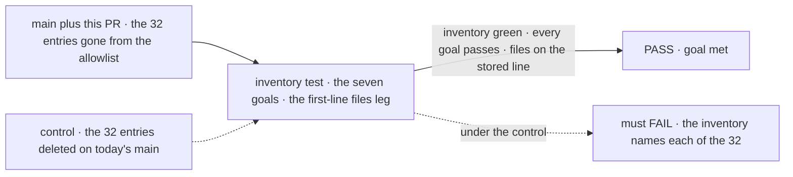
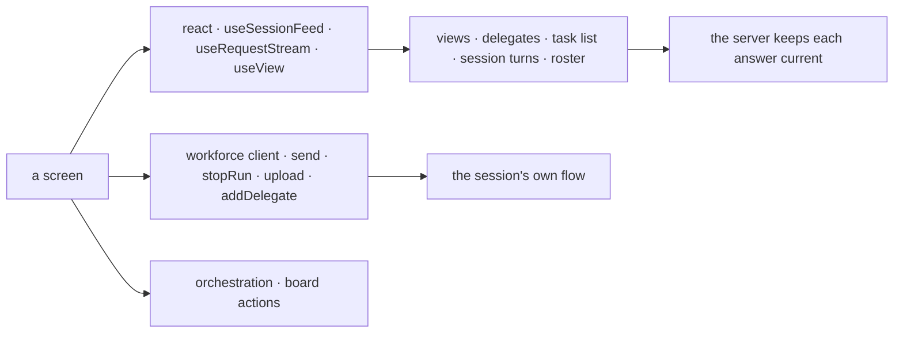

# FIX-2776 · Shift Manager's conversations and runs

**Spec** · [Decisions](DECISIONS.md)

The rules this issue obeys are the epic's: [FIX-2683 ER-1, ER-2, ER-3, ER-4 and ER-8](../../epics/FIX-2683/DECISIONS.md#who-owns-what),
and [D3](../../epics/FIX-2683/DECISIONS.md#d3)'s shrink-only allowlist. This spec settles what
the epic left to it: the delegate list's shape, what *delivered* means once the composer reads
live, and where the calls Shift Manager is missing go.

## Seven people, before and after

| Someone who… | Today | After |
|---|---|---|
| **opens a coordinator's delegates while the coordinator adds one itself** | Sees the old list until they leave and come back | Sees the new delegate as it lands ([D1](DECISIONS.md#d1)) |
| **attaches files to a project Stream's first line** | Loses the files when the line opens the Stream's session; the text is kept | The files go with the line |
| **watches a task's run and presses Interrupt** | Sees *interrupted* only once the run's record says so; the task stays | The same: the run stops, the task stays, the record decides ([D3](DECISIONS.md#d3)) |
| **sends a line to a worker, a task or an ask** | Is told *delivered* only once the session holds it; *unconfirmed* when that can't be read | The same words, read from the session as it changes ([D2](DECISIONS.md#d2)) |
| **opens a conversation, a task or a session after the Lab changed** | Sees the screen as of the last snapshot read | Sees what that screen's own reads say, kept current |
| **adds a need to one of these screens** | Adds a function to `run.ts`, `send.ts` or `action.ts` | Calls a package hook or call; a missing one goes into the package |
| **builds another app on workforce's client** | Has no call to stop one run, upload through a worker's flow, or change a delegate | Has them, typed, with the delegate list as a view ([D3](DECISIONS.md#d3)) |

## The goal, and how we'll know it's met

**Shift Manager's conversation, coordinator, session and task screens read and write only
through package hooks, views and calls, so the 32 allowlist entries for their area are deleted;
their goals pass, and a project Stream's first line keeps its files.**

| Is it the right goal? | |
|---|---|
| **The real need** | The epic's leg s: Shift Manager reads what the server computes through views, direct reads and package hooks, with an empty allowlist. This issue's row: "run, task, send, conversation and ask reads on the session hooks; delegates through a typed workforce view or hook; a project Stream's files survive its session opening" |
| **Smaller, and rejected** | "Move the reads; keep `send.ts` and `interruptRun` as they are." Both are L3 findings (`client.flow(`), so the allowlist can't shrink to what the epic's closure needs. Or "delegates only," the part a reviewer named: it leaves 30 entries |
| **Bigger, and not this issue's** | The Inbox, its count and the boards (FIX-2774). The directory: roster, inventory, projects, usage, routines (FIX-2775). Deleting the snapshot, `reads.ts` and `derive.ts`'s snapshot types (FIX-2777). Sharing the composer with the starters (FIX-2756) |
| **Not done if** | Any of the 32 entries is still on the allowlist, or moved to the screen-type list without a reason · a screen of this issue reads `useLab().snapshot` or imports `reads.ts` · `run.ts`, `send.ts`, `action.ts` or `delegates.ts` is still in `src/` · Interrupt draws *interrupted* before the run's record says `aborted` · *delivered* shows before the session holds the line · the delegates panel misses an add made by the coordinator's own tool · a goal control that swapped a deleted module no longer fires |



The inventory reads the source and the goals read the page and the store, so neither passes while
a screen still reads through `run.ts`.

| How we verify | |
|---|---|
| **Goal check** | `pnpm --filter @flow-state-dev/shift-manager test -- inventory` with the 32 entries deleted, then these goals under `goals/shift-manager/`: `it-sends-a-turn-into-a-worker-session`, `it-shows-and-stops-a-task-run`, `it-briefs-and-talks-with-the-shift-coordinator`, `a-task-shows-its-model-and-tokens`, `a-pr-task-waits-for-its-merge`, `a-coding-runs-question-is-answered-in-the-inbox`, `survives-a-crash-mid-turn`. Model as each goal names. Run by the implementer; verdicts on the implementation PR |
| **Signal** | The inventory test passes. Every goal passes. Two legs are new: `it-briefs-and-talks-with-the-shift-coordinator` gains **delegates live** (the coordinator's own `addDelegate` tool call shows in the open panel within 2 s, no reload), and `it-sends-a-turn-into-a-worker-session` gains **first-line files** (a project Stream's first line, sent with two files attached before Send, is stored in the newly opened session with both files on it) |
| **Input** | Each goal's own Lab and input. The first-line leg uses a project with no Stream session yet |
| **Anti-game** | Don't assert on a hook's return or a view's unit test. Every goal grades the store and the page. A goal control that swapped `src/lib/run.ts` or `src/lib/send.ts` is moved to the module that replaces it and must still fire, or the build fails as it does today |
| **Control that must fail** | Delete the 32 entries on today's main: the inventory test FAILS, naming each. `GOAL_CONTROL=optimistic-interrupt` and `GOAL_CONTROL=worker-session`, re-pointed, FAIL at their named legs. A new `GOAL_CONTROL=files-by-draft-key` keeps files keyed by the draft as today: FAILS **first-line files** |

The 32 are re-derived from the real allowlist by
[`poc/allowlist-split/check.mjs`](poc/allowlist-split/check.mjs), which classifies all 70 entries
and fails on one nobody named ([Settled](DECISIONS.md#settled)).

## What changes


Left, four app modules reach the server themselves; right, every arrow ends in a package, and the
modules are struck through.

| Entries removed (32) | What replaces them |
|---|---|
| `run.ts`: `ClientHttpError`, `compareItemOrder`, `sessionFeed`, `readRunRecord`, `followSessionItems`, `followRequest`, `interruptRun`; types `RunRecordRead`, `SessionItems`, `SessionItemsFollower`, `RequestFollower`, `InterruptOutcome` (12) | react's `useSessionFeed` for the run session and the conversation; `useRequestStream` on the run's flow for its live items and status, with when it ended; workforce's `stopRun` for Interrupt ([D3](DECISIONS.md#d3)). `compareItemOrder` from `@flow-state-dev/core/items`. The file goes |
| `send.ts`: `ClientHttpError`, `sendTurn`; types `TurnStop`, `TurnTarget` (4) | workforce's `send`, which takes the task id and answers the request id; *delivered* read from the session's feed and workforce's session turns view ([D2](DECISIONS.md#d2)). The file goes |
| `action.ts`: `ClientHttpError`, `runAction` (2); `delegates.ts`: types `Delegate`, `DelegateList` (2) | A `delegates` session view on the worker flow, read with `useView`; workforce's `addDelegate` and `removeDelegate` ([D1](DECISIONS.md#d1)). Both files go |
| `task.tsx`: `topic` (1) | The task's row from orchestration's task-list view on the conversation that holds the board (`taskListViewRef`), as `conversation-tasks.ts` already reads it |
| `ask-session.ts`: `compareItemOrder` (1) | The same function from `@flow-state-dev/core/items` |
| `files.ts`: `flowUploader` (1) | workforce's `upload`, through the worker's flow |
| `review-hold.tsx` `LandedWork`, `run-checks.tsx` `RunCheck`, `spend.tsx` `SpendSummary`, `task-actions.tsx` `TaskActionCalls` (4) | harness-manager's `LandedWork` and `ReviewCheck`, orchestration's `TaskSpendView` and `BoardActions` |
| `task-plan-state.ts`: `TaskStatus`, `Task`, `TaskChangeKind`, `BoardCounts`, `BoardMeta` (5) | orchestration's types for the `task-change` and `task-board-meta` items it writes, exported from `@flow-state-dev/orchestration/tasks` |

```diff
  // a Shift Manager screen
- readDelegates(client, worker.kind, sessionId)                       // an action per look
+ const { value } = useView(delegatesViewRef(flow), {}, { sessionId })  // kept live
- await sendTurn(client, { sessionId, flowId, door, taskId }, line, { onHeld }, files)
+ const { requestId } = await workforce.send(sessionId, line, { attachments: files, taskId })
- await interruptRun(client, { flowId, requestId })
+ await workforce.stopRun(sessionId, requestId)   // the run's live status says aborted
- flowUploader(client, flowId)
+ { upload: (file) => workforce.upload(worker, file) }

  // @flow-state-dev/workforce: WorkforceClient
- send(sessionId, message, { attachments? }): Promise<void>
+ send(sessionId, message, { attachments?, taskId? }): Promise<{ requestId: string }>  // the id the client set (FIX-2772 D2)
+ stopRun(sessionId, requestId): Promise<void>
+ upload(worker, request): Promise<FileContent>
+ addDelegate(sessionId, worker, note?): Promise<void>
+ removeDelegate(sessionId, worker): Promise<void>
  // @flow-state-dev/workforce/browser
+ delegatesViewRef(flow)   // the delegates session view, typed by its output
  // @flow-state-dev/react: UseRequestStreamResult
+ completedAt?: number
```

**Docs:** at release, `packages/workforce/README.md`'s client section gains `stopRun`, `upload`,
`addDelegate`, `removeDelegate`, `send`'s task id and answer, and the delegates view;
`apps/docs/docs/workforce/delegating-work.md` names the view beside the `listDelegates` action;
`packages/react/README.md`'s `useRequestStream` entry names `completedAt`. FIX-2774 carries
Shift Manager's own story to `/release-docs`. No new page.

## How it gets there



## What stays as it is

- What each screen shows and every word it uses, apart from the delegates panel now hearing
  changes it didn't make. The snapshot's refresh (R, *as of*) still covers screens not yet moved.
- `listDelegates`, `addDelegate`, `removeDelegate` and `setFallback` as actions and as model
  tools. `deriveSuspensions` in `react` for one session's asks.
- `reads.ts`: this issue removes importers and never adds a line to it ([ER-4](../../epics/FIX-2683/DECISIONS.md#who-owns-what)).
- The Inbox's list and count; the directory screens; the DevTeam fixture host.

## What's already here, and the debt

| Already here | What this does with it |
|---|---|
| **The job: read a session's items and follow it live.** Three ways today: `followSessionItems` and `readSessionItems` here, and react's `useSessionFeed` (FIX-2757). Searched `sessionFeed(`, `sessions.state(`, `followSession` across `packages/` and `labs/` | **Replaced** by `useSessionFeed`; this would otherwise stay the third |
| **The job: send a line to a worker.** Two ways: `sendTurn` here and workforce's `send` (FIX-2725), which claude-code-style and Teammates use | **Replaced** by workforce's `send`, extended ([D2](DECISIONS.md#d2)) |
| **The job: stop a run.** workforce's `stopTurns` (every turn of a session), react's `useSession().abortRequest` (one chat), board `cancel` (the task), and `interruptRun` here | **Extended**: `stopRun` beside `stopTurns` and `retryTurn`, on the same path ([D3](DECISIONS.md#d3)) |
| **The job: read a conversation's delegates.** The `listDelegates` action and tool (FIX-1802), read here through `runAction` | **Extended**: a session view over the same records ([D1](DECISIONS.md#d1)) |
| orchestration's task-list view and `BoardActions` ([FIX-2623](../FIX-2623/DECISIONS.md)), already read by `conversation-tasks.ts` | **Reused** for the task row and its actions |
| workforce's session turns view ([FIX-2725 D1](../FIX-2725/DECISIONS.md#d1)) | **Reused** for a turn's status after a send |
| [FIX-2409](../FIX-2409/SPEC.md)'s "moving around costs no reads" | **Retired** for these screens by the epic's [D2](../../epics/FIX-2683/DECISIONS.md#d2) |
| [FIX-1664](https://linear.app/fixpoint-labs/issue/FIX-1664)'s Interrupt (the record decides) and BR-4's *delivered* | **Kept**, read from live hooks instead of polls |

| Adds | Existing piece considered | Why it doesn't fit / how composed |
|---|---|---|
| `delegates` session view, `delegatesViewRef` | The `listDelegates` action; a workforce user view taking a session id | **Extends** the delegates module: the same records and per-delegate check, without the first-read write a view can't make ([D1](DECISIONS.md#d1)) |
| `WorkforceClient.stopRun` | `stopTurns`; board `cancel` | **Extends** the client: `stopTurns`' abort for one request by id. `cancel` ends the task ([D3](DECISIONS.md#d3)) |
| `WorkforceClient.upload` | The Lab-wide `client.upload` | **Extends**: the same upload through the worker's flow, whose sign-in the send runs |
| `addDelegate`, `removeDelegate` on the client | The coordinator's actions through `runAction` | **Composes** the existing actions, as `standingRules` does |
| `send`'s `taskId` and `{ requestId }` | `sendTurn`'s `TurnTarget` | **Extends** `send`; the door is always `respond`, so the target needs no door. The client sets the request id (FIX-2772's D2) and `send` returns it: one contract ([siblings](#where-this-meets-its-siblings--decided)) |
| `useRequestStream`'s `completedAt` | `readRunRecord`'s `endedAtMs` | **Extends** the hook with the terminal event's time |
| orchestration's item value types on `/tasks` | `task-plan-state.ts`'s inlined copies | **Extends**: `TaskChangeKind` exists on `/internal`; the board-meta value is typed where it is written |

| The debt | |
|---|---|
| **Removes** | `run.ts` (296 lines), `send.ts` (288), `action.ts` (90), `delegates.ts` (36), and the copies of nine package types; 14 of the 32 files that import `reads.ts` stop doing so; three ways to follow a session become one |
| **Adds** | Five client calls, a view, a hook field and two exported types: permanent by design. A second read of a delegate list beside the `listDelegates` action: permanent by design, one per reader (a live screen, a one-off host or model read), both through the one per-delegate check. A screen-side *delivered* check the starters don't have ([D2](DECISIONS.md#d2)), which FIX-2756 weighs when it shares the composer |
| **Leaves** | The other 38 entries: 22 to FIX-2777 (`reads.ts`, `lab-data.tsx`, `snapshot-subscribe.ts`, `derive.ts`) and 16 to FIX-2775 (messages, projects, routines, usage, MCP keys). FIX-2774 removes none. The ui registry's own `task-plan-state.ts` keeps its inlined types, since the registry ships without orchestration |

**Net: down.** Four app modules and three duplicate read paths go; the packages gain the calls
an app needs to do without them.

## What FIX-2777 and FIX-2778 need from this

- **FIX-2777** (the snapshot goes): no file this issue moves reads `useLab().snapshot` or imports
  `reads.ts` or `derive.ts`'s `LoadedSnapshot`. That is `Conversation.tsx`, `DelegatesPanel.tsx`,
  `TaskBoardMeta.tsx`, `TasksPanel.tsx`, `conversation.ts`, `conversation-tasks.ts`, `task.tsx`,
  `SessionView.tsx`, `ShiftCoordinator.tsx`, `TaskFrame.tsx`, `TaskInspector.tsx` and
  `TaskSession.tsx`. `AskCard.tsx` keeps the snapshot's `Ask` type, which the Inbox owns
  (FIX-2774); this issue changes only its review-hold types. The rest is FIX-2777's to delete.
- **FIX-2778** (the closure): the 32 entries gone, the seven goals green on one `main` commit with
  their re-pointed controls, and the two new legs passing.

## Where this meets its siblings · decided

The coordinator settled these seams before review. They are not open.

| Seam | With | Decided |
|---|---|---|
| `Inbox.tsx` calls `sendTurn`, `readSessionItems`, `flowUploader` and `askSessionOf` | FIX-2774 | This issue swaps those four call sites, because it deletes their modules (ER-3). FIX-2774 owns what the Inbox lists and draws. Both PRs edit `Inbox.tsx`; whichever merges second rebases |
| `AskCard.tsx`, and `SpendSummary` in `spend.tsx` | FIX-2774 | This issue changes only `AskCard`'s review-hold types and the `SpendSummary` type, and Tasks' import of it. The `Ask` type and the answer call stay with FIX-2774 |
| Whether a task's asks on the task screen must equal the Inbox's for that task | FIX-2774 | Carried into FIX-2774's spec, not this one. Here the task screen reads one task's asks per session. *Superseded by [FIX-2774 D2](../FIX-2774/DECISIONS.md#d2) (2026-11-17): the five task-ask sites in `TaskInspector`, `TaskSession` and `TaskFrame` read FIX-2774's `inbox` view* |
| Worker rows on these screens (name, flow), read from workforce's roster view | FIX-2775 | Carried into FIX-2775's spec, not this one |
| workforce's `send`, `useSessionFeed`, `useRequestStream` | FIX-2772 | One combined `send` contract: the workforce client sets each send's request id (FIX-2772's D2), and `send` takes `taskId` and returns that id as `{ requestId }`. Whichever PR lands second rebases onto the other's `send`. `completedAt` on `useRequestStream` is additive |
| The task row's read | FIX-2773 | Confirmed: Shift Manager's task row reads orchestration's task-list view, because its boards hold non-coding tasks. Teammates and claude-code-style read the coding board view |

FIX-2771 shares nothing with this issue. FIX-2770's pending-asks read is not touched.

## Sign off

**[The goal](#the-goal-and-how-well-know-its-met), at that size:** these screens off the snapshot
and their 32 entries gone, the goals passing, first-line files kept. If wrong: the closure finds
Shift Manager's allowlist non-empty for a reason nobody owns.

**[The debt](#whats-already-here-and-the-debt), net down:** four app modules and two duplicate
session reads go; five client calls and a view come. If wrong: workforce's client grows calls
only Shift Manager uses.

1. **[D1](DECISIONS.md#d1) · The delegate list is a view on the conversation's own session,
   read live, not a workforce view across sessions or a hook over the action.** If wrong: one
   more public view for a panel only Shift Manager shows.
2. **[D2](DECISIONS.md#d2) · *Delivered* still means the session holds the line, read live,
   not the starters' "the server took it".** The one to weigh. If wrong: Shift Manager keeps a
   composer the starters can't share.
3. **[D3](DECISIONS.md#d3) · Interrupt stays a stop of the run, through a new workforce call;
   every other missing call goes into its package.** If wrong: workforce's client carries calls
   few apps need.

Improvement · `shift-manager`, `workforce`, `react`, `orchestration` · M (four modules out,
twelve screen files moved, five client calls and a view in) · blocked by FIX-2769 (merged) · blocks
FIX-2777, FIX-2778 · [Linear](https://linear.app/fixpoint-labs/issue/FIX-2776)
