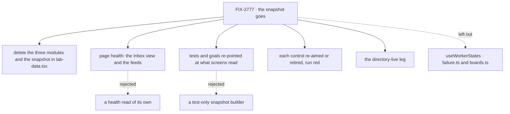

# FIX-2777 · Decisions

[Spec](SPEC.md) · **Decisions**

No decision here goes to sign-off. The epic decided the direction ([D2](../../epics/FIX-2683/DECISIONS.md#d2):
the snapshot goes; [ER-3](../../epics/FIX-2683/DECISIONS.md#who-owns-what): no legacy path;
[ER-8](../../epics/FIX-2683/DECISIONS.md#who-owns-what): this issue deletes last). What is left is how
the tests and goals keep their meaning, which is the implementer's discipline, written down so a
reviewer can hold the PR to it.

## The tree

## Decided, not asked

- **What goes.** `src/lib/reads.ts`, `src/lib/derive.ts`, `src/lib/snapshot-subscribe.ts`, and in
  `lab-data.tsx` the reader, the snapshot, its live read, `refreshing`, `asking`, `refresh` and the
  lapse counter. `LabProvider` keeps the connection, the client, the feed reporter and the
  health ([SPEC → What changes](SPEC.md#what-changes)). The file header is rewritten for what is
  left. Nothing is kept beside the old shape (ER-3): no alias, no re-export, no fallback.
- **The page's health is the worst of the feeds on screen, and the Inbox view reports its
  first read too.** The snapshot read was one input; the Inbox view is already another, on every
  page, because the frame mounts `useInbox()`. The view's retry is `client.live`'s, the same
  mechanism the snapshot's live read used, so a Lab that goes away after a good read still turns
  the bar *lapsed*. Before the frame mounts, the page shows *Reading the Lab…* (`Landed`), so the
  snapshot's *connecting* state is not needed.

  One gap opens when the snapshot's input goes. `useInbox()` reports nothing until the view has an
  answer (`inbox.ts`: `value !== undefined ? … : undefined`). So once the frame has mounted, an
  Inbox whose first read fails or is refused leaves no feed state, the empty set reads *live*, and
  the bar stays clear. The convergence point is `useInbox()`'s report: it reports *stopped* when
  the first read is refused (a 4xx) and *lapsed* when it fails any other way, as well as today's
  *lapsed* and *live*. Every screen that calls `useInbox()` reports through it, so no screen
  reports on its own. Red first ([Settled](#settled)): `connection.test.tsx` gains two cases, an
  Inbox whose first read answers 503 makes the page's health *lapsed*, and one answered 403 makes
  it *stopped*. Both fail on today's `inbox.ts` with *live*.

  The other feeds the bar counts are the session feeds (`conversation.ts`, `TaskSession.tsx`,
  through `followSession`). A stream refused before it went live reports *stopped*, which the bar
  draws (`session-feed.test.ts`: "says stopped … when the server has no stream"). A stream that
  can't connect at all stays *connecting*, by design: until it has named the session's runs it has
  vouched for nothing, so it has nothing to lapse (`follow-session.ts`). That is unchanged by this
  issue: the snapshot never covered it either, and a Lab that is gone already shows on the bar
  through the Inbox view.

  `connection.test.tsx` keeps every case a person sees: the bar says *lapsed* when the Lab goes
  after a good read, the page keeps what it drew, and the bar clears when a read lands again. Its
  `useInbox` mock reports a state the test sets; it goes, and the cases run the real `useInbox()`
  over a stand-in `useView`, as `inbox-stale.test.tsx` does, so they grade the code that reports.
- **A test checks the same fact through what a screen reads now.** Each *oracle* file reads the
  fact it checks through the view, collection, session list or workforce client call the screen
  for that fact makes ([SPEC → What changes](SPEC.md#what-changes) has the shape). Each *fixture*
  helper or mock feeds the screen through those reads too, as `test/helpers/directory.ts`'s
  `useFixtureReads` already does for the directory. The assertion's meaning stays: a re-point
  may change how a value is read, never what is expected of it. A test that called `read()`
  only to warm the Lab names the read it needs, or drops the line if the test passes without it.
- **A test whose subject is the snapshot goes, with a map.** `reads.test.ts` and
  `snapshot-subscribe.test.tsx` are deleted. The PR body lists each of their cases: the test that
  covers that behaviour now (the inbox view's, the directory's, workforce's), or why the behaviour
  is gone (it was the snapshot's own, such as which notices start a whole-Lab read). A case with
  no cover and a live behaviour gets a new test before the old one goes. No test is skipped, and
  no assertion is loosened.
- **Every goal control that aims at the snapshot is re-aimed or retired, and each kept one is
  run red.** Measured on `5a30c19092` and `372f30fa95` ([Settled](#settled)):

  | Control | Today | Disposition |
  |---|---|---|
  | `it-briefs-and-talks-with-the-shift-coordinator` · `static-brief` (swaps `derive.ts`) | Cannot build: no module imports `derive.ts` | Re-aimed at the module that computes the brief's asks now, and run red on `reach` or its own leg |
  | `it-opens-a-lab` · `unanswerable-asks` (swaps `reads.ts`) | **Passes** under the control: the snapshot's asks are drawn by no screen | Re-aimed at the `answerable` flag the Ask card reads off the Inbox view's hold, where the defect would land now, and run red |
  | `it-shows-and-stops-a-task-run` · `wrong-board` (swaps `reads.ts`) | Plants into `taskActions`, which no screen calls | Re-aimed at the board actions the task screen calls (`useBoardActions`), and run red |
  | `a-lab-is-worked-through-one-skinned-shell` · `static-names` (its `swapOf("reads.ts", "it-opens-a-lab", "static-names.ts")`) | Cannot build: `static-names.ts` now stands in for `directory-reads.ts` (FIX-2775), so swapping it in for `reads.ts` leaves `lab-data.tsx` importing a `createLabReader` it doesn't export | Re-aimed: the swap target becomes `directory-reads.ts`, as `it-opens-a-lab` already swaps it. That build is shown to work; it is then run red at `b:teams`, which needs a host where leg b sets up |
  | `it-shows-who-is-on-shift` · `status-from-snapshot` | Reads the snapshot this issue deletes | Retired, with a reason in its `goal.md`: the defect it plants (status from a second read of asks) needs a second read, and none is left. `one answer` keeps `ignore-asks` and `count-queued` |

  A retired control is a line in its goal's `goal.md`, never a silent removal.
- **A goal probe that waits on or counts the snapshot is re-pointed, and its leg is shown red.**
  `its-summary-changes-on-its-own` and `every-stop-is-one-inbox-item` draw the Inbox once the
  snapshot lands and pass it a `snapshot` prop the screen no longer takes: they wait on what the
  page waits on (the gate, then `Landed`). `realtime/app-views-read-on-notice` does the same for
  its Shift Manager screens. `live-read/one-loop-every-watcher`'s `sm` watcher counted snapshot
  reads: it counts Shift Manager's roster watch (`useRoster`) instead, which is what follows a
  hire now, and the goal's control is run against it.
- **The directory-live leg is three signals and three controls**
  ([SPEC → How we verify](SPEC.md#the-goal-and-how-well-know-its-met)). The probe draws the real
  Routines screen and Sidebar under the provider. The host gains the projects flow and one routine
  on a working schedule. The second client is the same user on Node's own `fetch`, so the
  provider's fetcher counts only the page's reads. *Within 2 s* is measured from the store
  reading the change, polled every 5 ms, as the goal's other legs are.
- **The inventory settles at nothing to allow.** `test/inventory-allowlist.json` is `[]`. The
  `gone` list gains `src/lib/derive.ts` and `src/lib/snapshot-subscribe.ts` beside `reads.ts`, so
  none can come back. `readModel`'s `reads.ts` entry is removed: ER-4's ratchet ends when the
  file goes.
- **Comments and codemods.** Comments that name a deleted module are reworded or dropped
  (BP-034): `test/inventory.test.ts`, `goals/lib/shift-manager.mts`, the contributor docs that
  describe the snapshot. The two codemods under `scripts/codemod/` that list `reads.ts` among
  their targets drop that entry; they have run, and a target that doesn't exist would fail them.
  `a-lab-is-worked-through-one-skinned-shell/parts.mts` reads `reads.ts`'s source to check it
  creates no session; that check goes with the file, and the same rule is checked over the files
  that read the Lab now.
- **Left out: the simplification follow-ups.** One memoized `useWorkerStates()` with a one-pass
  item map, and collapsing `failure.ts` (18 lines) and `boards.ts` (30). The deletion does not
  touch any of them: the five `workerStates` callers already read the Inbox view, and the two
  modules have 28 importers that the deletion does not change. Doing them here puts a
  behaviour-neutral refactor of five screens into a 50-file deletion. The comment on this issue
  says none blocks anything; they stay there for whoever next changes those screens.
- **One PR.** The deletion and the re-points cannot land apart: a test that still imports
  `reads.ts` fails to build once it goes. The directory-live leg lands in the same PR because the
  issue isn't done until it passes.
- **No changeset.** Shift Manager's behaviour is unchanged (BP-022).

## Considered and dropped

| Alternative | Why not |
|---|---|
| Keep a test-only snapshot builder, so the 29 test files change one import | It is the read model the epic deletes, kept in `test/` (ER-3). A screen test fed by it checks a shape no screen reads |
| A health read of its own for the connection bar | A second page-wide read to report what the Inbox view already reports |
| Delete the four snapshot-aimed controls with the modules | Three of them guard a defect that can still happen on the screens; only `status-from-snapshot`'s needs the snapshot |
| Split the goal leg into its own PR | The issue isn't done until it passes; a second PR is a second review for one change |

## Open / Settled

### Open

None.

### Settled

- **Which files reach the snapshot, and how.** `poc/snapshot-reach/check.mjs` on `372f30fa95`:
  58 files reach the three modules or the provider's snapshot (3 of them control modules): 3
  *subject*, 25 *oracle* (19 test files, 6 goals), 10 *fixture*, 5 *control*, 5 *probe*, 1
  *source*, 1 *inventory*, 2 *provenance*, 2 *codemod*, and `lab-data.tsx`. PASS. `--built`: FAIL,
  naming the three modules, as it must before the implementation. `--control` plants six files,
  one per way to reach, and FAILS naming all six; each `--control=<plant>` FAILS alone:
  `import`, `swap` (`swapOf("reads.ts", …)`), `alias` (`const lab = useLab(); lab.snapshot`),
  `member` (`useLab().snapshot`), `mock` (a `vi.mock` of `lab-data` whose provider carries
  `snapshot:`) and `fake` (a `lab-data` fake that carries it).
- **The first check missed six files, and passed.** Its path rule knew three shapes of a swap
  path and its provider rule only destructuring. The version first published (`20647456d2`), run
  on the same tree, printed PASS with 52 files. The six it could not see: the skinned-shell goal's
  helper-built swap (`run.mts`), `task-card-in-feed.test.tsx`, `conversation.test.tsx`,
  `session-view.test.tsx` and `task-session.test.tsx` (each mocks `lab-data` with a provider that
  carries `snapshot`, a field no screen reads), and the `conversation-scroll` goal's `lab-data`
  fake. The rule now matches any string literal naming a module's file, member access on a
  `useLab()` result or an alias of one, and a stand-in provider. A name built from fragments at
  run time is still not seen; a goal's swap build must fail when its swap is never reached.
- **`static-names` in the skinned-shell goal cannot build on main.** Run on `20647456d2`:
  `GOAL_PART=controls GOAL_CONTROLS=static-names pnpm tsx goals/shift-manager/a-lab-is-worked-through-one-skinned-shell/run.mts`
  prints *"control static-names: WRONG: failed at setup: packages/shift-manager/src/lib/lab-data.tsx
  (34:9): "createLabReader" is not exported by "goals/shift-manager/it-opens-a-lab/controls/static-names.ts""*.
  With the target changed to `directory-reads.ts` (a local edit, not committed) the build works,
  and the control reads *"WRONG: stayed green at b:teams; also red at b:setup, c:setup"*. Leg b
  without any control fails the same `b:setup` in this container (*"Shift Manager's command never
  served b-pentest"*), so `b:teams` is never graded here: the setup failure is the container's.
  The red run at `b:teams` is the implementation's, on a host where leg b sets up.
- **An Inbox whose first read fails leaves the bar clear.** A scratch test (not committed): the
  real `Inbox` under a `FeedHealthContext` that records reports, over a stand-in `useView` whose
  first read failed with no answer, graded on `worstFeedState` of what was reported, which is
  what `lab-data.tsx` computes once the snapshot's input is gone. On `372f30fa95`: 503 expected
  *lapsed*, received *live*; 403 expected *stopped*, received *live*; both FAIL. With a sketch of
  the report in `useInbox()` (refused first read → *stopped*, other first failure → *lapsed*),
  both pass and `inbox-stale.test.tsx` stays green. The sketch was reverted; it is the
  implementation's.
- **`static-brief` cannot build on main.** Run on `5a30c19092`:
  `GOAL_CONTROL=static-brief pnpm tsx goals/shift-manager/it-briefs-and-talks-with-the-shift-coordinator/run.mts`
  throws *"control static-brief: the build never imported …/src/lib/derive.ts, so nothing was
  swapped there"*.
- **`unanswerable-asks` passes under its control.** Run on `5a30c19092`:
  `GOAL_CONTROL=unanswerable-asks pnpm tsx goals/shift-manager/it-opens-a-lab/run.mts` prints
  `PASS` (*"devteam: inbox 1 listed / 1 asks + 0 questions pending … approved 1 of 1"*). The
  control marks the snapshot's asks unanswerable, and no screen draws them. It was meant to fail
  its leg.
- **`wrong-board` plants into code no screen calls.** Static, not run: `taskActions` has no
  caller in `src/` outside `reads.ts` (`grep -rn "taskActions" packages/shift-manager/src`).
  The implementation runs it after the re-aim.

## Analysis

Not run. This worker has no sub-agent to dispatch `analysis`, and the issue-spec skill asks for a
fresh one. The reuse question is small here: the spec adds one leg and two controls, on the
existing goal and its patch mechanism. Run it before the gate if the coordinator wants it.

## How it got here

- **Draft** — framed as "the epic says delete and edit nothing; the census says 47 more files
  and four controls depend on what goes". The approach: delete, re-point every test and goal at
  what screens read, re-aim or retire each snapshot control with a red run, keep the connection
  bar on the Inbox view, and add the directory-live leg moved here from FIX-2775. Builds on
  FIX-2775's census and the epic's D2, ER-2, ER-3, ER-8.
- **Review round 1 (Codex, `20647456d2`)** — three findings, all folded: the reach check missed a
  helper-built swap and aliased or mocked provider reads (six files, one of them a fifth control
  that cannot build on main, now re-aimed); and an Inbox whose first read fails left the bar
  clear once the snapshot's input goes, so `useInbox()` now reports its first read too.
