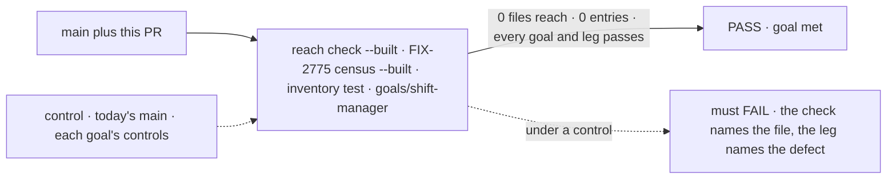
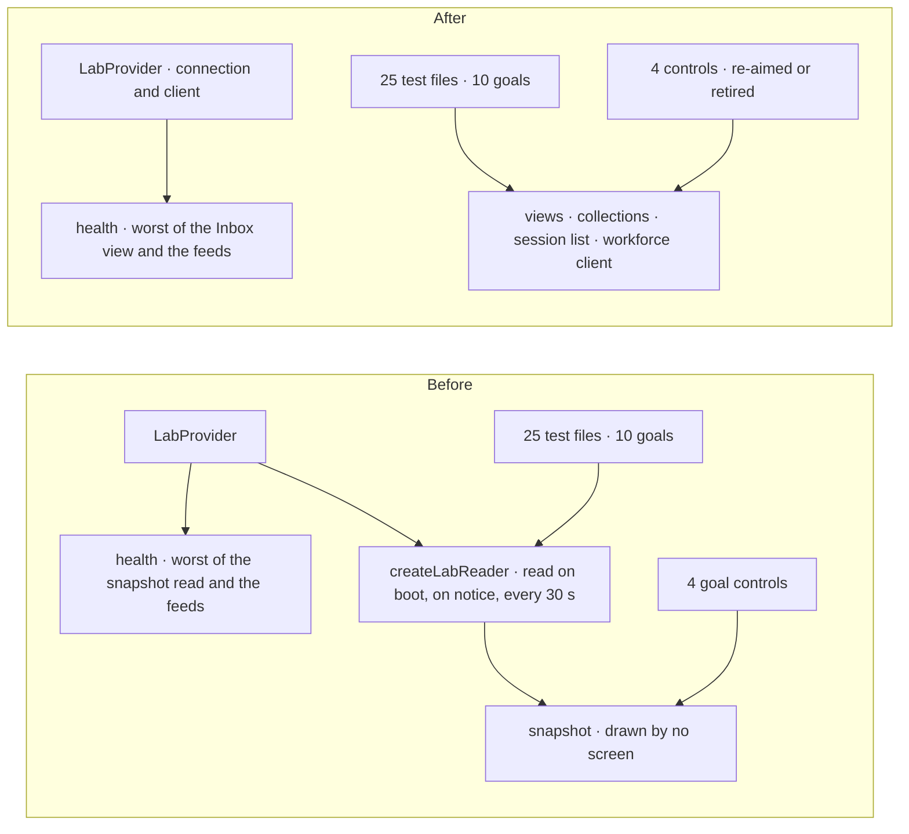

# FIX-2777 · Shift Manager's snapshot goes

**Spec** · [Decisions](DECISIONS.md)

## Five people, before and after

| Someone who… | Today | After |
|---|---|---|
| **has Shift Manager open** | Pays for a whole-Lab read on boot, on every notice it hears and every 30 s, though no screen draws it | Pays only for the reads the screens on the page make |
| **sees the Lab go away while a screen is open** | Sees the connection bar say *lapsed*, counted from the snapshot read and the feeds on screen | Sees the same bar, the same words, counted from the Inbox view and the feeds on screen |
| **pauses a routine or adds a project in another tab** | Sees it on Routines and in PROJECTS (FIX-2775), but no goal proves it | Sees it within 2 s, and a goal leg proves it and fails when the screens stop listening |
| **changes Shift Manager and runs its goals** | Gets four controls aimed at the snapshot: one cannot build, one passes under its own control, one plants into a reader method no screen calls, one reads the snapshot this deletes | Gets every control aimed at the code that now carries its defect, or retired with a reason; each one kept is shown failing its leg |
| **changes a Shift Manager test** | Finds 25 test files and 6 goals that check the Lab through the snapshot reader or a hand-built snapshot, and 4 goal probes that wait on it | Finds each checking the same fact through what a screen reads now |

## The goal, and how we'll know it's met

**`reads.ts`, `derive.ts` and `snapshot-subscribe.ts` are deleted and `lab-data.tsx` keeps only
the connection, the client and the page's health; no file in the repository reaches them;
Shift Manager's inventory allowlist is empty; every Shift Manager goal passes with every control
shown failing its leg; and `its-summary-changes-on-its-own` gains the directory-live leg.**

| Is it the right goal? | |
|---|---|
| **The real need** | The epic's leg s: "Shift Manager keeps `reads.ts`, `lab-data.tsx`'s snapshot or a snapshot type" is a *not done if* of [FIX-2683](../../epics/FIX-2683/SPEC.md#the-goal-and-how-well-know-its-met). The issue: "`reads.ts` and the snapshot are gone, Shift Manager's allowlist is empty, and every Shift Manager goal passes." The leg carried here from FIX-2775: "from another session, pause a routine and add a project; both show within 2 s, with no snapshot read" |
| **Smaller, and rejected** | "Delete four files, edit none", as the epic's row and FIX-2775's spec put it. True of `src/`, where FIX-2775's census finds 0 sites. False of the rest: 47 other files reach the three modules (the census below), `lab-data.tsx` keeps the provider, and four goals' controls depend on the snapshot. Deleting only the files breaks the build of the tests and goals that grade Shift Manager |
| **Bigger, and not this issue's** | One memoized `useWorkerStates()` with a one-pass item map, and collapsing `failure.ts` and `boards.ts` ([Decided, not asked](DECISIONS.md#decided-not-asked)). The closure's run of both legs (FIX-2778) |
| **Not done if** | one of the three modules exists, or `LabData` carries `snapshot`, `reader`, `refresh`, `asking` or `refreshing` · `poc/snapshot-reach/check.mjs --built` names a file · the allowlist has an entry · a test was deleted with no line saying where its behaviour is covered, or an assertion was loosened · a goal control does not fail its leg, or fails to build · a goal or leg is retired with no stated reason · the directory-live leg is missing or has no failing control · the connection bar stops saying *lapsed* when the Lab goes away after a good read |



The reach check reads the source, the census reads the screens, the goals read the page and the
store. A test re-pointed at a hand-built snapshot passes the goals and fails the reach check.

| How we verify | |
|---|---|
| **Goal check** | `node specs/issues/FIX-2777/poc/snapshot-reach/check.mjs --built`; `node specs/issues/FIX-2775/poc/directory-census/check.mjs --built`; the Shift Manager inventory test; then every goal under `goals/shift-manager/`, plus the six goals outside it that the reach check names. Run by the implementer; verdicts on the implementation PR and in each goal's verdict log |
| **Signal** | The reach check prints `still on disk` and `still reaches` for nothing. The inventory test passes with `[]`. Every goal passes. The new leg, in `its-summary-changes-on-its-own`: `live:routine-within-2s` (a second client, as the same user, pauses a routine; the drawn Routines screen shows it paused less than 2000 ms after the store reads it), `live:project-within-2s` (the second client adds a project; the drawn sidebar's PROJECTS lists it within 2000 ms), `live:own-reads` (each change adds only the read of the screen that shows it: the routines view run, the projects collection page; no session list, manifest, identity or inventory read) |
| **Input** | Each goal's own Lab. The new leg's host adds the projects flow and one routine on a working schedule, as the comment on this issue asks |
| **Anti-game** | Grade the drawn page and the provider's own fetcher, never a hook's return. A control is proven by running its leg red, never by reading the patch |
| **Control that must fail** | The reach check with `--built` on today's main: FAILS, naming the three modules. `--control` plants an unclassified importer: FAILS. The new leg: `GOAL_CONTROL=no-subscribe` (already in this goal: a view subscribes to nothing) must FAIL `live:routine-within-2s`; a new `resource-no-subscribe` (the collection read hears no notice) must FAIL `live:project-within-2s`; a new `whole-read` (the directory reads all its parts again on any notice) must FAIL `live:own-reads`. Every re-aimed control fails its leg on this PR |

The 52 reaching files and their kinds are re-derived by
[`poc/snapshot-reach/check.mjs`](poc/snapshot-reach/check.mjs), which classifies every file that
imports, names or stands in for a snapshot module, and fails on one nobody classified
([Settled](DECISIONS.md#settled)).

## What changes



The snapshot read goes from the page, and every test and goal that read the Lab through it reads
what the screens read. The page's health loses one input, which the Inbox view already covers on
every page.

`LabData` after this change:

```diff
 export type LabData = {
   connection: Connection;
   client: Client;
-  reader: LabReader;
-  snapshot: LabSnapshot | undefined;
-  refreshing: boolean;
-  asking: boolean;
   health: ConnectionFeedStatus;
   stale: boolean;
-  refresh(): Promise<void>;
 };
```

A test that checked a fact through the reader, before and after (the shape of each *oracle*
re-point):

```diff
-  const snapshot = await createLabReader(client).read();
-  expect(snapshot.inventory.ok && snapshot.inventory.value.workers.map((w) => w.id)).toContain("eng.coder");
+  const rows = await client.resource(workerInventoryResource).listAll();
+  expect(rows.map((row) => toWorker(row.value)?.id)).toContain("eng.coder");
```

**Docs:** none. Shift Manager's behaviour is unchanged, so no changeset and no `/release-docs` line.
Contributor docs that name the snapshot (`docs/contributing/docs-revamp/pages/catalog/starters/shift-manager.facts.md`
and the inventory test's header) are reworded in the same PR.

## What stays as it is

- **Every screen, and what it reads.** FIX-2774, FIX-2775 and FIX-2776 moved them; this issue
  changes no screen.
- **The connection bar's words and states.** *Lapsed* after a good read that can't reach the Lab,
  *stopped*, the stale styling. Only the inputs to `health` change.
- **The gate and the first-read pages.** `useGate()` and the directory's `Landed` already decide
  them (FIX-2775).
- **`feed-health.ts`**, `useReportFeedState` and `worstFeedState`.
- **Each goal's legs and signals**, except where a leg graded the snapshot itself
  ([Decided, not asked](DECISIONS.md#decided-not-asked)).

## What's already here, and the debt

| Already here | What this does with it |
|---|---|
| [FIX-2683 ER-8](../../epics/FIX-2683/DECISIONS.md#who-owns-what): "s4 alone deletes `lab-data.tsx`'s snapshot, its re-read, `reads.ts` and the snapshot types" | **Delivers** it |
| [FIX-2683 ER-2](../../epics/FIX-2683/DECISIONS.md#who-owns-what): Shift Manager's inventory has "no `reads.ts` and no snapshot type" | **Delivers** it: the allowlist goes to `[]`, and the inventory's `gone` list gains `derive.ts` and `snapshot-subscribe.ts` |
| [FIX-2683 ER-4](../../epics/FIX-2683/DECISIONS.md#who-owns-what): `reads.ts` never grows past its merge-base | **Ends** it, as ER-4 says, when the file goes: its `readModel` ratchet entry is removed |
| [FIX-2775 SPEC](../FIX-2775/SPEC.md#the-goal-and-how-well-know-its-met): "FIX-2777 deletes four files and edits none"; the directory-live leg | **Amended**: true of `src/` only. The leg is **delivered** here, as the comment on this issue moved it |
| [FIX-2409](../FIX-2409/SPEC.md) and FIX-2551: the snapshot's read on notice, through `client.live` | **Superseded in whole**, already by the epic's [D2](../../epics/FIX-2683/DECISIONS.md#d2); this removes the code |
| `useInbox()` reports *lapsed* or *live* to the page's health, and is mounted by the frame on every page (`App.tsx`, `inbox.ts`) | **Builds on**: it is the page-wide read the bar keeps |
| FIX-2775's census (`specs/issues/FIX-2775/poc/directory-census/check.mjs`) | **Builds on**: it proves no screen reaches the snapshot; this issue's check covers tests, goals and controls, which it doesn't scan |

| Adds | Existing piece considered | Why it doesn't fit / how composed |
|---|---|---|
| The directory-live leg, in `its-summary-changes-on-its-own` | That goal's host, probe and fetcher count | **Extends** them: the same host gains the projects flow and a routine; the same fetcher wrapper counts the reads |
| Two controls, `resource-no-subscribe` and `whole-read` | The goal's `module-patch` controls (`no-subscribe`, `hear-run`, `no-poll`) | **Same mechanism**, two new patches |

| The debt | |
|---|---|
| **Removes** | `reads.ts` (645 lines), `derive.ts` (142), `snapshot-subscribe.ts` (86), `lab-data.tsx`'s snapshot (about 110 of 183 lines), `reads.test.ts` and `snapshot-subscribe.test.tsx` (936), the 16 allowlist entries, one whole-Lab read per notice and every 30 s per open page, three controls that cannot fail and one that cannot build |
| **Adds** | One goal leg and two controls |
| **Leaves** | The simplification follow-ups ([Decided, not asked](DECISIONS.md#decided-not-asked)). The same data served on two routes (FIX-2618's follow-up) |

**Net: down.** About 980 lines of read model and 936 of its own tests go, and one whole-Lab
read per page; one leg and two controls come.

## Sign off

**[The goal](#the-goal-and-how-well-know-its-met), at that size:** the three modules and the
snapshot gone, every test and goal re-pointed with its meaning kept, every control proven red,
and the directory-live leg added. If wrong: the deletion is smaller than this, and the goals
that grade Shift Manager stop building or keep controls that cannot fail.

**[The debt](#whats-already-here-and-the-debt), net down:** about 980 lines and one whole-Lab
read per page go; one leg and two controls come. If wrong: a test's meaning is lost in a
re-point, which the reach check cannot see and review must.

**Decisions: none for sign-off.** Every call here is an engineering one, listed in
[Decided, not asked](DECISIONS.md#decided-not-asked). **Open: none.**

Issue · Improvement · epic [FIX-2683](../../epics/FIX-2683/SPEC.md) · blocked by FIX-2774, FIX-2775,
FIX-2776 (all merged) · blocks FIX-2778 · size: one PR, about 50 files, most of them tests ·
[Linear](https://linear.app/fixpoint-labs/issue/FIX-2777)
