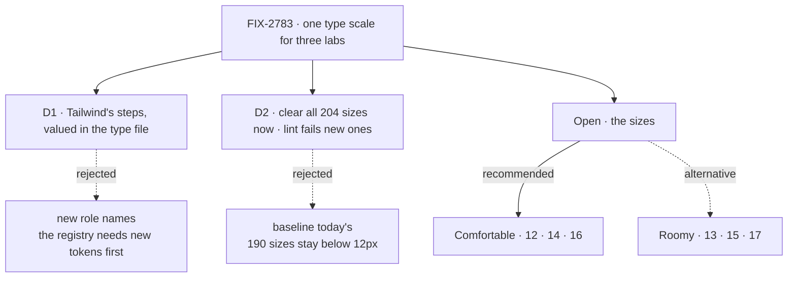

# FIX-2783 · Decisions

[Spec](SPEC.md) · **Decisions**

Two decisions and one open question are the sign-off surface; the rest is context.

## The tree

Solid edges are what you're signing. Dashed edges lost, and the label says why.

## D1 · The scale is Tailwind's own size steps, given their values in the design system's type file; components keep writing `text-xs` … `text-2xl`

| | |
|---|---|
| **Instead of** | New role names (`text-body`, `text-meta`, `text-label`, …) that every component switches to |
| **Because** | The registry is copied byte for byte into four apps and installed into any app by `fsdev ui add`, and every Tailwind app has the steps. A role name needs a token in the registry's `tokens` item first; an app without it gets unsized text and no error. The steps already compile to `var(--text-*)`, so a value in the type file resizes every use ([POC](#settled)), as the design system already does for radius and fonts. About 154 edits instead of about 1,000 judgment calls |
| **Locks in** | In the labs a step is a role: `xs` meta, labels, mono ids · `sm` controls, lists, code · `base` feed body and composer · `lg`–`2xl` headings. Feed and composer share a size, and `text-sm` in a lab means the type file's value, not 14px by definition. The issue's "not from bare Tailwind steps" is met as "not from Tailwind's values" |

It comes down to the registry: role names leave any app without the new token with unsized text.

**What would change my mind:** the composer needing a size apart from the feed. Then that one role gets a name in the registry's `tokens` item.

## D2 · Clear all 204 hard-coded sizes now, each to the step of its role and never smaller; the lint fails any new one, with no baseline

| | |
|---|---|
| **Instead of** | A baseline of today's sizes, with the lint failing only new ones, and only the body and composer sites moved |
| **Because** | 190 of the 204 are below 12px (meta, counts, tags, mono ids): half the complaint, kept forever by a baseline. The mapping is mechanical, to the step of the size's role and never smaller. 154 are unique sites; the other 50 are the labs' registry copies, refreshed by one command |
| **Locks in** | No text below 12px in the labs or the registry without a reason on the line. Kitchen Sink's registry copies move too: its drift test holds them byte-identical |

It comes down to the meta text: a baseline leaves 190 sizes below 12px on the screen.

## Decided, not asked

- **Convergence:** the type file is the one place a size is set; the lint is where every source passes. It reads string and template literals (so `cn()` and conditionals), with any variant prefix, over `labs/*/src`, `packages/shift-manager/src` and `packages/ui/registry/components`. Kitchen Sink's copies are held by byte identity.
- **Icon glyphs keep their size by a reasoned exception on the line:** the 7.5px marks in Shift Manager's sidebar (two) and the coordinator avatar's 13px initials.
- **Mono has no step of its own:** labels and ids are `xs`, code is `sm`.
- **Line heights belong to the steps;** a `leading-*` class still overrides. No base size on `body`: unstyled text stays at 16px, the body step.
- **Each lab imports the type file; `shift-manager.css` does not,** so Kitchen Sink and the docs site don't change by accident. Teammates gains a workspace dependency on the design system.
- **Contrast:** full-strength muted text passes 4.5:1 in every theme (5.2–7.3:1, computed). Translucent muted (`/40`–`/70`, 1.9–3.9:1) is almost all icons; where it carries words in a main view it goes to full strength.
- **The PR split is the implementer's.** One PR fits. If split: type file, lint and registry first, then a PR per lab, the lint's scope growing with each. No baseline file.

## Considered and dropped

| Alternative | Why not |
|---|---|
| Raise the root font size | Scales spacing with the text, and hard-coded px sizes don't move |
| A `@theme` block in each lab | Three copies of the scale. The issue asks for one place |
| The scale in `shift-manager.css` | Teammates can't import that look; Kitchen Sink and docs would change too |
| Kitchen Sink on the scale now | Outside the issue's three labs; a one-line opt-in later |
| Tune each lab separately | The issue rules it out: one scale, no lab override |

## Open

### The sizes: Comfortable (12 · 14 · 16), or Roomy (13 · 15 · 17)?

**Plain terms.** The type file holds one size per role. Comfortable makes the feed and composer 16px, lifts every small label to 12px, and leaves buttons, lists and the sidebar at 14px. Roomy is one step larger throughout: 13, 15 and 17px. Headings are 18, 22 and 26px in both.

**The trade-off.** Roomy enlarges the dense panes too: Shift Manager's rail, the Inbox list and the Tasks table wrap and truncate more. Comfortable grows only what you read and type.

**My recommendation: Comfortable.** Your complaint is the feed and the composer; the chat apps these labs are modelled on set both at about 16px, and 12px is the usual floor for meta (GitHub's Primer uses it). Controls at 14px keep the panes' fit.

**What would change my mind:** buttons and lists still reading small after a day, or working at a distance from a large screen. Then Roomy.

**What being wrong costs:** little. Either is one edit to the type file, plus new screenshots.

It comes down to the dense panes: Roomy wraps and truncates more of the rail, Inbox and Tasks.

## Settled

- **A new value for a Tailwind step resizes every use, with no class edit** — **CONFIRMED** by `poc/theme-steps/` on Tailwind 4.1.12 (`result.txt`), and re-run unchanged on 4.3.0, the version the lockfile resolves for all three labs (4.1.12 is only the floor of their `^4.1.12` range): the output is byte-identical. `text-sm` compiles to `font-size: var(--text-sm)`, Tailwind's default sits in `@layer theme`, and an unlayered `:root` value wins. `text-meta` gets a class only if an `@theme` block defines it; `text-[11px]` compiles to a literal no token reaches. The premise held; D1 rests on it.
- **The counts** — re-derived by `poc/census/census.mjs` on `0a64fb96`: 204 hard-coded sizes, 190 below 12px, 154 unique sites (the other 50 sit in the labs' registry copies); Kitchen Sink's own screens 5, in 3 files, its registry copies excluded; all 118 registry copies in the three labs and Kitchen Sink byte-identical. Its control plants one `text-[9px]` and the count rises by one. Every file and line the issue cites (read at `7b99800`) still holds; Shift Manager now has 113 hard-coded sizes, not 111.

## Analysis

### Analysis — FIX-2783 spec · 2026-11-17 · watermark 2026-11-17 (issue filed)

**Verdict: Right approach, with changes.** Run fresh by an agent that did not author the spec (the author's own pass came first). The direction holds; two scope facts and three factual corrections are below, none of which moves D1, D2 or the sizes fork.

1. **Reuse** — fresh check of the Adds table: `type.css` is genuinely new (no type scale anywhere; same mechanism as the theme's `--radius-*`/`--font-*`, confirmed in `shift-manager.css`). The goal check reuses `skins-reused-components-from-one-token-set`'s Chromium reading, as stated. The lint rule is the one **extend** candidate the spec didn't weigh: `eslint-plugin-better-tailwindcss`'s `no-restricted-classes` bans a class pattern with a custom message and reads `cn()` and template literals. It saves writing a rule but adds a dependency and can't map 10px to "use `text-xs`" per size. Implementer's call; doesn't change the approach.
2. **Prior art** — [Radix Themes](https://www.radix-ui.com/themes/docs/theme/typography): a numbered size scale whose values are CSS variables you override in one place, with no role names — the same shape as D1. [Vercel AI Elements](https://vercel.com/blog/introducing-ai-elements) (shadcn-style, copied into apps): Tailwind steps in components; our registry's `message.tsx` keeps its `text-sm` body class verbatim. Both back D1: copied components size by Tailwind steps, and the host retunes values.
3. **Other shapes** — role names, a root font-size bump, per-lab `@theme`, the scale in `shift-manager.css` are weighed in *Considered and dropped*; no shape beats D1. No `adhd` run: no new block kind, public API or schema.
4. **New factors** — 32 issues in the project updated since the watermark, plus a title search for font/type/size/composer. **FIX-2797** (Kitchen Sink's own screens on the scale) is now filed; the spec said "follow-up to file" (corrected). **FIX-2792** (open PR) renders worker replies through `MarkdownText className="text-sm"` in `ReceivedMessage`: a feed-body site at `text-sm`. Whichever merges second moves it to `text-base`. FIX-2781/2782 add review-card UI; the lint covers new sizes there. FIX-1944 is still Backlog; the type file moves with it.
5. **Necessity** — should exist. Note on size: with Comfortable, `xs`/`sm`/`base` equal Tailwind's defaults, so the type file changes only line heights and `xl`/`2xl`; nearly all the visible change is D2's class edits plus the body re-tags below. The file earns its place as the single knob the issue asks for, which goal signal (c) proves.
6. **Ergonomics** — an author writes the same `text-xs` … `text-2xl` and loses `text-[Npx]`; one concept to learn, "a step is a role", documented only in the design-system README. Surprise: nothing tells an author that feed text is `base`, not `sm`; the lint can't see it, and only goal signal (a) catches it in the seeded views.
7. **Concerns** — **the edit count is understated.** "About 154 edits" counts arbitrary sizes only. Body and composer text is written as `text-sm` today and must be re-tagged to `text-base`: at least the registry's `message.tsx` (two sites), Shift Manager's `ReceivedMessage` and `TurnComposer`, Teammates' `Entry` (three), `Steps` and `Composer`, and Claude Code-style's `Composer`, about a dozen judgment calls. Still far fewer than role names' ~720 `xs`/`sm` uses to re-tag (census, copies included), so D1 is unaffected. **The registry is not private to the labs:** adopters install it with `fsdev ui add`, so D2's registry edits change what they get (12px meta, 16px body). That is a fine default, but the Docs line said "private" (corrected).

| Finding | Objective | Changes the approach? | Disposition |
|---------|-----------|-----------------------|-------------|
| Body/composer `text-sm` sites need re-tagging to `text-base` (~a dozen), not counted in "154" | 7 | No | Recorded; implementer's list starts from objective 7 |
| FIX-2792's `ReceivedMessage` body lands at `text-sm` | 4 | No | Second to merge re-tags it |
| Registry reaches adopters via `fsdev ui add` | 7 | No | SPEC Docs line corrected |
| `better-tailwindcss` `no-restricted-classes` as the lint | 1 | No | Implementer's call |
| POC ran on 4.1.12; labs resolve 4.3.0 | Settled | No | Re-ran on 4.3.0, identical; Settled corrected |
| Kitchen Sink follow-up is filed | 4 | No | SPEC Leaves line now names FIX-2797 |

**Jake's three questions, after this pass.** D1 holds, and the re-tag finding strengthens it. D2 holds; know that it also changes what registry adopters install. Sizes: Comfortable still recommended; under Roomy a registry piece would read 15px in the labs and 14px in Kitchen Sink and adopters' apps, one more reason for Comfortable.

## How it got here

- **Draft** — framed as one scale for three labs; Tailwind's steps given values in a new design-system type file, every hard-coded size cleared and a lint against new ones; builds on the design system's existing overrides of Tailwind's theme variables.

## Notes from review

- "Consider documenting an alternative in DECISIONS *if the gate feels too heavy at implementation*: one synthetic host (reuse skins’ install + Chromium pattern) that imports `type.css` and renders representative registry surfaces, plus manual or lighter lab smoke. Not insisting—only saying it’s the main place this spec adds operational complexity beyond “one CSS file + lint + class edits.”" — cursor ([thread](https://github.com/fixpoint-labs/flow-state-dev/pull/5385#discussion_r4607316495))
- "When implementing, prefer **copying the host harness** (`goals/design-system/skins-reused-components-from-one-token-set/run.mts` structure) over growing three lab-specific goal runners—unless you explicitly need lab-only chrome (sidebar/inspector tokens) in the oracle." — cursor ([thread](https://github.com/fixpoint-labs/flow-state-dev/pull/5385#discussion_r4607316501))
- "Before a bespoke rule, worth a short spike on `eslint-plugin-tailwindcss` (or similar) for arbitrary `text-[…]`—if it can’t suggest the right step or doesn’t cover `cn()`/templates the way you need, the planned `fsd/*` rule aligned with `no-tracker-ids` is the right fallback." — cursor ([thread](https://github.com/fixpoint-labs/flow-state-dev/pull/5385#discussion_r4607316507))
- "add `"./type.css": "./type.css"` to `labs/design-system/package.json` `exports` and `files` (today only `shift-manager.css` / `page.css` are exported)." — cursor ([thread](https://github.com/fixpoint-labs/flow-state-dev/pull/5385#discussion_r4607316520))

These are inputs, not instructions. Adopt, adapt, or discard.
