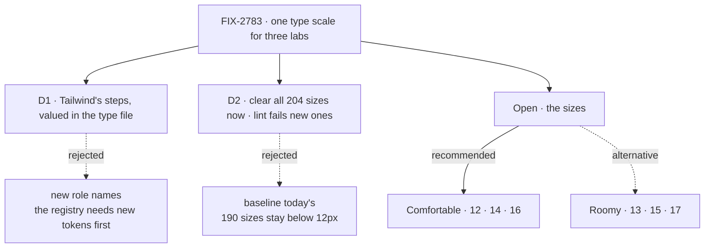

# FIX-2783 · Decisions

[Spec](SPEC.md) · **Decisions**

Two decisions and one open question are the sign-off surface; the rest is context.

## The tree

Solid edges are what you're signing. Dashed edges lost, and the label says why.

## D1 · The scale is Tailwind's own size steps, given their values in the design system's type file; components keep writing `text-xs` … `text-2xl`

| | |
|---|---|
| **Instead of** | New role names (`text-body`, `text-meta`, `text-label`, …) that every component switches to |
| **Because** | The registry is copied byte for byte into four apps and installed into any app by `fsdev ui add`, and every Tailwind app has the steps. A role name needs a token in the registry's `tokens` item first; an app without it gets unsized text and no error. The steps already compile to `var(--text-*)`, so a value in the type file resizes every use ([POC](#settled)), as the design system already does for radius and fonts. About 154 edits instead of about 1,000 judgment calls |
| **Locks in** | In the labs a step is a role: `xs` meta, labels, mono ids · `sm` controls, lists, code · `base` feed body and composer · `lg`–`2xl` headings. Feed and composer share a size, and `text-sm` in a lab means the type file's value, not 14px by definition. The issue's "not from bare Tailwind steps" is met as "not from Tailwind's values" |

It comes down to the registry: role names leave any app without the new token with unsized text.

**What would change my mind:** the composer needing a size apart from the feed. Then that one role gets a name in the registry's `tokens` item.

## D2 · Clear all 204 hard-coded sizes now, each to the step of its role and never smaller; the lint fails any new one, with no baseline

| | |
|---|---|
| **Instead of** | A baseline of today's sizes, with the lint failing only new ones, and only the body and composer sites moved |
| **Because** | 190 of the 204 are below 12px (meta, counts, tags, mono ids): half the complaint, kept forever by a baseline. The mapping is mechanical, to the step of the size's role and never smaller. 154 are unique sites; the other 50 are the labs' registry copies, refreshed by one command |
| **Locks in** | No text below 12px in the labs or the registry without a reason on the line. Kitchen Sink's registry copies move too: its drift test holds them byte-identical |

It comes down to the meta text: a baseline leaves 190 sizes below 12px on the screen.

## Decided, not asked

- **Convergence:** the type file is the one place a size is set; the lint is where every source passes. It reads string and template literals (so `cn()` and conditionals), with any variant prefix, over `labs/*/src`, `packages/shift-manager/src` and `packages/ui/registry/components`. Kitchen Sink's copies are held by byte identity.
- **Icon glyphs keep their size by a reasoned exception on the line:** the 7.5px marks in Shift Manager's sidebar (two) and the coordinator avatar's 13px initials.
- **Mono has no step of its own:** labels and ids are `xs`, code is `sm`.
- **Line heights belong to the steps;** a `leading-*` class still overrides. No base size on `body`: unstyled text stays at 16px, the body step.
- **Each lab imports the type file; `shift-manager.css` does not,** so Kitchen Sink and the docs site don't change by accident. Teammates gains a workspace dependency on the design system.
- **Contrast:** full-strength muted text passes 4.5:1 in every theme (5.2–7.3:1, computed). Translucent muted (`/40`–`/70`, 1.9–3.9:1) is almost all icons; where it carries words in a main view it goes to full strength.
- **The PR split is the implementer's.** One PR fits. If split: type file, lint and registry first, then a PR per lab, the lint's scope growing with each. No baseline file.

## Considered and dropped

| Alternative | Why not |
|---|---|
| Raise the root font size | Scales spacing with the text, and hard-coded px sizes don't move |
| A `@theme` block in each lab | Three copies of the scale. The issue asks for one place |
| The scale in `shift-manager.css` | Teammates can't import that look; Kitchen Sink and docs would change too |
| Kitchen Sink on the scale now | Outside the issue's three labs; a one-line opt-in later |
| Tune each lab separately | The issue rules it out: one scale, no lab override |

## Open

### The sizes: Comfortable (12 · 14 · 16), or Roomy (13 · 15 · 17)?

**Plain terms.** The type file holds one size per role. Comfortable makes the feed and composer 16px, lifts every small label to 12px, and leaves buttons, lists and the sidebar at 14px. Roomy is one step larger throughout: 13, 15 and 17px. Headings are 18, 22 and 26px in both.

**The trade-off.** Roomy enlarges the dense panes too: Shift Manager's rail, the Inbox list and the Tasks table wrap and truncate more. Comfortable grows only what you read and type.

**My recommendation: Comfortable.** Your complaint is the feed and the composer; the chat apps these labs are modelled on set both at about 16px, and 12px is the usual floor for meta (GitHub's Primer uses it). Controls at 14px keep the panes' fit.

**What would change my mind:** buttons and lists still reading small after a day, or working at a distance from a large screen. Then Roomy.

**What being wrong costs:** little. Either is one edit to the type file, plus new screenshots.

It comes down to the dense panes: Roomy wraps and truncates more of the rail, Inbox and Tasks.

## Settled

- **A new value for a Tailwind step resizes every use, with no class edit** — **CONFIRMED** by `poc/theme-steps/` on Tailwind 4.1.12, the labs' version (`result.txt`). `text-sm` compiles to `font-size: var(--text-sm)`, Tailwind's default sits in `@layer theme`, and an unlayered `:root` value wins. `text-meta` gets a class only if an `@theme` block defines it; `text-[11px]` compiles to a literal no token reaches. The premise held; D1 rests on it.
- **The counts** — re-derived by `poc/census/census.mjs` on `c0bf4f40`: 204 hard-coded sizes, 190 below 12px, 154 unique sites; all 118 registry copies in the three labs and Kitchen Sink byte-identical. Its control plants one `text-[9px]` and the count rises by one. Every file and line the issue cites (read at `7b99800`) still holds; Shift Manager now has 113 hard-coded sizes, not 111.

## Analysis

2026-11-17 · watermark 2026-11-17 (issue filed) · **Right approach.** Run by the spec author, not a fresh sub-agent; a fresh run is owed before the gate.

1. **Reuse** — every Adds item composes an existing piece ([Builds on / Adds](SPEC.md#whats-already-here-and-the-debt)).
2. **Prior art** — Tailwind v4 retunes its steps through theme variables; Material 3 and Primer use 14px controls, 16px long reading, 12px smallest text.
3. **Other shapes** — role names, a root font-size bump, per-lab `@theme`: dropped above.
4. **New factors** — FIX-2792 (Shift Manager replies, in development) touches the feed: merge order only.
5. **Necessity** — daily complaint; without the lint it returns.
6. **Ergonomics** — authors write the same classes, minus arbitrary sizes.
7. **Concerns** — none.

## How it got here

- **Draft** — framed as one scale for three labs; Tailwind's steps given values in a new design-system type file, every hard-coded size cleared and a lint against new ones; builds on the design system's existing overrides of Tailwind's theme variables.
