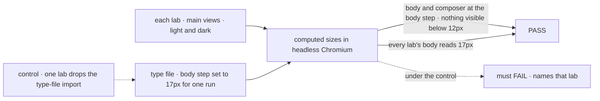
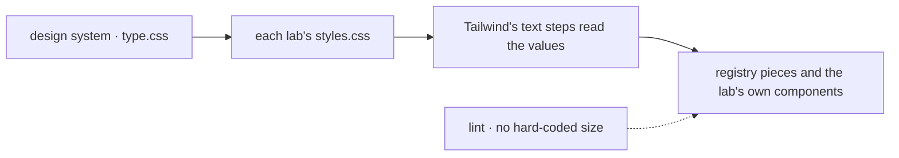

# FIX-2783 · Labs' text is too small to read and type in: one balanced, readable type scale in the design system

**Spec** · [Decisions](DECISIONS.md)

## Six people, before and after

| Someone who… | Today | After |
|---|---|---|
| **reads a worker's reply in any lab's feed** | 14px on a 20px line (16px only in the Shift Coordinator's summary) | 16px on a 26px line, in all three labs |
| **types a long message in a composer** | 14px in every composer but the Shift Coordinator's | 16px in every composer of every lab |
| **scans timestamps, counts, tags and mono ids** | 9.5–11px, hard-coded, in 190 places | Never below 12px |
| **finds a size still wrong after a day** | Edits each lab, class by class | Changes one value in the design system's type file; all three labs move |
| **adds a component with `text-[11px]`** | Nothing stops it | The lint fails, and names the step to use |
| **uses Kitchen Sink** | The same registry pieces, the same tiny meta | Its registry copies get the 12px floor and the 16px message body; its own screens don't change |

Teammates keeps its own dark look and fonts, and takes the same sizes.

## The goal, and how we'll know it's met

**In each of the three labs, the feed and the composer read at a comfortable long-session size, no text in the main views is below 12px, and one value in the design system changes that size in all three labs.**

| Is it the right goal? | |
|---|---|
| **The real need** | Jake: "it feels pretty damn small to type on or read most of the time". Reading and typing are the whole day in these labs, which the epic wants as a daily driver ([FIX-2369](../../epics/FIX-2369/SPEC.md)) |
| **Smaller, and rejected** | "Make the message body and composer 16px." The 10px meta beside them stays, and the next screen hard-codes 11px again |
| **Bigger, and not this issue's** | Kitchen Sink's own screens on the scale, and the design system as a published package (FIX-1944) |
| **Not done if** | One lab never imports the type file and looks right only because the sizes nearly match Tailwind's · the lint reads `className="…"` but misses `cn()` and template strings · the registry holds the floor but a lab's own files keep 10px |



The check reads what a browser paints. Changing one value and seeing all three labs move is the only proof each lab reads the file, since the recommended sizes nearly match Tailwind's.

| How we verify | |
|---|---|
| **Goal check** | `goals/design-system/labs-read-one-type-scale/` · model n/a · headless Chromium, run by the implementer at completion (to `fsd-qa` only if no browser runs) · verdict in the implementation PR |
| **Signal** | (a) feed body and composer compute to the body step in all three labs · (b) no visible text below 12px except the lint's three glyph exceptions · (c) with the body step set to 17px for the run, every lab's body computes 17px |
| **Input** | Shift Manager: coordinator feed, Inbox, a task. Teammates: chat, panel. Claude Code-style: main session, a thread. Another seeded session must pass too |
| **Anti-game** | Assert on computed styles, never on classes (the lint covers source). The glyph allowance is the lint's exceptions, nothing added for the check |
| **Control that must fail** | `GOAL_CONTROL=drop-import` removes the type-file import from Teammates: (c) FAILS naming Teammates. Today's `main` FAILS (a) and (b) in every lab |

Before-and-after screenshots of these views go in the implementation PR, light and dark; Teammates has no light theme, so dark only.

## What changes


Each role gets one step, and each step's size is one value in a new design-system type file. The sizes are the open sign-off.

**The type file, and the import each lab adds:**

```diff
+ /* labs/design-system/type.css: the scale. Unlayered, like the theme's radius and fonts. */
+ :root {
+   --text-xs: 0.75rem;   --text-xs--line-height: 1rem;        /* meta, labels, mono ids */
+   --text-sm: 0.875rem;  --text-sm--line-height: 1.25rem;     /* controls, lists, code */
+   --text-base: 1rem;    --text-base--line-height: 1.625rem;  /* feed body, composer */
+   --text-lg: 1.125rem;  --text-xl: 1.375rem;  --text-2xl: 1.625rem;  /* headings, with line heights */
+ }

  /* labs/teammates/src/styles.css (Shift Manager and Claude Code-style the same) */
  @import "tailwindcss" source(none);
  @import "./lib/theme.css";
+ @import "@flow-state-dev/design-system/type.css";
```

**What a component author writes:**

```diff
- "is-user:dark flex w-fit … overflow-hidden text-sm",     /* the registry's message body */
+ "is-user:dark flex w-fit … overflow-hidden text-base",
- <span className="font-mono text-[10px] text-muted-foreground">
+ <span className="font-mono text-xs text-muted-foreground">
```

**Docs:** no user-docs impact. The labs and design system are private; the registry is not, since adopters install its pieces with `fsdev ui add`, so after this an installed `message` reads a 16px body and 12px meta at Tailwind's defaults. No docs page states a size. `labs/design-system/README.md` gains the type file's import and steps.



## What stays as it is

- Colours, fonts and corners. Teammates' `theme.css` keeps its own.
- Kitchen Sink's and the docs site's own sizes: they load `shift-manager.css`, which does not import the type file. Kitchen Sink's registry copies follow the registry ([D2](DECISIONS.md#d2)).
- Spacing and layout, and `page.css`'s `--label-size`, the docs pages' register.

## What's already here, and the debt

| Already here | What this does with it |
|---|---|
| A type scale, anywhere | **None.** Searched `--text-`, `font-size`, `fontSize`, `text-[` in `labs/`, `packages/ui`, `packages/shift-manager`, `apps/kitchen-sink`, `mechanisms.yaml`: only Tailwind's defaults and `page.css`'s `--label-size` |
| Tailwind v4's steps, compiled to `var(--text-sm)` | **Builds on.** A new value resizes every use ([POC](DECISIONS.md#settled)) |
| The design system's `--radius-*` and `--font-*` overrides | **Builds on.** The same mechanism |
| `refreshRegistryCopies` and the copies' byte-identity tests | **Builds on.** A registry edit reaches all four apps in one command |
| ESLint's `fsd/*` rules (`scripts/eslint-rules/`) | **Extends.** One more rule |
| The design-system palette fence | **Leaves alone.** Sizes aren't brand values |
| FIX-1944, the design system as a package | **Not superseded.** The type file moves with it |

| Adds | Existing piece considered | Why it doesn't fit / how composed |
|---|---|---|
| `type.css` in the design system | `shift-manager.css` | Teammates can't import the Shift Manager look, and Kitchen Sink and docs load it |
| A lint rule: no hard-coded text size | `fsd/no-tracker-ids`; a vitest scan | Same home and reasoned-disable escape as the first; a test can't flag the line in an editor |
| The `labs-read-one-type-scale` goal check | `skins-reused-components-from-one-token-set` | That one reads colours in a host app, not the labs; reuse its Chromium reading |

| The debt | |
|---|---|
| **Removes** | 154 hard-coded sizes (204 counting the labs' registry copies). The Shift Coordinator's one-off body and composer sizes |
| **Adds** | One stylesheet and one lint rule. Three reasoned lint exceptions for icon glyphs in fixed boxes, permanent by design |
| **Leaves** | Kitchen Sink's own screens off the scale, 5 hard-coded sizes in 3 files, its registry copies excluded (census; filed as FIX-2797). Translucent muted icons, decorative |

**Net: down.** 154 one-off sizes and two special cases go; one file and one rule arrive.

## Sign off

**[The goal](#the-goal-and-how-well-know-its-met), at that size:** feed and composer at the body step, nothing under 12px, one value moves all three labs. If wrong: bigger screenshots that drift back with the next hard-coded size.

**[The debt](#whats-already-here-and-the-debt), net down:** 154 one-off sizes go; a type file and a lint rule arrive. If wrong: a second place sizes are set.

1. **[D1](DECISIONS.md#d1) · The scale is Tailwind's own steps, given values in the type file. No new role names.** It reads the issue's "not from bare Tailwind steps" as "not from Tailwind's values". If wrong: sizing the composer apart from the feed needs a new name. **The one to weigh.**
2. **[D2](DECISIONS.md#d2) · Clear all 204 hard-coded sizes now; the lint fails any new one, no baseline.** If wrong: a bigger change than body and composer alone, reaching Kitchen Sink's registry copies.

**Open: the sizes.** Comfortable (12 · 14 · 16) recommended over Roomy (13 · 15 · 17). Full reasoning: [DECISIONS.md → Open](DECISIONS.md#open).

Improvement · design-system lab, `ui` registry, `shift-manager`, `teammates`, `claude-code-style`, ESLint rules · medium (1 stylesheet, 1 lint rule, 1 goal check, ~154 class edits) · epic FIX-2369
