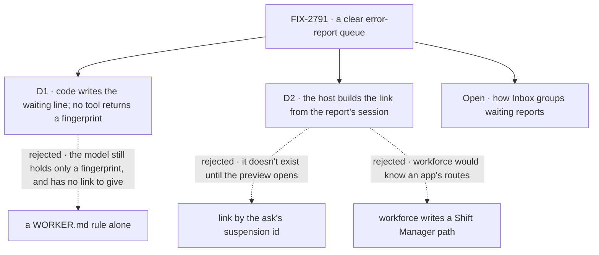

# FIX-2791 · Decisions

[Spec](SPEC.md) · **Decisions**

Two decisions and one open question are the sign-off. Jake fixed the frame: Inbox review stays
for every report, no auto-file. FIX-2793 gives both workers the reports by title, status and
history. What was left: who writes the *waiting* message, how a link reaches one Inbox item, and
how Inbox groups reports.

## The tree

Solid edges are what you're signing. Dashed edges lost, and the label says why.

## D1 · Code writes the *waiting in Inbox* line, as it writes *Filed* today, and no tool hands a model a fingerprint

| | |
|---|---|
| **Instead of** | Only a `WORKER.md` rule telling the model to say *Inbox* and not the fingerprint |
| **Because** | The model said the fingerprint because the tool gave it nothing else: `reportProblem` returns `reportId: "fp-…"`. And at that moment there is no Inbox item yet, since drafting takes minutes. So the honest reply at report time is *drafting, it will wait in Inbox*, and the link comes later, when the preview opens. Code knows that moment (`keepDraft` moves the report to `previewing`), and already writes the *Filed* line at the matching moment, so the *waiting* line goes out the same way, worded by code. `reportProblem` and FIX-2793's `error-history` view name a report by title, status and link. Tenet 7: the check grades what is stored, not a prompt |
| **Locks in** | A line in the reporter's conversation each time a report starts waiting in Inbox; a Lab that wants fewer lines can't turn it off without a new option. `reportProblem`'s answer changes shape: a model that read `decision` and `reportId` reads `status`, `title` and `inbox` |

| Trade-off | Code writes the line (chosen) | `WORKER.md` rule alone |
|---|---|---|
| A link at the right time | Yes, when the preview opens | No; nothing to link at report time |
| Fingerprint in a reply | Not in any tool output | Still in the tool output; the rule must hold |
| Lines in the conversation | One more per report | None |

It comes down to timing: the link exists only once the preview opens, and only code is there then.

**What would change my mind:** a Lab where the reporter's conversation is read by nobody. Then
the line goes only to the report's own session, and the coordinator's tool carries the link.

## D2 · The host builds the link from the report's session, and Shift Manager opens the waiting ask in that session

| | |
|---|---|
| **Instead of** | Linking by the ask's suspension id (Inbox's item id today); or workforce writing a Shift Manager path |
| **Because** | A report's session (`error-report~<id>`) is fixed at intake, before its ask exists, and one report has at most one waiting ask in it: the preview is the flow's only `ctx.suspend`, and a report's runs take turns under its claim, so a later preview replaces an answered one, never sits beside it. Shift Manager finds the ask by the `sessionId` every loaded ask already carries, a search of the Inbox it has read, not of the store. So one address serves every reply, from *drafting* to *waiting*, and Shift Manager finds the item by it. The suspension id appears only inside `ctx.suspend`, too late for the first reply. The host already builds a Shift Manager path for an occurrence's task (`links`), so the Inbox path is built the same way (`inboxLink`), and workforce names no app route (L2 over the app) |
| **Locks in** | Shift Manager's `/inbox/<item>` accepts a session id as well as an item id, and resolves it only against the asks already in the caller's own snapshot (loaded from `sessions.list({ userId })`, the owner check). An id that matches none, whether no report, a report that isn't waiting, or another user's session, opens the same empty selection an unknown id opens today: no status note, no read of the report record or of session state for that id. The ask waits in the operator's session, so the link opens it for the operator only; it is given only where the operator reads it (below). The address holds the report's key, so the fingerprint can appear inside a link's address, never in the text a person reads. A host without `inboxLink` gets the words with no link |

| Trade-off | Report's session, host-built (chosen) | Suspension id |
|---|---|---|
| Known at report time | Yes | No, only once the preview opens |
| Workforce knows app routes | No | No |
| Inbox lookup change | Find a lone ask by its session | None |

It comes down to the first reply: only the session is known when the person reports the problem.

**What would change my mind:** an ask whose id can be fixed before it is raised. Then the link
uses the item id and Inbox needs no second lookup.

## Decided, not asked

- **What each line says** (wording is the implementer's): *waiting* names the title, the source
  in plain words (a failed task and its title, a failed request and its flow and action, or
  described by the user), the count and the link. *Filed* stays as it is and is the only place
  the Linear URL appears in the conversation.
- **Where the lines go:** where `reporter.say` writes today, the reporter's conversation. A
  manual report is made in that conversation, so its reporter hears both lines there.
- **The Shift Coordinator's `WORKER.md`** gains one sentence: when it tells the user about a
  report, it gives the link its `error-history` record carried, never an id.
- **error-reporter's `WORKER.md`**'s existing line ("tell them it will wait in Inbox for the
  operator") stays and gains: never quote a report's id.
- **The ask's message carries source and count** so Inbox shows them with no error-report
  knowledge in the app; `data.source` is added for a reader that wants it.
- **The link is given only to the operator.** The *waiting* line carries it only when the
  conversation's user (`ctx.session.identity.userId`) is the operator, and FIX-2793's
  `error-history` hook puts `inbox` on the record only when its `ctx.userId` is the operator. Anyone else gets the words, *waiting in the operator's
  Inbox*, with no link, as a host without `inboxLink` does. A link they could not open would read
  as broken.
- **`inboxLink` gets the report's own session** (`error-report~<id>`), for every source. For a
  manual report that is not the conversation it was made in (`ctx.session`), which holds no ask.
- **The old `reportProblem` answer needs no dual-read (BP-030).** No code reads its `decision` or
  `reportId`: the goal's `run.mts` reads the preview's answer, which is a different `decision`;
  no `WORKER.md` names either field; one test in `packages/workforce/test` asserts the old shape
  and changes with it. Old answers stay in stored conversations as text a model reads, and no
  tool takes a report id back, so hiding it leaves no follow-up call without its input.
- **The convergence point for "no fingerprint in a conversation"** is every model-facing output
  and every line about a report: `reportProblem`'s answer, the `error-history` record and its path,
  `sayInConversation`'s lines (`keepFiled`, `keepComment`, the new *waiting* line) and
  `keepFiled`'s `ctx.emit.message` fallback, which today prints the report id when the draft has
  no title. A test asserts no `fp-` across all of them.

## Considered and dropped

| Considered | Why it lost |
|---|---|
| Auto-file, so nothing waits | Jake decided Inbox review stays for every report |
| Show the Inbox item's link only in the coordinator's answers | The person who reported in error-reporter's conversation would still get no link |
| Put the Inbox path in `links` | `links` is written into the filed issue's Context; an Inbox path doesn't belong in a public tracker |

## Open

### How should Inbox group waiting error reports?

**In plain terms.** Jake asked that Inbox show error reports as a recognizable group with count,
title and source. Inbox today groups asks under their task; a report's ask has no task, so each
is an item on its own, mixed with every other ask.

**The trade-off.** Group every lone ask by the worker that raised it: error reports become
*Error Reporter · 3 waiting*, and the Shift Coordinator's own approvals (a fire, a repository)
group the same way. One rule, no error-report code in Shift Manager, but other workers' asks
change look too. Or a group for error reports only: exactly what was asked, and nothing else
moves, but Shift Manager learns to recognize the reporter's asks, a special case in the app.

**My recommendation.** Group every lone ask by its worker. The narrower option, a group for
error reports only, is the safer first version if other workers' asks should not move yet. The reporter's asks then carry title,
source and count in their own words (D1's ask message), and Inbox stays one rule.

**What would change my mind.** If the coordinator's approvals must stay as single items at the
top, because they block a turn that a person is watching, then group error reports only.

**What being wrong costs.** A layout change in one Inbox list, inside FIX-2774's view: undone in
a day, with no stored data to move.

## Notes from review

For the implementer; none of these changes the direction.

- **Second look:** "Pass only `reportId`, or pass nothing and let the host receive the final link
  target." Taken as `{ sessionId }`, the report's own session, so a host can't build a link from
  the wrong session.
- **Second look:** the Inbox grouping lands on FIX-2774's unfinished view; ship the reply and
  line parts first, and the grouping when that view is in.
- **Cursor (security), D2:** "Resolve `/inbox/<id>` only against asks already in the caller's
  snapshot. If none match, render the same empty selection an unknown id gets. Do not read the
  org report row, and do not call session state for an id that was not in
  `sessions.list({ userId })`." Folded into D2's Locks in, and the *not waiting now* note is
  dropped: on main, `inboxItemAt` searches only the loaded snapshot, and a status note would have
  been the one path that read past it. The operator-only link is the "resolved principal" half.
- **Second look:** an opaque address (a short hash, the suspension id once known) would keep the
  key out of the address too. Not taken: it needs a second mapping for a value the person never
  reads.

## Analysis

2026-11-17 · watermark: `origin/main` at c0bf4f40 · verdict: **right approach, build as
scoped**.

- *Reuse:* the *Filed* line's path, the `links` precedent and FIX-2774's Inbox view are reused;
  nothing new beside them.
- *Other shapes:* a prompt-only fix and auto-file were weighed (D1, dropped list).
- *Should it exist:* yes; Jake's thread shows a coordinator restating fingerprints.
- *Major concern:* the Inbox part depends on FIX-2774, which is in development.

The analysis and validation passes were run by the author in this session; no separate
sub-agent ran them.

Factual base: no counted set; no checker is built.

## How it got here

- **Draft** — framed as "say plainly where a report is, and let the person open it"; code writes
  the *waiting* line when the preview opens, links are host-built from the report's session, and
  "did you report X" is FIX-2793's tool. Trade-offs are drawn as tables, not SVG, to keep the
  set lean.
- **Review round 1** — the fingerprint may sit in a link's address, never in text a person
  reads, because the report's session holds it (Greptile, second look); the check now strips
  link addresses.
- **Review round 2** — `/inbox/<session>` resolves only against the caller's own asks, and an id
  that matches none opens the same empty selection as an unknown one; the *not waiting now* note
  is gone, and only the operator is given the link (Cursor).
