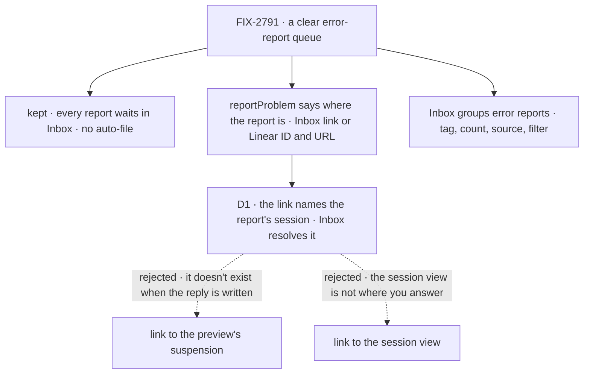

# FIX-2791 · Decisions

[Spec](SPEC.md) · **Decisions**

One decision is the sign-off. Jake already settled the big one: every report waits in Inbox for
review, and nothing auto-files. What is left is what the link in a reply points at.

## The tree

Solid edges are what you're signing. Dashed edges lost, and the label says why.

## D1 · The link names the report's session, so it exists before the draft and Inbox resolves it

| | |
|---|---|
| **Instead of** | Linking the preview's suspension (Inbox's own item id), or the report's session view (`/s/<id>`) |
| **Because** | The reply is written when the report is taken, minutes before the draft and its preview exist, so no suspension id exists yet. The report's session id (`error-report~<report id>`) exists from then on and never changes, a redraft included. The session view shows the run, but the answer is given in Inbox, and the issue asks for "a way to open that Inbox item". So Inbox resolves `/inbox/<session id>` to the item whose hold is in that session. When none waits, it reads that session's lines, which the operator owns and can read: *Filed FIX-123 <url>* shows as filed, *Not filed* as dismissed, and nothing yet as still drafting. Only the operator gets the link: report sessions and their previews are the operator's, and another user's Inbox would never show the item |
| **Locks in** | `/inbox/<report session id>` as a Shift Manager address, beside item ids and suspension ids, with four states: waiting (the item), still drafting, filed, not filed. The link's format is the Lab's (`inboxLink`), never written into `@flow-state-dev/workforce` |

It comes down to when the reply is written: before the preview exists.

**What would change my mind:** if the reply waited for the preview. It can't without holding the
user's turn for the length of a Claude Code draft.

## Decided, not asked

- **The tool output carries the pointer, not only the model's words.** `reportProblem` returns
  `where` (`inbox` or `filed` or `dismissed`), `status`, `inbox` (the link, for the operator,
  while it is not filed) and `issue` (identifier and URL, once filed), and a `say` sentence the
  model can use as is. No fingerprint or report key is in the output except inside the link's
  path. Error-reporter's `WORKER.md` says to give the link, or the Linear ID and URL, and never a
  fingerprint. FIX-2793's `listErrorReports` entries take the same `where`/`inbox`/`issue`
  fields; the link names the report's own session, which is the operator's, never a user's.
- **A non-operator is told where, without a link.** *It waits in Inbox for the operator's review
  before anything is filed.* The operator's Inbox is the only one that holds it.
- **A dismissal says so in its session.** `dismiss` emits *Not filed: set aside until <time>*, as
  `keepFiled` emits its filed line, so the link's not-filed state has a line to read.
- **A repeat answers with the existing report's state.** A `counted` decision reads the row: filed
  gives its issue, waiting gives its Inbox link, dismissed says it was set aside until a time.
- **The conversation says when a preview opens.** The preview step calls `say` with *Waiting in
  Inbox for review: <title> <link>* before it suspends, as `keepFiled` already says *Filed
  FIX-123: <title> <url>*. Both go to the reporter's own conversation, where the operator talks to
  it; a person who reported elsewhere reads the state with `listErrorReports`.
- **The `reportProblem` tool line is talk.** In Shift Manager it reads *Error report, waiting in
  Inbox* (or *filed as FIX-123*) with an Open link, like the `sendMessage` line, so the way in
  doesn't depend on the model or on markdown.
- **Inbox's error report group.** An item whose hold is in an `error-report~` session gets the
  tag ERROR REPORT, the draft title as its heading, *seen N times · from a task / a failed request
  / a burst of failures / described by a person* as its line, and an Error reports filter tab whose
  count is how many reports wait. "Count" in the issue is read as both: the group's and each
  report's. The preview's suspension
  data gains `source` beside `count`; `REPORT_SESSION_PREFIX` is exported from
  `@flow-state-dev/workforce/browser`.
- **No-reporter Labs** pass no `inboxLink`; `reportProblem` then says the report waits for review
  in Inbox, with no link.
- **Changesets:** `@flow-state-dev/workforce` (minor: `inboxLink`, the richer `reportProblem`
  output) and `@flow-state-dev/shift-manager` (patch: the Inbox group and link).

## Considered and dropped

- **Auto-file some reports.** Ruled out by Jake (2026-11-17).
- **Put the Inbox route into workforce.** Workforce knows no Shift Manager routes; `links` already
  takes the same stance.
- **Fix the coordinator's restating here.** That is FIX-2792's.

## Open

None.

## Settled

No POC: the Inbox resolves items by id today, and adding a session match is a read over data the
Inbox already holds. No claim here is disputed. The spec rests on no counted facts.

## Analysis

2026-11-17, at the draft's head. **Verdict: right approach, with folds.**

- **Reuse:** `inboxLink` beside `links`; the preview line through `say`; the group extends
  Inbox's filters and tag; the tool line follows `sendMessage`; the hold already carries its
  session id.
- **Other shapes:** a server read of report status for Inbox was weighed against reading the
  report session's own lines; the session lines win, since the operator can already read them and
  the collection stays closed to browsers.
- **Should it exist:** yes.
- **Concerns, folded:** the link showed *still drafting* forever for a non-operator and after an
  answer. Now the link goes only to the operator, and Inbox reads filed and not-filed states from
  the session. The two specs disagreed on ids in the tool output; one rule now covers both. The
  check's "no `fp-`" rule contradicted the link's path and missed a bare hash; it now names both.
  The debt is up a little, not flat.

## How it got here

- **Draft** — framed as "say where each report is, and make Inbox open it"; the reply points at
  the report's session, which Inbox resolves, and reads FIX-2793's tool for filed reports.
