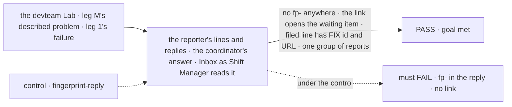
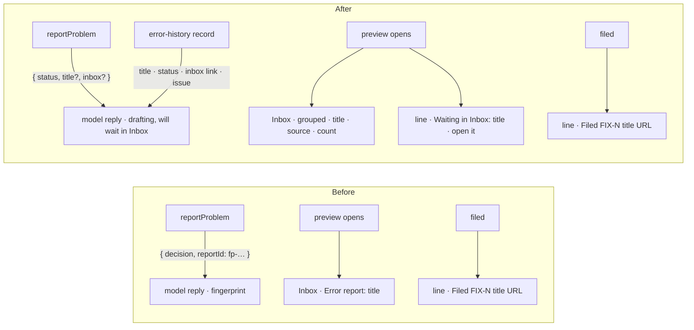
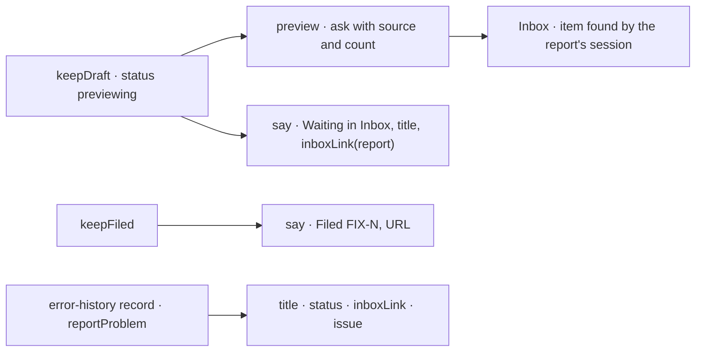

# FIX-2791 · Make the error-report queue clear: what's waiting, where, and what got filed

**Spec** · [Decisions](DECISIONS.md)

Part of epic [FIX-2369](../../epics/FIX-2369/SPEC.md). Builds on [FIX-2793](../FIX-2793/SPEC.md),
whose history and read-only `error-history` view this spec reads; it does not restate them.

## Five people, before and after

| Someone who… | Today | After |
|---|---|---|
| **tells error-reporter about a problem** | Gets back the tool's answer, `{ decision: "new", reportId: "fp-ba36…" }`, which the model repeats as a fingerprint | Is told it is being drafted and will wait in Inbox for the operator, by title, with no fingerprint ([D1](DECISIONS.md#d1)) |
| **has a report reach Inbox** | Hears nothing in the conversation until it is filed | Gets a line in the reporter's conversation: *waiting in Inbox*, the title, where it came from, how many times seen, and a link that opens that Inbox item ([D1](DECISIONS.md#d1), [D2](DECISIONS.md#d2)) |
| **asks the Shift Coordinator what was reported** | Gets fingerprints relayed from error-reporter, then the same list restated | Gets titles, statuses and the same Inbox links, read from FIX-2793's `error-history` view ([D2](DECISIONS.md#d2)) |
| **sees a report filed** | Gets *Filed FIX-N: title URL* in the reporter's conversation | The same line, and the report's `error-history` record carries the Linear ID and URL from then on |
| **opens Inbox with three reports waiting** | Sees three separate items headed *Error report: …*, mixed with every other ask, no source | **Open to the owner** ([Open](DECISIONS.md#open)). Recommended: one group per asking worker, *Error Reporter · 3 waiting*, each item with its title, source and count |

## The goal, and how we'll know it's met

**Whenever error-reporter or the Shift Coordinator speaks about a report, the person can tell
whether it is waiting in Inbox or filed, and can open it in one click: the Inbox item while it
waits, the Linear issue once it is filed. No reply shows a fingerprint in the text a person
reads, and Inbox shows waiting reports together, each with its title, source and count.**

| Is it the right goal? | |
|---|---|
| **The real need** | The issue: the replies "didn't say that or give a way to open them", and "the queue and the replies were unclear". Jake (2026-11-17): Inbox review stays for every report, no auto-file |
| **Smaller, and rejected** | "Tell the model in `WORKER.md` not to say fingerprints." The tool still hands it one, and the model has no link to give, so the reply can say *Inbox* but can't open anything |
| **Bigger, and not this issue's** | Filing without review (Jake decided against). The history and the read tool (FIX-2793). Inbox's read path (FIX-2774, in development). Reports that never reach the reporter (FIX-2790) |
| **Not done if** | A tool output, line or reply about a report holds `fp-` outside a link's address · the operator's *waiting* line has no link, or its link opens nothing for the operator while the report waits · an `/inbox/` address that matches none of the caller's own asks shows anything an unknown id doesn't · a filed report's line or tool entry lacks the Linear ID or URL · the Shift Coordinator's answer drops the link the `error-history` record gave it · Inbox shows the reports with no source or count |



The check reads the stored conversation items and opens the link on the page, so a reply that
says *Inbox* without a working link still fails.

| How we verify | |
|---|---|
| **Goal check** | A new **leg Q** in [`goals/error-reporter/files-a-reproducible-issue`](../../../goals/error-reporter/files-a-reproducible-issue/goal.md), after leg M and leg R (FIX-2793) |
| **Signal** | **a** After leg M's `reportProblem`, the reporter's reply and every item in its conversation hold no match for `/fp-[0-9a-f]{8,}/` once link addresses (a Markdown link's target, an `href`) are removed; a bare URL counts as text and fails. **b** When leg M's preview opens, a line in the reporter's conversation says it waits in Inbox and links to it; that link, opened in Shift Manager, shows that report's ask. **c** After leg 1 files, the line and its `error-history` record carry the tracker's identifier and URL. **d** The Shift Coordinator, asked what is waiting, answers with the report's title and its link, no fingerprint. **e** Inbox, read as Shift Manager reads it, shows the waiting reports together with each one's title, source and count |
| **Input** | The goal's Lab and plants; the coordinator's question is held out of every prompt |
| **Anti-game** | Grade the stored items and the page the link opens, not the reporter's prompt. A link that opens Inbox's list, not the item, fails **b** |
| **Control that must fail** | `GOAL_CONTROL=fingerprint-reply`: `reportProblem` returns today's `{ decision, reportId }`, and no *waiting* line is written. FAILS **a** and **b** |
| **Reproduce first** | In `packages/workforce/test/error-reporter.test.ts`, on today's main: a `reportProblem` call's output holds `fp-` and nothing that says Inbox or opens it (red). Green with this change |

## What changes



Left, the model's only handle on a report is its fingerprint. Right, code writes the *waiting*
line with a link, and every tool answer names a report by title, status and link.

```diff
  // @flow-state-dev/workforce · ErrorReporterOptions
  links?: (ids: OccurrenceIds) => Record<string, string>;
+ inboxLink?: (report: { sessionId: string }) => string;  // the report's own session, error-report~<id>, for every source

  // reportProblem's answer
- { decision: "new", reportId: "fp-ba3661df…" }
+ { status: "drafting", waitsIn: "Inbox", note: "It will wait in Inbox for the operator; I'll post the link here." }
+ { status: "waiting in Inbox", title: "Checkout total wrong after coupon", inbox: "/inbox/error-report~…" }   // a repeat of a waiting one

  // the preview's ask, as Inbox reads it
- title: "Error report: <title>", message: "Seen 3 times. File it?"
+ title: "Error report: <title>", message: "From a failed task (Tidy checkout) · seen 3 times. File it?"
+ data: { …, source: "task" }

  // packages/shift-manager/teams/devteam/host.mts
+ inboxLink: ({ sessionId }) => `/inbox/${encodeURIComponent(sessionId)}`,
```

**Docs:** at release, [`apps/docs/docs/workforce/error-reporter.md`](../../../apps/docs/docs/workforce/error-reporter.md)'s
"From failure to filed issue" gains what the reporter says at each step, and "Options" gains
`inboxLink`; `packages/workforce/README.md`'s reporter options name it. Shift Manager's Inbox
grouping goes in its own release notes. No new page.

## How it gets there



## What stays as it is

- Inbox review for every report (Jake's decision). Auto-file stays only where a Lab already names
  it (`preview.autoFile`).
- The issue's Context section still lists the fingerprint: it is for the engineer in Linear,
  not the person in the conversation.
- The *Filed* and *Commented* lines `keepFiled` and `keepComment` write today.
- How Inbox lists and answers asks: FIX-2774's view. This spec changes only how waiting asks are
  grouped and what the reporter's ask says.

## What's already here, and the debt

| Already here | What this does with it |
|---|---|
| **The job: tell the conversation what happened to a report.** One way: `sayInConversation` → `reporter.say` → the `line` entry, used for *Filed* and *Commented* | **Extended**: one more line, *waiting in Inbox*, from the same place in the flow |
| **The job: give a host's link for something a report names.** One way: `links` on `ErrorReporterOptions`, which the devteam host fills with a Shift Manager task path | **Extended** by a sibling option, `inboxLink`, same shape of host-built relative path. Not folded into `links`, which is per occurrence and lands in the filed issue |
| **The job: open one Inbox item.** Shift Manager's `/inbox/<item>` route, resolved by `inboxItemAt` by item id or hold id | **Extended**: it also finds a lone ask by the session it waits in, which a report knows from intake, before its ask exists, among the asks already in the caller's snapshot only |
| **The job: group what waits on the user.** Orchestration's `inboxItems` groups holds under their task; a lone ask is its own item | **Extended** per the [Open](DECISIONS.md#open) answer |
| FIX-2793's `error-history` view | **Reused**: its record carries `inbox` for a waiting report and `issue` for a filed one |

| Adds | Existing piece considered | Why it doesn't fit / how composed |
|---|---|---|
| `inboxLink` reporter option | `links` | Composed beside it: `links` is per occurrence and written into the Linear issue; an Inbox path in a public issue is wrong |
| The *waiting* line | The *Filed* line | Same `sayInConversation` path |
| `source` on the preview's ask | The ask's `data`, already carrying `reportId`, `count` | Extends the same data |
| Inbox lookup by session | `inboxItemAt` | Extends the same lookup |

| The debt | |
|---|---|
| **Removes** | The fingerprint as the model's handle on a report |
| **Adds** | One reporter option and one line: permanent by design. Inbox grouping: permanent by design, inside FIX-2774's view |
| **Leaves** | Nothing new |

**Net: flat.** One option and one line in, the fingerprint out of every conversation surface.

## Where this meets its neighbours

- **FIX-2793** must merge first: its view and its title-not-fingerprint rule are this spec's input.
- **FIX-2774** (in development) moves Inbox onto a workforce `inbox` view. The grouping and the
  lookup by session land on that view, so the Inbox part of this issue waits for it; the reply
  and line parts don't.
- **FIX-2790** (another thread) changes the capture paths in `reporter.ts`; this spec touches
  `flow.ts`'s `reportProblem`, `keepDraft` and `preview`, and the reporter's options. Whichever
  merges second rebases.

## Sign off

**[The goal](#the-goal-and-how-well-know-its-met), at that size:** waiting or filed is always
plain, one click opens it, no fingerprint, reports grouped in Inbox. If wrong: the next reply
still reads like a database key.

**[The debt](#whats-already-here-and-the-debt), net flat:** one option and one line in, the
fingerprint out. If wrong: a host with no `inboxLink` gets words without a link.

1. **[D1](DECISIONS.md#d1) · Code writes the *waiting in Inbox* line, as it writes *Filed*
   today, and no tool hands a model a fingerprint.** If wrong: the model's own reply and the code's
   line can both appear for one report.
2. **[D2](DECISIONS.md#d2) · The link is built by the host from the report's session, and Shift
   Manager opens the waiting ask in that session, found only among the caller's own asks.** If
   wrong: a link that opens nothing once the report stops waiting, the same as an unknown id.
3. **[Open](DECISIONS.md#open) · How Inbox groups waiting reports.** Recommended: group every
   lone ask by the worker that raised it. The narrower option is a group for error reports only.
   The one to weigh.

Improvement · `workforce`, `shift-manager` · S (one option, one line, the `error-history` record's and ask's
fields, one Inbox lookup and a grouping) · blocked by FIX-2793 (this PR) and, for the Inbox part,
FIX-2774 · [Linear](https://linear.app/fixpoint-labs/issue/FIX-2791)
