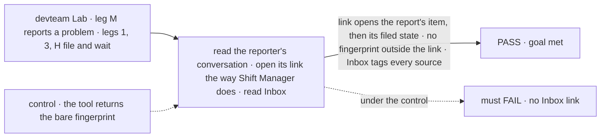

# FIX-2791 · Make the error-report queue clear: what's waiting, where, and what got filed

**Spec** · [Decisions](DECISIONS.md)

## Six people, before and after

| Someone who… | Today | After |
|---|---|---|
| **tells error-reporter about a problem** | Gets a reply naming `fp-ba3661df…`, with no word that it waits in Inbox or how to open it | Gets a reply that says it waits in Inbox for review, with a link to that Inbox item, and no fingerprint. The `reportProblem` line in the conversation reads *Error report, waiting in Inbox* with an Open link |
| **opens that link before the draft is ready, or after it was answered** | (no link) | Sees Inbox say the report is still being drafted; once the preview opens, the same link opens the item; once answered, it says *Filed as FIX-123* with the URL, or *Not filed* |
| **reports a problem but isn't the Lab's operator** | Gets a fingerprint | Is told it waits in Inbox for the operator's review, with no link, since the item is the operator's to answer |
| **asks the Shift Coordinator what error-reporter filed** | Gets the fingerprints restated | Gets error-reporter's reply relayed: each report waiting in Inbox with its link, or filed with its Linear ID and URL ([FIX-2793](../FIX-2793/SPEC.md)'s tool) |
| **reports a problem already filed** | Gets "counted" and a fingerprint | Is told it is already filed as FIX-123, with the URL, and that this one was counted on it |
| **scans Inbox** | Sees an error report as one more QUESTION from "unknown worker · task —" | Sees an **ERROR REPORT** tag, the report's title, "seen 3 times · from a task" (or a failed request, a burst of failures, or described by a person), and an Error reports filter with how many wait |

## The goal, and how we'll know it's met

**Whoever deals with an error report can tell, at every point, where it is: waiting in Inbox with
a way to open that item, or filed with its Linear ID and URL, and Inbox shows error reports as
their own group. Every report still waits in Inbox for review; nothing files on its own.**

| Is it the right goal? | |
|---|---|
| **The real need** | The issue: "Those are Inbox items waiting for review, but the reply didn't say that or give a way to open them." Jake (2026-11-17): "Inbox review stays for every report. No auto-file." |
| **Smaller, and rejected** | "Change the reply's wording only." A model's reply can still drop the pointer; the tool output and the tool line have to carry it, and the link has to open something |
| **Bigger, and not this issue's** | Rendering worker replies as markdown, and the coordinator restating answers already visible (FIX-2792). Auto-filing (ruled out) |
| **Not done if** | A reply, tool output or tool line names a fingerprint (an `fp-` id or its bare hash) anywhere but inside the Inbox link's path · the operator's link opens nothing, before the preview, while it waits, or after it was filed or dismissed · a non-operator is handed a link to an item they can't see · a repeat of a filed report isn't told its Linear ID and URL · a filed report's line or listing lacks them · an Inbox error report, from any source including a storm, doesn't show its tag, count and source · a report files without the operator's answer |



The link must open the same item Inbox lists for that report, through Shift Manager's own route
resolution.

| How we verify | |
|---|---|
| **Goal check** | `goals/error-reporter/files-a-reproducible-issue/`, legs **M**, **1**, **3** and **H** extended · models as those legs run today (leg M's turn real) · run by the implementer at completion, after FIX-2793 lands · verdict on the implementation PR |
| **Signal** | Leg M, as the operator: the `reportProblem` output holds an Inbox link and no 32-hex fingerprint outside it; the reply holds the same link. Resolving the link with Shift Manager's own route and Inbox code over the Lab's Inbox and the report's session gives the *still drafting* state before the preview opens and the report's item while it waits. Leg 1: after filing, the same link resolves to the *filed* state with the recorded identifier and URL, and the conversation line and `listErrorReports` carry them too. Inbox read with `createLabReader` tags legs M, 1, 3 and H's items ERROR REPORT with their count and source (described, request, burst, task). Every existing leg still asserts nothing is filed before the operator answers |
| **Input** | The goal's devteam Lab, its planted failures and its leg M message |
| **Anti-game** | The link is resolved by Shift Manager's code, not matched by text. The reply is graded on what it holds (the link, no fingerprint), not on wording, and the tool output carries the link so the grade doesn't rest on the model alone |
| **Control that must fail** | `GOAL_CONTROL=bare-fingerprint`: `reportProblem` returns only `{ decision, reportId }` as today; it must FAIL leg M on *an Inbox link*. `GOAL_CONTROL=untagged-inbox`: Inbox draws error reports as plain questions; it must FAIL on *tagged with count and source*. `GOAL_CONTROL=filed-no-link`: the filed state drops the issue; it must FAIL leg 1 on *the link resolves to the filed state with the identifier* |

## What changes


The reporter says where each report is, and Inbox can open it from that.

```diff
  // the devteam Lab (host.mts)
  createErrorReporter({
    worker, operator, tracker, …,
+   inboxLink: (reportSessionId) => `/inbox/${encodeURIComponent(reportSessionId)}`,
  })

  // what reportProblem returns to the model
- { decision: "new", reportId: "fp-ba3661df23accff4f40d285b0aa08d7d" }
+ { decision: "new", where: "inbox", status: "drafting",
+   inbox: "/inbox/error-report~fp-ba3661df…",
+   say: "It waits in Inbox for the operator's review before anything is filed: /inbox/…" }
+ // a repeat of a filed report:
+ { decision: "counted", where: "filed", status: "filed",
+   issue: { identifier: "FIX-123", url: "https://linear.app/…" }, say: "Already filed as FIX-123 …" }
```

**Docs:** at release, `docs/workforce/error-reporter.md` updates "From failure to filed issue"
(the reply's Inbox link, the line when a preview opens, the Error reports group in Inbox) and
"Options" (`inboxLink`). The workforce README lists `inboxLink`. No new page.

## What stays as it is

- Every report waits for the operator in Inbox. `preview.autoFile` and `autoFileAfterMs` stay as
  they are, off unless a Lab sets them (the devteam Lab sets neither).
- The preview form, its answers, filing, counted comments, dedupe and the storm report.
- Inbox items keep their ids; old links by suspension id still open.

## What's already here, and the debt

| Already here | What this does with it |
|---|---|
| **The job: point a person at where a report is.** `ErrorReporterOptions.links` (per-occurrence links, such as "Task in Shift Manager"), and `keepFiled`'s conversation line with the issue's ID and URL. Searched `links`, `Filed `, `say(` in `error-reporter/` | **Extended**: `inboxLink` sits beside `links`, for the report itself rather than an occurrence. The filed line is reused as is |
| **The job: open an Inbox item from a link.** `inboxItemAt` (an item's id, or a hold's id for older links) | **Extended**: also a hold's session id |
| **The job: draw a tool call as talk.** `ToolLine.tsx` draws `sendMessage` as its own line with a link | **Precedent** for the `reportProblem` line |
| **The job: answer "did you report X".** [FIX-2793](../FIX-2793/SPEC.md)'s `listErrorReports` | **Reused**: its report entries gain the same `where`/`inbox`/`issue` fields |
| No retained predecessor spec; FIX-1983's design is in the headers of `error-reporter/*.ts` | **Kept** |

| Adds | Existing piece considered | Why it doesn't fit / how composed |
|---|---|---|
| `inboxLink` reporter option | `links` | `links` takes an occurrence's ids and labels several pages; the Inbox link is one per report and keyed by the report's session |
| A "waiting in Inbox" conversation line when a preview opens | `say`, already used for filed and commented | **Composed** from `say` |
| An Error reports group in Inbox | The All / Approvals / Questions filters | **Extends** the filter list and the item's tag |

| The debt | |
|---|---|
| **Removes** | The raw fingerprint as the only handle a reply gives |
| **Adds** | Inbox knows the error report's session prefix, its preview data shape and its filed and not-filed lines, and takes a third address form (a session id, beside item and suspension ids). `ToolLine` special-cases `reportProblem`. Accepted: Shift Manager already special-cases the reporter's flow (`TaskBoardMeta.tsx`) and `sendMessage`; one Inbox group is the issue's ask |
| **Leaves** | The link is plain text in a worker's reply until FIX-2792 renders replies as markdown; the tool line's Open link works now |

**Net: up, a little.** One option, one conversation line, one Inbox group and one address form
come; the fingerprint as a handle goes.

## Sign off

**[The goal](#the-goal-and-how-well-know-its-met), at that size:** at every point a report is
either waiting in Inbox behind a link that opens it, or filed with its ID and URL; Inbox groups
them; nothing auto-files. If wrong: someone is still handed a fingerprint and has to hunt.

**[The debt](#whats-already-here-and-the-debt), net up a little:** one option, one line, one
Inbox group, one address form. If wrong: Inbox knows one worker's data shape.

1. **[D1](DECISIONS.md#d1) · The link names the report's session, so it exists before the
   draft and Inbox resolves it, through to filed or not filed.** The one to weigh. If wrong: a
   link that says "still drafting" for a few minutes after the reply.

Improvement · `workforce`, `shift-manager`, the error-reporter goal · S · after
[FIX-2793](../FIX-2793/SPEC.md) (reads its tool) · [Linear](https://linear.app/fixpoint-labs/issue/FIX-2791)
