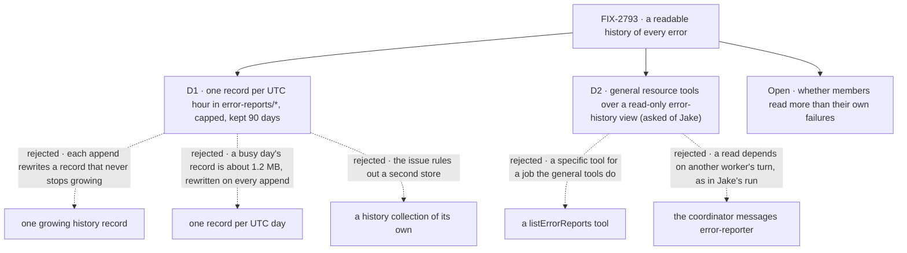

# FIX-2793 · Decisions

[Spec](SPEC.md) · **Decisions**

Two decisions and one open question are the sign-off. Jake fixed the frame: build on the
`error-reports/*` collection, no second store, and both error-reporter and the Shift Coordinator
read the history. What was left: the history's shape (the issue recommends one record per day),
how the two workers read it, and who in an org may. D2 is asked of Jake on the PR's decision
card: general tools on a filtered view (recommended), or keep `listErrorReports`.

## The tree

Solid edges are what you're signing. Dashed edges lost, and the label says why.

## D1 · The history is one record per UTC hour, in the same collection, capped per hour and kept 90 days

| | |
|---|---|
| **Instead of** | One history record that grows forever (the issue's other option); one record per UTC day (the issue's recommendation); or a collection of its own |
| **Because** | A record is written whole through a compare-and-set, so a growing record makes every append cost more and makes every append on a busy time collide with one big write. A day record is not small enough: an entry is about 600 bytes of JSON (ids, a 32-character fingerprint and a 200-character message), so a day capped at 2,000 entries is about 1.2 MB, rewritten on every append. An hour's record is capped at 250 entries, about 150 KB at worst, and a busy hour contends on one key the way a repeated failure already contends on its own `fp-` report. A date range reads computed keys (or one prefix per day), with no list of the whole family, and retention deletes computed old keys. One collection keeps the issue's rule (no second store) and the reports' scope, redaction and org fence, unchanged. Tenet 2: no new primitive |
| **Locks in** | The `log-<YYYY-MM-DD>-<HH>` keys in `error-reports/*`, in UTC. A reader that wants a local day reads the hours that make it up. A deployment's stored history stays readable across releases, so a later change of entry shape dual-reads (BP-030) |

| Trade-off | One record per hour (chosen) | One growing record |
|---|---|---|
| Cost of one append | One record of at most ~150 KB | Grows with the whole history |
| A date range | Computed keys, no list | One read, then filter |
| Retention | Delete computed old keys | Rewrite the record |
| A busy hour | Capped at 250, with a count of what was cut | Unbounded |

It comes down to the cost of an append: a growing record makes the hundredth failure cost more
than the first.

**What would change my mind:** a store with a real append verb for a record. Then one growing
record costs nothing to append, and a list by range is the only difference.

## D2 · Workers read the history with core's general resource tools, over a read-only, caller-filtered `error-history` view

Asked of Jake on the PR's decision card; this is the recommendation.

| | |
|---|---|
| **Instead of** | A `listErrorReports` tool made for error reports (the first draft); the coordinator asking error-reporter (`sendMessage`) and relaying, as in Jake's run |
| **Because** | Jake: workers should search and navigate resources without a tool made for one resource. Core already has that surface: `searchResources` and `readResourceContent` reach any `llmReadable` collection, projected ones included, and a projected collection's `read`/`search` hooks get a trusted, server-derived `ctx.userId`, so the per-record caller check (BP-031) lives in the hook, where the per-collection `resourceVisibility` rule can't put it. A read still never rests on a second worker's turn. Workforce owns the view (L2); core and engine learn nothing. Tenet 2: no new tool |
| **Locks in** | The `error-history/**` path and its record fields, which a worker's searches spell. `searchResources` and `readResourceContent` in the devteam catalog and in two `tools:` lines, which also reach every other `llmReadable` collection the worker's flow declares. Narrowing by status or source is by search words: `searchResources` forwards no equality `filter` today |

| Trade-off | General tools on a view (chosen) | `listErrorReports` |
|---|---|---|
| New public surface | A collection path | A tool name and its arguments |
| Narrow by status or source | Search words the hook reads | Exact arguments |
| A list with no keyword | A query is needed (`"error report"` matches every record) | No arguments needed |
| Same as other Workforce lookups | No: they are tools of their own | Yes |

It comes down to surface: one view the general tools reach, against one more tool for one
resource. The cost is looser narrowing.

**What would change my mind:** a goal run where a worker misses a report it should have listed
because its search words didn't match. Then the fix is `searchResources` forwarding `filter`
(core), not a specific tool.

## Decided, not asked

- **One helper writes the history, and only two callers use it (tenet 5).** Every history write
  goes through one append helper, called only from `intakeOccurrence` and `updateReport`.
  Occurrences go in at `intakeOccurrence`, the one door every occurrence enters by (the capture,
  the board drain, `reportProblem`), after its decision, for every decision except `ignored`:
  `new`, `counted` and `storm` each write one entry with the report id the decision named. A
  `held` decision names no report (a failed request inside a task, whose task may still pass),
  so its entry carries the `taskId` and no report id; the view joins it to the task's report at
  read time through the `task-<task>` mapping, so no entry is rewritten later. Status changes go
  in at `updateReport`, which every flow handler that moves a status goes through (draft kept →
  `previewing`, dismiss, approve → `filing`, file → `filed`, keep only, the comment's `closed`).
  It writes a status entry when the status or the issue (identifier or URL) it wrote differs
  from what it read, and reads both from the row it wrote. That entry is appended after the
  compare-and-set settles, from the row read and the row written, never inside `change`, which
  re-runs on a conflict; its dedupe key (report id, status, issue identifier) makes a retry
  append once. The three writers in
  `reports.ts` that build a report with `updateStateWith` directly (`decide`'s new report,
  `countOn`, `listOnStorm`) set the first status, `owed`, which the occurrence entry already
  records. A writer added later that moves a status outside `updateReport` must write its own
  entry; the implementer adds a test that fails on that.
- **How the hooks reach the store.** A projected hook gets a trusted `ctx` and no resource
  refs, so it can't open `error-reports/*` itself. The reporter can: `ErrorReporter` gains one
  read method that runs the intake flow's internal `reports` entry through its bound host
  (`host.run`, `source: "internal"`, as the operator), the path the restart outbox takes at
  bind. The devteam host's `run` is an in-process `runAction` on the runtime's stores. The entry
  gains an op that returns a day's hour records with the reports they name. One `search` is one
  such run. Before `bind`, and in a Lab with no Error Reporter, the hooks return no hit. The
  implementer checks that this read doesn't queue behind a long intake run on the intake
  session, and reads in a session of its own if it does.
- **The view is deny-by-default (BP-031), and the hook is its only fence.** The internal run
  reads as the operator, so the hook filters what it returns, by `ctx.userId` and `ctx.orgId`
  only, never a query word: a different org reads nothing. The operator reads every report and
  entry. Any other user reads a report, with its title, status, count, issue and entries, only
  through their own occurrences: an entry whose `userId` is theirs, or a held entry of their
  task. Anyone else gets no hit, and `read` returns `null` as for an unknown key, so the answer
  doesn't tell a refused report from no report. Search words narrow only what the caller may
  read. The existing `error-reporter-begin` makes the same check, for the same reason: the
  dossier reads every user's failures. Whether to widen it is the [Open](#open) question.
- **One record per report per UTC day,** at `error-history/<YYYY-MM-DD>/<ref>`, org scope,
  `llmReadable`, no client read. A report has a record on each day it has an entry (an
  occurrence or a status change), so a day narrows by `prefix`, and a search with no prefix
  reads the last 7 days. The record carries the report's title, status in words, source, count,
  first and last seen, task ids, issue, and that day's entries, newest first, at most 50, with
  the hour's `cut` count when one was cut; a `contentTemplate` renders it for
  `readResourceContent`. `ref` is a short name from the title and a few characters that keep it
  unique, never `fp-` or the fingerprint (FIX-2791's rule covers paths); `read` resolves it
  through that day's hour records, which name every report the day saw, with no list of the
  collection.
- **An entry holds:** its time, kind (`occurrence` or `status`), the report id, the source, the
  fingerprint, the ids (`requestId`, `sessionId`, `taskId`, `boardId`, `attempt`, `userId`), a
  short redacted message (the first 200 characters of the error or description), and for a
  status entry the new status and, for `filed`, the issue's identifier and URL. Entries are
  redacted with the same secrets the intake uses.
- **A redelivered occurrence is logged once.** An entry carries the occurrence's key (the one
  `seen` dedupes by), and an append with a key already in that hour's record is skipped. An
  intake retried after a failed history write therefore doesn't log twice.
- **The history write never fails the intake.** A history write that fails is logged through the
  reporter's `log` and the intake returns its decision. A report is what must not be lost; the
  history is a record of it.
- **An hour keeps at most 250 entries,** then counts the rest in the record (`cut: n`), so a
  storm can't grow one record without bound. Past the cap an occurrence is counted, not kept:
  the view says when an hour was cut and by how many.
- **Retention is 90 days, with no list.** When the intake creates the first record of a UTC
  day, it deletes the computed keys of the days 91 to 97 back (7 × 24 keys). A delete of a
  missing key is a no-op, so two intakes that both prune do no harm, and a Lab silent for up to
  a week still prunes the days it skipped. A Lab silent for longer leaves those older records
  in place; the view never reads past 90 days, so they cost storage only.
- **`listReports` lists by prefix.** It lists `fp-` and `storm-` keys only, so the restart outbox
  never loads history (BP-033).
- **The view's statuses are the caller's words, not the stored enum:** `owed` and `drafting` read
  *drafting*, `previewing` *waiting in Inbox*, `filing` *approved, filing*, `filed` with an issue
  *filed*, `filed` with none *kept, no tracker* (what `keepOnly` stores today), `dismissed`,
  `closed` *issue closed*. It never names a report by its fingerprint; it names it by the title
  (the draft's, else the error's first line). FIX-2791 relies on that.
- **What a search matches.** The hook reads the query's words against each record's title,
  status words (with *not filed* for any status short of filed), source and task ids, and every
  record carries the words *error report*, so `"error report"` lists them all. The hook also
  takes an equality `filter` on `status`, `source` and `taskId` for a caller of the
  collection's `list`; `searchResources` doesn't forward one today.
- **error-reporter's `WORKER.md` gains one paragraph:** asked whether something was reported,
  search `error-history` and answer from it, never from the task board. The Shift Coordinator's
  gains the same. Both `tools:` lines name `searchResources` and `readResourceContent`; the
  catalog has them in every Lab, so the files are the same whether a Lab has an Error Reporter
  or not.

## Considered and dropped

| Considered | Why it lost |
|---|---|
| Keep every occurrence on the report (`KEPT_OCCURRENCES` unbounded) | The report is read whole by every draft, repeat and run; it would grow with every repeat |
| **Rejected: a `listErrorReports` tool** (the first draft's D2) | A public tool for one resource, where core's general tools reach a projected view of it. Jake's review asked why workers need a resource-specific tool. Its exact filters are the one thing it had over the view ([D2](#d2)) |
| Read the reports through the intake's internal `reports` entry from the coordinator | Internal entries are not a model's tool, and it returns whole records, dossier fields included. The view's hooks call it, and filter what it returns |
| A history screen in Shift Manager | Not asked. The tool answers in conversation; a screen can read the same records later |

## Open

### Should a member see more than their own failures?

**In plain terms.** The reports belong to the org. In a Lab with several users, one user's
failure becomes a report another member's Shift Coordinator could read: its title, its message,
and the ids of the session and task that failed. Until you decide, the view shows a member only
their own failures and the operator everything ([Decided, not asked](#decided-not-asked)). The
question is whether other members should also read a summary (title, status, count, source,
when, the Linear link) of reports that aren't theirs.

**The trade-off.** Summaries for everyone: a team sees its shared errors, and a teammate asking
"was this reported?" about a failure they didn't hit gets an answer. But a title is not a safe
summary: a described problem's message is the user's own description (`reports.ts`, the manual
intake), the title falls back to the message's first 120 characters (`flow.ts`), and the drafted
title comes from a dossier of every user's failures. Own-only: private, and widening later is one
check in the hook, but the teammate gets an empty answer.

**My recommendation.** Keep the default: operator and own failures only. I changed this from
round 1's "every member reads summaries" because the condition I named then as what would change
my mind is true on main: a title can quote a user's own words. The coordinator that would read it
also holds `hire`, `fire` and the routine tools, so another user's text would reach a model that
acts. If members need more later, widen to "a report exists, with its status and Linear link",
with no title or message.

**What would change my mind.** Titles written only from code-side fields (flow, action, error
code), never from a message or a description. Then a summary carries no user text, and every
member can read it.

**What being wrong costs.** Too closed: a teammate's coordinator says it found nothing about a
failure they didn't hit, and they ask the operator. Too open: one user's words reach another
user's coordinator. Either is one check in the hook to change.

## Notes from review

For the implementer; none of these changes the direction.

- **gitar-bot, D1:** "add a size estimate for the 2,000 cap and state the worst-case record size,
  or shard the day by hour (`log-<day>-<hh>`), or lower the cap and name the tradeoff against the
  goal." Folded as the hourly record; the 250 cap and the ~600-byte entry are estimates for the
  implementer to measure in a test.
- **Cursor, D1:** "implementers may co-append history in the same CAS as the `fp-*` update or use
  hour shards before chasing a store-level append verb." Hour shards taken. Co-appending on the
  `fp-` report would put the history back on a record that grows with every repeat, so no.
- **Second look, `listReports`:** `list(prefix)` exists on the collection ref and filters keys
  before refs are made, so `listReports` lists `fp-` and `storm-`. One `isReportKey` helper used by
  `listReports` and the view is cheaper than a prefix list written twice.
- **Second look, words for statuses:** the reporter's lines (FIX-2791) and the view's status words
  should share one status-to-words function, or they will drift.
- **Cursor (security), the tool's access:** "Return title, message, inbox link, and every id only
  when the caller is the operator or that occurrence's `userId`. Anyone else gets the same empty
  `{ reports: [] }`… Apply `taskId` only after that allow. Add a goal or unit check that a second
  user in the org is refused." Folded as the deny-by-default bullet (now the hook's check, where
  the empty answer is no hit) and the access check. A
  report with occurrences from several users shows a non-operator their own entries only; its
  shared title can still come from the whole dossier, which is why the Open question recommends
  against widening.
- **Second look, order with FIX-2790:** prefer FIX-2790 first, since it only widens capture.

## Analysis

2026-11-17 · watermark: `origin/main` at c0bf4f40 · verdict: **right approach, build as
scoped**.

- *Reuse:* the collection, its CAS helper and the read helpers are reused, and since the owner
  amendment, core's projection and general resource tools too; the Adds table names each piece
  considered. No second store, no new tool.
- *Other frameworks:* error trackers (Sentry, Rollbar) keep an issue per fingerprint with an
  unbounded event stream beside it; this is the same split, at Lab scale.
- *Other shapes:* raising the keep and a second collection were weighed (D1).
- *Should it exist:* yes; the screenshot shows a coordinator unable to answer a direct question.
- *Major concern:* who reads it in a multi-user org: deny-by-default, and widening is the open
  question.

The analysis and validation passes were run by the author in this session; no separate
sub-agent ran them. A reviewer should weigh that.

Factual base: the spec rests on no counted set beyond two constants read from source
(`KEPT_OCCURRENCES = 5`, the seven statuses), so no checker is built.

## How it got here

- **Draft** — framed as "keep every occurrence and status change, and let both workers read
  it"; one record per UTC day in the existing collection, written at the intake and at
  `updateReport`, read by one Workforce tool. Trade-offs are drawn as tables, not SVG, to keep the
  set lean.
- **Review round 1** — the history is one record per UTC hour, not per day, because a day capped
  at 2,000 entries is about 1.2 MB rewritten on every append (gitar-bot, Cursor). Retention deletes
  computed keys with no list; a held occurrence is logged by its task; the org-read question
  names how the tool knows its caller.
- **Review round 2** — the tool is deny-by-default: operator and own failures only, an empty
  answer for anyone else, filters after the check, and a unit check that a second user is refused
  (Cursor). The Open question's recommendation moved to that default, because a title can quote a
  user's own words.
- **Owner amendment** — the read side is a read-only, caller-filtered projected collection,
  `error-history/**`, searched with core's `searchResources` and `readResourceContent`, and
  `listErrorReports` is rejected, because Jake asked why workers need a resource-specific tool
  when general ones exist. Its hooks read through the reporter's bound host. D2 is asked of
  Jake on the card.
