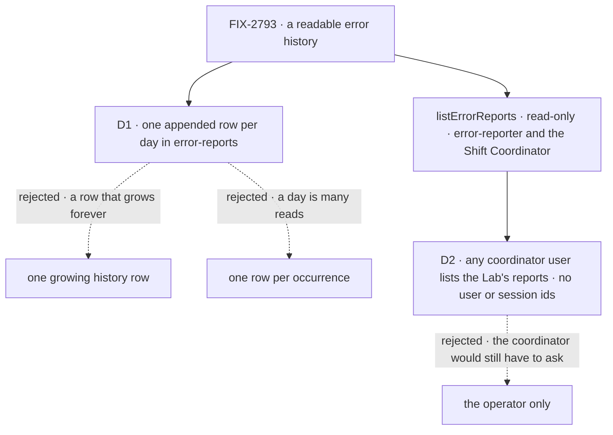

# FIX-2793 · Decisions

[Spec](SPEC.md) · **Decisions**

Two decisions are the sign-off. The issue fixes the outcome and the store: build on
`error-reports/*`, add no second store. What is left is the history's shape, and who may read it.

## The tree

Solid edges are what you're signing. Dashed edges lost, and the label says why.

## D1 · The history is one row per day, appended, in `error-reports/*`

| | |
|---|---|
| **Instead of** | One history row that grows forever; or one row per occurrence, like the worker message log |
| **Because** | The issue recommends per-day and leaves the choice open. A day row is read by its key, so "the last two days" is two reads, as `worker-usage.ts` reads a period. A day row is still rewritten whole on each append, as any row is, but it is capped and starts empty each day; one growing row has no bound and costs more on every write for as long as the Lab runs. A row per occurrence is one read per entry for a day's question. Tenet 2: no new store, one new key in the collection the reports live in |
| **Locks in** | The key `log-<YYYY-MM-DD>` (UTC) in `error-reports/*`. A day row is bounded: past its cap, entries are counted, not kept, and the tool says how many were dropped |

It comes down to how a question about a few days is read: a day row is one read per day.

**What would change my mind:** a Lab where one day's intakes contend on the row enough to slow the
intake. Intakes can run at once (the intake entry allows concurrency, and a board's dispatch and
`reportProblem` write outside the capture's chain), so a storm's appends retry on the row's
compare-and-set; the cap keeps each retry small. If that shows up, the day splits by hour.

## D2 · Any user who talks to the Shift Coordinator can list the Lab's reports, without user or session ids

| | |
|---|---|
| **Instead of** | Only the Lab's operator can list them (as only the operator drafts and files) |
| **Because** | Jake asked for the coordinator to read the history, and the coordinator talks to whoever is using it. The rows are org-scoped already ("one Lab's reports, shared by its users"). Leaving out user and session ids keeps another user's sessions out of the answer; the title, status, source, count, task id, request id and the redacted error are what "did X get reported" needs. A request id alone opens nothing for another user |
| **Locks in** | `listErrorReports` is open to every caller of a flow whose catalog has it, in the caller's org. Its output never carries user ids or a user's session ids, fingerprints, report keys or a draft body. A reported problem's entry carries the reporter's own words (its redacted description), so another user of the Lab can read them |

It comes down to who asks the coordinator: whoever uses it.

**What would change my mind:** a Lab shared by people who must not see each other's failures. Then
the tool filters to the caller's own occurrences, and the operator alone sees all.

## Decided, not asked

- **Occurrences: one convergence point, `intakeOccurrence`.** The capture, the board's drain,
  the rescued path and `reportProblem` all pass through it. It logs an occurrence only when it
  counted it: a new report, a repeat on a live one, a storm entry, or a held request the task's
  row didn't have. A redelivery that the row's `seen` keys already hold is not logged, so entries
  match the store's occurrences one for one. The intake's internal decision says which, without
  changing the public `IntakeDecision`. Ignored occurrences (the reporter's own, the Lab's filter)
  are not logged: the reporter never took them.
- **Status: every writer of a row's status logs the change.** `updateReport` covers the run's
  writes (`begin`, `keepDraft`, `dismiss`, `approve`, `keepFiled`, `keepOnly`, `keepComment`,
  `releaseClaim`): it compares the status of the row its winning change read with the one it
  wrote, after the compare-and-set, since `change` re-runs on a conflict. The intake's own writes
  that set status directly (a new report, a new storm report, a closed or lapsed-dismissed row
  reopened as `owed`) log `owed` from the intake. A dismissal that lapses writes no row; its
  `dismissed` entry carries the time it holds until. A re-run after a lapsed claim (`drafting` to
  `drafting`) is not a change. The `filed` entry carries the issue's identifier and URL.
- **An entry is small and redacted.** Time, event, the report's key (mapped to its title in the
  tool's output), source, task id and request id when there are some, and the error message cut
  to 300 characters. It is built from the redacted occurrence, as the row is.
- **Day rows are kept 90 days.** The first write of a new day deletes rows older than 90 days, by key, so the history stays bounded with no timer (the same bound `worker-usage.ts` reads to).
- **A day row holds at most 1,000 entries.** Past that, `dropped` counts them. 1,000 entries of
  ~400 bytes stay under half a megabyte.
- **The tool only reads.** It reads days by key with `getOptional`, never `getOrCreate` or
  `list()` of the whole collection. `from`/`to` default to the last 7 days and span at most 31.
  `listReports` lists the `fp-` and `storm-` prefixes, so `bind` never loads day rows (BP-033).
- **"One Lab's reports" means one org's.** Captured failures go in as the operator's org; a
  board's dispatch and `reportProblem` go in as the caller's. In the devteam Lab every user is in
  the one org, so the history is one. A Lab with several orgs keeps one history per org, as the
  reports already are.
- **One tool, two homes.** `listErrorReportsTool(options?)` is exported from
  `@flow-state-dev/workforce` beside the reporter, a factory so FIX-2791 can hand it the Lab's
  Inbox link. The reporter builds its own with its options and its turn takes it in `extraTools`;
  the devteam Lab puts that same block in its catalog, or `listErrorReportsTool()` when it has no
  reporter, where the collection is empty and the tool returns no reports.
- **Error-reporter's `WORKER.md`** gains one line: answer "did you report X" from
  `listErrorReports`, never from the task board. The Shift Coordinator's gains the tool on its
  `tools:` line and one line on when to call it.
- **Changesets:** `@flow-state-dev/workforce` (minor: the tool and the history) and
  `@flow-state-dev/shift-manager` (patch: the coordinator can read reports).

## Considered and dropped

- **Raise `KEPT_OCCURRENCES`.** Simplest, and it keeps everything on one row, but any cap still
  loses history, and the row the intake writes on every repeat grows with it.
- **A second collection for the history.** The issue rules it out, and it would need its own
  declaration on every flow that reads it.
- **Read the history off request and task records.** They expire on their own schedule, don't
  know the report status, and a manual report has no request.

## Open

None.

## Settled

No POC: the history adds a key to a collection whose reads and writes are already exercised by
the goal, and no claim here is disputed. The spec rests on no counted facts beyond the file
references, which the validators checked.

## Analysis

2026-11-17, at the draft's head. **Verdict: right approach, with folds.**

- **Reuse:** extends `error-reports/*` and reads through `readReport`/`listReports`; the tool sits
  beside the internal `reports` entry. `list(prefix)` loads only the prefix, so BP-033 holds.
- **Other shapes:** the day row stands; one growing row and a row per occurrence lose (D1).
- **Should it exist:** yes; the coordinator has no other way to answer.
- **Concerns, folded:** status writes that bypass `updateReport` (the intake's own) and
  redeliveries logged twice. Both now in *Decided, not asked*. D1's "one intake at a time" was
  wrong and is corrected. D2's price now names a reported problem's own words. The org scope is
  stated. The goal check now matches entries to the store's requests, checks the filters, asks one
  filed and one waiting question, and covers error-reporter's turn.
- **Recorded:** no history page in Shift Manager (out of scope).

## How it got here

- **Draft** — framed as "keep every intake and status change, readable by two workers"; one row
  per day in the existing collection and one read-only tool, on the precedent of `worker-usage.ts`.
