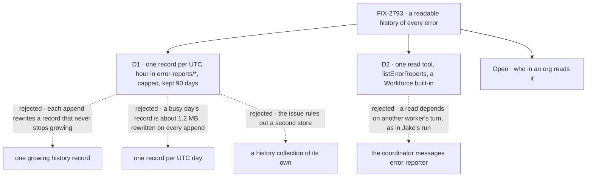

# FIX-2793 · Decisions

[Spec](SPEC.md) · **Decisions**

Two decisions and one open question are the sign-off. Jake fixed the frame: build on the
`error-reports/*` collection, no second store, and both error-reporter and the Shift Coordinator
read the history. What was left: the history's shape (the issue recommends one record per day),
how the two workers read it, and who in an org may.

## The tree

Solid edges are what you're signing. Dashed edges lost, and the label says why.

## D1 · The history is one record per UTC hour, in the same collection, capped per hour and kept 90 days

| | |
|---|---|
| **Instead of** | One history record that grows forever (the issue's other option); one record per UTC day (the issue's recommendation); or a collection of its own |
| **Because** | A record is written whole through a compare-and-set, so a growing record makes every append cost more and makes every append on a busy time collide with one big write. A day record is not small enough: an entry is about 600 bytes of JSON (ids, a 32-character fingerprint and a 200-character message), so a day capped at 2,000 entries is about 1.2 MB, rewritten on every append. An hour's record is capped at 250 entries, about 150 KB at worst, and a busy hour contends on one key the way a repeated failure already contends on its own `fp-` report. A date range reads computed keys (or one prefix per day), with no list of the whole family, and retention deletes computed old keys. One collection keeps the issue's rule (no second store) and the reports' scope, redaction and org fence, unchanged. Tenet 2: no new primitive |
| **Locks in** | The `log-<YYYY-MM-DD>-<HH>` keys in `error-reports/*`, in UTC. A reader that wants a local day reads the hours that make it up. A deployment's stored history stays readable across releases, so a later change of entry shape dual-reads (BP-030) |

| Trade-off | One record per hour (chosen) | One growing record |
|---|---|---|
| Cost of one append | One record of at most ~150 KB | Grows with the whole history |
| A date range | Computed keys, no list | One read, then filter |
| Retention | Delete computed old keys | Rewrite the record |
| A busy hour | Capped at 250, with a count of what was cut | Unbounded |

It comes down to the cost of an append: a growing record makes the hundredth failure cost more
than the first.

**What would change my mind:** a store with a real append verb for a record. Then one growing
record costs nothing to append, and a list by range is the only difference.

## D2 · One read tool, `listErrorReports`, a Workforce built-in: always on error-reporter's turn, and named in the Shift Coordinator's `tools:`

| | |
|---|---|
| **Instead of** | The coordinator asks error-reporter (`sendMessage`) and relays, as in Jake's run; or Shift Manager writes its own read of the collection |
| **Because** | A read should not depend on a second worker's model turn, which is the step that went wrong: error-reporter answered from the task board. One block serves both workers, so their answers can't disagree. The block declares `errorReportsResources`, so a flow that carries it installs the org-scoped collection itself, and a worker gets it only by naming it in `tools:`, as every catalog tool works. Workforce owns it (L2), Shift Manager adopts it in its catalog and the Shift Coordinator's file; core and engine learn nothing |
| **Locks in** | A public tool name, `listErrorReports`, that a worker's `tools:` line spells, and `errorReportTools()` exported from `@flow-state-dev/workforce`. It only reads: a model can't change a report through it |

| Trade-off | One built-in tool (chosen) | Coordinator messages error-reporter |
|---|---|---|
| Answers agree | One read, one answer | Two models, two answers |
| Works when error-reporter is busy or failed | Yes | No |
| New public surface | One tool name | None |

It comes down to the dependency: the coordinator's answer can't rest on another worker's turn.

**What would change my mind:** a second worker beside the coordinator needing reports with
different fields. Then the tool takes a projection option, and it is still one tool.

## Decided, not asked

- **One helper writes the history, and only two callers use it (tenet 5).** Every history write
  goes through one append helper, called only from `intakeOccurrence` and `updateReport`.
  Occurrences go in at `intakeOccurrence`, the one door every occurrence enters by (the capture,
  the board drain, `reportProblem`), after its decision, for every decision except `ignored`:
  `new`, `counted` and `storm` each write one entry with the report id the decision named. A
  `held` decision names no report (a failed request inside a task, whose task may still pass),
  so its entry carries the `taskId` and no report id; the tool joins it to the task's report at
  read time through the `task-<task>` mapping, so no entry is rewritten later. Status changes go
  in at `updateReport`, which every flow handler that moves a status goes through (draft kept →
  `previewing`, dismiss, approve → `filing`, file → `filed`, keep only, the comment's `closed`).
  It writes a status entry when the status or the issue (identifier or URL) it wrote differs
  from what it read, and reads both from the row it wrote. That entry is appended after the
  compare-and-set settles, from the row read and the row written, never inside `change`, which
  re-runs on a conflict; its dedupe key (report id, status, issue identifier) makes a retry
  append once. The three writers in
  `reports.ts` that build a report with `updateStateWith` directly (`decide`'s new report,
  `countOn`, `listOnStorm`) set the first status, `owed`, which the occurrence entry already
  records. A writer added later that moves a status outside `updateReport` must write its own
  entry; the implementer adds a test that fails on that.
- **An entry holds:** its time, kind (`occurrence` or `status`), the report id, the source, the
  fingerprint, the ids (`requestId`, `sessionId`, `taskId`, `boardId`, `attempt`, `userId`), a
  short redacted message (the first 200 characters of the error or description), and for a
  status entry the new status and, for `filed`, the issue's identifier and URL. Entries are
  redacted with the same secrets the intake uses.
- **A redelivered occurrence is logged once.** An entry carries the occurrence's key (the one
  `seen` dedupes by), and an append with a key already in that hour's record is skipped. An
  intake retried after a failed history write therefore doesn't log twice.
- **The history write never fails the intake.** A history write that fails is logged through the
  reporter's `log` and the intake returns its decision. A report is what must not be lost; the
  history is a record of it.
- **An hour keeps at most 250 entries,** then counts the rest in the record (`cut: n`), so a
  storm can't grow one record without bound. Past the cap an occurrence is counted, not kept:
  the tool says when an hour was cut and by how many.
- **Retention is 90 days, with no list.** When the intake creates the first record of a UTC
  day, it deletes the computed keys of the days 91 to 97 back (7 × 24 keys). A delete of a
  missing key is a no-op, so two intakes that both prune do no harm, and a Lab silent for up to
  a week still prunes the days it skipped. A Lab silent for longer leaves those older records
  in place; the tool never reads past 90 days, so they cost storage only.
- **`listReports` lists by prefix.** It lists `fp-` and `storm-` keys only, so the restart outbox
  never loads history (BP-033).
- **The tool's statuses are the caller's words, not the stored enum:** `owed` and `drafting` read
  *drafting*, `previewing` *waiting in Inbox*, `filing` *approved, filing*, `filed` with an issue
  *filed*, `filed` with none *kept, no tracker* (what `keepOnly` stores today), `dismissed`,
  `closed` *issue closed*. Its `status` filter takes `filed`, `not-filed`, `dismissed`, or one of
  those words. It never returns the fingerprint as a name for a report; it returns the title
  (the draft's, else the error's first line). FIX-2791 relies on that.
- **The tool's filters** are the issue's (status, date range, source) plus `taskId`, because the
  question that started this was about two tasks. The date range defaults to the last 7 days.
  It returns the reports seen in the range, and their history entries only when asked, newest
  first, at most 50.
- **error-reporter's `WORKER.md` gains one paragraph:** asked whether something was reported,
  call `listErrorReports` and answer from it, never from the task board. The Shift Coordinator's
  gains the same, and its `tools:` line names the tool.
- **A Lab with no Error Reporter still has the tool** in its catalog: the collection is empty and
  the tool says no Error Reporter is on. So the Shift Coordinator's file is the same in every Lab,
  since a `tools:` line that names a key the catalog lacks is refused at the mint.

## Considered and dropped

| Considered | Why it lost |
|---|---|
| Keep every occurrence on the report (`KEPT_OCCURRENCES` unbounded) | The report is read whole by every draft, repeat and run; it would grow with every repeat |
| Read the reports through the intake's internal `reports` entry from the coordinator | Internal entries are not a model's tool, and it returns whole records, dossier fields included |
| A history screen in Shift Manager | Not asked. The tool answers in conversation; a screen can read the same records later |

## Open

### Who in an org reads the error history?

**In plain terms.** The reports belong to the org. In a Lab with several users, one user's
failure becomes a report every member's Shift Coordinator could now read: its title, its
message, and the ids of the session and task that failed. Today only the operator sees a report,
in Inbox.

**The trade-off.** Everyone reads everything: simplest, and a team sees its shared errors, but a
user sees another user's failing messages. Operator only (the narrower first version Cursor's
review suggests): private, and widening later is one check, but a teammate asking "was this
reported?" gets no answer, which is the question this issue is for.

**My recommendation.** Every member reads each report's summary (title, status, count, source,
when, the Linear link), and the ids of an occurrence only when they are the operator or that
occurrence was their own. The tool knows its caller only from the turn's server-set identity
(`ctx.session.identity.userId`, and the operator from the reporter's options), never from an
input (BP-031). A turn with no user, such as a routine's, is denied the ids by default and reads
summaries only. The `taskId` filter matches only occurrences whose ids the caller may read, so a
model can't learn that another user's task failed by asking for it.

**What would change my mind.** If a Lab's reports can quote a user's private words in the title
(a described problem's title is drafted from the user's own description), then summaries go to
the operator only, and others see "a report exists, filed as FIX-N".

**What being wrong costs.** Too open: a teammate reads a short line from another user's failure,
in a Lab of one team. Too closed: the coordinator says "I can't see that" to everyone but the
operator, and Jake's question stays unanswered for them. Either is one check in the tool to
change.

## Notes from review

For the implementer; none of these changes the direction.

- **gitar-bot, D1:** "add a size estimate for the 2,000 cap and state the worst-case record size,
  or shard the day by hour (`log-<day>-<hh>`), or lower the cap and name the tradeoff against the
  goal." Folded as the hourly record; the 250 cap and the ~600-byte entry are estimates for the
  implementer to measure in a test.
- **Cursor, D1:** "implementers may co-append history in the same CAS as the `fp-*` update or use
  hour shards before chasing a store-level append verb." Hour shards taken. Co-appending on the
  `fp-` report would put the history back on a record that grows with every repeat, so no.
- **Second look, `listReports`:** `list(prefix)` exists on the collection ref and filters keys
  before refs are made, so `listReports` lists `fp-` and `storm-`. One `isReportKey` helper used by
  `listReports` and the tool is cheaper than a prefix list written twice.
- **Second look, words for statuses:** the reporter's lines (FIX-2791) and the tool's status words
  should share one status-to-words function, or they will drift.
- **Second look, order with FIX-2790:** prefer FIX-2790 first, since it only widens capture.

## Analysis

2026-11-17 · watermark: `origin/main` at c0bf4f40 · verdict: **right approach, build as
scoped**.

- *Reuse:* the collection, its CAS helper and the read helpers are reused; the Adds table names
  each piece considered. No second store.
- *Other frameworks:* error trackers (Sentry, Rollbar) keep an issue per fingerprint with an
  unbounded event stream beside it; this is the same split, at Lab scale.
- *Other shapes:* raising the keep and a second collection were weighed (D1).
- *Should it exist:* yes; the screenshot shows a coordinator unable to answer a direct question.
- *Major concern:* who reads it in a multi-user org, which is the open question.

The analysis and validation passes were run by the author in this session; no separate
sub-agent ran them. A reviewer should weigh that.

Factual base: the spec rests on no counted set beyond two constants read from source
(`KEPT_OCCURRENCES = 5`, the seven statuses), so no checker is built.

## How it got here

- **Draft** — framed as "keep every occurrence and status change, and let both workers read
  it"; one record per UTC day in the existing collection, written at the intake and at
  `updateReport`, read by one Workforce tool. Trade-offs are drawn as tables, not SVG, to keep the
  set lean.
- **Review round 1** — the history is one record per UTC hour, not per day, because a day capped
  at 2,000 entries is about 1.2 MB rewritten on every append (gitar-bot, Cursor). Retention deletes
  computed keys with no list; a held occurrence is logged by its task; the org-read question
  names how the tool knows its caller.
