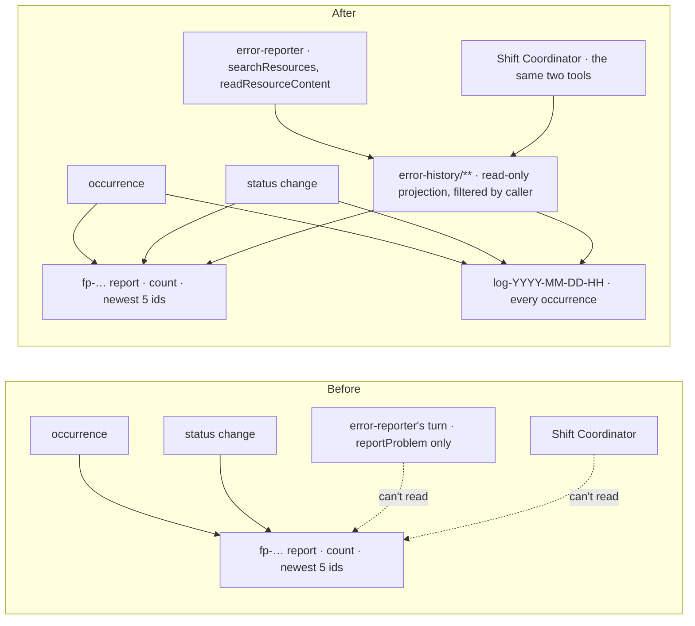
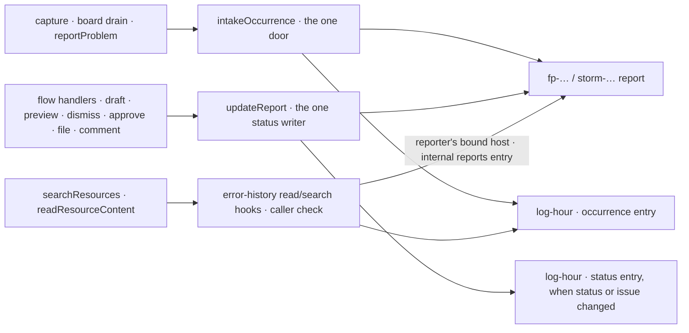

# FIX-2793 · Error Reporter keeps a readable history of every error it reported, filed or not

**Spec** · [Decisions](DECISIONS.md)

Part of epic [FIX-2369](../../epics/FIX-2369/SPEC.md) (the workforce apps as a daily driver).
[FIX-2791](../FIX-2791/SPEC.md) builds on this spec: it reads the history this one keeps.

## Five people, before and after

| Someone who… | Today | After |
|---|---|---|
| **asks error-reporter "did you report the two aborted coder runs?"** | It has no way to read its own reports. In Jake's run it read the task board and answered from that | It searches the error history with the general resource tools and answers with each report's status: drafting, waiting in Inbox, filed as FIX-N (with the URL), dismissed, or not reported at all ([D2](DECISIONS.md#d2)) |
| **asks the Shift Coordinator what has been reported** | The coordinator can't read reports. It messages error-reporter and relays the answer | It searches the same history itself, read-only, and answers in the same turn ([D2](DECISIONS.md#d2)) |
| **sees one failure come back a sixth time** | The report's count goes up, but it keeps the ids of only the newest 5 occurrences. The first one's time, request and task are gone | Every occurrence is in that hour's history, with its time, ids and a short message ([D1](DECISIONS.md#d1)) |
| **wants to know when a report was filed or dismissed** | Only the current status is kept, and a filed report's `filedAt` | Each change of status is in the history with its time; *filed* carries the Linear ID and URL ([D1](DECISIONS.md#d1)) |
| **is one of several users in the org and asks the coordinator** | Can't read reports at all | Reads only the reports and entries of their own failures; the operator reads all. Anyone else gets the same empty answer as a filter that matches nothing ([Decided, not asked](DECISIONS.md#decided-not-asked)). Whether to widen that is **open to the owner** ([Open](DECISIONS.md#open)) |

## The goal, and how we'll know it's met

**Every occurrence that reaches the Error Reporter, and every change of a report's status, is
kept in a history beside the reports, and both error-reporter and the Shift Coordinator answer
"what was reported, and was it filed?" from that history and the reports, not from the task
board or from each other, showing a caller only the operator's view or their own failures.**
They read it with the general resource tools, not a tool made for error reports.

| Is it the right goal? | |
|---|---|
| **The real need** | Jake (2026-11-17): "every error the Error Reporter detects should be logged automatically the moment it's detected, with its status (filed or not filed), so there's a history of our errors that both error-reporter and the Shift Coordinator can read" |
| **Smaller, and rejected** | "Give error-reporter a read tool over the reports as they are." It answers "is it filed?" but keeps losing every occurrence after the fifth, and no status change has a time. Or "raise `KEPT_OCCURRENCES`": the report record grows with every repeat, forever |
| **Bigger, and not this issue's** | Errors that never reach the Error Reporter: an aborted run today ([FIX-2790](https://linear.app/fixpoint-labs/issue/FIX-2790), in development). What the replies say and the Inbox shows ([FIX-2791](../FIX-2791/SPEC.md)). A history screen in Shift Manager |
| **Not done if** | An occurrence past the fifth of one fingerprint is missing from the history while its hour is under the cap, or past the cap is not counted · a held occurrence (a failed request inside a task) has no entry · a status change made by any writer has no entry · the Shift Coordinator answers by messaging error-reporter or reading the task board · a read of the history writes anything · the restart path (`listReports`, the outbox at bind) reads history entries · one hour's history has no upper size · a caller who is neither the operator nor the occurrence's user reads anything of it, a title included |


The check grades the stored history and the recorded tool calls, so a turn that guessed right
without reading still fails.

| How we verify | |
|---|---|
| **Goal check** | A new **leg R** in [`goals/error-reporter/files-a-reproducible-issue`](../../../goals/error-reporter/files-a-reproducible-issue/goal.md), run after leg 2 in the same Lab |
| **Signal** | **a** The day's history holds 11 occurrence entries for leg 2's fingerprint; the report still keeps 5. **b** Leg 1's report has entries `previewing`, then `filed` with the tracker's identifier and URL. **c** Asked "what has been reported today, and is any of it filed?", the Shift Coordinator's turn calls `searchResources` with a hit under `error-history/`, and sends no message or task to error-reporter; its answer names leg 1's issue identifier. **d** Asked in its own conversation "did you report the `burst` failure?", error-reporter calls `searchResources` or `readResourceContent` on `error-history/` and answers with that report's status |
| **Input** | The goal's own Lab and plants. The two questions are held out of every prompt and WORKER.md |
| **Access check** | A unit test in `packages/workforce/test/error-reporter.test.ts`: two users in one org, user A's failure reported. User B's `searchResources` (with A's title words and with A's `taskId`) gets no `error-history` hit, and B's `readResourceContent` of A's record gets the same answer as an unknown path. A's turn and the operator's get the record. The test fails if the hook's caller check is removed |
| **Anti-game** | Grade the store's history and the sessions' recorded tool calls. An answer that names the identifier without an `error-history` read fails **c** |
| **Control that must fail** | `GOAL_CONTROL=no-history`: the intake writes no history entry. FAILS **a** (5 kept, 0 entries). `GOAL_CONTROL=no-report-read`: `error-history` left out of the coordinator's flow. FAILS **c** |
| **Reproduce first** | In `packages/workforce/test/error-reporter.test.ts`, on today's main: seven occurrences of one fingerprint leave the ids of only five anywhere in the collection (red); a coordinator flow built as the devteam host builds it reaches no report through any tool (red). Both go green with this change |

## What changes



Left, the reports keep a count and the newest five ids, and nobody in a conversation can read
them. Right, one hour's history beside them takes every occurrence and status change, and a
read-only view over both is searched with the general resource tools both workers already know.

```diff
  // @flow-state-dev/workforce · the error-reports/* collection, one key per record
  fp-<fingerprint> · storm-<window> · cap · held-<task> · task-<task>
+ log-<YYYY-MM-DD>-<HH>    // that UTC hour's history: append-only, capped at 250 entries

+ // a read-only, llmReadable projected collection over it, one record per report per UTC day
+ error-history/<YYYY-MM-DD>/<ref>       // org scope; read() and search() filter by the caller

  // packages/shift-manager/teams/devteam/host.mts · the agent turn's catalog
+ searchResources, readResourceContent   // core's general tools, under their own names

  // teams/devteam/workforce/org/workers/error-reporter/WORKER.md
- tools: []
+ tools: [searchResources, readResourceContent]

  // teams/devteam/workforce/org/workers/shift-coordinator/WORKER.md
- tools: [hire, fire, …, pauseRoutine, deleteRoutine]
+ tools: [hire, fire, …, pauseRoutine, deleteRoutine, searchResources, readResourceContent]
```

A model reads it like this (record fields past the path are the implementer's):

```ts
searchResources({ query: "error report filed task", prefix: "error-history/2026-11-17" })
// → { results: [{ uri: "org/error-history/2026-11-17/checkout-total-3f5e", snippet: "… filed FIX-412 …" }] }
readResourceContent({ uri: "org/error-history/2026-11-17/checkout-total-3f5e" })
// → title, status in words, source, count, first and last seen, task ids, issue, and that day's entries
```

What a read returns depends only on who is calling, read from the hook's trusted `ctx.userId`:
the operator reads everything, any other user only their own failures, and anyone else gets no
hit, the same as a search that matches nothing ([Decided, not asked](DECISIONS.md#decided-not-asked)).

**Docs:** at release, [`apps/docs/docs/workforce/error-reporter.md`](../../../apps/docs/docs/workforce/error-reporter.md)
gains a short "The history" section (what is kept, for how long, and the `error-history`
collection a worker searches), and [`shift-coordinator.md`](../../../apps/docs/docs/workforce/shift-coordinator.md)
names the two tools in its list. `packages/workforce/README.md` names the collection's export.
No new page. FIX-2791 adds its own lines to the same page.

## How it gets there



Two writers converge every write the history needs: `intakeOccurrence` for occurrences and
`updateReport` for status. The hooks have no store of their own: they read through the
reporter's bound host, the path the restart outbox already takes ([Decided, not asked](DECISIONS.md#decided-not-asked)).

## What stays as it is

- The reports themselves: one per fingerprint, the cap, the storm report, the held requests,
  the preview in Inbox, filing only after the operator answers. Jake's FIX-2791 decision keeps
  Inbox review for every report.
- `KEPT_OCCURRENCES` (5) on the report. The dossier still reads the newest occurrences.
- The collection stays unreadable by a browser (`client.state.read: false`), and so does the
  projection, which declares no client read. Workers read on the server, in their turn.
- The intake flow's internal `reports` entry, which the restart outbox reads.

## What's already here, and the debt

| Already here | What this does with it |
|---|---|
| **The job: keep what the Error Reporter saw.** One way: the report records in `error-reports/*` ([FIX-1983](../FIX-1983/SPEC.md)), with a count and the newest 5 occurrences. Mechanism entry `error-reporter`. Searched `log`, `history`, `ledger`, `append` across `packages/*/src` and `docs/mechanisms/mechanisms.yaml`: the closest are orchestration's observation ledger (`task-flow-policy`, tool calls of a board run) and event-actors' entry log (a pattern's session log), neither about reports | **Extended**: the history is new keys in the same collection, written by the same intake. This would otherwise be the second store of error reports |
| **The job: read the reports.** One way: the intake flow's internal `reports` entry (`op: "all" \| "get"`), which only the reporter's bind calls through its bound host | **Extended**: it gains a read of the history records, and the projection's hooks call it through the same bound host, as the operator, then filter by caller |
| **The job: a worker reads app data in conversation.** Core's `searchResources` and `readResourceContent` over an `llmReadable` collection, projected ones included (`defineProjectedResourceCollection`; Workforce precedent: the standard-worker projection). Other Workforce lookups are tools of their own (`listRoutines`, `listProjects`, `readProject`, `listLeads`), and no Shift Manager worker holds the general tools yet | **Reused**: the history is a projected collection those two tools reach; no tool made for error reports |
| **The job: read what happened to a task from a conversation.** `listTasks`/`getTask` on the coordinator's board | **Kept**. They answer what a task did; the history answers what was reported about it |
| `links` on `ErrorReporterOptions`, which the devteam host fills with a Shift Manager path | **Kept**. FIX-2791 adds `inboxLink` beside it for the Inbox link; nothing here |
| [FIX-1983](../FIX-1983/SPEC.md)'s report lifecycle | **Kept**. The history records it; it changes nothing in it |

| Adds | Existing piece considered | Why it doesn't fit / how composed |
|---|---|---|
| `log-<day>-<hour>` records in `error-reports/*` | Raising `KEPT_OCCURRENCES`; a second collection | **Composes** the existing collection and its CAS helper (`updateStateWith`). A larger keep grows each report forever; a second store is what the issue rules out |
| `error-history/**` projected collection, exported by Workforce | A `listErrorReports` tool; messaging error-reporter (`sendMessage`) | **Composes** core's projection and general tools over the intake's `reports` entry. A specific tool is a public name for a job the general tools do ([D2](DECISIONS.md#d2)); a message makes the coordinator depend on another worker's turn for a read |

| The debt | |
|---|---|
| **Removes** | Nothing |
| **Adds** | One more key family in the collection, and an hourly record every intake writes to: permanent by design. A model-facing view over reports beside the internal entry: permanent by design; it reads through that entry, so there is one read path |
| **Leaves** | `listReports` lists the whole collection and drops what doesn't parse; with the history beside it, it must list only report keys (BP-033). That is part of this change, not left. Pruning history older than the retention is done at the intake ([Decided, not asked](DECISIONS.md#decided-not-asked)), so nothing is left without an owner. Workforce's other lookups (`listRoutines`, `listProjects`, `readProject`, `listLeads`) are tools of their own where this uses the general tools: a follow-up to weigh, not this issue's |

**Net: up, a little.** One key family and one read-only collection, both inside the Error
Reporter's own package; no new tool, no second store and no second report lifecycle.

## Where this meets its neighbours

- **FIX-2790** (in development, another thread) makes an aborted run reach the intake. Until it
  lands, an aborted coder run is not in the history, because it never reached the Error
  Reporter. This spec needs nothing from it and changes none of its files' capture paths: both
  touch `reporter.ts`/`flow.ts`, and whichever merges second rebases.
- **FIX-2791** reads this history and adds the Inbox link to the projected record.

## Sign off

**[The goal](#the-goal-and-how-well-know-its-met), at that size:** every occurrence and status
change kept, and both workers answering from it. If wrong: Jake asks again next week why the
coordinator didn't know.

**[The debt](#whats-already-here-and-the-debt), net up a little:** one key family, one read-only
collection, no new tool, no second store. If wrong: a history nobody reads, written on every failure.

1. **[D1](DECISIONS.md#d1) · The history is one record per UTC hour, in the same collection,
   capped at 250 entries an hour and kept 90 days, not one growing record.** If wrong: a read
   over a long range reads many small records instead of one large one.
2. **[D2](DECISIONS.md#d2) · Workers read the history with core's general resource tools over a
   read-only, caller-filtered `error-history` view, not a `listErrorReports` tool.** Asked of Jake
   on the PR's decision card; recommended. If wrong: narrowing by status or source is by search
   words, not an exact filter, and a model may miss a report it would have listed.
3. **[Open](DECISIONS.md#open) · Should other members see more than their own failures?** Until
   you decide, the view is deny-by-default: the operator reads everything, a user only their own
   failures, anyone else nothing. Recommended: keep it so; a title can quote a user's own words.
   The wider option is every member reading summaries. The one to weigh.

Improvement · `workforce`, `shift-manager` · S–M (one key family and two writers in
`reports.ts`, one projected collection, two catalog entries and two WORKER.md lines) · depends on nothing ·
FIX-2791 builds on it · [Linear](https://linear.app/fixpoint-labs/issue/FIX-2793)
