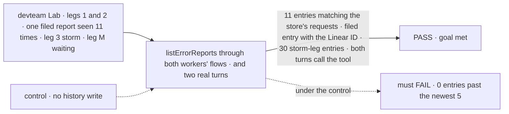

# FIX-2793 · Error Reporter keeps a readable history of every error it reported, filed or not

**Spec** · [Decisions](DECISIONS.md)

## Five people, before and after

| Someone who… | Today | After |
|---|---|---|
| **asks the Shift Coordinator "did error-reporter report the two aborted runs?"** | The coordinator can't read reports, so it asks error-reporter, which looks at the task board instead | The coordinator calls `listErrorReports` and answers from it: each report, its status, and the Linear issue once filed |
| **asks error-reporter "did you report X?"** | It has only `reportProblem`, so it guesses or files a second report | It calls `listErrorReports` and answers from its own reports |
| **wants every occurrence of a failure that happened 40 times** | Gets the count and the newest 5; the other 35 are gone | Reads one entry per occurrence in that day's history, with its time, source and task or request |
| **wants to know when a report was previewed, filed or dismissed** | Sees only the row's current status | Reads each status change in the history, with the Linear ID and URL on the filed one |
| **runs a Lab with no Error Reporter** | Nothing | `listErrorReports` answers with no reports. Nothing else changes |

## The goal, and how we'll know it's met

**Every error the Error Reporter takes in, and every status its report goes through, is kept as it
happens, and both error-reporter and the Shift Coordinator can read that history and the reports'
current state with one tool.**

| Is it the right goal? | |
|---|---|
| **The real need** | Jake (2026-11-17): "every error the Error Reporter detects should be logged automatically the moment it's detected, with its status (filed or not filed), so there's a history of our errors that both error-reporter and the Shift Coordinator can read." |
| **Smaller, and rejected** | "Give the two workers a tool over today's rows." It answers "is X filed" but loses every occurrence past the newest 5, which is half of what Jake asked for |
| **Bigger, and not this issue's** | A history page in Shift Manager. Aborted runs reaching the reporter at all (FIX-2790). The Inbox pointer and Linear link in replies (FIX-2791, which reads this history) |
| **Not done if** | An occurrence the intake counted is missing from its day, or a redelivery is logged twice · an occurrence the cap put on the storm report is missing · a status change (owed, drafting, previewing, filing, filed, dismissed, closed) is missing, or a filed one lacks the Linear ID and URL · an entry is rewritten or deleted, or lands on the wrong UTC day · either worker's tools can't reach `listErrorReports`, or its status, date or source filter returns the wrong rows · the tool writes anything · a second store holds the history |



Each of the eleven occurrences must be in the history with its own request id, and both workers'
answers must come from the tool.

| How we verify | |
|---|---|
| **Goal check** | `goals/error-reporter/files-a-reproducible-issue/`, new leg **R**, run after legs 1, 2, 3 and M and before leg 6's restart · the Shift Coordinator's `WORKER.md` model and error-reporter's, both real; drafts as each leg already makes them · run by the implementer at completion · verdict on the implementation PR |
| **Signal** | `listErrorReports`, run through the Shift Coordinator's flow and through error-reporter's: (a) legs 1 and 2's report has count 11, status `filed` with the recorded tracker's identifier and URL, and 11 occurrence entries whose request ids equal the store's 11 requests, plus `previewing`, `filing` and `filed` entries; (b) leg 3's 30 failures each have one entry, on its report or the storm report; (c) `status: ["filed"]` returns legs 1 and 2's report and not leg M's, `source: ["manual"]` returns only leg M's, and a `to` before today returns nothing. A real Shift Coordinator turn asked "Did the error reporter file the problem I described?" (leg M's, still waiting) calls the tool and says it is not filed; asked about legs 1 and 2's failure, it says filed and names the identifier. A real error-reporter turn asked "Did you report the coordinator's crash?" calls the tool, not the board. The collection's rows are byte-identical before and after each tool call |
| **Input** | The goal's devteam Lab and its planted failures, as legs 1, 2, 3 and M already run them |
| **Anti-game** | The check compares history entries to the store's request records, never to the row's `count`. It never writes a history entry. The turns are graded on their tool call and on filed versus not filed in the answer, with one question of each kind so a guess fails one |
| **Control that must fail** | `GOAL_CONTROL=no-history`: the intake writes no history entry; it must FAIL leg R (a) on *11 occurrence entries*. `GOAL_CONTROL=no-status-history`: status changes write no entry; it must FAIL (a) on *a filed entry*. `GOAL_CONTROL=no-coordinator-tool`: the tool is left out of the coordinator's catalog; it must FAIL on *the coordinator's turn calls the tool* |

## What changes


The history is a row per day in the collection the reports already live in, and one tool reads it.

```diff
  # packages/shift-manager/teams/devteam/workforce/org/workers/shift-coordinator/WORKER.md
- tools: [hire, fire, listProjects, …, deleteRoutine]
+ tools: [hire, fire, listProjects, …, deleteRoutine, listErrorReports]

  // the Lab's catalog (host.mts)
  catalog: {
    ...rosterTools,
+   listErrorReports: listErrorReportsTool,
  }
```

```ts
// what either worker's model calls, every field optional
listErrorReports({ status: ["previewing", "filed"], source: ["task"], from: "2026-11-16", to: "2026-11-17" })
// → { reports: [{ title, status, source, count, firstSeenAt, lastSeenAt, taskIds, issue?: { identifier, url } }],
//     history: [{ at, event, report: <its title>, source, taskId?, requestId?, message, issue? }], dropped }
// No fingerprint, report key, user, session or draft body is in the output.
```

Error-reporter gets the tool on its conversation turn beside `reportProblem`, and its `WORKER.md`
tells it to answer "did you report X" from it.

**Docs:** at release, `docs/workforce/error-reporter.md` gains a short "History" section (the
day rows, what an entry holds, `listErrorReports` and who has it); the workforce README names
`listErrorReportsTool`. Contributor docs in the implementation PR: the file header of
`error-reporter/reports.ts` lists the `log-<day>` key. No new page.

## What stays as it is

- The report rows, their keys (`fp-`, `storm-`, `cap`, `held-`, `task-`), status lifecycle,
  dedupe, cap, storm report and redaction.
- The newest 5 occurrences on a report row, which the draft's dossier reads.
- Preview in Inbox, filing and counted comments.
- The collection stays unreadable from a browser (`client.state.read: false`).

## What's already here, and the debt

| Already here | What this does with it |
|---|---|
| **The job: keep a record of what the reporter took in.** One way: the report row (`error-reporter/reports.ts`), count plus newest 5 occurrences. Searched `KEPT_OCCURRENCES`, `occurrences`, `error-reports/` across `packages/` | **Extended**: the same collection gains day rows. Still one store |
| **The job: an append-only, day-keyed record.** `worker-usage.ts` keys usage `<YYYY-MM-DD>/<worker>` and reads a period as one key per day. The worker message log (`messages/message-log.ts`) is one row per message, user-scoped | **Precedent** for the day key and the period read. A row per occurrence (the message log's shape) was dropped ([D1](DECISIONS.md#d1)) |
| **The job: read the reports.** The intake flow's internal `reports` entry (`readReport`, `listReports`), used by `bind` to restart owed runs | **Reused**: the tool reads through `readReport`/`listReports`. `listReports` stops loading day rows (reads the `fp-` and `storm-` prefixes) |
| **The job: give a worker a tool from the Lab.** The Lab catalog in `host.mts` (`listLeads`, `listProjects`), and `extraTools` on the reporter's turn (`reportProblem`) | **Reused** for both workers. No new wiring |
| No retained predecessor spec. The reporter's design is FIX-1983's, recorded in the headers of `error-reporter/*.ts` | **Kept** |

| Adds | Existing piece considered | Why it doesn't fit / how composed |
|---|---|---|
| `log-<YYYY-MM-DD>` rows in `error-reports/*` | Raising `KEPT_OCCURRENCES`; a second collection | A bigger cap still loses history and grows the hot row. A second collection is the second store the issue rules out |
| `listErrorReportsTool`, a read-only handler | The internal `reports` entry | That entry returns raw rows (user and session ids, drafts) to server code. The tool returns a summary a model can read, filtered |

| The debt | |
|---|---|
| **Removes** | Error-reporter answering "did you report X" from the task board |
| **Adds** | Day rows, kept 90 days and each capped (see [Decided, not asked](DECISIONS.md#decided-not-asked)): permanent by design and bounded. One more write per intake on the day's row. Every flow whose catalog has the tool declares `error-reports/*` (in the devteam Lab, the agent and coordinator flows): the same org cell, no new storage |
| **Leaves** | Nothing shows the history in Shift Manager; the tool is the only reader. FIX-2791 is the next reader |

**Net: up, a little.** One row kind and one read tool come; nothing goes. The history is what the
issue asks for.

## Sign off

**[The goal](#the-goal-and-how-well-know-its-met), at that size:** every intake and status
change is kept as it happens, and both workers read it with one tool. If wrong: the coordinator
still has to ask error-reporter, and occurrences past 5 are still lost.

**[The debt](#whats-already-here-and-the-debt), net up a little:** day rows and one read tool,
in the existing collection. If wrong: a second store for one job.

1. **[D1](DECISIONS.md#d1) · The history is one row per day, appended, in `error-reports/*`.** The
   one to weigh. If wrong: a burst's writes contend on one row.
2. **[D2](DECISIONS.md#d2) · Any user who talks to the Shift Coordinator can list the Lab's
   reports, without user or session ids.** If wrong: a user sees that another user's
   task failed.

Improvement · `workforce`, `shift-manager` (devteam Lab), the error-reporter goal · S (one row
kind, one tool, two `WORKER.md` lines) · no blocker; FIX-2791 builds on it ·
[Linear](https://linear.app/fixpoint-labs/issue/FIX-2793)
