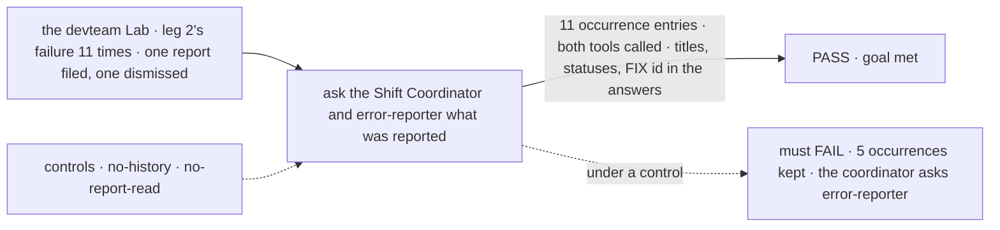
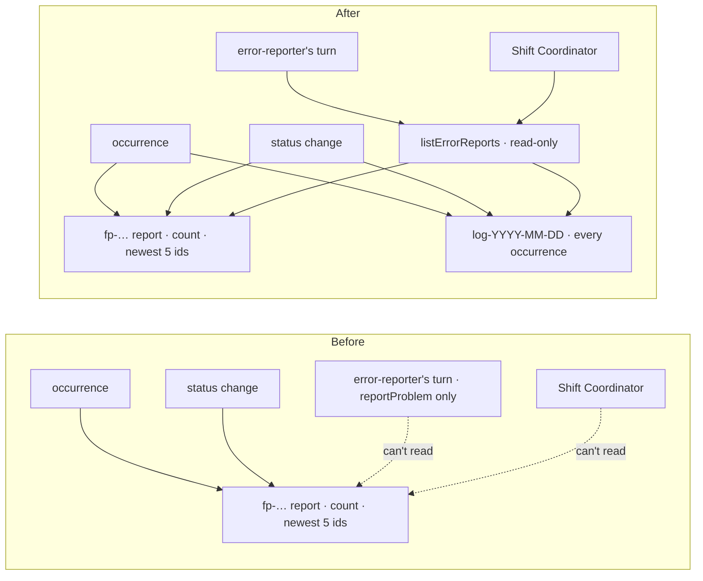
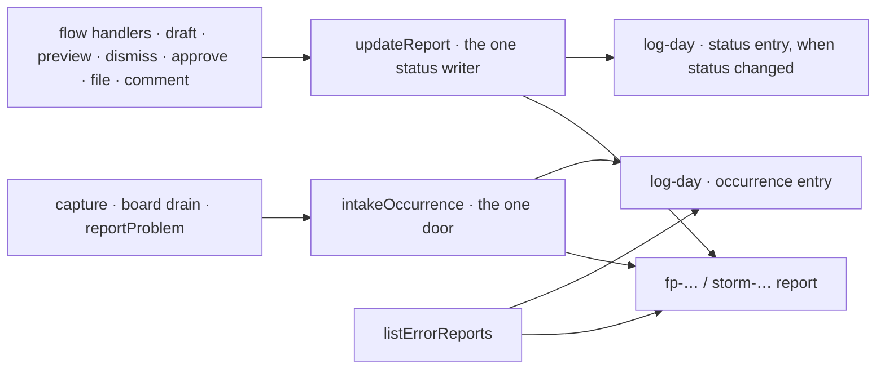

# FIX-2793 · Error Reporter keeps a readable history of every error it reported, filed or not

**Spec** · [Decisions](DECISIONS.md)

Part of epic [FIX-2369](../../epics/FIX-2369/SPEC.md) (the workforce apps as a daily driver).
[FIX-2791](../FIX-2791/SPEC.md) builds on this spec: it reads the history this one keeps.

## Five people, before and after

| Someone who… | Today | After |
|---|---|---|
| **asks error-reporter "did you report the two aborted coder runs?"** | It has no way to read its own reports. In Jake's run it read the task board and answered from that | It reads its reports and answers with each one's status: drafting, waiting in Inbox, filed as FIX-N (with the URL), dismissed, or not reported at all ([D2](DECISIONS.md#d2)) |
| **asks the Shift Coordinator what has been reported** | The coordinator can't read reports. It messages error-reporter and relays the answer | It reads the reports itself, read-only, and answers in the same turn ([D2](DECISIONS.md#d2)) |
| **sees one failure come back a sixth time** | The report's count goes up, but it keeps the ids of only the newest 5 occurrences. The first one's time, request and task are gone | Every occurrence is in that day's history, with its time, ids and a short message ([D1](DECISIONS.md#d1)) |
| **wants to know when a report was filed or dismissed** | Only the current status is kept, and a filed report's `filedAt` | Each change of status is in the history with its time; *filed* carries the Linear ID and URL ([D1](DECISIONS.md#d1)) |
| **is one of several users in the org and asks the coordinator** | Can't read reports at all | **Open to the owner** ([Open](DECISIONS.md#open)). Recommended: reads every report's summary, and the occurrence ids only of their own failures |

## The goal, and how we'll know it's met

**Every occurrence that reaches the Error Reporter, and every change of a report's status, is
kept in a history beside the reports, and both error-reporter and the Shift Coordinator answer
"what was reported, and was it filed?" from that history and the reports, not from the task
board or from each other.**

| Is it the right goal? | |
|---|---|
| **The real need** | Jake (2026-11-17): "every error the Error Reporter detects should be logged automatically the moment it's detected, with its status (filed or not filed), so there's a history of our errors that both error-reporter and the Shift Coordinator can read" |
| **Smaller, and rejected** | "Give error-reporter a read tool over the reports as they are." It answers "is it filed?" but keeps losing every occurrence after the fifth, and no status change has a time. Or "raise `KEPT_OCCURRENCES`": the report record grows with every repeat, forever |
| **Bigger, and not this issue's** | Errors that never reach the Error Reporter: an aborted run today ([FIX-2790](https://linear.app/fixpoint-labs/issue/FIX-2790), in development). What the replies say and the Inbox shows ([FIX-2791](../FIX-2791/SPEC.md)). A history screen in Shift Manager |
| **Not done if** | An occurrence past the fifth of one fingerprint is missing from the history · a status change made by any writer has no entry · the Shift Coordinator answers by messaging error-reporter or reading the task board · the read tool writes anything · the restart path (`listReports`, the outbox at bind) reads history entries · one day's history has no upper size |



The check grades the stored history and the recorded tool calls, so a turn that guessed right
without reading still fails.

| How we verify | |
|---|---|
| **Goal check** | A new **leg R** in [`goals/error-reporter/files-a-reproducible-issue`](../../../goals/error-reporter/files-a-reproducible-issue/goal.md), run after leg 2 in the same Lab |
| **Signal** | **a** The day's history holds 11 occurrence entries for leg 2's fingerprint; the report still keeps 5. **b** Leg 1's report has entries `previewing`, then `filed` with the tracker's identifier and URL. **c** Asked "what has been reported today, and is any of it filed?", the Shift Coordinator's turn calls `listErrorReports` and sends no message or task to error-reporter; its answer names leg 1's issue identifier. **d** Asked in its own conversation "did you report the `burst` failure?", error-reporter calls `listErrorReports` and answers with that report's status |
| **Input** | The goal's own Lab and plants. The two questions are held out of every prompt and WORKER.md |
| **Anti-game** | Grade the store's history and the sessions' recorded tool calls. An answer that names the identifier without a `listErrorReports` call fails **c** |
| **Control that must fail** | `GOAL_CONTROL=no-history`: the intake writes no history entry. FAILS **a** (5 kept, 0 entries). `GOAL_CONTROL=no-report-read`: `listErrorReports` left out of the coordinator's catalog and `tools:` line. FAILS **c** |
| **Reproduce first** | In `packages/workforce/test/error-reporter.test.ts`, on today's main: seven occurrences of one fingerprint leave the ids of only five anywhere in the collection (red); a coordinator flow built as the devteam host builds it has no tool that reads a report (red). Both go green with this change |

## What changes



Left, the reports keep a count and the newest five ids, and nobody in a conversation can read
them. Right, one day's history beside them takes every occurrence and status change, and one
read tool serves both workers.

```diff
  // @flow-state-dev/workforce · the error-reports/* collection, one key per record
  fp-<fingerprint> · storm-<window> · cap · held-<task> · task-<task>
+ log-<YYYY-MM-DD>    // that UTC day's history: append-only, capped per day

  // the Error Reporter's conversation turn
- extraTools: [reportProblem]
+ extraTools: [reportProblem, listErrorReports]

  // packages/shift-manager/teams/devteam/host.mts · the agent turn's catalog
+ ...errorReportTools(),                 // { listErrorReports }, from @flow-state-dev/workforce

  // teams/devteam/workforce/org/workers/shift-coordinator/WORKER.md
- tools: [hire, fire, …, pauseRoutine, deleteRoutine]
+ tools: [hire, fire, …, pauseRoutine, deleteRoutine, listErrorReports]
```

A model calls it like this (names past `listErrorReports` are the implementer's):

```ts
listErrorReports({ status: "not-filed", from: "2026-11-17", source: "task" })
// → { reports: [{ title, status: "waiting in Inbox", source: "task", count: 2,
//                 firstSeenAt, lastSeenAt, taskIds: ["task_3f5e"], issue: null }],
//     history?: [{ at, kind: "occurrence" | "status", status?, taskId?, requestId?, message }] }
```

**Docs:** at release, [`apps/docs/docs/workforce/error-reporter.md`](../../../apps/docs/docs/workforce/error-reporter.md)
gains a short "The history" section (what is kept, for how long, and `listErrorReports`), and
[`shift-coordinator.md`](../../../apps/docs/docs/workforce/shift-coordinator.md) names the tool in
its list. `packages/workforce/README.md` names `errorReportTools`. No new page. FIX-2791 adds its
own lines to the same page.

## How it gets there



Two writers converge every write the history needs: `intakeOccurrence` for occurrences and
`updateReport` for status ([Decided, not asked](DECISIONS.md#decided-not-asked)).

## What stays as it is

- The reports themselves: one per fingerprint, the cap, the storm report, the held requests,
  the preview in Inbox, filing only after the operator answers. Jake's FIX-2791 decision keeps
  Inbox review for every report.
- `KEPT_OCCURRENCES` (5) on the report. The dossier still reads the newest occurrences.
- The collection stays unreadable by a browser (`client.state.read: false`). The tool reads on
  the server, in a worker's turn.
- The intake flow's internal `reports` entry, which the restart outbox reads.

## What's already here, and the debt

| Already here | What this does with it |
|---|---|
| **The job: keep what the Error Reporter saw.** One way: the report records in `error-reports/*` ([FIX-1983](../FIX-1983/SPEC.md)), with a count and the newest 5 occurrences. Mechanism entry `error-reporter`. Searched `log`, `history`, `ledger`, `append` across `packages/*/src` and `docs/mechanisms/mechanisms.yaml`: the closest are orchestration's observation ledger (`task-flow-policy`, tool calls of a board run) and event-actors' entry log (a pattern's session log), neither about reports | **Extended**: the history is new keys in the same collection, written by the same intake. This would otherwise be the second store of error reports |
| **The job: read the reports.** One way: the intake flow's internal `reports` entry (`op: "all" \| "get"`), which only the reporter's bind calls | **Kept** for the outbox. The tool reads through the same `readReport`/`listReports` helpers, never through that entry |
| **The job: read what happened to a task from a conversation.** `listTasks`/`getTask` on the coordinator's board | **Kept**. They answer what a task did; the new tool answers what was reported about it |
| `links` on `ErrorReporterOptions`, which the devteam host fills with a Shift Manager path | **Reused** by FIX-2791 for the Inbox link, not here |
| [FIX-1983](../FIX-1983/SPEC.md)'s report lifecycle | **Kept**. The history records it; it changes nothing in it |

| Adds | Existing piece considered | Why it doesn't fit / how composed |
|---|---|---|
| `log-<day>` records in `error-reports/*` | Raising `KEPT_OCCURRENCES`; a second collection | **Composes** the existing collection and its CAS helper (`updateStateWith`). A larger keep grows each report forever; a second store is what the issue rules out |
| `listErrorReports` tool, exported as `errorReportTools()` | The intake's `reports` entry; messaging error-reporter (`sendMessage`) | **Composes** `readReport`/`listReports`. The entry is internal and returns raw records with dossier fields; a message makes the coordinator depend on another worker's turn for a read |

| The debt | |
|---|---|
| **Removes** | Nothing |
| **Adds** | One more key family in the collection, and a daily record every intake writes to: permanent by design. A second read path over reports beside the internal entry: permanent by design, one for the outbox and one for a model, both through the same helpers |
| **Leaves** | `listReports` lists the whole collection and drops what doesn't parse; with the history beside it, it must list only report keys (BP-033). That is part of this change, not left. Pruning history older than the retention is done at the intake ([Decided, not asked](DECISIONS.md#decided-not-asked)), so nothing is left without an owner |

**Net: up, a little.** One key family and one read tool, both inside the Error Reporter's own
package; no second store and no second report lifecycle.

## Where this meets its neighbours

- **FIX-2790** (in development, another thread) makes an aborted run reach the intake. Until it
  lands, an aborted coder run is not in the history, because it never reached the Error
  Reporter. This spec needs nothing from it and changes none of its files' capture paths: both
  touch `reporter.ts`/`flow.ts`, and whichever merges second rebases.
- **FIX-2791** reads this history and adds the Inbox link to what the tool returns.

## Sign off

**[The goal](#the-goal-and-how-well-know-its-met), at that size:** every occurrence and status
change kept, and both workers answering from it. If wrong: Jake asks again next week why the
coordinator didn't know.

**[The debt](#whats-already-here-and-the-debt), net up a little:** one key family, one read tool,
no second store. If wrong: a history nobody reads, written on every failure.

1. **[D1](DECISIONS.md#d1) · The history is one record per UTC day, in the same collection,
   capped per day and kept 90 days, not one growing record.** If wrong: a read over a long range
   reads many small records instead of one large one.
2. **[D2](DECISIONS.md#d2) · One read tool, `listErrorReports`, a Workforce built-in: always on
   error-reporter's turn, and named in the Shift Coordinator's `tools:`.** If wrong: a public tool
   name to keep stable.
3. **[Open](DECISIONS.md#open) · Who in an org reads the history.** Recommended: everyone reads
   summaries; occurrence ids only for the operator and for one's own failures. The one to weigh.

Improvement · `workforce`, `shift-manager` · S–M (one key family and two writers in
`reports.ts`, one tool, one catalog entry and one WORKER.md line) · depends on nothing ·
FIX-2791 builds on it · [Linear](https://linear.app/fixpoint-labs/issue/FIX-2793)
