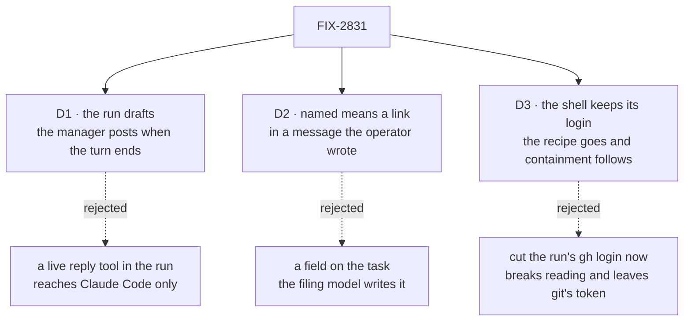

# FIX-2831 · Decisions

[Spec](SPEC.md) · **Decisions**

What was considered, what was chosen, why, and what each choice locks in. Three decisions are the sign-off surface. Everything else here is context for them.

## The tree

Solid edges are what you're signing. Dashed edges lost, and the label says why.

## D1 · The run drafts its replies in a file; the harness manager posts them when the turn ends

| | |
|---|---|
| **Instead of** | A reply tool handed to the run, relayed beside the project's MCP tools (`mcpTools`) |
| **Because** | Codex and Cursor take no relayed tools, so a tool covers one harness of three and leaves the other two on `gh`. A file the brief names is the channel the ask marker already uses on every harness. Posting after the turn's push or landing also means a reply never names a commit that is not on the pull request yet (tenet 2: one path, not one per harness) |
| **Locks in** | Replies are the host's to post, not the run's. A run learns of a refusal only in its next turn; the operator sees it at once, as a session line |

It comes down to Codex and Cursor: a relayed tool leaves them on `gh`.

**What would change my mind:** a reviewer flow that needs a reply before the push, or Codex and Cursor gaining relayed tools. Then a tool over the same poster is a second front door, not a second check.

## D2 · "The operator named it" means a link in a message the operator wrote

| | |
|---|---|
| **Instead of** | A field on the task (`pullRequest`, `comments`) that the filer writes |
| **Because** | The filer is a model reading text; a review comment it was shown could talk it into naming any pull request. The operator's own message (the one the filing turn answers, or a steer from the user on the task whose `by` is the operator) is written by the server under a server-set identity (BP-031). A pull request linked there is one the run may reply on; a comment linked there may be answered whatever its author |
| **Locks in** | A link in the operator's words is a grant. Pasting a comment's link is how the operator opens a reply to someone outside the reviewer list |

It comes down to who writes it: a model's field can be steered by the review itself.

**What would change my mind:** the operator never needing replies to unlisted authors or to a pull request the task didn't open. Then drop the exception and the stamp; listed reviewers on the task's own pull requests only.

## D3 · The shell keeps the operator's GitHub login; only the recipe goes, and containing the credential is a follow-up

| | |
|---|---|
| **Instead of** | Cutting the run's `gh` login in this change (an empty `GH_CONFIG_DIR`, no token in the environment) |
| **Because** | A wake still tells the run to push to its pull request's branch, with the operator's login through git's credential helper, and a chat ask reads its pull request with `gh`. Cutting `gh` alone breaks the reading and still leaves the token one `git credential fill` away. Real containment moves every run's push to the host, which is its own change |
| **Locks in** | Until the follow-up lands, the check binds the path the coder is told to use, not a run that disobeys. A comment that talks the run into `gh api …` still posts as the operator |

It comes down to what still works: cutting `gh` breaks reading and contains nothing.

**What would change my mind:** the follow-up shipping first, so runs no longer push themselves. Then cut `gh`'s login here too, and "enforced" covers a run that disobeys.

## Decided, not asked

- **The convergence point is one poster in `workforce/service-flows/github`**, built from what `operatorGitHub` holds (operator, token, reviewers). Every reply a coder posts goes through it; the harness manager only reads drafts and hands them over. Names in the spec's diff (`replies`, `reviewReplies`) are the implementer's.
- **Five checks, in this order, each with a session line on refusal:** the session user is the operator (else no token); the pull request is one of the task's (`taskPullRequests` over `requestIds`, and `landedPullRequests`) or one the operator linked; the comment id is read from that pull request on GitHub at post time; its author passes the trusted-reviewers rule (a listed bot, or a listed user who can push), or the operator linked it; the body goes as a JSON field, never through a shell.
- **A draft names its comment by link.** Repository, pull request and id are parsed from it and then checked; nothing else in the draft is believed.
- **An inline review comment gets a reply in its thread.** A conversation comment or a review's summary has no thread on GitHub, so it gets one comment on the same pull request that links the one it answers.
- **The reply file sits beside the ask marker** under `.fsdev/`, and the check provisioning runs that git ignores the ask marker covers it too. Its path carries the attempt and the run, so a stale file is never read.
- **A turn FIX-2900 holds read-only posts nothing,** and says so.
- **The operator's links are stamped on the task at filing,** like the project stamp, and read from steers from the user later.

## Considered and dropped

| Alternative | Why not |
|---|---|
| Parse replies from the run's last message | The ask marker's own reasoning: absent on a thrown exit, and the field a model most likes to reword |
| A tool for Claude Code and the file for the others | Two front doors to keep in step for no gain the file lacks |
| Deny `Bash(gh:*)` in Claude Code's settings | A prefix rule is not a boundary (`env gh`, `sh -c`), and Codex and Cursor have no such rule |
| Put the poster in `workspace` beside `landRun` | The operator check and the reviewer list live in workforce; FIX-2931 decides where GitHub code lives in the end |

## Analysis

2026-11-27 · watermark 2026-11-18 (issue filed) · **Right approach, scope as asked.** Run inline by the author; no fresh sub-agent was available in this session, so the gate should read this as self-analysis.

1. **Reuse** — every *Adds* item composes an existing piece (the ask marker's channel, `reads(ctx)`, the trusted-reviewers rule, the filing stamp); none is new. See [Builds on / Adds](SPEC.md#whats-already-here-and-the-debt).
2. **Prior art** — in-repo: landing already writes to GitHub host-side with the host's credential, never from the run. No outside survey was run.
3. **Other shapes** — a live tool, a last-message parse, a shell deny rule: all in *Considered and dropped*.
4. **New factors** — FIX-2900 (read-only turns) and FIX-2873 (one reviewer list) landed since; both are composed, not crossed.
5. **Necessity** — earns its place: the reply path posts as the operator.
6. **Ergonomics** — the coder writes a file instead of a `gh` command; the operator pastes a link to widen.
7. **Concerns** — the run's ambient GitHub login (D3). Recorded as the follow-up, not folded.

## How it got here

- **Draft** — framed as one checked path for a coder's review replies; drafts in a file posted by the harness manager over a relayed tool, so all three harnesses share it; builds on the ask marker, `reads(ctx)` and the trusted-reviewers rule.

**Open: none.**
