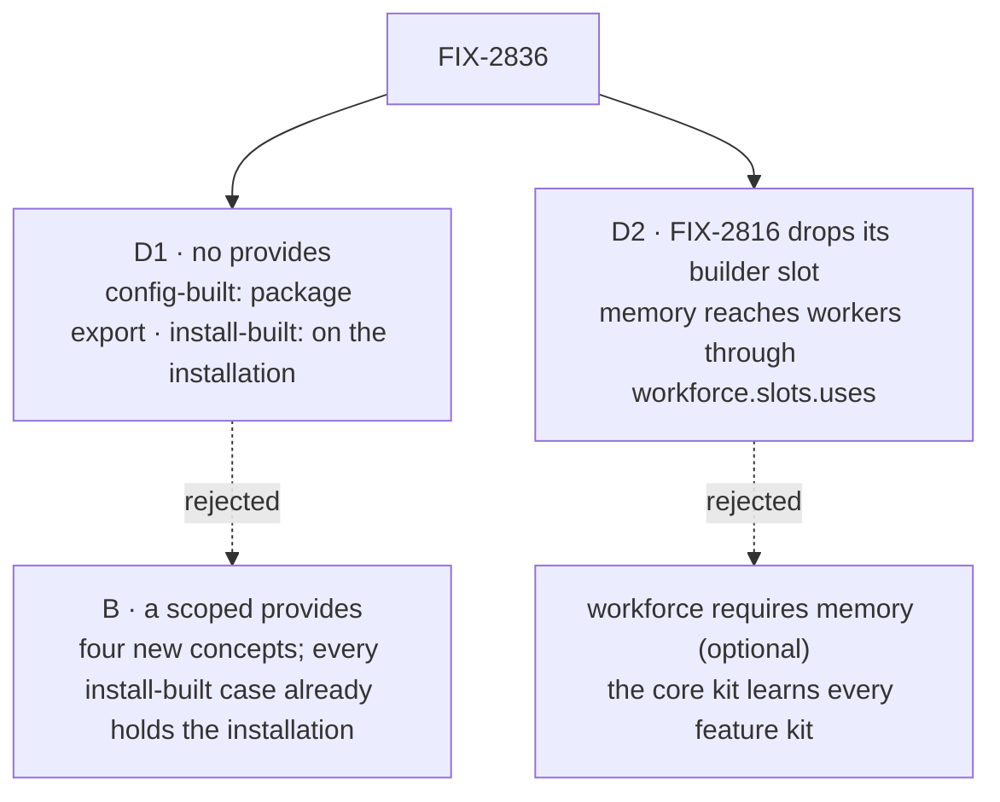

# FIX-2836 · Decisions

[Spec](SPEC.md) · **Decisions**

The issue asked for `provides`; the dispatch allowed "don't build it" if `requires` plus config
covers the real cases. The evidence says it does, so both cards argue for not building. D1 was
reopened on 2026-11-25 for values built at install, and the owner chose option A: they go on
the installation, with no new primitive.

## The tree

Solid edges are what you are signing. Dashed edges lost, and the label says why.

## D1 · No `provides`: a value built from config is a package export; a value built at install goes on the installation

| | |
|---|---|
| **Instead of** | **B**, a scoped `provides`: `provide` and `provided` on `defineKit`, typed through `requires`, the requiring kit reading the value in its own install (the issue's sketch; option B on the owner's [2026-11-25 comment](https://github.com/fixpoint-labs/flow-state-dev/pull/5548#issuecomment-7148066040)) |
| **Because** | **Built from config.** Memory (#5434): `system(config)` needs only config, and its capability reaches workforce's worker flow and a block's `ctx.cap` with no new API ([the POC](poc/memory-without-provides/README.md), control fails). Second opinion (#5435) and research (#5436) return one flow from config; nothing shared. Harnesses' list: its consumers are workforce, which harnesses requires (a cycle if reversed), and Shift Manager, an app; `provides` reaches neither. Inbox (FIX-2058): Done, no kit. **Built at install** (the three cases on the comment). (1) Workforce keeps its internal events in a module-level WeakMap keyed by installation and reads it back through `internalEventsOf(installation)`. Every caller already holds the installation inside a builder (the goal's and the kit test's `workerFlow` builders, the routines page's flow builder), so a field on the installation serves them all. (3) A kit that publishes internal events requires workforce, so it installs after it, and it gets the installation by contributing a builder to `workforce.slots.flows`, as harnesses does; `installation.internalEvents.publishEvent` is there. (2) The message board's validator (FIX-2839) is built from schemas other kits contribute; if workforce needs it, workforce owns that slot and builds the validator in its own install. And a dependent's `contributes` runs before any install, so B could only feed the reader's own `install`: memory reaching workers would need workforce to require memory |
| **Locks in** | One rule in `kits.md`: a value made from config is a package export, placed with `uses` or a slot fill; a value made at install goes on the object the owner hands its builders (workforce's installation), reached by a dependent through the owner's builder slot. **`installation.internalEvents` replaces `internalEventsOf` and its WeakMap, removed with no alias**: an app that calls it changes one line when it upgrades workforce. ER-5 stands unamended. A feature author who wants another kit's flows to have their capability needs that kit to declare a slot, or the app to place it |

It comes down to where the value is built: from config, a module export carries it, typed; at
install, the owner already hands the object it built to every builder, so the value rides on it.

**Why B lost:** four new concepts (`provide`, `provided`, a record `requires`, `.optional()`)
that reach only kits requiring the provider, never the app's flows, for cases that all run in
a builder, not in the reader's `install`.

**What would reopen this:** a kit that needs, during its own `install`, a value another kit
built in its `install`. A builder slot can't hand that over without a closure capturing it. The
known candidate is FIX-2839's planned follow-up, workforce requiring a separate message-board
kit: if workforce's install needs that kit's validator, scoped `provides` is the shape, with
Fastify's `decorate` and `dependencies` and Backstage's service refs and `deps` as precedent.
FIX-2839's spec decides it, and reopens this card if it lands there.

## D2 · FIX-2816 drops its builder slot; memory reaches workforce's workers through `workforce.slots.uses`

| | |
|---|---|
| **Instead of** | The draft's `memory.slots.flows`, a keyed slot of `(mem) => flow` builders, or the issue's `workforce` with `requires: { memory: memory.optional() }` |
| **Because** | The builder slot makes every flow that wants memory be built inside memory's kit, the inversion the issue names. The optional-require makes workforce, the core kit, import each feature kit; today memory is only a dev dependency of workforce (`packages/workforce/package.json`, `devDependencies`). The app fill is one line and already proved (POC leg a) |
| **Locks in** | The memory package's `system(config)` is how an app gets memory, kit or not. FIX-2816 decides whether a memory kit still exists for a flow it serves; it serves none in the draft. #5434 changes before it merges |

It comes down to dependency direction: features reach workforce through its slot, never by
workforce requiring them.

**What would change my mind:** memory needs per-installation state that two `system()` calls
would split, and an app can't hold the one instance. No such state was found; kitchen-sink
holds one at `apps/kitchen-sink/flows/chat-agent/run/cognition.ts:20`.

## Decided, not asked

- **The issue closes on merge of the implementation PR** (the `kits.md` section and the goal),
  not on this spec alone.
- **`installation.internalEvents` is optional**, `undefined` when the kit has no `internalEvents`
  config; a caller narrows it instead of catching `internalEventsOf`'s throw. It is set after
  the installation is created (the service flow is built on it) and before the hire, which is
  when builders first run.
- **Typed contributions** (harnesses annotates `installation: WorkerInstallation` by hand at
  `harnesses-kit.ts:131`) are a separate, smaller question; not raised here.
- **Linear follow-ups when approved:** FIX-2816 loses "a slot whose entries are flow builders";
  FIX-2839's sequencing and FIX-2813's "Sharing between units" drop FIX-2836.

## Considered and dropped

| Option | Why it lost |
|---|---|
| `provides`, as sketched or scoped (B) | D1: no case needs a value inside its own install, and it can't reach the app's own flows |
| Keep `internalEventsOf` beside the new field | Two ways to one value; the owner's rule is one mechanism, no aliases |
| Values on the kit instance (`memory(cfg).value`, built at the factory call) | Same reach as a package export, plus a new `defineKit` field |
| A bridge kit requiring both memory and workforce | Contributions run before installs, so it can't read memory's built value; with a module export it is just the app's fill, renamed |
| Leave the builder slot in memory | Every feature kit would copy it (the issue's own warning) |

## Settled

- **Memory reaches another kit's flows with no `provides`. CONFIRMED** on 2026-11-21 by
  [the POC](poc/memory-without-provides/README.md): leg a (real workforce) and leg b
  (`fsdev run`, `ctx.cap`) pass; `POC_CONTROL=no-fill` fails both.
- **The issue's block sketch throws as written:** a handler refuses the composed
  `mem.capability` (its presets add context); it needs `.with({ working: false, digest: false,
  recall: false })`, or `mem.workingMemoryCapability`. `ctx.cap.memory.remember` does not exist.

## Analysis

2026-11-21, watermark: FIX-2626's spec merge. **No sub-agents could be dispatched from this
worker, so reuse-review and analysis were done by the author, who also chose the direction.**
Weigh them accordingly. Verdict: **don't build; reshape to a docs rule and a goal.**

1. **Reuse:** reuse `capability` + `uses`; reuse slots and the app's `fill`; reuse the owner's
   builder slot. `provides` was a fourth way to one job. Folded (D1).
2. **Prior art:** [Fastify decorators](https://fastify.dev/docs/latest/Reference/Decorators/)
   (`decorate`, `dependencies`) and [Backstage services](https://backstage.io/docs/backend-system/architecture/services/)
   (`createServiceFactory`, `deps`) both share by named value. Both build the value at boot,
   from config and lifecycle the plugin can't see earlier; our named values are built from
   config the app holds. Recorded.
3. **Other shapes:** instance values and a bridge kit (dropped, above). The next-variant test:
   without a written rule, the next feature kit copies memory's builder slot; the `kits.md`
   section is that rule. Folded.
4. **New factors:** FIX-2837 (rename) canceled 2026-11-21; drafts #5434, #5435, #5436 read;
   FIX-2058 Done. None needs `provides`.
5. **Necessity:** not needed now. Leaner version: a docs rule and a goal.
6. **Ergonomics:** `provides` would add `provide`, `provided`, a record form of `requires` and
   `.optional()`: four concepts. The rule adds none. The handler preset throw is a surprise
   this walks past; it belongs to the memory package, and FIX-2816 meets it first. Recorded.
7. **Major concerns:** none.

## How it got here

- 2026-11-21 · Drafted. The issue asked to build `provides`; the POC and the case survey turned
  the spec into a recommendation not to.
- 2026-11-25 · The owner reopened D1: it covered values built from config, not at install
  (`internalEventsOf`, the message board's validator, kits publishing internal events). The
  owner chose option A; D1 now puts install-built values on the installation and records B's
  falsifier.
