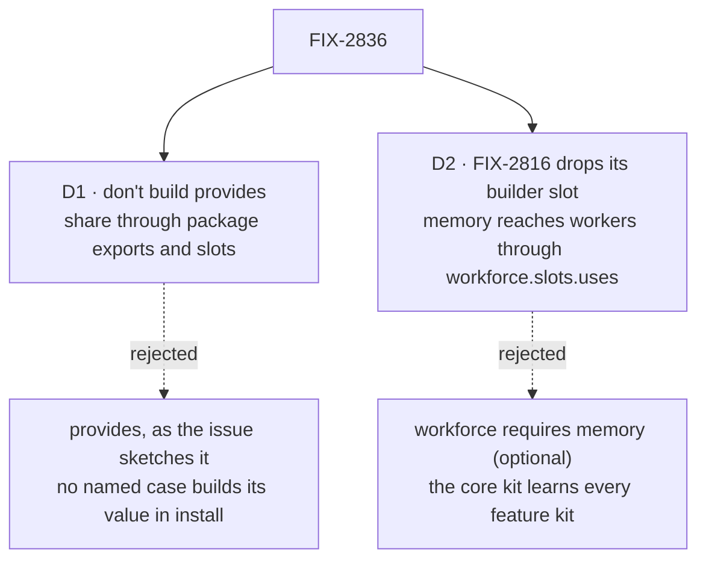

# FIX-2836 · Decisions

[Spec](SPEC.md) · **Decisions**

The issue asked for `provides`; the dispatch allowed "don't build it" if `requires` plus config
covers the real cases. The evidence says it does, so both cards argue for not building.

## The tree

Solid edges are what you are signing. Dashed edges lost, and the label says why.

## D1 · Don't build `provides`; a kit shares what it builds through its package's exports and slots

| | |
|---|---|
| **Instead of** | `provides` on `defineKit`, with `provide` and `provided` in `install`, typed through `requires` (the issue's sketch) |
| **Because** | Every case the issue names, checked against code and the draft PRs. **Memory** (#5434): `system(config)` needs only config, and its capability reaches workforce's worker flow and a block's `ctx.cap` with no new API ([the POC](poc/memory-without-provides/README.md), control fails). **Second opinion** (#5435) and **research** (#5436): each kit's install returns one flow from config alone; no slot, nothing shared. **Harnesses' list**: its consumers are workforce, which harnesses requires (a cycle if reversed), and Shift Manager, an app; `provides` reaches neither. **Inbox** (FIX-2058): Done, with its wait on the `wait-gate` and `inbox` rows, no kit. **Message board** (FIX-2839): its sketch only takes contributions (`schemas`, `sync`, `watchers`). The one real install-time value, workforce's installation, already reaches harnesses through the `flows` builder slot. And a dependent's `contributes` runs before any install (`packages/engine/src/flowstate/kits.ts:222` vs `:297`), so a provided value could feed only the reader's own `install`: memory reaching workers would need workforce to require memory |
| **Locks in** | One rule in `kits.md`: a value made from config is a package export, placed with `uses` or a slot fill; a value made from a kit's folder or slots goes to dependents through the owner's builder slot. ER-5 stands unamended. A feature author who wants another kit's flows to have their capability needs that kit to declare a slot, or the app to place it |

It comes down to where the value is built: every named case builds it from config, so a module
export already carries it, typed.

**What would change my mind:** a kit whose value needs its folder or its slots, consumed by
more than one kit that requires it, where a builder slot on the owner reads badly. Then
`provides` is the right shape, and Fastify's `decorate` with `dependencies` and Backstage's
service refs with `deps` are the precedent.

## D2 · FIX-2816 drops its builder slot; memory reaches workforce's workers through `workforce.slots.uses`

| | |
|---|---|
| **Instead of** | The draft's `memory.slots.flows`, a keyed slot of `(mem) => flow` builders, or the issue's `workforce` with `requires: { memory: memory.optional() }` |
| **Because** | The builder slot makes every flow that wants memory be built inside memory's kit, the inversion the issue names. The optional-require makes workforce, the core kit, import each feature kit; today memory is only a dev dependency of workforce (`packages/workforce/package.json`, `devDependencies`). The app fill is one line and already proved (POC leg a) |
| **Locks in** | The memory package's `system(config)` is how an app gets memory, kit or not. FIX-2816 decides whether a memory kit still exists for a flow it serves; it serves none in the draft. #5434 changes before it merges |

It comes down to dependency direction: features reach workforce through its slot, never by
workforce requiring them.

**What would change my mind:** memory needs per-installation state that two `system()` calls
would split, and an app can't hold the one instance. No such state was found; kitchen-sink
holds one at `apps/kitchen-sink/flows/chat-agent/run/cognition.ts:20`.

## Decided, not asked

- **The issue closes on merge of the implementation PR** (the `kits.md` section and the goal),
  not on this spec alone.
- **Typed contributions** (harnesses annotates `installation: WorkerInstallation` by hand at
  `harnesses-kit.ts:131`) are a separate, smaller question; not raised here.
- **Linear follow-ups when approved:** FIX-2816 loses "a slot whose entries are flow builders";
  FIX-2839's sequencing and FIX-2813's "Sharing between units" drop FIX-2836.

## Considered and dropped

| Option | Why it lost |
|---|---|
| `provides` as sketched | D1: no case needs it, and it can't reach the app's own flows |
| Values on the kit instance (`memory(cfg).value`, built at the factory call) | Same reach as a package export, plus a new `defineKit` field |
| A bridge kit requiring both memory and workforce | Contributions run before installs, so it can't read memory's built value; with a module export it is just the app's fill, renamed |
| Leave the builder slot in memory | Every feature kit would copy it (the issue's own warning) |

## Settled

- **Memory reaches another kit's flows with no `provides`. CONFIRMED** on 2026-11-21 by
  [the POC](poc/memory-without-provides/README.md): leg a (real workforce) and leg b
  (`fsdev run`, `ctx.cap`) pass; `POC_CONTROL=no-fill` fails both.
- **The issue's block sketch throws as written:** a handler refuses the composed
  `mem.capability` (its presets add context); it needs `.with({ working: false, digest: false,
  recall: false })`, or `mem.workingMemoryCapability`. `ctx.cap.memory.remember` does not exist.

## Analysis

2026-11-21, watermark: FIX-2626's spec merge. **No sub-agents could be dispatched from this
worker, so reuse-review and analysis were done by the author, who also chose the direction.**
Weigh them accordingly. Verdict: **don't build; reshape to a docs rule and a goal.**

1. **Reuse:** reuse `capability` + `uses`; reuse slots and the app's `fill`; reuse the owner's
   builder slot. `provides` was a fourth way to one job. Folded (D1).
2. **Prior art:** [Fastify decorators](https://fastify.dev/docs/latest/Reference/Decorators/)
   (`decorate`, `dependencies`) and [Backstage services](https://backstage.io/docs/backend-system/architecture/services/)
   (`createServiceFactory`, `deps`) both share by named value. Both build the value at boot,
   from config and lifecycle the plugin can't see earlier; our named values are built from
   config the app holds. Recorded.
3. **Other shapes:** instance values and a bridge kit (dropped, above). The next-variant test:
   without a written rule, the next feature kit copies memory's builder slot; the `kits.md`
   section is that rule. Folded.
4. **New factors:** FIX-2837 (rename) canceled 2026-11-21; drafts #5434, #5435, #5436 read;
   FIX-2058 Done. None needs `provides`.
5. **Necessity:** not needed now. Leaner version: a docs rule and a goal.
6. **Ergonomics:** `provides` would add `provide`, `provided`, a record form of `requires` and
   `.optional()`: four concepts. The rule adds none. The handler preset throw is a surprise
   this walks past; it belongs to the memory package, and FIX-2816 meets it first. Recorded.
7. **Major concerns:** none.

## How it got here

- 2026-11-21 · Drafted. The issue asked to build `provides`; the POC and the case survey turned
  the spec into a recommendation not to.
