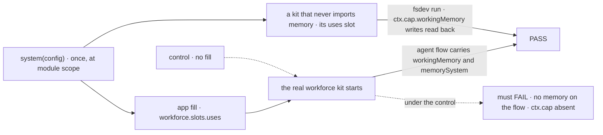
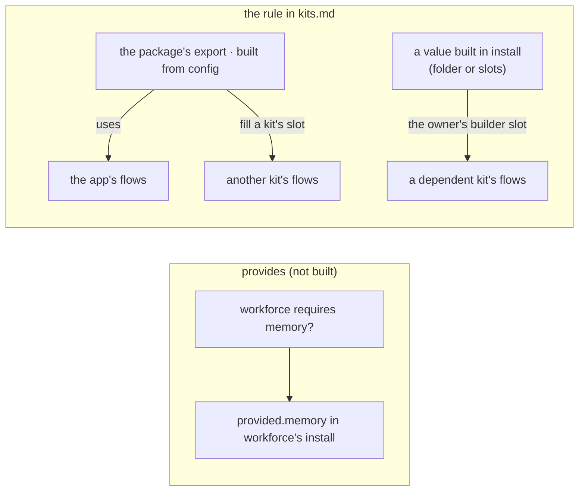

# FIX-2836 · Kits can provide typed values to the kits that require them (`provides`)

**Spec** · [Decisions](DECISIONS.md)

A kit that builds something other kits need, such as memory, has no named way to share it. The
draft memory kit works around that with a builder slot, so every flow that wants memory has to be
built inside the memory kit, and workforce's workers can't get memory without that.

**Recommendation: don't build `provides`.** The case that motivated it, memory reaching
workforce's workers, works today with no new API ([the POC](poc/memory-without-provides/README.md)).
None of the other named cases builds its value in `install`. This spec records that finding,
says how a kit shares what it builds, and reshapes FIX-2816 to use it.

## Five people, before and after

| Someone who… | Today | After |
|---|---|---|
| **writes a kit that others use** (memory) | Copies the draft memory kit's builder slot: apps hand memory flow builders, and memory calls them with its system | Exports the value from its package, built from config. Apps place it with `uses` or a slot fill. The kit keeps `install` for the flows it serves |
| **runs workforce workers with memory** | Workers can't get memory unless they are built inside memory's slot | Fills `workforce.slots.uses` with `mem.capability`, one line. Workforce's agent flow carries memory's resources; a block in a kit that never imports memory reads it through `ctx.cap` (the POC checks the second on a stand-in kit, not a model-backed worker run) |
| **maintains workforce** | Would have to `require` memory, second opinion and research, one at a time, to read what each provides | Requires nothing new. A feature reaches workers through workforce's own `uses` slot |
| **adds a block that needs memory** | Not affected | Not affected: `uses: [mem.capability]`, as kitchen-sink does today |
| **reads `kits.md`** | Finds no word on how a kit shares a value it builds | Finds a short rule, with the case for each |

## The goal, and how we'll know it's met

**A kit's built value reaches the flows of another kit, and the app's own flows, typed, with
one way to do it and no hidden wiring.**

| Is it the right goal? | |
|---|---|
| **The real need** | The issue: "a way for a kit to share a built thing with other kits", proved on "Memory provides its capability and resources. Workforce workers get `ctx.cap.memory` without memory's builder slot" |
| **Smaller, and rejected** | "Add `provides` and use it in memory." It meets the case by making workforce require memory, and it does not reach the app's own flows (rule 1: only a kit that requires the provider reads it) |
| **Bigger, and not this issue's** | An app reading a kit's value after start-up (three test and goal hosts capture workforce's installation through its `flows` slot today). Typed contributions to a slot |
| **Not done if** | A worker gets memory only by being built inside memory's kit · workforce gains a `requires` on a feature kit · the memory kit keeps a builder slot |



The check reads what the started app registers and what a block does under `fsdev run`.

| How we verify | |
|---|---|
| **Goal check** | The POC, promoted to `goals/kits/memory-reaches-another-kit/` in the implementation PR so the rule in `kits.md` stays proved. Model `n/a` |
| **Signal** | Leg a: workforce's `agent` flow carries `workingMemory` and `memorySystem`. Leg b: a block in a kit that never imports memory reads both of its writes back through `ctx.cap.workingMemory` |
| **Input** | Workforce as shipped, with an empty `workforce/` folder; `system({ model, working: true })` |
| **Anti-game** | Assert on the started app's registry and a real `fsdev run`, not on `system()`'s return |
| **Control that must fail** | `POC_CONTROL=no-fill`. Both legs fail (run 2026-11-21, [the POC](poc/memory-without-provides/README.md)) |

## What changes



A value made from config is a module export. Only a value made from the folder or the slots
needs the kit, and the owner's builder slot covers it.

The memory kit, as FIX-2816 reshapes:

```diff
 // app
+const mem = system({ model, working: true, episodic: true });
 createFlowState({
-  kits: [memory({ model, working: true, episodic: true }), workforce({ agent: { model } })],
-  fill: { [memory.slots.flows]: { chat: (mem) => chatFlow(mem) } },
+  kits: [workforce({ agent: { model } })],
+  fill: { [workforce.slots.uses]: [mem.capability] },
+  flows: [chatFlow(mem)],
 });
```

Whether memory still ships a kit, for a flow it serves (none in the draft), is FIX-2816's call.

**Docs:** `docs/architecture/kits.md` gains "Sharing what a kit builds" (the three cases above).
No user docs (no public change); FIX-2816's changeset carries the memory recipe.

## What stays as it is

- `defineKit`, `requires`, slots, `contributes` and `install` (FIX-2626).
- Workforce's `uses`, `workerFlows` and `flows` slots; harnesses reads workforce's installation
  through `flows`, as today.
- Capabilities as the one way a block reaches a helper (`uses`, `ctx.cap`).

## What's already here, and the debt

**Job: share a value a feature builds with another feature's flows.** Mechanism rows `kit` and
`capability` (`docs/mechanisms/mechanisms.yaml`). `provides` would be the **fourth** way:

| Already here | What this does with it |
|---|---|
| A package export placed with `uses` (`capability` row; kitchen-sink builds memory at module scope, `chat-agent/run/cognition.ts:20`, and places it at `assistant/assistant.ts:32`) | **Builds on** it: the rule for config-only values |
| A slot the consumer kit declares, filled by the app or a dependent (`workforce.slots.uses`, `packages/workforce/src/kit/workforce-kit.ts:193,226`; harnesses fills it with readiness) | **Builds on** it: how a feature reaches another kit's flows |
| An owner's builder slot handed its built value (`workforce.slots.flows`, `workerFlow(…)`; harnesses uses it at `harnesses-kit.ts:131`) | **Keeps** it for values built from a folder or slots |
| The draft memory kit's `flows` builder slot (#5434, `packages/memory/src/kit/memory-kit.ts`) | **Removes** it, in FIX-2816, before merge |
| FIX-2626 [D1](../FIX-2626/DECISIONS.md#d1), epic [ER-5](../../epics/FIX-2618/DECISIONS.md#who-owns-what): "a kit reaches another only through slots that kit publishes" | **Keeps** both. `provides` would have needed ER-5 amended |

| Adds | Existing piece considered | Why it doesn't fit, or how it is composed |
|---|---|---|
| A `kits.md` section | — | Docs only |
| The goal check | `goals/kits/install-in-any-order` | Same shape; composed from the POC |

| The debt | |
|---|---|
| **Removes** | The memory draft's builder slot, before it lands |
| **Adds** | Nothing in code |
| **Leaves** | Three hosts capture workforce's installation through an empty `flows` builder (`apps/kitchen-sink/test/workforce-host.ts`, `goals/lib/workers.mts`, `goals/pentest-lab/lab/host.mts`): all test or goal plumbing, and `provides` would not have reached them. No issue filed; it earns one when an app needs it |

**Net: down,** by a pattern not copied and a concept not added.

## Sign off

**[The goal](#the-goal-and-how-well-know-its-met):** a kit's built value reaches another kit's
flows with one way to do it. If wrong: a kit appears whose value only `install` can build and a
kit that is not its owner needs it, and the builder slot is the only door.

**[The debt](#whats-already-here-and-the-debt), net down.** If wrong: each feature kit invents
its own sharing, which is what this was meant to stop.

1. **[D1](DECISIONS.md#d1) · Don't build `provides`; share through package exports and slots.**
   The one to weigh. If wrong: we add `provides` later, when a real case arrives, at the cost
   of a reshaped memory kit.
2. **[D2](DECISIONS.md#d2) · FIX-2816 drops its builder slot; memory reaches workers through
   `workforce.slots.uses`.** If wrong: one draft PR edited twice.

**Open: none.**

Feature (reshaped to docs and a goal) · `docs/architecture`, `goals`; FIX-2816 · S · epic
[FIX-2618](../../epics/FIX-2618/SPEC.md) · [Linear](https://linear.app/fixpoint-labs/issue/FIX-2836)
