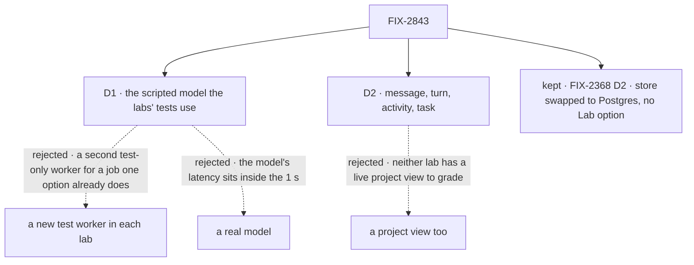

# FIX-2843 · Decisions

[Spec](SPEC.md) · **Decisions**

The issue said the labs need a test worker first. They don't: both hosts already take a model
resolver, and the labs' own tests drive them on a scripted one. Two calls are this spec's: who
answers in the labs (D1), and which views are graded (D2). Where the labs are graded is
[FIX-2368 D2](../FIX-2368/DECISIONS.md#d2), kept.

## The tree

Solid edges are what you're signing. Dashed edges lost, and the label says why.

## D1 · The labs' workers answer on the scripted model their own tests use

| | |
|---|---|
| **Instead of** | A new test worker (a handler worker kind, or a flow added to each lab's tree), as the issue proposed · a real model |
| **Because** | Both hosts take `modelResolver` and a scripted coder already. `labs/test-support/contract.ts`'s `scriptedModels` answers each block by script, one model step at a time, so tools run for real between steps; each lab's contract test and `goals/routines/sessions-in-the-labs-manage-their-routines` open the real hosts on it. A test worker would be a second way to stand in for the model, beside one that works, and the lab's workers would then not be its own. A real model puts its latency inside the 1 s and makes a miss ambiguous ([FIX-2087 D1](../FIX-2087/DECISIONS.md#d1)) |
| **Locks in** | The check proves the labs' views and wiring, not what a real model's turn looks like. The model is `n/a (scripted)` on every verdict line. The scripts live with the goal, not in the labs |

![D1: who answers in the labs during the check. Chosen: the scripted model the labs' own tests use, through the host's existing model resolver. Instead of: a new test worker in each lab. It comes down to the first line, a second way to stand in for the model: the scripted model already exists, and a test worker would add one beside it. The price: the check never sees a real model's turn. A tie: no product option either way, though a test worker grows each lab's tree. Locks in: model n/a, scripted, on every verdict line. Flips if a lab's view behaves differently on a real model's stream in a way a scripted one can't produce](figures/d1-scripted-model.svg)

It comes down to a second stand-in for the model: the scripted model exists, a test worker
would sit beside it.

**What would change my mind:** a lab view that behaves differently on a real model's stream in a
way a scripted step can't produce. Then that view gets a real-model leg, outside the closure.

## D2 · Graded views: message, turn, activity and task; no project view

| | |
|---|---|
| **Instead of** | The four FIX-2368 named for j2, project included |
| **Because** | Neither lab keeps a project view live. Teammates has none; claude-code-style's project picker lists your projects once, when the page loads (`src/components/App.tsx`), with no watch to grade. What each lab does watch: the conversation (session feed and session turns view), the worker list (worker sessions view, Teammates' roster), and the tasks (coding board view). The idle window counts every request the page sends, so a live read the four don't name, such as claude-code-style's pins or Teammates' Talk lines, still fails `:no-poll` if it keeps a timer |
| **Locks in** | A project created or shared from another client shows in claude-code-style's picker only after the page loads again, and this check doesn't look. Making the picker live is product work for its own issue |

![D2: which lab views the check grades. Chosen: message, turn, activity and task. Instead of: those four plus a project view. It comes down to the first line, what exists to grade: neither lab keeps a project view live, so a project line would grade a one-time read or need a new view built first. The price: a project shared from another client stays stale in the picker until the page loads again, unchecked. A tie: the idle count covers every request the page sends either way. Locks in: no project assertion. Flips if a lab gets a live project view](figures/d2-graded-views.svg)

It comes down to what exists to grade: no lab keeps a project view live.

**What would change my mind:** a lab with a live project view, or a person who wants the picker
to follow other clients. Then the view is built under its own issue and joins this scene.

## Decided, not asked

- **Every graded change is written by process 1 and read on process 2.** The convergence point is
  the statement log: each sample's write is attributed by `application_name`, and a sample written
  by process 2 is a setup error, never counted. Every writer passes it: the line's answer, the
  turn's request, the task's filing, and the coder's run, whose process is the dispatcher's
  choice. The implementer keeps the run on process 1, or reports that it can't, which is an
  amendment.
- **One scene per lab, in FIX-2368's goal, not a new goal.** It reuses the Postgres, the
  controls and the scenes switch, and the issue names that harness. `GOAL_SCENES` runs a lab alone.
- **Each lab is served the way it ships, with `fsdev dev --app` over its built pages**, from a
  goal-owned config that calls the lab's own open function. Its `host.mts` is the file on `main`,
  its store line swapped as it loads (or in a scratch copy, the implementer's call within FIX-2368
  D2). The swap fails setup when the line is missing, as the run-lab copy does: open PRs edit
  `labs/teammates/host.mts` (#5659, #5661), though neither touches that line.
- **One page per lab, fronted, probed at 20 frames a second or more** before any sample, as j2
  learned (the goal's Nov 19 verdict line).
- **Where a sample starts.** `:message` from the send, as j2's line is; `:turn`, `:activity` and
  `:task` from when the runner's own connection sees the store change. Samples 1.5 s apart, past
  the session stream's read interval. Every latency is printed.
- **Idle means nothing written and nothing running anywhere**, as j2's window is: open tasks
  cancelled and no request in progress before the 10 s starts. Statements are counted only where
  they name a watched session, so the lab's own clocks don't count.
- **`main-before` runs neither scene**, as it runs no j4: the labs' hosts on that commit predate
  the options this uses.
- **A red here is a finding**, filed as its own issue and fixed in the lab or the package, as
  FIX-2841 was for Shift Manager.

## Considered and dropped

| Alternative | Why not |
|---|---|
| A test worker in each lab | D1: a second stand-in for the model; the lab's workers would no longer be its own |
| A Postgres store option on each lab | FIX-2368 D2: product surface nobody asked for |
| The labs' hooks over happy-dom, two processes | It skips the page's own wiring, the part the issue says nothing exercises |
| FIX-2466's `timer` control for the idle legs | It fails `:no-poll` only; `never-crosses` fails the page and Postgres legs together, by the product's own fallback |

## Analysis

Nov 25, at `35e48f5`. **Right approach, one fold.** Run by the author in this dispatch: the
worker can't start a fresh sub-agent. The owner can dispatch an independent pass.

- **Reuse:** nothing added to a package. The scripted model, the hosts' options, the lab
  launchers, Postgres and two controls are reused; `never-crosses` derives from `no-listen`.
- **Others' shapes:** a cross-process real-page check is the closure's own shape (FIX-2242, FIX-2368).
- **Should it exist:** yes; the issue's *done when*, and FIX-2368's j2 as first written.
- **Major concern, folded:** the issue's premise, a test worker first, would have added a second
  stand-in for the model. Became D1.

## How it got here

- **Draft** — the labs' half of FIX-2368's j2 as two scenes in its goal, each lab on two processes
  over Postgres with the store swapped as FIX-2368 D2 does, its workers on the scripted model the
  labs' tests use. Found: no test worker is needed, and neither lab has a live project view.

**Open: none.**
