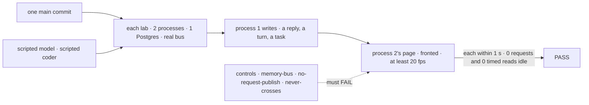
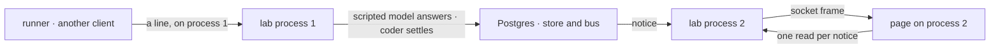

# FIX-2843 · Closure journey over the Teammates and claude-code-style labs

**Spec** · [Decisions](DECISIONS.md)

## Four teams, before and after

| A team that… | Today | After |
|---|---|---|
| **runs the Teammates lab on more than one process** | Nothing checks that a reply, a working status or a settled task written on one process reaches a page served by another, or that the page stops reading while idle | The closure check shows each on process 2's page within a second, and the page reads nothing over 10 s idle |
| **runs the claude-code-style lab on more than one process** | The same: its thread, sessions list and tasks pane are proved only on one process, on the in-memory bus | The same proof, on its own views |
| **decides whether "a change reaches every screen" is true** | FIX-2368's closure passed with j2 on Shift Manager only; the labs' half moved here | One re-runnable scene per lab in the same goal, each beside a control that fails |
| **changes a lab's live-read wiring** | A lab that reads on a clock across processes still passes FIX-2466's one-process check | The closure scene fails, and names the view |

## The goal, and how we'll know it's met

**On one `main` commit, each lab, served as two processes over one Postgres on the real bus with
its workers on a scripted model and the scripted coder, shows on process 2's page a reply, a
running turn, the worker's activity and a settled task that process 1 wrote, each within a
second; and over 10 s with nothing written, the page sends no request and process 2 makes no
timed read of a watched session.**

| Is it the right goal? | |
|---|---|
| **The real need** | The issue's *done when*: "the closure check opens both labs' views on a second process, they update within 1 s of a change, and they make no timed reads while idle." It finishes [FIX-2368's j2](../FIX-2368/DECISIONS.md#the-plan-in-full) as first written |
| **Smaller, and rejected** | "FIX-2466's check already covers the labs." It drives the labs' hooks over happy-dom on one process and the in-memory bus, which says it crosses. A Postgres notice that never reaches process 2, or a lab view that keeps a timer once the bus really crosses, passes it |
| **Not done if** | a sample's change was written by process 2, not 1 · the page timed was a background tab · the run set a poll, timer or timed-read switch · the model was a real one · a control was skipped or passed · either lab skipped |



The check reads what process 2's page draws, the requests it sends and the statements process 2
logs; each control breaks one named assertion.

| How we verify | |
|---|---|
| **Goal check** | `goals/realtime/a-change-reaches-every-screen/`, extended · two scenes, `j2-teammates` and `j2-claude-code-style` (`GOAL_SCENES`) · model `n/a` (scripted, [D1](DECISIONS.md#d1)) · run by the implementer on one `main` commit, verdict in the implementation PR and the goal's verdict log; kept and run on demand as the rest of the goal is |
| **Signal** | Every `j2-<lab>:<assertion>` in [the signal](#the-signal) passes, for both labs. Each "within 1 s" is 5 samples, all under 1000 ms, none retried |
| **Input** | Per lab: its own host (`openTeammates`, `openClaudeCodeStyle`) served twice with `fsdev dev --app`, on two ports, over the Postgres the goal already starts (`log_statement = all`, an `application_name` per process), its store line swapped as [FIX-2368 D2](../FIX-2368/DECISIONS.md#d2) swaps the run-lab's; its workers answer through `labs/test-support`'s `scriptedModels`, and coding tasks run on harness-manager's scripted coder. One Chromium context per lab, one page on process 2, fronted |
| **Anti-game** | Never `publish` calls. Grade what the page drew, the requests Playwright saw it send, and the statements Postgres logged by process. Every graded change is shown, from the statement log, to be written by process 1. The run sets no poll, timer or timed-read switch. A page under 20 frames a second is a setup error, never a sample |
| **Control that must fail** | `memory-bus`: **`:message`, `:turn`, `:activity`, `:task`** on both labs (process 2 never hears) · `no-request-publish`: **`:message`, `:turn`** on both labs, with `:task` passing · `never-crosses`, new (the Postgres bus never listens, so it never says it crosses): **`:no-poll`, `:no-timed-read`** on both labs |

### The signal

| Assertion | Passes when |
|---|---|
| `j2-<lab>:message` | A line sent into the worker's conversation from another client, on process 1, is answered there by the scripted model; process 2's page draws the answer within 1 s of the send |
| `j2-<lab>:turn` | A held turn starts on process 1; the conversation draws it running within 1 s of the store holding it running, and ended within 1 s of the store holding it ended |
| `j2-<lab>:activity` | During that turn, the worker list (Teammates' status line, claude-code-style's sessions list) draws the worker working within 1 s of the store |
| `j2-<lab>:task` | A task the scripted model files on process 1 runs on the scripted coder there and settles; the tasks view draws it settled within 1 s of the store holding it completed |
| `j2-<lab>:no-poll` | Over 10 s from the page's first `crosses: true` frame, nothing written and nothing running, the page sends 0 requests |
| `j2-<lab>:no-timed-read` | Over the same 10 s, Postgres logs 0 statements from process 2 naming a watched session |

## What changes


Before, each lab's live reads were proved on one process; after, a change written on process 1
reaches the real page on process 2, or the closure check is red.

No product code changes. The run puts the scripted model into each lab through the host's
existing option, from a config the goal owns:

```diff
+// goals/realtime/a-change-reaches-every-screen/labs/teammates.config.mts (goal-owned)
+export default await openTeammates({
+  ...fromEnv,                                   // store, user, working folder, as the lab's own config reads them
+  modelResolver: scriptedModels(LAB_SCRIPTS),    // labs/test-support, as the labs' contract tests use it
+  scriptedHarnessStepMs: 50,                    // harness-manager's scripted coder
+});
+// host.mts as on main, its store line swapped as the process loads it (FIX-2368 D2):
+//   sqliteStores({ filename: options.store })  ->  postgresStores({ connectionString: FSD_DB_URL })
```

**Docs:** no documentation impact. The change is a goal check and its `goal.md`; no reader-facing
page or README describes it.



**Stays as it is:** both labs' source and their shipped SQLite setup; Shift Manager's j2 and
every other scene; FIX-2466's one-process check.

## What's already here, and the debt

| Already here | What this does with it |
|---|---|
| [FIX-2368 D2](../FIX-2368/DECISIONS.md#d2): graded on a copy with the store swapped to Postgres, no Lab option | **Kept**, applied to the labs as its Nov 19 note says |
| [FIX-2368's plan, j2](../FIX-2368/DECISIONS.md#the-plan-in-full), and its [Nov 19 amendment](../FIX-2368/DECISIONS.md#how-it-got-here) | **Amended**: the labs' half of j2 lands here |
| [FIX-2368 *Decided, not asked*](../FIX-2368/DECISIONS.md#decided-not-asked): 5 samples none retried, reads counted in the browser and in Postgres, idle window with nothing written | **Kept** |
| j2's fronted page and 20 frames-a-second probe (the goal's Nov 19 verdict line) | **Kept**, for each lab page |
| `labs/test-support/contract.ts` → `scriptedModels`; each host's `modelResolver`; the scripted coder (`scriptedHarnessStepMs`, `scriptedStepMs`) | **Builds on.** The labs' contract tests and `goals/routines/sessions-in-the-labs-manage-their-routines` already open both real hosts this way ([D1](DECISIONS.md#d1)) |
| `goals/teammates-lab/lab.mts` (`startTeammates`), `goals/claude-code-style-lab/lab.mts` (`startLab`), `goals/lib/postgres.mts`, `playwright.mts`, `module-patch.mts` | **Reused** to serve each lab, start Postgres, open the page and apply the store swap and the controls |
| Controls `memory-bus`, `no-request-publish`; FIX-2427's `no-listen` | **Reused**; `never-crosses` is `no-listen` without its "crosses" half |
| Whatever already grades a lab's live read: FIX-2466 (`realtime/app-views-read-on-notice`), FIX-2412 (`realtime/roster-follows-hires`), FIX-2551 (`live-read/one-loop-every-watcher`) | **Left alone.** All one process, on the in-memory bus or the crossing double, hooks over happy-dom. This is the fourth way, and the only one across processes on the real page. Searched `goals/` for imports of `labs/teammates` and `labs/claude-code-style`, and for `postgresStores` |

**Builds on / Adds:** nothing added to a package. Searched each lab's `src/`, `host.mts` and
`labs/test-support` for a test worker or a store option; the scripted model and the coder exist.

| The debt | |
|---|---|
| **Removes** | Nothing |
| **Adds** | Two scenes, one control and two goal-owned lab configs in the kept closure goal. Permanent by design: run on demand, never a CI gate |
| **Leaves** | The labs as shipped stay on SQLite and keep their fallback timer while a task is open ([FIX-2368 D2](../FIX-2368/DECISIONS.md#d2), FIX-2429). Neither lab has a live project view ([D2](DECISIONS.md#d2)) |

**Net: up, a little.** Goal code only, for a promise two labs make.

## Sign off

**[The goal](#the-goal-and-how-well-know-its-met), at that size:** both labs, four kinds of
change each, across two processes on the real bus, idle silence on the page and in Postgres. If
wrong: the labs' cross-process path stays unproved and FIX-2368's j2 stays half done.

**[The debt](#whats-already-here-and-the-debt), net up a little:** goal code only. If wrong: a
slower closure run nobody repeats.

1. **[D1](DECISIONS.md#d1) · The labs' workers answer on the scripted model their own tests use,
   not a new test worker.** If wrong: the check proves the views, not how a real model's turn
   behaves, which it never claimed.
2. **[D2](DECISIONS.md#d2) · Graded views: message, turn, activity and task; no project view.**
   If wrong: a project another client shares stays stale in claude-code-style's picker until the
   page loads again, unchecked.

**Open: none.** D2 is the one to weigh.

Feature · closure follow-up · `goals/` only · medium: 2 scenes, 1 control, 2 configs, 0 packages ·
no epic; follows [FIX-2368](../FIX-2368/SPEC.md) (done) · Linear
[FIX-2843](https://linear.app/fixpoint-labs/issue/FIX-2843)
