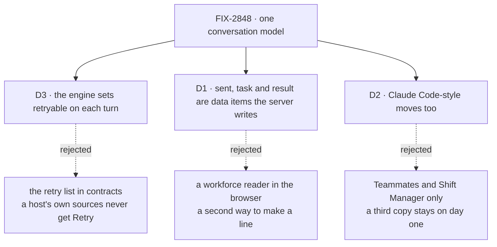

# FIX-2848 · Decisions

[Spec](SPEC.md) · **Decisions**

Jake set the direction in the issue. These are the three calls it leaves open or changes, and
the ones decided without asking.

## The tree

Solid edges are what you're signing. Dashed edges lost, and the label says why.

## D3 · The engine sets `retryable` on each turn, instead of the retry list moving to contracts

| | |
|---|---|
| **Instead of** | The issue's shape: the built-in list (`http`, `mcp`, `scheduled`) moves to contracts, and React checks each turn's `source` against it |
| **Because** | The route's rule is more than the list: `isPublicReentryAllowed` adds a host's `publicReentrySources` and refuses a never-set. A browser list can't see the host's sources, so Retry never shows on them. Set where the turn is read, the answer is the route's own. The turns view carries `source` today, not `retryable` |
| **Locks in** | `retryable?: boolean` on core's `SessionTurn` (set in `request-sessions.ts` with the runtime's host sources) and on workforce's turns view. An engine test pins that it agrees with the retry route |

**What would change my mind:** you'd rather keep the issue's shape. Then only the built-in set
moves to contracts (the engine keeps the rule, the never-set and the host merge), and the
people table says a host's own sources get no Retry. No host in this repo adds one.

## D1 · Sent, task and result are `data` items the server writes, not lines a workforce reader decodes in the browser

| | |
|---|---|
| **Instead of** | A workforce *line reader* registered with React's model, decoding the `sendMessage` and `createTask` calls, the board's ending line and `task-change` |
| **Because** | FIX-2738 settled that structured content reaches a screen as a `data` item with a registered renderer, as `workforce:received` does. A reader is a second way to make a line, for every plugin |
| **Locks in** | Conversations stored before this show those three as plain steps and messages (Jake: no backwards compatibility). Three public dataType names, `workforce:sent`, `workforce:task` and `workforce:result` |

**What would change my mind:** stored conversations someone depends on. Then a reader for old
sessions only, deleted on a date.

## D2 · Claude Code-style moves to the model too

| | |
|---|---|
| **Instead of** | Teammates and Shift Manager only, as the issue names |
| **Because** | Its `entriesOf` and `withStopped` hold the same logic and their own retry-list copy with a sync test. The issue's *done when* can't hold while it does |
| **Locks in** | A third app and its goals in `goals/claude-code-style-lab/`, as the last slice. Its review stop and thread cards stay its own |

## Decided, not asked

- **The model takes turns as input**: `{ id, status, retryable }`. A failed line offers Retry
  when its turn is the newest that drew a line and is `retryable`.
- **Every line kind is decided in the model, once**: user, assistant (streaming, or cut off),
  failed, stopped (after its turn's last line), steps (one turn's calls and the thinking
  between them), approval (with its answer) and any `data` item. A renderer decides how a kind
  looks, never whether an item is one.
- **A tool call that wrote a line is not a step.** The tie is the data item's
  `provenance.blockInstanceId`, whose `tool[name][callId]` segment names the call's
  `toolCall.callId` ([settled](#settled)). Read it with contracts' block-instance-id parsing.
- **A refused send is still a sent line**, saying why; a waited send's answer updates it (keyed).
- **`buildItemRenderStream` becomes the model, named `conversationLines`**, with no alias; every
  caller moves with it. The return type and glossary term must not reuse workforce's coordinator
  `ConversationLine`.
- **Teammates' task popup reads the same lines.**

## Considered and dropped

| Alternative | Why not |
|---|---|
| A workforce reader in the browser | D1 |
| The retry list in contracts | D3 |
| Keep `toolGroupRenderer` grouping and add lines beside it | Two ways to group a run of calls |

## Settled

**CONFIRMED · a data item written inside a tool call can be tied to that call.** Throwaway
`settle-claim` POC on the real path (`testFlow`, core's tool executor, only the model scripted):
calls `sendMessage` (tc_A), `search` (tc_B), `sendMessage` (tc_C), each send emitting a `data`
item. The two carry `…/step[0]/tool[sendMessage][tc_A]:0` and `…[tc_C]:0`, matching the
`tool_output` items' `callId`; a later step's item has no `tool[…]` segment. `PASS —
[{"to":"ada","callId":"tc_A"},{"to":"bo","callId":"tc_C"}]`; control (emit removed) `FAIL —
sent=0`; 3 runs, no model, no variation. A real provider's segment is `[<step>:<callId>]`
(`tool-executor.ts`). D1 stays workforce-local: no engine or contracts seam.

## Analysis

2026-11-19 · watermark 2026-11-19 (issue filed) · **Right approach, scope widened.** Run by
the author, so a reviewer should treat it as unchecked.

1. **Reuse** — each *Adds* item extends or moves a piece ([Adds](SPEC.md#whats-already-here-and-the-debt)).
2. **Prior art** — the AI SDK's `UIMessage` parts: a model, drawn by part type.
3. **Other shapes** — the browser reader (D1); the browser list (D3).
4. **New factors** — Claude Code-style's third copy (D2).
5. **Necessity** — three copies, a fourth planned (FIX-2839).
6. **Ergonomics** — one call and one spread.
7. **Concerns** — none open.

## How it got here

- **Draft** — three app decoders of one conversation; React's render stream made turn-aware,
  workforce lines as `data` items, the retry list moved to contracts; Claude Code-style added.
- **Review round 1** — Retry now reads a `retryable` the engine sets (D3), because the shared
  list can't see a host's sources. D1's tie settled by POC. Goal signals split into required
  and stretch; delivery may be sliced.

## Notes from review

- "Make sure the engine keeps a test that the contracts export and `isPublicReentryAllowed` agree" — jhoffner ([review](https://github.com/fixpoint-labs/flow-state-dev/pull/5488#pullrequestreview-5984216438)); under D3 it is the `retryable`-agrees-with-the-route test
- "prefer emit-only over model dedup if possible" — cursor ([thread](https://github.com/fixpoint-labs/flow-state-dev/pull/5488#discussion_r4635812786))
- "module-level or `useMemo` stable registry … computing `conversationLines` where items/turns update" — cursor ([thread](https://github.com/fixpoint-labs/flow-state-dev/pull/5488#discussion_r4635812770))
- "avoid a second pass over raw `items` (today's suspension scan) alongside the model output" — cursor ([review](https://github.com/fixpoint-labs/flow-state-dev/pull/5488#pullrequestreview-5984254592))
- "the one thing to guard is the model growing a per-app option bag" — jhoffner ([review](https://github.com/fixpoint-labs/flow-state-dev/pull/5488#pullrequestreview-5984216438))
- "necessity/ergonomics as author self-assessment until a fresh `analysis` pass runs" — cursor ([thread](https://github.com/fixpoint-labs/flow-state-dev/pull/5488#discussion_r4635812816))

These are inputs, not instructions.

**Open: D3** (it changes what the issue named).
