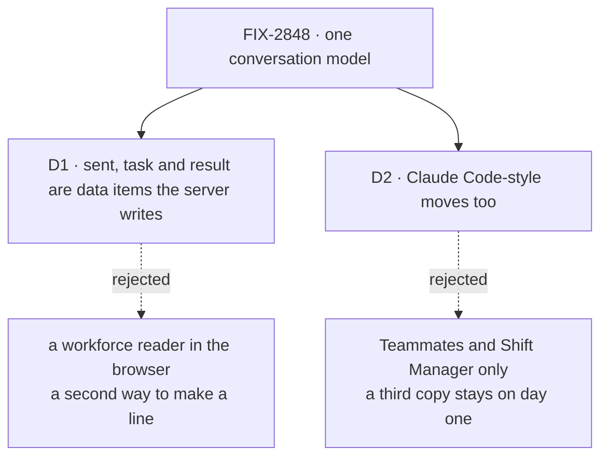

# FIX-2848 · Decisions

[Spec](SPEC.md) · **Decisions**

Jake set the direction in the issue. These are the two calls it leaves open, and the ones
decided without asking.

## The tree

Solid edges are what you're signing. Dashed edges lost, and the label says why.

## D1 · Sent, task and result are `data` items the server writes, not lines a workforce reader decodes in the browser

| | |
|---|---|
| **Instead of** | A workforce *line reader* registered with React's model, which reads the `sendMessage` and `createTask` calls and the board's ending line and the latest `task-change` copy, and returns a `data` line |
| **Because** | FIX-2738 settled that a `data` item drawn by a registered renderer is how structured content reaches a screen; `workforce:received` already works that way. A reader is a second way to make a line, and every plugin would get one. Written where it happens, each line carries what it shows: the result needs no join against `task-change` |
| **Locks in** | Conversations stored before this ship show those three as plain steps and messages, with no compatibility read (Jake: no backwards compatibility). Three public dataType names, `workforce:sent`, `workforce:task` and `workforce:result`, that a plugin and an app renderer key on |

It comes down to how many ways make a line: a reader is a second one, for every plugin.

**What would change my mind:** stored Teammates or Shift Manager conversations someone depends
on. Then a reader for old sessions only, deleted on a date, is cheaper than the loss.

## D2 · Claude Code-style moves to the model too

| | |
|---|---|
| **Instead of** | Teammates and Shift Manager only, as the issue names |
| **Because** | Claude Code-style's `entriesOf` and `withStopped` hold the same failed, stopped and steps logic and their own retry-list copy with a sync test. The issue's *done when* says no app keeps a copy, which can't hold while it does |
| **Locks in** | A larger implementation PR, touching a third app and its page goals in `goals/claude-code-style-lab/`. Its review stop and thread cards stay its own: they are harness-manager's and threads mode's, not conversation lines |

It comes down to the issue's own *done when*: leaving it out leaves a copy on day one.

## Decided, not asked

- **The retry list moves to `@flow-state-dev/contracts`**, re-exported by core; the engine
  imports it. React imports only types from core (`ItemsRenderer.ts`), so contracts is where
  React can read it. That is the issue's "core exports it".
- **The model takes turns as input**: `{ id, status, source }`, which workforce's turns view and
  the client's request list both carry. A failed line is retryable when its turn is the newest
  that drew a line and its source is on the list.
- **The convergence point for "a line per thing" is the model.** Every line kind is decided
  there, once: user, assistant (streaming, or cut off when its turn failed), failed, stopped
  (after its turn's last line), steps (one turn's consecutive calls and the thinking between
  them; a run never spans two turns), approval (with its answer) and any `data` item. A
  renderer decides how a kind looks, never whether an item is one.
- **A tool call that wrote a line is not a step.** The tie between a `data` item and the call it
  came from is the tool's execution scope (its block instance carries the call id). The
  implementer confirms that tie first; it is the one premise D1 rests on.
- **A refused send is still a sent line**, saying it was not sent and why, as Shift Manager draws
  it today. A waited send's answer updates the same line (a keyed `data` item).
- **`buildItemRenderStream` becomes the model, named `conversationLines`**, with no alias. The
  registry's `request-group` and its copies in each app move with it. The implementation PR adds
  *Conversation line* to `docs/contributing/glossary.mjs`.
- **Teammates' task popup reads the same lines.** `toSteps` and `runSteps` go with `steps.ts`;
  the run summary (`runSummaryLine`, `commandsRun`) is presentation and moves to the popup.
- **Order:** after #5473 merges. The Teammates side was read on its branch.

## Considered and dropped

| Alternative | Why not |
|---|---|
| A workforce reader in the browser | D1 |
| The server stamps `retryable` on each turn | Also sees a host's extra sources, but Jake chose the shared list. Named under *Leaves* |
| Keep `toolGroupRenderer` grouping and add lines beside it | Two ways to group a run of calls |

## Analysis

2026-11-19 · watermark 2026-11-19 (issue filed) · **Right approach, scope widened.** Run by
the author: this session could not dispatch a fresh analyst, so a reviewer should treat this
as unchecked.

1. **Reuse** — each *Adds* item extends or moves a piece ([Builds on / Adds](SPEC.md#whats-already-here-and-the-debt)).
2. **Prior art** — the Vercel AI SDK's `UIMessage` parts: a model, drawn by part type. Same split.
3. **Other shapes** — the browser reader; lost on D1.
4. **New factors** — Claude Code-style's third copy. Folded as D2.
5. **Necessity** — three copies, a fourth planned (FIX-2839).
6. **Ergonomics** — one call and one spread.
7. **Concerns** — Shift Manager's *as before* is a gain: it gets failed and stopped lines. In
   the people table.

## How it got here

- **Draft** — framed as three app decoders of one conversation; React's render stream extended
  into a turn-aware model, workforce lines written as `data` items (FIX-2738), the retry list
  moved to contracts; Claude Code-style added because it holds the third copy.

**Open: none.**
