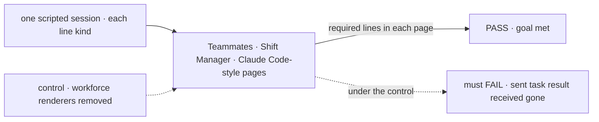
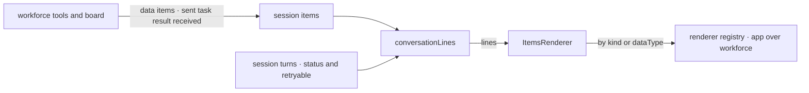

# FIX-2848 · One conversation model: React owns turn-aware conversation lines, workforce registers its line types, and Teammates and Shift Manager delete their copies

**Spec** · [Decisions](DECISIONS.md)

## Seven people, before and after

| Someone who… | Today | After |
|---|---|---|
| **sees a turn fail in Teammates** | A failed line with Retry, from Teammates' own `toEntries` and a copy of the engine's retry list | The same line, from React and the turn's `retryable`, which the engine sets ([D3](DECISIONS.md#d3)) |
| **sees a worker's turn fail or get stopped in Shift Manager** | Plain red error text. No Retry, no stopped line | Teammates' failed line with Retry, and its stopped line |
| **watches a worker message another, file a task and get its result** | Each app decodes the `sendMessage` and `createTask` calls and the board's ending line its own way | Workforce writes each as a `data` item with its own renderer; an app can register its own look |
| **builds a new conversation screen**, such as the message board plugin ([FIX-2839](https://linear.app/fixpoint-labs/issue/FIX-2839)) | Writes a fourth copy of the decoding | Calls React's model and spreads workforce's renderers |
| **opens a conversation stored before this ships** | Sent, task and result lines show | Those three show as ordinary steps and messages. No compatibility read ([D1](DECISIONS.md#d1)) |
| **uses a browser build older than the server** | The three types don't exist | Sent, task and result don't show (no renderer, no line). Nothing breaks |
| **runs a host that adds its own retry source** (`publicReentrySources`) | No lab offers Retry on those turns | Retry shows: `retryable` uses the route's own rule ([D3](DECISIONS.md#d3)) |

Claude Code-style's `entriesOf` is a third copy the issue doesn't name; it moves too ([D2](DECISIONS.md#d2)).

## The goal, and how we'll know it's met

**Every app that shows a conversation draws it from React's one model and workforce's
renderers, and none of them reads conversation items itself.**

| Is it the right goal? | |
|---|---|
| **The real need** | "Nothing in either is unique to the app": one model the framework owns (the issue, Jake, 2026-11-19) |
| **Smaller, and rejected** | Move `toEntries` into React, keep workforce lines app-side. Shift Manager keeps its copy, and that decoding is the larger half |
| **Bigger, and not this issue's** | One model for every item view. The devtool shows raw items on purpose |
| **Not done if** | Any app keeps a retry list, a sync test, or a function that turns items into its own entries · Shift Manager still has no stopped line · workforce lines show with workforce's renderers removed · a page goal in `goals/teammates-lab/`, `goals/shift-manager/` or `goals/claude-code-style-lab/` fails |



| How we verify | |
|---|---|
| **Goal check** | `goals/workforce-apps/one-conversation-model/` (new) · scripted model · real browser, run by the implementer at completion · verdict on the last implementation PR |
| **Signal · required** | Each page draws failed with Retry, stopped, sent, received, task and result |
| **Signal · stretch** | User, assistant (streaming, then cut off), steps, approval with its answer. Same run; a flake here doesn't block while each app's page goals pass |
| **Input** | One session holding each kind once. Moving the stopped turn before the failed one must pass too |
| **Anti-game** | Not the model's return or a component test: both pass while an app still decodes items |
| **Control that must fail** | `GOAL_CONTROL=no-workforce-renderers` must FAIL on sent, task, result and received. Today's `main` must FAIL on Shift Manager's stopped line |

## What changes


**A conversation screen, as an app writes it:**

```diff
- const entries = toEntries(items, workers, ended, retryable, stopped)
- return entries.map((entry) => <Entry key={entry.id} entry={entry} />)
+ // module level: one registry object, not one per render
+ const renderers = { ...appRenderers, data: { ...workforceRenderers, ...appRenderers.data } }
+ const lines = conversationLines(items, turns) // turns: { id, status, retryable }[]
+ return (
+   <FlowProvider renderers={renderers}>
+     <ItemsRenderer lines={lines} />
+   </FlowProvider>
+ )
```

**Delivery may be sliced**, in order: (1) the model, the rename and every caller, `retryable`,
workforce's data types and renderers; (2) Teammates and Shift Manager; (3) Claude Code-style.

**Docs:** changesets (BP-022): `minor` for `react`, whose published export is renamed with no
alias; `patch` for `core`, `engine`, `workforce`. Pages: `client/react.md`, `api/react.md`,
`workforce/ui.md`, `workforce/messaging-workers.md`, the React and workforce READMEs.

## How a line reaches the screen



The model alone knows turns; the registry alone knows looks.

## What stays as it is

- The engine's retry route, its rule and its source list.
- Each app's look, through its own renderers.
- Teammates' divider and *is answering* read (FIX-2772's).
- The devtool's raw item view.

## What's already here, and the debt

| Already here | What this does with it |
|---|---|
| Ways to turn items into lines (searched `toEntries`, `entriesOf`, `callRuns`, `buildItemRenderStream` across `packages/`, `labs/`, `apps/`) | **Four today, one after.** `buildItemRenderStream` becomes the model; its other callers (the registry's and kitchen-sink's `request-group`, Shift Manager's `TaskSession`) switch in slice 1 |
| `react` · `ItemsRenderer`, `toolGroupRenderer`, the approval receipt | **Extends.** Draws lines; the approval keeps its `resolution` |
| Engine `isPublicReentryAllowed` | **Reused** to set `retryable` on each turn ([D3](DECISIONS.md#d3)) |
| Workforce `workforce:received` | **Builds on**, per [FIX-2738](https://github.com/fixpoint-labs/flow-state-dev/pull/5284) ([D1](DECISIONS.md#d1)) |

| Adds | Existing piece considered | Why it doesn't fit / how composed |
|---|---|---|
| Turns as input; stopped and failed lines | `buildItemRenderStream` | Composed: its filter and grouping, plus turns |
| `retryable` on `SessionTurn` and the turns view | The route's check | The same function, called where the turn is read |
| `workforce:sent`, `:task`, `:result` and `workforceRenderers` | `workforce:received`; the apps' components | Received's pattern; components moved, not new |

| The debt | |
|---|---|
| **Removes** | Teammates' `toEntries`, `items.ts`, `steps.ts` · Shift Manager's `callRuns`, `UNDRAWN` and message-call decoding · Claude Code-style's `entriesOf` and `withStopped` · two retry-list copies and two sync tests |
| **Adds** | One rule: a tool call that wrote a line is not a step (its tie [confirmed by a POC](DECISIONS.md#settled)) |
| **Leaves** | Kitchen-sink's harness turn notices. Its `request-group` draws one request, not a conversation, so it is outside the goal check |

**Net: down.**

## Sign off

**[The goal](#the-goal-and-how-well-know-its-met):** all three apps, measured on the page. If
wrong: apps that call the model and still decode beside it.

1. **[D3](DECISIONS.md#d3) · The engine sets `retryable` per turn**, not the issue's list in
   contracts. If wrong: two additive fields we didn't need.
2. **[D1](DECISIONS.md#d1) · Sent, task and result are server-written `data` items.** If wrong:
   stored conversations lose those three lines for good.
3. **[D2](DECISIONS.md#d2) · Claude Code-style moves too**, last. If wrong: one more PR.

**Open: D3**, since it changes what the issue named. D1's premise held on a POC. Starts after
[#5473](https://github.com/fixpoint-labs/flow-state-dev/pull/5473) merges.

Improvement · `core` `engine` `react` `workforce` `orchestration` `shift-manager` `ui`, kitchen-sink, two labs · large, sliced · no epic
